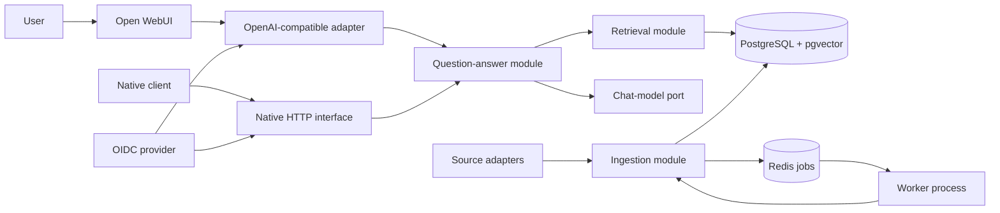
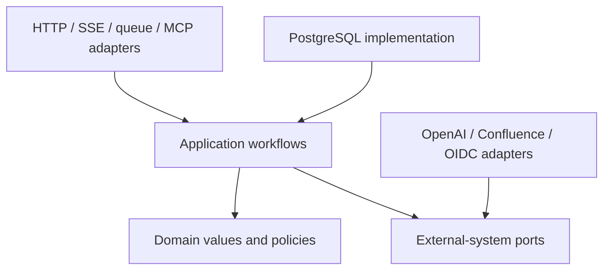
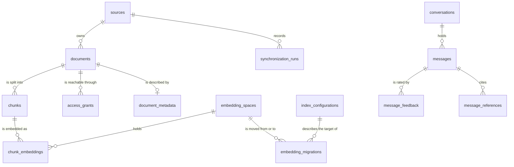
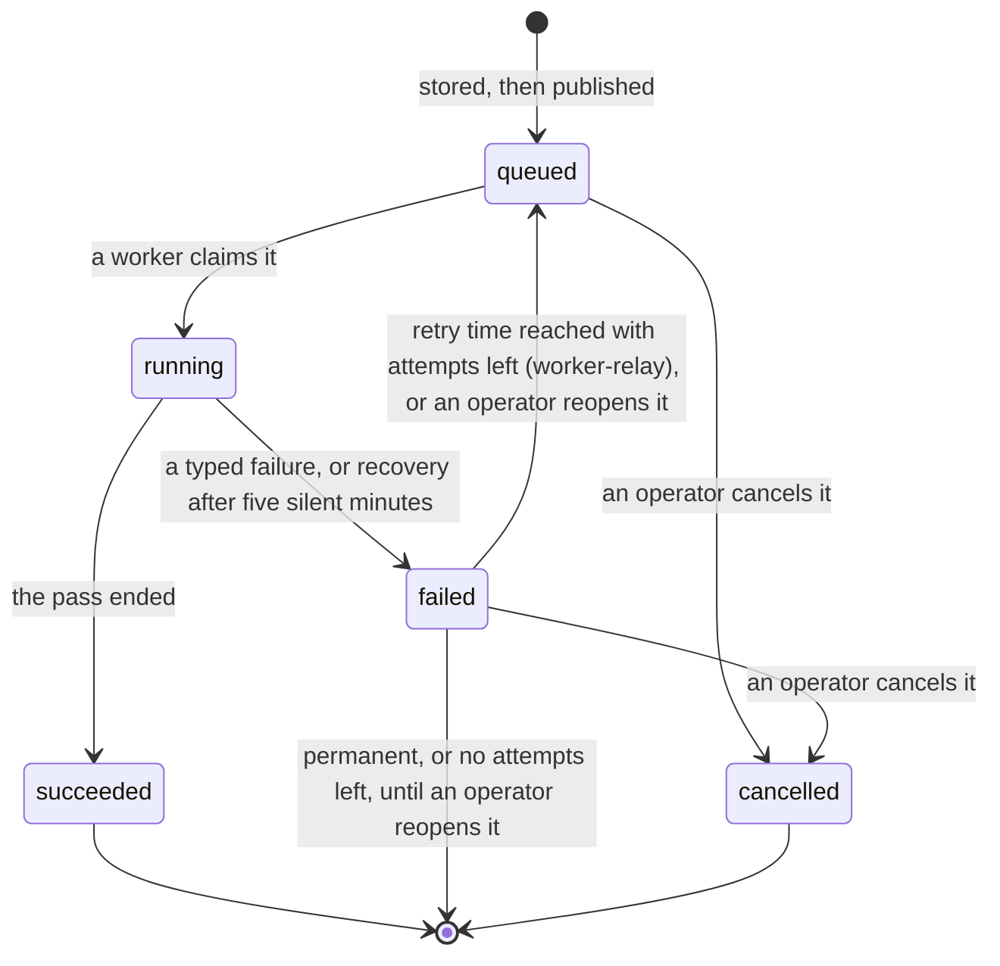
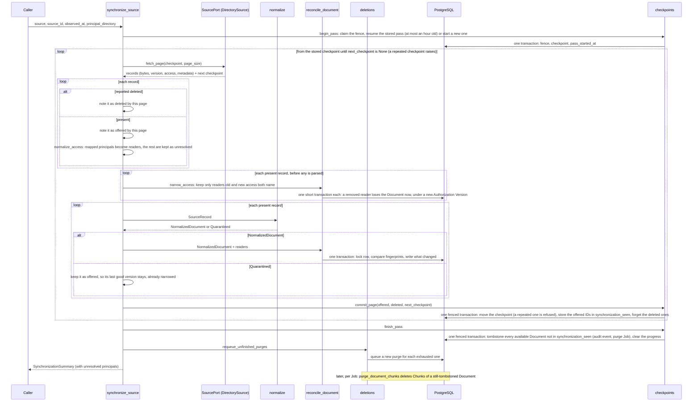
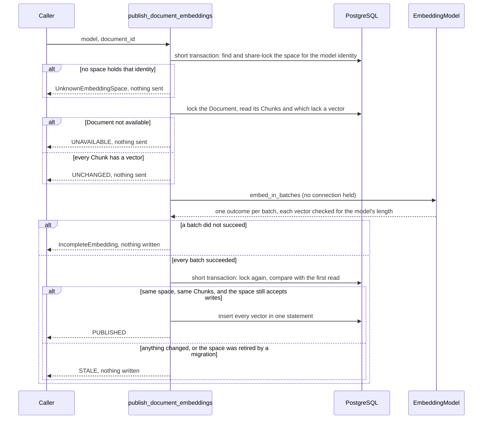
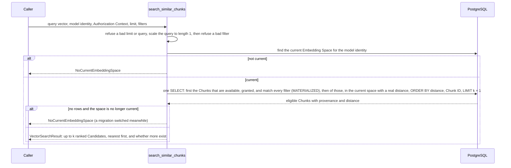
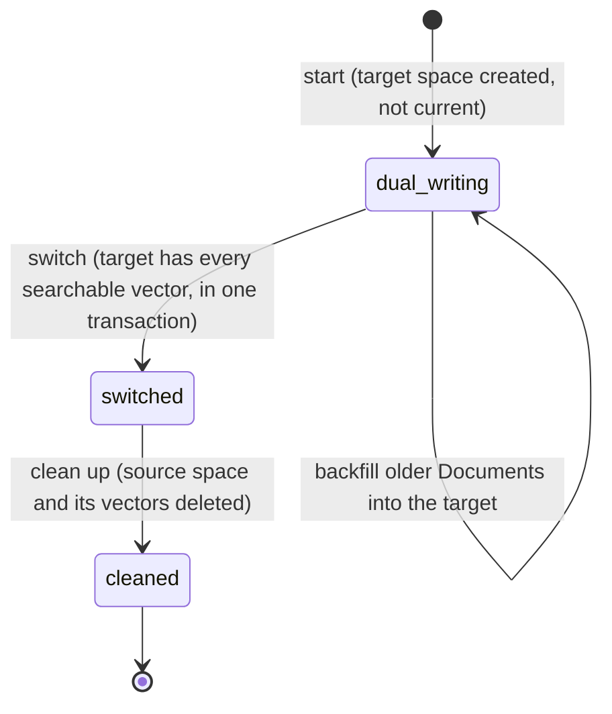
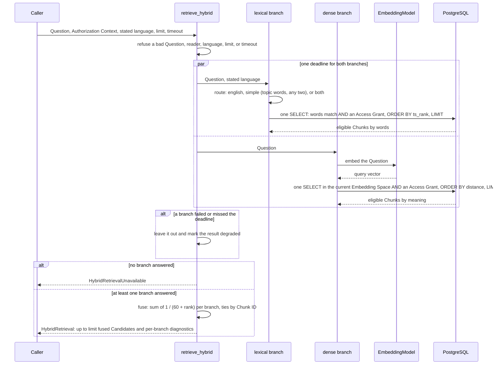
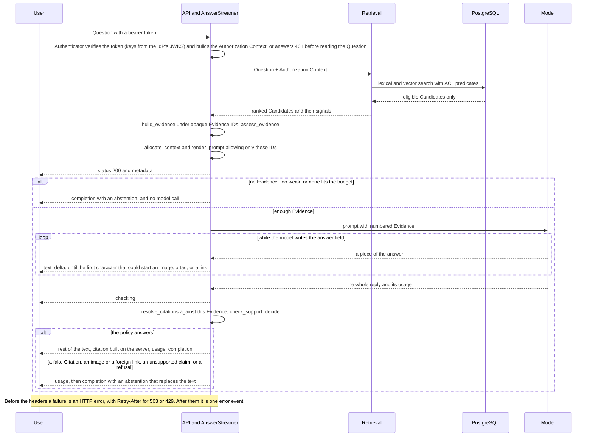

# Architecture

## Shape

The system is a modular monolith: one repository and one domain model, deployed as an API process and one or more worker processes. This is a distribution choice, not permission for domain logic to leak into HTTP routes or queue handlers.



## Deep modules and seams

A module earns its interface by hiding meaningful behavior and invariants. Tests and callers use the same interface.

| Module | Interface promises | Hidden implementation |
|---|---|---|
| Source synchronization | Start/resume a run and report an outcome | pagination, checkpoints, retries, version comparison, tombstones |
| Document normalization | Convert a Source Record into a Document | format parsing, sanitization, structural metadata, language detection |
| Indexing | Reconcile one Document with searchable state | chunk replacement, embedding batches, lexical vectors, ACL updates |
| Retrieval | Return authorized ranked Candidates | ACL predicates, dense/lexical queries, fusion, reranking, budgets |
| Question answering | Produce an Answer or Abstention | history rewriting, token budgeting, evidence formatting, citation validation |
| Evaluation | Execute an Evaluation Dataset and emit comparable results | concurrency, caching policy, scorers, judge calls, artifacts |

Use a port at a seam for true external systems: model providers, Confluence, identity, and optional external search. Each port must have a production adapter and a deterministic test adapter. PostgreSQL is tested through real PostgreSQL in integration tests rather than hidden behind a repository interface for every query.

## Dependency direction



Domain values do not import FastAPI, Dramatiq, SQLAlchemy, OpenAI SDKs, or LangGraph. Transport adapters translate protocol data into application requests and translate results back. The OpenAI-compatible interface adapts to the same question-answer module as the native interface.

## Code layout

Each module above has its own package under `src/knowledge_service/`
([ADR 0013](adr/0013-group-code-into-packages-by-module.md)):

| Package | Module | Main entry points |
|---|---|---|
| `ingestion` | Source synchronization, Document normalization, Indexing | `synchronize_source` (claims the Source's fence and checks it in every write; an optional `heartbeat` runs after every page), `synchronize_source_exclusively` (`exclusive_sync`, the same pass while holding the Source's lease), `schedule_due_synchronizations` (`scheduling`, a synchronization Job for each enabled Source that is due), `normalize`, `reconcile_document`, `normalize_access` (`grant_normalization`, a Source's `user:<id>` and `group:<id>` principals to Access Grant subjects through its `PrincipalDirectory`, as the same UUIDv5 IDs the Authorization Context uses, and only to subjects and paths a token could carry; distinct, in a stable order, and failing closed: an unmapped or malformed principal grants nothing and is reported), `narrow_access` (a record that fails to normalize keeps its last good version only for readers its old and new access both name) |
| `ingestion.parsers` | Document normalization | `parse_text`, `parse_markdown`, `parse_html`, `parse_pdf` |
| `embeddings` | Indexing (vectors) | `EmbeddingModel` (`port`), `OpenAIEmbeddingModel` (managed), `LocalEmbeddingModel` (BGE-M3 over HTTP, pinned revision), `SparseModel` (`sparse`, the port for sparse term weights; M05-T10 prototype only), `publish_document_embeddings`, the migration workflow |
| `retrieval` | Retrieval | `search_similar_chunks`, `search_lexical_chunks` (routes each Question to English, `simple`, or both; `simple` reads a Question's topic words, without Ukrainian stop words, and needs two of them), `search_english_chunks`, `search_ukrainian_chunks`, `Candidate` (the fields every branch returns), `fuse_ranked_candidates` (Reciprocal Rank Fusion of branch Candidates), `retrieve_hybrid` (both branches at once under one deadline, fused, with per-branch diagnostics), `MetadataCondition`, `load_dataset` / `verify_corpus` / `run_dataset` / `compare_branches` (the bilingual seed Evaluation Dataset in `datasets/bilingual-seed/`, run lexical, dense, and fused), `recall_at` / `reciprocal_rank` (Recall@k and MRR), `compare_sparse` with `search_sparse_chunks` (M05-T10 prototype: BGE-M3 sparse weights against PostgreSQL word search; no default uses it), `Reranker` (`reranking`, the port for cross-encoder scores) with `rerank_candidates` (reorders eligible Candidates within the reranker's limits under one deadline) and `LocalReranker` (`local_reranker`, bge-reranker-v2-m3 over HTTP, pinned revision), `compare_reranking` (fused retrieval before and after reranking; no default reranks yet), `RankingModel` (`llm_reranking`, the port for a language model that returns a ranking) with `rerank_with_llm` (orders the top eligible Candidates under opaque IDs within a candidate and token budget, checks the ranking, keeps retrieval's order on any failure, and returns the billed usage) and `OpenAIRankingModel` (`openai_ranking`, a pinned model over the Responses API with Structured Outputs), `compare_llm_reranking` (the same comparison with fallbacks and cost), `compare_reranking_strategies` (no reranker, the cross-encoder, and the language model on the same Candidates of each case, with quality, latency, and cost per case), `classify_question` (`rewrite_classes`, one rewrite class per Question and the words any rewrite must keep; any word with a digit, or with `_`, `@`, `/`, `.`, `:`, or a backslash inside it, is `exact_identifier` and never rewritten) with `load_rewrite_cases` / `score_rewrite_cases` (`rewrite_cases`, the verified labels in `datasets/bilingual-seed/rewrite-classes.json` and how often the rules agree), `rewrite_question` (`query_rewriting`, the `RewriteModel` port: a Question is sent only when its class is switched on in a `RewritePolicy`, and its rewrite is used only when it keeps every word to keep, every typed identifier, and the stated language, and adds no search operator; otherwise the Question is searched as typed) with `OpenAIRewriteModel` (`openai_rewriting`, a pinned model over the Responses API; `QUERY_REWRITE_CLASSES` is the policy flag, empty by default), and `compare_rewriting` with `score_rewriting` / `check_rollout` (`rewrite_evaluation`, the gain per class on `datasets/bilingual-seed/rewrite-retrieval.json`; a class that harms a case, was not fully measured, or does not gain is not rolled out) |
| `answering` | Question answering | `build_evidence` / `EvidenceSet` (`evidence`, the Chunks an Answer may use, each under a fresh opaque `EvidenceId`, with provenance, excerpt, and source link copied from retrieval) and `resolve_citations` / `read_citations` (`citations`, a model's Evidence IDs checked against the request's own set: unknown, malformed, or mismatched references are refused, a repeated one is cited once, and a repeat in stored Citations read back is refused, and a Citation's provenance always comes from the server), `render_prompt` (`prompt`, the fixed policy, the Question and numbered Evidence as one escaped JSON document, and a response schema that allows only this request's Evidence IDs), `allocate_context` (`context_budget`, splits a `ContextBudget` between the fixed policy, the Answer and History reserves, the Question, and Evidence; keeps the longest head of retrieval's order whose counted prompt fits, drops the rest whole, and reports kept and dropped Evidence IDs with token counts), `generate_answer` (`generation`, the `AnswerModel` port: fits the context, sends the counted prompt once, and checks the reply on the server into one outcome, answered with Citations of Evidence in the prompt, abstained with a reason, refused, invalid with a named defect, or no Evidence without a call; provider failures raise the M01 `ChatModelError` family) with `OpenAIAnswerModel` (`openai_answering`, a pinned model over the Responses API with Structured Outputs and no tools, where a reply holding a tool call is unreadable; `AnswerSettings` gives the budget), `has_active_content` / `unsourced_links` (`answer_content`, what an Answer may hold whatever a Document told the model: no Markdown image, loading HTML tag, or mermaid block, and only links an Evidence it cites contains; `held_from` marks where a stream stops sending text until the check), `confirm_citations` (`current_citations`, run after generation and before the client: one query rechecks every cited Chunk under the retrieval permission check and its current version; one Chunk that is gone, rewritten, tombstoned, or no longer visible withdraws the whole Answer, keeping its usage, and confirmed Citations are rebuilt from the stored rows), `check_support` (`support`, splits an Answer into claims by position and asks a versioned `SupportJudge`, the deterministic `LexicalSupportJudge` or a `ModelSupportJudge` over any `AnswerModel`, which cited Evidence supports each claim; the server keeps a finding only for a quote found in cited Evidence on word boundaries that holds the claim's numbers, and returns a separate `SupportReport` bound to the judge's version and the answer text's SHA-256, never editing the Answer), `decide` (`abstention`, the answer policy: `assess_evidence` judges retrieval before any model call as empty or weak by a threshold calibrated for one `RerankerIdentity`, `find_conflicts` finds cited Documents that disagree on a claim's numbers, and `decide` answers, or abstains with one reason and a fixed bilingual message, answering only with a support report of this exact text; empty, unauthorized, and withdrawn read the same; `classify`, `score_abstention`, and `calibrate_threshold` measure correct answers, correct abstentions, over-abstentions, and unsupported answers against labelled cases), `AnswerEventWriter` / `AnswerEventReader` (`events`, the SSE event contract of a streamed Answer: `metadata`, then `text_delta`, at most one `checking` once the model is done, `citation`, and at most one `usage`, then one terminal `completion` or `error`, with IDs counting up from 0; the writer refuses an event out of order without changing the stream, and the reader refuses invalid order, lost or repeated events, a cut-off stream, any spelling but the writer's, or a stream over its limits, and rebuilds the Answer however the bytes are split; an answer needs visible text, a Citation, and its usage, Citations never precede an abstention, and abstentions and errors carry only their fixed messages), and `AnswerStreamer` (`streaming`, behind `POST /v1/questions`, with `DatabaseAuditTrail` (`audit_trail`) as its `AuditTrail`: one `question.asked` audit event per stream, committed before the decision's Citations and completion are sent; finds the Evidence the request's reader may see, rereads it as the reader with `evidence_still_visible`, and judges it before any byte, so its failures stay HTTP errors; then pulls the model's stream one event at a time, passes the answer's text on as it arrives, sends `checking`, checks the whole reply, has its `CitationCheck` (`CurrentCitations`, each call in a short transaction of its own) reread every cited Chunk as the reader with `confirm_citations`, withdrawing the Answer if one fails, and lets an `AnswerFinisher` decide, and sends Citations only after an `answer` decision and the usage before the terminal event; one deadline covers it all, and a client that leaves cancels the work and closes the model's stream through `EventStreamResponse`), `VectorEvidenceSource` (`vector_evidence`, the stream's Evidence from PostgreSQL: checks the reader, embeds the Question, requires one vector from its own model, and runs the vector search with the request's Authorization Context, so eligibility is decided in the same SQL that ranks; no reranking, so its signals carry no score), `stream_failure` (`stream_failures`, one policy per failure kind and phase: before the headers an HTTP error with the M01 status and, for an outage or a limit, a `Retry-After` header; after them one terminal `error` event, the caller's to retry for an outage or a limit, a validation failure reported as internal; a database that is unreachable, overloaded, or too slow is an outage, any other database error a bug; every stream is recorded with its phase, one audit outcome, what became of its partial text, and for an abstention its reason and any defect of the reply, such as `invalid_citation`), and `load_history` (`history`, the earlier turns of the reader's own Conversation within `history_tokens`: recent turns whole, older ones as their Questions; an Answer's text only when it was answered and every Chunk it and every earlier Answer cited is current and visible to the reader now, so a revoked, deleted, or rewritten Document never returns through an old Answer; Questions and their replies are stored together by `add_turn`, with the reply's outcome and cited Chunks), and `resolve_question` (`follow_up`, a follow-up Question made standalone for search: only the `follow_up` class is ever sent to the `RewriteModel`, with the earlier Questions of the History and never an Answer; the rewrite must stay in the stated language and keep the Question's words to keep and the identifiers and acronyms of the newest earlier Question, or the Question is searched as typed; a `ResolvedQuestion` records both texts and how the search text was chosen) with `compare_resolution` (`follow_up_evaluation`, the bilingual rewrite cases replayed as stored Conversations and searched with and without resolution) |
| `identity` | Identity, the seam to the OIDC provider | `OidcVerifier` (`oidc`, accepts an access token only when it is RS256-signed by a key the issuer publishes and names the exact issuer, the API audience, and a current time window within the allowed clock skew; returns `VerifiedToken` or raises `TokenRejected` with one `Rejection`, or `IdentityProviderUnavailable` when no usable keys are cached; discovery and keys are cached, an unknown key ID refreshes them at most once per interval, and cached keys outlive failed refreshes only up to a stale limit)), and `Authenticator` (`context`, the only way a request gets an `AuthorizationContext`: one `Authorization: Bearer` header, verified by `OidcVerifier`, from a trusted client (`azp`); the User and each plain full group path become UUIDv5 IDs scoped to the issuer, a `groups` claim over 64 names is refused, and a path with `~` or a hidden character is left out; refusals are `Unauthenticated` with an RFC 6750 error; it returns a `Caller`, the reader and, apart from it, the Application Roles from the token's realm roles) |
| `persistence` | PostgreSQL implementation | `schema` and one module per kind of record |
| `worker` | Queue transport: the Redis broker and the worker process | `build_broker` (`broker`, a Dramatiq `RedisBroker` with JSON messages, the `knowledge-service.v1` namespace, the `maintenance` and `synchronization` queues, a 60-second default time limit, a one-day message age limit, and no Dramatiq retries; `ActorOwnsOptions` drops any limit a message sets for itself, so only its actor's limits apply; Redis calls make one attempt with bounded timeouts), `declare_actors` / `send_ping` (`actors`, the harmless `ping` job, whose token is checked on both sides), `broker_ready` (`health`, a readiness probe that is false, within one overall deadline, whenever Redis does not answer PING or any part of the check fails), `declare_job_actors` / `DramatiqJobPublisher` / `run_stored_job` (`jobs`, one `run_<queue>_job` actor per queue of the kinds in `HANDLERS`, today only `purge_document_chunks`; a message carries one canonical Job ID, and the worker reads the Job from PostgreSQL, runs it only while it is queued, and returns the stored Job as the outcome of a duplicate; `JobRunner` gives each message its own event loop and database engine), `relay` (one pass: `requeue_due_retries`, `schedule_due_synchronizations`, then `publish_pending_jobs`), and `main`, the module the `dramatiq` command loads |

Domain values, settings, the database runtime, and the HTTP application stay
at the top level. Among them, `roles` holds the Application Roles policy:
`PERMISSIONS` lists the operations each role permits, roles do not inherit,
an operation no role lists is denied, and no role permits reading a
Document. `POST /v1/questions`, the one Question route, requires the
`ask_questions` operation before it reads the body, and refuses with 403
otherwise.
`DELETE /v1/conversations/{conversation_id}` requires
`manage_own_conversations` before it parses the ID, and deletes through
`DatabaseConversationStore` (`answering.conversation_store`), which passes
the token's User as the owner and returns nothing, so the response is the same whether the
Conversation was deleted, missing, or another User's.
`GET /v1/jobs/{job_id}` requires `start_synchronization_runs` before it
parses the ID, and shows a synchronization Job with its newest attempt
through `DatabaseJobReports` (`job_reporting`), read from one snapshot. A
missing Job and a Job of any other kind give the same 404, so a purge's
target, such as a Conversation, is never shown.
`GET /v1/job-decisions`, `POST /v1/jobs/{job_id}/retry`, and
`POST /v1/jobs/{job_id}/cancel` require `recover_jobs` (the administrator
role) before the ID, `limit`, or `cursor` is read. They list the Jobs that
failed for good and that no newer Job replaced, a page at a time, and retry or cancel one through
`DatabaseJobDecisions` (`job_decisions`), which records each decision in the
audit log with the operator as its actor.

The Source routes, `GET` and `POST /v1/sources`, `GET` and
`PATCH /v1/sources/{source_id}`, and `POST .../enable` and
`POST .../disable`, require `configure_sources` (the content-manager
role) before the ID, page, or body is read. `source_administration`
checks every setting (`SourceDefinition`): a folder is an absolute path
and a Confluence site an https address with a host name, each in its one
spelling, so the kind and location, unique in `sources`, are the
Source's identity and never change. `credentials_reference` names a
secret in the secret store and never holds one; default readers are
`user:<id>` or `group:<id>`. A refusal names the rule, never the value.
Each change locks the Source, stores it, and records `source.registered`,
`source.updated` (which settings changed, never their values),
`source.enabled`, or `source.disabled` in the same transaction; a change
to the values a Source has records nothing. Disabling waits for a
scheduler that is queueing a Job for the Source, but does not cancel a
Job already queued or running. New default readers reach stored
Documents at the Source's next pass.

`POST /v1/sources/{source_id}/synchronizations` and
`GET /v1/sources/{source_id}/synchronizations` require
`start_synchronization_runs` (the content-manager role) before the ID or
page is read. `synchronization_administration` starts a synchronization
the way the scheduler does: it share-locks the Source, refuses one that
is missing (404) or disabled (409 `source_disabled`), and asks
`enqueue_job` for one Job; while the Source has an open Job (queued,
running, or failed with a retry planned) that Job comes back with 200,
and only a start that queues one answers 202 and records `job.queued`
with the operator as actor. The start commits before it tries once to
publish, so a refused message is sent later by the relay. The history
lists a Source's synchronization Jobs a page at a time, the newest
made first, each with its newest attempt, from one snapshot. It pages
on the Job's ID, a UUIDv7 that never changes, not on `queued_at`,
which every retry rewrites. Status, retry, and cancel stay on
`/v1/jobs/{job_id}`; a retry of a synchronization Job, once its status
fits, share-locks the Source as a start does and refuses one that is
missing or disabled with 409 `source_disabled`. Every refusal of these
five operations has one fixed status, code, and message. A Source's
history pages on `ix_jobs_synchronization_target (target_id, job_id)`.

`api_routes` is the native API's design. `ROUTES` lists every route the
service serves or plans under `/v1`, each with the Operation an
Application Role must permit, the task that builds it, and whether it
pages; the app serves exactly its served rows. `route_problems` checks the
rules: path words are lowercase and joined by `-`, each `{x_id}` follows
the list it names (`/v1/sources/{source_id}`), and every GET of a list
pages. A paginated route takes `limit` (1 to 100, 50 by default) and
`cursor`, both read after the role check, refuses any other query
parameter, and answers
`{"items": [...], "next_cursor": ...}`; `pagination` writes the cursor,
which names the last item of the page, so a page never repeats or skips
an item added in between, and checks every field of one that comes back.
Every `/v1` route documents its errors in OpenAPI with the one
`ErrorResponse` shape. A provider's protocol is an adapter's business: no
native route or schema uses its field names (ADR 0004).

`job_dispatch` puts a Job on the queue without ever losing it. `submit_job`
commits the Job to PostgreSQL first, then sends one message naming only its
ID, under a lock on its row, and records the send in `published_at`. When
the queue refuses the message, or the process stops before the send is
recorded, the Job stays queued and unpublished; `publish_pending_jobs`
(`make worker-relay`) sends such Jobs later, oldest first, and stops at the
first refused message. Jobs that other workflows store in their own
transactions, such as the purge `tombstone_missing` queues, reach the queue
the same way. A Job queued again for another attempt is unpublished again.
Only kinds a worker runs are submitted or sent. A Job can be named by two
messages; the worker runs it only while it is still queued.

A Job's intent is its kind and target, such as "purge the Chunks of Document
D". `enqueue_job` keeps at most one open Job per intent: queued, running, or
failed with a retry scheduled. The partial unique index `uq_jobs_open_intent`
enforces it, so asking for the same work again, even at the same moment,
returns the open Job (`Enqueued.created` is false, `Submission.duplicate` is
true) instead of storing a second one, and an open Job that failed keeps
waiting for its retry time. A handler claims a queued Job under a row lock and
stores its outcome, success or failure, in the same transaction; a claim that
finds the Job no longer queued raises `JobAlreadyClaimed` with the stored Job,
and `run_stored_job` returns that Job as the outcome of every duplicate
message, so every delivery reports the same result.

The stored Job is the one layer that retries. Dramatiq retries nothing, model
adapters keep their SDK retries off, and repository code never loops.
`fail_attempt` (`job_failures`) classifies a failed attempt by its error as a
Source, database, or model that is unavailable (transient) or refused
(permanent), a programming error (permanent), or a pass superseded by a newer synchronization pass (permanent), and stores that code. Only a
transient failure with attempts left gets a `retry_at`: half of a doubling
backoff (30 seconds, capped at 15 minutes) plus a random share of the other
half. `requeue_due_retries`, run first by every `make worker-relay` pass, is
the only path a failed Job takes back to the queue, and only once its
`retry_at` has come; `Job.retry` refuses a permanent failure and an early one.
Each call owns its own timeout: the database's statement, connect, and pool
timeouts and each model adapter's deadline end a slow call as a classified,
retried failure. When the database drops the connection under an attempt,
the claim's lock goes with it, so the purge records the attempt in a new
transaction by the error that started it. The actor's 60-second time limit
and a cancellation are only backstops: the attempt's transaction rolls back
and the Job waits as queued for M08-T08. A tombstoned Document whose last
purge failed permanently is not given a new purge by later synchronization
passes; one that ran out of attempts on a passing failure is.

Each attempt of a Job has its own progress row (`job_progress`,
`persistence.job_attempts`): a stage, three counters (processed, changed,
skipped), warning codes, a heartbeat, and, once it ends, a typed outcome
(`succeeded`, `succeeded_with_warnings`, `retry_scheduled`, `superseded`, or
`failed`). A handler stores the row with its claim (`begin_attempt`),
reports totals so far with `report_progress`, each report in its own
transaction, and ends it with `finish_attempt` in the transaction that
stores the finished Job. A report shares the lock of the Job's row only
while the Job runs that attempt, so a worker that lost its attempt cannot
write; counters and warnings never go down and the heartbeat never goes
back, both in the domain and in the `UPDATE`'s own conditions; a report
stamped more than five minutes ahead of the database's clock is refused.

`job_conditions` tells a slow Job from a dead one, and `job_recovery`, run
first in every relay pass, acts on it. A running Job is alive
while the database heard from it within `stale_after` (five minutes): each
report stamps the attempt's `heard_at` with the database's own clock, even
one refused for going back, so no worker's clock decides it, and a Job with
no attempt row falls back to its start time. One silent longer is stale, and its attempt is failed with
`worker_lost`. A queued Job whose message was sent
`orphan_after` (30 minutes) ago and that no worker took up is orphaned, and
the attempt the lost message stood for is failed with `delivery_lost`. Both
codes are transient, so the stored Job plans a retry while attempts are
left, and a message that keeps getting lost ends as `exhausted`, not in a
loop. Each Job is judged again under its row lock, skipping a row a worker
holds, and its attempt row is ended, never deleted. A Job that failed with
no retry planned waits for an operator: a retry gives an exhausted Job one
more attempt and is refused while another Job for the same work is open; a
cancel closes a queued or failed Job as `cancelled`, and is refused for a
running one, whose worker may still write.
Ending never fails on what a report stored: higher counters stay, and a
heartbeat later than the Job's finish time is pulled back to it. A worker
presumed dead that ends an attempt its Job has moved past gets
`AttemptNotCurrent`, so its whole transaction rolls back. Nothing here knows
about queue messages; a later attempt never touches an earlier one's row.

`leases` holds short-lived, owned locks in Redis. A lease is a key that
expires on its own, holding its holder's random token; renewing and
releasing compare that token inside Redis, so a holder whose lease expired
cannot touch the next holder's. Only synchronization takes one, through
`synchronize_source_exclusively` (`ingestion.exclusive_sync`): it stops a
second pass of one Source from starting, so the Source is not paged and
parsed twice. The lease is renewed after every page through
`synchronize_source`'s `heartbeat` and given up however the pass ends.
Correctness never depends on it: an older pass that finishes late could
re-grant a reader a newer pass removed, roll content back, or tombstone a
Document the newer pass saw, so every `synchronize_source` pass, leased or
not, claims the Source's fence (`sources.synchronization_fence`) with its
observation time, which works only when that time is newer than the fence,
and every write of the pass (each narrowing, each reconciliation, the
tombstones) first checks under a share lock on the Source's row that it
still holds the fence. A newer claim waits for those writes, and every later
write of the older pass is refused with `SynchronizationSuperseded`, which
is never retried. An observation more than five minutes in the future is
refused, so a bad clock cannot hold the fence. Purges, retries, the relay,
and `enqueue_job` take no lease, because row locks, `SKIP LOCKED`, and the
open-intent index already give them one effect. The lease errors are
`SourceUnavailable`, so a Job that meets one is retried later, with a new
observation time.

`schedule_due_synchronizations` (`ingestion.scheduling`), run by every
`make worker-relay` pass after the retries, queues one `synchronize_source`
Job for each enabled Source with no open synchronization Job whose last one
finished, or was queued if it never finished, at least one interval ago
(`synchronization_interval_minutes`, an hour by default). A Source that
never synchronized is due at once; a disabled one never is. A schedule
missed while the relay was not running queues one Job, not one per missed
interval, and two passes at once still store one Job per Source through the
open-intent index. When more Sources are due than a pass may queue, the
longest-waiting go first, so none is starved; a finish time from a clock that
ran ahead is ignored, so it cannot silence a Source; and the pass rechecks,
under a share lock, that each Source still exists and is enabled before it
queues its Job. A Source with an open synchronization Job is not scheduled
again until that Job ends, so a Job stuck running waits for M08-T08. A
failure while scheduling is logged and makes the relay exit 1, but the relay
still publishes. The Job carries the Source's ID only: its handler
(`ingestion.synchronization_jobs`) reads the location, credentials
reference, readers, and progress from PostgreSQL when it runs, so no
configuration or secret travels through Redis.

`telemetry` decides what leaves the process as logs. `configure_telemetry`
installs one root handler that writes JSON lines, and its `TelemetryFilter`
keeps only the fields `TELEMETRY_FIELDS` lists, with plain values, only this
service's own messages, and only an exception's type. Raw Questions,
Evidence, and Answers appear only when `Settings.telemetry_diagnostics` is
on, which production refuses.

Model runtimes that need their own Python live outside `src/`, each as its
own uv project (ADR 0009).
`ml/bge_m3_server/` serves BGE-M3 dense embeddings, and for the M05-T10
prototype its sparse term weights, on Python 3.12, on 127.0.0.1 only. The application reaches it through `LocalEmbeddingModel`,
which refuses any answer that does not name the pinned model revision.
`ml/bge_m3_server/reranker_server.py` serves the bge-reranker-v2-m3
cross-encoder from the same uv project, because it needs the same
libraries, as a separate process on 127.0.0.1 only. The application reaches
it through `LocalReranker`, which also refuses other revisions.

LLM reranking calls an external provider instead. `OpenAIRankingModel`
sends the Question and the text of Candidates that already passed the
permission check, under random IDs, to OpenAI with `store=False`. Only the
evaluation script uses it; no default search reranks.

Query rewriting calls OpenAI too. `OpenAIRewriteModel` sends only the
Question, the earlier Questions of its Conversation, the stated language,
the rewrite class, and the words to keep, with `store=False`; never a
Chunk. Nothing rewrites by default: `QUERY_REWRITE_CLASSES` is empty, and
`--compare-rewriting` exits 1 when it switches on a class the measurement
did not allow. The decision and its numbers are recorded in
`docs/evidence/M05-T15-query-rewriting.md`. In answering,
`resolve_question` sends only follow-ups, whatever else the flag switches
on, and reads their earlier Questions from the reader's own History
(`docs/evidence/M06-T12-resolve-follow-up-questions.md`).

`--compare-rerankers` runs both rerankers on the same Candidates of each
case. The default chosen for each environment, and the numbers behind it,
are recorded in `docs/evidence/M05-T13-reranking-strategies.md`.

The Evaluation module has no package yet. Code that measures retrieval
alone, such as the vector benchmark and the bilingual seed Evaluation
Dataset (`retrieval.evaluation_dataset`), lives in `retrieval` until Answer
evaluation needs its own package.

## Data model

Every row is named by an opaque identifier it keeps for its whole life:
`source_id`, `document_id`, `chunk_id`, `conversation_id`, `message_id`,
`run_id`, `job_id`, `event_id`, `grant_id`, `space_id`. Nothing is identified
by a natural key or a position, so identity survives a rename, a move, or a
re-ingest.

A Document carries two versions that move independently. `content_version` rises
when its text changes, and `authorization_version` rises when who may read it
changes. Chunks record the `content_version` they were written from, and a
publication refuses a Chunk run that disagrees with the Document or that is older
than the one already stored. An authorization change therefore leaves the content
version alone, so the same text is never split again; a content change is the
only thing that produces a different Chunk run.



The rules each table enforces:

| Table | Rule |
|---|---|
| `sources` | One Source per `(kind, location)`. |
| `synchronization_runs` | A Source has at most one run in flight; a finished run leaves the way clear for the next. |
| `documents` | One Document per `(source_id, external_id)`; `content_version >= 1`; availability is `available` or `tombstoned`. |
| `document_metadata` | At most one row per Document, removed with it; a non-empty media type of at most 255 characters; language is `en`, `uk`, `mixed`, or `unknown`; `modified_at` may be unknown. |
| `chunks` | One Chunk per `(document_id, ordinal)`; `token_count >= 1`; a Chunk's `content_version` is at least 1. `search_en`, its English search terms (title A, headings B, text C), and `search_simple`, the same words only lowercased (the Ukrainian baseline: no stemming, no stop words), are computed by database triggers on every insert and update of the Chunk and when the Document's title changes; the application never writes them. |
| `index_configurations` | One row per settings `fingerprint` (64 lowercase hex digits); rows are only inserted, so a changed setting is a new row. |
| `embedding_spaces` | One space per `(provider, model, dimensions)`; dimensions from 1 to 16000; at most one space is current. |
| `embedding_migrations` | A state of `dual_writing`, `switched`, or `cleaned`; `updated_at >= started_at`; a deleted space leaves the row with that space set to null. |
| `chunk_embeddings` | One vector per `(chunk_id, space_id)`; the vector's length must equal its space's dimensions; removed with its Chunk or its space. |
| `access_grants` | One Grant per `(document_id, subject_kind, subject_id)`; a `public` Grant carries no subject and every other kind carries one. |
| `conversations` | `retention_deadline > created_at`; `last_message_at >= created_at`. |
| `messages` | One Message per `(conversation_id, ordinal)`; only an assistant Message has an `outcome`: `answered`, `abstained`, or `failed`. |
| `message_references` | One row per `(message_id, position)` and per `(message_id, chunk_id)`; `content_version >= 1`; removed with its Message. No foreign key to `chunks`, so a reference outlives the Chunk it names and History can tell that it is gone. |
| `message_feedback` | One rating per `(message_id, user_id)`, replaced when the same User rates again. |
| `jobs` | A status that agrees with the timestamps it carries (a `cancelled` Job has a finish time, and keeps the start and error code it had, if any); a bounded attempt count; a capped error code; a retry time only on a failed Job with attempts left, never before it finished; at most one open Job (queued, running, or failed with a retry scheduled) per kind and target. |
| `job_attempts` | One row per `(job_id, attempt)`, removed with its Job; a `heard_at` the database stamps on every report; a known stage, warnings, and outcome; counters never below zero; an outcome exactly when it has a finish time; a heartbeat no earlier than the start and no later than the finish. |
| `audit_events` | An action, target kind, decision (`allowed` or `denied`), and outcome from fixed lists, with optional request and Synchronization Run IDs; no raw content: metadata keys are short names, string values one plain word, and the bag is capped at 1024 bytes. Rows are only ever inserted. |
| `evaluation_runs` | An artifact location only once the run has succeeded. |

A rule that spans rows of one table, such as one running Synchronization Run per
Source, is enforced by a partial unique index rather than a check constraint,
because a check constraint can only see the row it is written on.

## Runtime flows

### Synchronization

Two systems carry a synchronization, and only one of them holds the truth.
Redis holds **delivery**: a message that says "run Job J" and whether a
worker has acknowledged it. PostgreSQL holds **business state**: the Job's
status and attempts, the Source's checkpoint and seen IDs, and the
Documents. A message can arrive twice, late, or after its worker died; every
decision is made from PostgreSQL, so a message only ever asks a question.

```mermaid
sequenceDiagram
    participant Relay as worker-relay
    participant DB as PostgreSQL (business state)
    participant Redis as Redis (delivery)
    participant Worker
    participant Source
    Relay->>DB: fail attempts silent for five minutes and queued Jobs whose message is 30 minutes old, requeue due retries, store due synchronize_source Jobs
    Relay->>Redis: publish one message per unpublished Job: its ID only
    Redis->>Worker: deliver at least once; again if a worker died before acknowledging
    Worker->>DB: claim: queued to running with an attempt row; any other status runs nothing
    Worker->>Redis: take the Source's lease
    loop each page, from the stored checkpoint
        Worker->>Source: fetch_page, or fetch_changes in an incremental pass
        Worker->>DB: narrow removed readers, then reconcile each record, one transaction each
        Worker->>DB: commit_page: checkpoint and seen IDs, one fenced transaction
        Worker->>DB: report the attempt's progress, its sign of life
    end
    Worker->>DB: finish_pass: tombstones, purge Jobs, cursor
    Worker->>DB: store the end only if the Job still runs this attempt
    Worker->>Redis: acknowledge the message
```

A Job's status moves only in PostgreSQL, and every move is checked under
the Job's row lock:



A worker killed in the middle of a page loses only that page's uncommitted
work. Its message stays unacknowledged in Redis, and a redelivery finds the
Job running and runs nothing. Recovery fails the silent attempt as
`worker_lost`, the relay requeues it at its retry time, and the next attempt
resumes from the last committed page; records of the killed page that had
already landed compare equal and change nothing.
`tests/test_synchronization_gate_integration.py` stops a worker for good,
by cancelling it, at every step of a pass and compares the result with a
pass nobody interrupted; a cancellation still runs cleanup that a killed
process skips, so the real kill is a drill (`docs/operations.md`).
Embeddings are not part of the pass: `publish_document_embeddings` runs
separately.

#### Synchronization as built in M03

One call, `synchronize_source`, runs a complete pass; since M08-T10 the
worker runs it for every `synchronize_source` Job, as drawn above.

Since M08-T09 the pass is resumable (`ingestion.checkpoints`). Its progress
lives in PostgreSQL: `sources.pass_started_at`, `sources.checkpoint`, every
checkpoint it stored in `synchronization_checkpoints`, and the external IDs
it has seen in `synchronization_seen`. The checkpoint moves past a page only
in the transaction that also stores what the page offered and forgets what
it reported deleted, and that transaction commits only after every record of
the page is reconciled. Nothing is tombstoned before the last page, so an
item reported deleted and then offered again keeps its last report. A pass
that fails resumes on its next attempt from the last committed page, and its
final tombstones still count the pages earlier attempts saw. Progress older
than `MAX_RESUME_AGE` (an hour, counted from the pass's first attempt) is
dropped, and the pass starts again from the beginning.



A Source may report an item's `web_url` (since M08-T16): where a person
opens the item in the Source, such as a wiki page. Normalization keeps only
its safe form, without credentials, query, or fragment, and only when a
Citation would show it unchanged; otherwise the item has none. Every Chunk's
anchor then leads to it, as `<web_url>#offset=START-END` or `#page=N`, and
a Citation keeps that fragment. The link counts in the content fingerprint
only when present, so items without one keep their fingerprints; a moved
page rewrites its Chunks once.

#### Synchronization Jobs as built in M08-T10

The worker runs each `synchronize_source` Job through one module,
`ingestion.synchronization_jobs`. It claims the queued Job in a short
transaction, reads the Source the Job names, opens it with a Source opener,
and runs the pass under the Source's lease, observed at the attempt's start
time. After every committed page it reports the attempt's totals, which is
also the attempt's sign of life for recovery. It stores the end only if the
Job still runs that attempt. A Source that is gone, disabled, or that no
adapter opens fails the Job for good; an unavailable Source, database, or
lease is retried, and the retry resumes from the checkpoint.

A pass is full or incremental. A full pass reads every item and tombstones
what it did not see. A Source that is a `ChangeFeed` gives a cursor on the
last page of a full pass; the next pass then reads only the changes after
it, with `fetch_changes`, and tombstones only what the Source reported
deleted. A full pass comes back once `full_synchronization_interval_hours`
(24 by default) has passed since the last one, to catch changes the feed
missed. A local folder has no change feed, so it is always read in full.

```mermaid
sequenceDiagram
    participant Relay as worker-relay
    participant Worker
    participant Jobs as synchronization_jobs
    participant Sync as synchronize_source_exclusively
    participant DB as PostgreSQL
    Relay->>Worker: message with the Job's ID only
    Worker->>Jobs: run_stored_job: the handler for synchronize_source
    Jobs->>DB: claim: queued to running, store the attempt row, commit
    Jobs->>DB: read the Source: kind, location, readers (gone or disabled fails for good)
    Jobs->>Sync: the opened Source, observed at the attempt's start
    loop each committed page
        Sync->>Jobs: on_page with the attempt's totals
        Jobs->>DB: report_progress (also the attempt's sign of life)
    end
    Sync->>DB: finish_pass: full tombstones the unseen, incremental the reported deleted; keep the cursor
    Jobs->>DB: if still running this attempt: succeed, or fail and plan a retry
```

#### Embedding publication as built in M04

`publish_document_embeddings` runs after a Document is reconciled. It embeds
the Chunks that lack a vector in the model's Embedding Space with no
database connection held, then writes all their vectors only if the
Document is still as it was read.



Between a content change and the next publication, the Document's new Chunks
have no vectors, so dense search does not find it yet; it never finds some
of its Chunks and not others.

#### Vector search as built in M04

`search_similar_chunks` returns the Chunks nearest to a query vector that
one reader may see. Eligibility is part of the same SQL statement as the
ranking, so a Chunk the reader may not see is never ranked and never leaves
the database. Stored vectors and the query both have length 1, and cosine
distance runs from 0 (same direction) to 2 (opposite). Optional metadata
filters (Source, Document, media type, language, modified since) are typed
conditions from a fixed list; they are added to the same WHERE and only
narrow it. Since M07-T11 the statement settles the reader's Chunks in a
`MATERIALIZED` step before it ranks any, so its work, and its time, does not
grow with hidden Chunks near the question.



#### Embedding model migration as built in M04

Moving search to a new embedding model goes through three stored states.
Search reads only the current space in every one of them, so it never
mixes vectors of different lengths and is never without a current space.



While `dual_writing`, publication writes to both spaces and search reads the
source; from `switched` on, both happen in the target only. Publication
refuses to write into any space that is neither current nor the target of a
`dual_writing` migration.

#### Hybrid retrieval as built in M05

`retrieve_hybrid` asks two branches at once, under one deadline, and fuses
what they return. Each branch applies the reader's permission check in its
own SQL statement, so fusion only reorders eligible Chunks.

- **Words.** `search_lexical_chunks` routes each Question by its alphabet
  and stated language to `english` (stems, English stop words, every word
  must match), to `simple` (exact lowercased words), or to both. A
  Ukrainian Question read with `simple` keeps only its topic words, without
  Ukrainian stop words, and a Chunk must hold two of them. Without stemming,
  every word of a Ukrainian Question rarely appears in one Chunk.
- **Meaning.** `search_similar_chunks` embeds the Question with the current
  model and reads only the current Embedding Space; it finds the right
  Chunk across languages, where words cannot.
- **Fusion.** Reciprocal Rank Fusion adds `1 / (60 + rank)` for each branch
  that found a Chunk. Ranks near the top differ little, so a Chunk both
  branches found outranks one only a single branch found a place higher.
- **Off by default.** Reranking (M05-T11 to T13) and query rewriting
  (M05-T15) are measured, but no default search uses them.



### Answering

The streamed path, `POST /v1/questions`, as `AnswerStreamer` runs it.
The model only ever sees Evidence the reader may see, under opaque IDs, and
nothing it writes about its sources is trusted: a Citation is resolved
against this request's own Evidence and rebuilt from it on the server.



## Deliberate exclusions from the default path

- LangGraph and multi-agent orchestration do not replace ordinary question answering.
- MCP is an additional protocol adapter, not the owner of search logic.
- Redis is not the durable record for conversations, jobs, or Documents, and a lease is a hint: correctness comes from PostgreSQL, such as a Source's synchronization fence, never from holding a lease.
- Generated-answer caching is excluded until permission and staleness behavior is proven.
- Kubernetes does not change application module interfaces.
