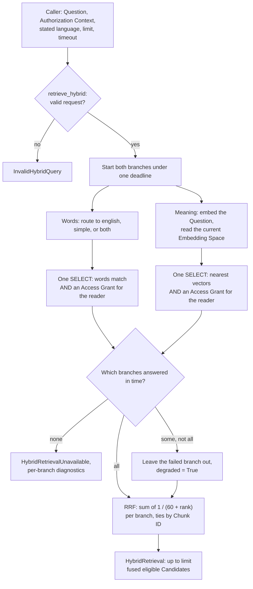

# M05-T16 — Hybrid-retrieval gate evidence

## Invariant

Hybrid retrieval returns only Chunks the reader may see: each branch
applies the permission check in its own SQL statement, and fusion only
reorders what the branches returned. A repair to one language's word
search is accepted only when every slice of the seed evaluation holds or
improves, for fused search as well as for the branch, and the Question
reaches PostgreSQL only as bound parameters.

## Expected failing check

Before the change, `uv run python -c "from knowledge_service.retrieval.lexical_search import simple_query"`
fails with `ImportError`.

## Predictions

These were written before the run in this repository. They are not blind:
Claude wrote them and had diagnosed and measured the prototype while
preparing the lesson.

- Why fused search ranks `uk-uk-sick-first-day` second: word search
  finds only the page's opening Chunk, because it requires every word and
  only the opening holds "що", "робити", and "в"; RRF then gives the
  opening two parts (rank 2 by meaning, rank 1 by words) against the right
  section's one part (rank 1 by meaning only).
- How many of the 8 Questions asked in Ukrainian word search finds today:
  one, `uk-uk-per-diem-abroad`, so lexical R@10 on `uk->*` is 0.125.
- What happens to `uk->en` if Ukrainian word search accepts any one word:
  fused MRR falls well below 1.000, because one common word such as
  "днів" matches Ukrainian Chunks that outrank the English page.
- Fused MRR on `uk->*` before and after your repair: 0.938 before and
  1.000 after, with no other slice falling.

## Language-specific failures and fusion

Claude drafted these answers from the code and psql; the learner should
rewrite them in their own words.

1. **What each configuration does to a word.** `english`
   (`chunks.search_en`, `lexical_search.py`) stems words and drops English
   stop words: `to_tsvector('english', 'requesting leave')` is
   `'request' & 'leav'`, so "requests for leave" matches too, and "the
   who" becomes an empty query (both are stop words). That is why
   `route_lexical_question` (`lexical_routing.py`) adds `simple` when
   English keeps no word. `simple` (`chunks.search_simple`) only
   lowercases: "відпустку" and "відпустки" stay two different words, so a
   Question in one case of a Ukrainian noun misses a page that uses
   another case. Until this lesson, `simple` also required every word,
   stop words included.
2. **Why `uk-en-annual-leave-days` finds nothing by words.** The Question
   "Скільки днів щорічної відпустки має працівник?" is Cyrillic, so it is
   routed to `simple`, and the answer is an English page: no Ukrainian word
   occurs in it. Word search cannot cross languages. Meaning search
   (`search_similar_chunks`, BGE-M3) puts both languages in one vector
   space and ranks the right English section first.
3. **Why `EXP-2041` goes to both configurations.** `question_script`
   skips every word that holds a digit, because an identifier is no
   evidence of a language, so a Question of only an identifier has no
   script and is matched against both. Both read it the same way,
   `'exp' <-> '-2041'`, so both find the page that holds it.
4. **RRF arithmetic** (`fusion.py`, k = 60). A Chunk ranked 1 by meaning
   only scores 1/61 = 0.0164. A Chunk ranked 2 by meaning and 1 by words
   scores 1/62 + 1/61 = 0.0161 + 0.0164 = 0.0325, almost twice as much,
   and wins. Near the top, ranks differ by little, so agreement between
   branches outweighs one place in a single branch: fusion rewards being
   found twice, even by a branch that is wrong.
5. **When a branch fails.** `retrieve_hybrid` (`hybrid.py`) gives every
   branch one deadline. A branch that times out or fails with a known
   dependency error is left out of the fusion and reported in `branches`
   with `BranchStatus.TIMED_OUT` or `FAILED` and its error type; the
   result's `degraded` is True, so the caller knows Candidates may be
   missing. If no branch succeeds, `HybridRetrievalUnavailable` is raised
   with the same diagnostics. Any other error is a bug and propagates.

## Diagram

Claude drew this draft; it is not from memory in the learner's sense,
because Claude wrote the verified diagram for the lesson. The learner
should redraw it without looking, then compare in Step 9.

The permission check sits inside each branch's SQL statement, so fusion
only reorders Chunks the reader may already see.

## Slice plan

Claude wrote this plan; it was not independent, since Claude chose the
slice while preparing the lesson. The learner should write their own
before comparing.

- **Which cases.** Every case asked in one language, whatever the
  evidence's language: `en->*` is `en->en` with `en->uk`, and `uk->*` is
  `uk->uk` with `uk->en`.
- **Why.** A change to Ukrainian word search acts on how a Question is
  read, so it reaches every Question typed in Ukrainian, also those about
  English pages. The directions split those eight cases into five and
  three, so a fix in one and a regression in the other can each look
  small; `uk->*` shows their sum, and `en->*` shows that English did not
  move. Eight cases per slice also move less per case than three.
- **Where.** In `score_slices`, after the four directions and before the
  query classes, named in the direction format so every report shows the
  new rows with no other change.
- **Test.** Score a hand-made report with three `en->en` cases and one
  `uk->en` case: `en->*` must hold three cases with MRR 5/12 and `uk->*`
  one case with MRR 1/3, in that slice order.

What the verified change did differently: nothing, since the plan was
written from it; the learner's own plan is the one to compare.

## Diagnosis

Run on 2026-11-11: `--local-embeddings` on a fresh database
`knowledge_service_dataset`, BGE-M3 on `127.0.0.1:8766`, after Step 4,
so the report already has the question-language slices. Claude ran the
commands and drafted this; the learner should rewrite it.

Before, by slice (lexical R@10 and MRR are equal here, because every
case has one relevant Chunk):

| Slice | Cases | lexical R@10 | dense MRR | fused MRR |
|---|---:|---:|---:|---:|
| all | 16 | 0.312 | 1.000 | 0.969 |
| uk->uk | 5 | 0.200 | 1.000 | 0.900 |
| uk->en | 3 | 0.000 | 1.000 | 1.000 |
| en->* | 8 | 0.500 | 1.000 | 1.000 |
| uk->* | 8 | 0.125 | 1.000 | 0.938 |

The chain, from evidence:

1. **Where each branch ranks the right section.** For
   `uk-uk-sick-first-day`, the case tables give: lexical `missed`, dense
   1, fused 2. Meaning search is right; fusion makes it worse.
2. **What the query asks for.** PostgreSQL reads the Question as
   `'що' & 'робити' & 'в' & 'перший' & 'день' & 'хвороби'`: every word,
   function words included. The section "Лікарняний > Перший день
   хвороби" holds "що", "перший", "день", and "хвороби", but not
   "робити" or "в" (its text says "у"), so it does not match. Only the
   page's opening, which says "що робити ... в перший день хвороби",
   matches.
3. **PostgreSQL would rank the section higher.** On the three Chunks of
   the page, `ts_rank` gives the section 0.986 and the opening 0.912: its
   heading holds three of the words, and a heading weighs more than body
   text. The every-word rule (`every_word` f) drops it before ranking.
4. **RRF arithmetic with this case's ranks.** The opening: rank 2 by
   meaning and rank 1 by words, 1/62 + 1/61 = 0.0325. The section: rank 1
   by meaning only, 1/61 = 0.0164. The opening wins by agreement.
5. **The cause in one sentence.** Ukrainian word search asks for every
   word in exact form, function words included, so it finds only the Chunk
   that repeats the Question's wording, and fusion then lifts that Chunk
   above the right one. This points to a repair in how `simple` reads a
   Question: drop words that carry no topic and stop requiring all of the
   rest, while keeping one wrong shared word from being enough.

The same rule explains the slice: word search finds the right Chunk for
only one of eight Ukrainian Questions (`uk->*` 0.125), and for none of the
three about English pages.

## Repair plan

Claude wrote this plan from the change it had already verified; the
learner should write their own before reading Step 6 and compare.

- **What changes.** Only how `simple` reads a Question that uses no
  web-search syntax: drop Ukrainian function words, and instead of every
  remaining word, require two of them in a Chunk, or the only one. Let
  PostgreSQL split the Question with the same parser as the stored terms,
  so the words compared are the words stored.
- **What must not change.** The `english` configuration and its query;
  the permission check, which stays in the same `WHERE` as the match;
  the Question reaching PostgreSQL only as bound parameters; a Question
  with quotes, `-word`, or "or" read exactly as typed.
- **How to know it worked.** `uk-uk-sick-first-day` ranks first fused
  and lexical; fused MRR on `uk->uk` and `uk->*` reaches 1.000; no slice,
  fused or lexical, falls; and a test shows that one shared word is not a
  match, since "any one word" is the version that harms `uk->en`.

## Design

Changed files:

- `src/knowledge_service/retrieval/evaluation_dataset.py`:
  `QUESTION_LANGUAGES` and two new slices in `score_slices`, `en->*` and
  `uk->*`, between the directions and the query classes.
- `src/knowledge_service/retrieval/lexical_search.py`:
  `UKRAINIAN_STOP_WORDS`, `MIN_SIMPLE_WORDS`, `MAX_SIMPLE_WORDS`,
  `SimpleQuery`, `simple_query`, `_uses_syntax`, and `_topic_match`;
  `lexical_search_statement` reads `simple` through `_topic_match` unless
  the text is read as typed. The module docstring describes the rule.
- Tests: `tests/test_evaluation_dataset.py` (the slice),
  `tests/test_lexical_search.py` (syntax and bound parameters),
  `tests/test_ukrainian_lexical_search_integration.py` (the seed page,
  one shared word, words that stay whole, words counted once, the
  exclusion, and "на" now matching nothing), and
  `tests/test_language_aware_lexical_search_integration.py` ("помилка
  E-1042" now also finds the English page with that code).
- `docs/architecture.md`: the `retrieval` row and a "Hybrid retrieval as
  built in M05" section with a sequence diagram.

Why a question-language slice: the repair changes how a Ukrainian
Question is read, so it reaches every Question typed in Ukrainian,
whatever the page's language; `uk->*` shows the sum that the two
directions split, and `en->*` shows English did not move.

Why two topic words, not one and not all: all words is the rule that
caused the miss, since an inflected language without stemming rarely has
every word of a Question in one Chunk. One word is the broken version
measured in the Decision: it lets a common word such as "днів" pull
Ukrainian Chunks above English pages, and fused `uk->en` fell to 0.511.
Two words keep the fix and harm no slice.

Why stop words are dropped from the query only: the stored terms keep
every word, so the list can change without rebuilding the index, and a
Question read as typed still matches them.

Why PostgreSQL finds the topic words: `ts_debug` uses the parser that
built the stored terms, so a date, a decimal, an address, or a file name
stays one word, and the words compared are the words stored. A version
that split words in Python matched none of those.

Why syntax is read as typed: quotes, `-word`, and "or" are the user's
own instructions to `websearch_to_tsquery`, and `_uses_syntax` follows
PostgreSQL's rule, so `(-лікарняний)` still excludes.

Unchanged: the `english` configuration and its query; the permission
check, which stays in the same `WHERE` as the match; the Question
reaching PostgreSQL only as bound parameters (`query_text` and the
`simple_stop_words` array).

## Verification

Commands, in order, on the final code:

| Command | Result |
|---|---|
| `uv run pytest tests/test_lexical_search.py tests/test_evaluation_dataset.py -q` | 139 passed |
| `KNOWLEDGE_SERVICE_TEST_DATABASE_URL=... uv run pytest -m integration tests/test_ukrainian_lexical_search_integration.py tests/test_language_aware_lexical_search_integration.py -q` | 46 passed |
| `make format-check` | 223 files already formatted |
| `make lint` | All checks passed! |
| `make typecheck` | 0 errors, 0 warnings, 0 informations |
| `make test-unit` | 1676 passed, 334 deselected |
| `KNOWLEDGE_SERVICE_TEST_DATABASE_URL=... make test-integration` | 329 passed, 1681 deselected |
| `make docs-check` | passed |
| `git diff --check` | clean |

The three measurements and the deliberate break are under Decision. The
expected failing check, an `ImportError` on `simple_query`, failed before
Step 6.

Predictions against the result: all four held, as expected for
predictions written after the prototype was measured. The cause was
right; one Ukrainian Question of eight was found by words; "any one word"
dropped fused `uk->en` (to 0.511); fused `uk->*` went from 0.938 to 1.000.

Known limits: 16 seed cases are few, and the two-word rule was chosen
while looking at them. Ukrainian still has no stemming. PostgreSQL splits
some words in two, `E-1042` into "e" and "-1042" and `п'ять` into "п" and
"ять", and each part counts as a topic word; so "помилка E-1042" now also
finds the English page that holds the code, which widens what a
Ukrainian Question finds. A dash typed as "Відпустка - це" sends the
Question to the as-typed reading. The stop-word list is short and
hand-made. A Question whose words match tens of thousands of Chunks costs
hundreds of milliseconds: 782 ms on 50,000 matching Chunks, against about
100 ms for the old every-word query.

## Review

Three adversarial reviews of the prototype found five broken guarantees;
all are fixed, each with a test that failed before the fix:

- A punctuation-only word such as "?" counted as a topic word that could
  never match, so "відпустка ?" found nothing.
- A word typed twice counted twice, so one shared word passed the
  two-word rule.
- `(-лікарняний)` slipped past the syntax check, and the exclusion did
  the opposite.
- Words split in Python, differently from PostgreSQL, so "ставка 1.5", a
  date, an e-mail address, or a file name matched nothing. Now
  `ts_debug` finds them.
- The topic words were found again for every matching Chunk. Now they are
  computed once per query: 1,726 ms to 782 ms on 50,000 matching Chunks.

A check of the diagnosis also corrected the guide: the section lacks
"робити" and "в", not "що".

Finishing reviews (Standards and Spec, in parallel on the same
worktree). Standards found nothing blocking. Spec found the gate's own
condition unmet: the explanations, the diagram, the slice plan, the
diagnosis, and the repair plan are Claude's drafts, and the outcome asks
for the slice to be added independently and the result explained in the
learner's own words. Non-blocking points left as they are:

- The docstring of `search_ukrainian_chunks` said it matched "the exact
  words of `text`", no longer the whole rule. Fixed at the learner's
  request: it now describes topic words, the two-word rule, and syntax
  read as typed.
- `SimpleQuery.text` is never read.
- The `uk->*` slice groups by the direction label's prefix, not by the
  case's question language.
- The seed-page test cuts the page at a heading without asserting that
  the heading exists.
- `MAX_SIMPLE_WORDS in compiled.params.values()` is a weak assertion.
- `_uses_syntax` copies PostgreSQL's rule in Python; no test compares the
  two directly.

## Decision

Three runs of `scripts/run_retrieval_dataset.py --local-embeddings` on
2026-11-11, each on a fresh database, BGE-M3 on `127.0.0.1:8766`: before
the repair (after Step 4), after it, and with the repair broken
(`MIN_SIMPLE_WORDS = 1`). Copied here because `/tmp` and `artifacts/` are
not kept.

| Slice | Cases | lexical before | after | broken | fused before | after | broken |
|---|---:|---:|---:|---:|---:|---:|---:|
| all | 16 | 0.312 | 0.500 | 0.562 | 0.969 | 1.000 | 0.877 |
| en->en | 6 | 0.667 | 0.667 | 0.667 | 1.000 | 1.000 | 1.000 |
| en->uk | 2 | 0.000 | 0.000 | 0.000 | 1.000 | 1.000 | 1.000 |
| uk->en | 3 | 0.000 | 0.333 | 0.333 | 1.000 | 1.000 | 0.511 |
| uk->uk | 5 | 0.200 | 0.600 | 0.800 | 0.900 | 1.000 | 0.900 |
| en->* | 8 | 0.500 | 0.500 | 0.500 | 1.000 | 1.000 | 1.000 |
| uk->* | 8 | 0.125 | 0.500 | 0.625 | 0.938 | 1.000 | 0.754 |
| plain | 9 | 0.333 | 0.444 | 0.444 | 0.944 | 1.000 | 0.837 |
| identifier | 4 | 0.250 | 0.750 | 0.750 | 1.000 | 1.000 | 1.000 |
| morphology | 3 | 0.333 | 0.333 | 0.667 | 1.000 | 1.000 | 0.833 |

Lexical columns are R@10, equal to lexical MRR here; fused columns are
MRR. Dense MRR is 1.000 on every slice in all three runs.

**The repair is accepted.** Fused MRR rose on `all` (0.969 to 1.000),
`uk->uk` (0.900 to 1.000), `uk->*` (0.938 to 1.000), and `plain`, and no
slice fell, fused or lexical. `uk-uk-sick-first-day` moved from fused
rank 2 to 1 and from lexical `missed` to 1. Word search also found
`uk-uk-form-it-0457` and `uk-en-error-vpn-4031` by their identifiers, which
the every-word rule had hidden. English slices did not move. The
decision covers the seed set only; on 16 cases it shows the repair harms
nothing it can see, not that it helps everywhere.

**What the broken version shows.** With one shared word enough, word
search looked better on its own: lexical `uk->*` rose to 0.625 and
`uk->uk` to 0.800. Fused search got worse: `uk->en` fell to 0.511, `uk->*`
to 0.754, `all` to 0.877. Ukrainian Questions about English pages pulled
Ukrainian Chunks by one common word: `uk-en-annual-leave-days` fell to
fused rank 5 and `uk-en-lost-receipt` to 3, and `uk-uk-order-laptops` to
2. A branch measured alone can improve while the search the reader gets
degrades, so a repair is judged on fused search, slice by slice. The
break also failed 6 integration tests: the fixture report,
`test_one_shared_topic_word_is_not_a_match`, the `typed-twice` and
`two-words` cases of
`test_each_topic_word_counts_once_and_an_exclusion_still_excludes`, and
both "the who" cases of
`test_a_question_of_english_stop_words_falls_back_to_simple`; the 68 unit
tests passed, because the rule lives in SQL. After the undo, 46 passed.

**Falsified assumption.** I assumed, from M05-T08 and M05-T09, that word
search helps fusion only where it agrees with meaning search and is
harmless elsewhere, so finding more with words could only help. The
broken run shows the opposite: more lexical hits (`uk->*` 0.125 to 0.625)
lowered fused MRR on `uk->en` from 1.000 to 0.511
(`uk-en-annual-leave-days`, `uk-en-lost-receipt`). So "more recall in one
branch cannot hurt fusion" is wrong: RRF rewards agreement, and a wrong
Chunk that both branches rank near the top wins.

## Reflection

The learner chose to close the gate with Claude's drafts. These answers,
like the explanations, diagram, slice plan, diagnosis, and repair plan
above, are Claude's, not the learner's own words; the learner should
rewrite them.

1. What `search_lexical_chunks` hides from `retrieve_hybrid`: which
   PostgreSQL configuration reads a Question and why (stated language,
   alphabet, whether English keeps any word); English stemming and stop
   words; Ukrainian stop words, the topic words PostgreSQL finds, and the
   two-word rule; when web-search syntax sends a Question to the as-typed
   reading; and the refusal of a query PostgreSQL cannot parse. The hybrid
   code only sees ranked, eligible Candidates or `InvalidLexicalQuery`.
2. Dropping the word-count subquery and keeping only the "or" match is
   the broken version measured above: one shared word becomes enough.
   That breaks "a repair is accepted only when every slice holds": fused
   `uk->en` fell to 0.511. `test_one_shared_topic_word_is_not_a_match` and
   the `typed-twice` and `two-words` cases would fail, and the `uk->en`
   and `uk->*` slices would show it in a seed run.
3. A Ukrainian Question whose answer page shares two common topic words
   with a wrong page, such as "Скільки днів відпустки при звільненні?"
   where a sick-leave page also says "днів" and "відпустки". If that
   wrong page outranked the right one fused, the rule should weigh words
   by rarity, for example by trusting `ts_rank` order more than the count,
   or adding stemming so that the right page matches more forms.
4. None failed outright, because they were written after the prototype
   was measured. The belief behind them that the run falsified was the
   one under Decision: that more recall in one branch cannot hurt fusion.
5. 1.000 says that, on 16 easy seed cases with one relevant Chunk each,
   the right Chunk is first. It says nothing about questions the seed set
   lacks, longer or vaguer questions, pages with several relevant Chunks,
   a larger corpus where wrong pages compete, or latency at scale. Next:
   a larger labelled set per slice (M10), with recall of every relevant
   Chunk, not only the first.
