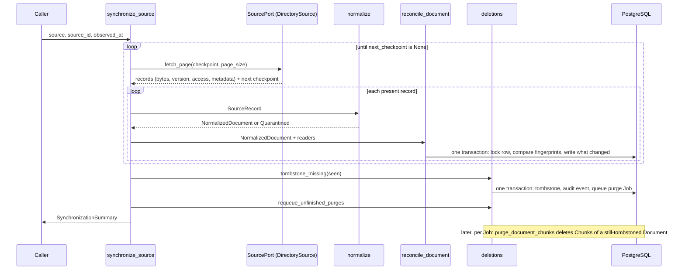

# M03-T14 — Pass the local-ingestion understanding gate

Source task: [M03-T14](../curriculum/milestones/M03-local-ingestion/M03-T14-pass-the-local-ingestion-gate.md)

## What you will do

This is the M03 gate. It mixes writing, diagnosis, and one small feature:

- **Explain** what the connector (`DirectorySource`) does and what the parsers do, from the code you have.
- **Redraw synchronization** as it is actually built today, in `docs/architecture.md`.
- **Diagnose a malformed PDF**: feed broken PDFs through `normalize`, predict the outcome first, and trace which layer decided what.
- **Add one metadata field through the pipeline**: the document **title**, from the Source all the way to the `documents` table, without breaking provenance or idempotency.

This lesson includes coding: Steps 5–8 write code. Steps 1, 2, 4, and 9 are writing and running commands, and Step 3 edits a Markdown diagram.

Terms used in this lesson:

- **Connector:** the Source adapter that talks to where documents live (today a folder; later Confluence). It lists, pages, and reads raw bytes.
- **Parser:** a function that turns one file's bytes or text into structural blocks (`ParsedDocument`).
- **Provenance:** where a Document came from: its Source, its external ID, and the Source's version label. `DocumentProvenance` holds it.
- **Idempotent:** doing the same thing twice has the same effect as doing it once. Here: syncing an unchanged folder again writes nothing.

## Before you begin

- **Why the title.** `NormalizedDocument.title` already exists. `DirectorySource` sets it to the file name without its extension, and `normalize` cleans it and cuts it to 200 characters. But `reconcile_document` drops it, so nothing stores it. M05-T01 weights titles in full-text search, and citations will want a readable name, so the title is the field most worth carrying through.
- **Where a title change belongs.** A title is not content (the text did not change) and not access (the readers did not change). So a title-only change updates the row and raises neither version: no re-chunking, no new grants. That is the idempotency rule this lesson protects.
- **What the prototype and its review found.** Two bugs, both fixed in the code below and both caught only by real-database tests:
  - The first version passed every domain test but stored the old title after a rename. `upsert_document` updates only the columns listed in its `ON CONFLICT ... DO UPDATE SET`, and `title` was missing there.
  - An adversarial review broke the first migration. It filled old rows with the first 200 characters of their external ID, and an ID that starts with 200 spaces (or other characters Python's `strip()` removes) gave a blank title. `Document` refuses a blank title, so loading that one row failed, and with it every sync of its Source. The migration now writes the placeholder `Untitled`.
- **Running the integration tests.** Set the URL in your shell first, with your test user's real password:

  ```bash
  export KNOWLEDGE_SERVICE_TEST_DATABASE_URL="postgresql://test_user:<password>@localhost:5433/knowledge_service_test"
  ```

  Never write the real password into a file in the repository.
- **Files you will touch:**
  - `docs/architecture.md`
  - `src/knowledge_service/documents.py`, `normalization.py`, `persistence.py`, `reconciliation.py`
  - new migration `migrations/versions/d2e3f4a5b6c7_document_title.py`
  - nine existing test files (one keyword each), `tests/test_documents.py`, `tests/test_indexes_integration.py`, and new `tests/test_document_title_integration.py`
  - a new evidence file

  Leave the task spec and `PROGRESS.md` alone.

## Walkthrough

### Step 1 — No coding in this step: write the invariant and your prediction

**Invariant:** M03 turns a folder into searchable state with these guarantees. A connector only lists and reads; it never decodes or interprets content. A file that cannot be parsed is quarantined, not deleted. Each Document keeps its ID and provenance for life. Re-reading an unchanged item writes nothing, and only a change to the text produces new Chunks. The new title must keep all of that: the same title writes nothing, and a new title changes only the row.

**Action:** create `docs/evidence/M03-T14-local-ingestion-gate.md`:

```markdown
# M03-T14 — Local-ingestion gate evidence

Completed: pending

## Invariant

Pending.

## Prediction

Before running anything, say what you expect for: a valid PDF, a PDF cut in
half, a file that starts like a PDF but is not one, a file with no PDF header,
and a PDF whose only page has no text. For the title: what is stored after
syncing `handbook.md`; what a second sync of the same folder writes; what a
rename of the title (same text, same readers) changes; and what title an
existing row gets when the migration runs.

## Connector versus parser

Pending.

## Synchronization

Pending.

## Malformed PDF diagnosis

Pending.

## Design

Pending.

## Verification

Pending.

## Reflection

Pending.
```

**Check:** the file holds your invariant and predictions.

### Step 2 — No coding in this step: explain connector versus parser responsibilities

Read the code and answer in `## Connector versus parser`, in your own words.

| Read | Look for |
|---|---|
| `src/knowledge_service/directory_source.py` | What `fetch_page` returns, how the checkpoint works, how `version` and `media_type` are chosen, what happens to symlinks and unreadable folders, and which error it raises. |
| `src/knowledge_service/sources.py` | `SourceRecord`, `SourcePage`, `SourceUnavailable`: the contract every connector must meet. |
| `src/knowledge_service/structure.py` and one parser, such as `pdf_parser.py` | What a parser takes and returns, and its typed errors (`DocumentParseError` and its subclasses). |
| `src/knowledge_service/normalization.py` | How `normalize` picks a parser by media type and turns a parse error into `Quarantined`. |

Answer these questions:

1. What does the connector promise, and what does it refuse to do? Why does `DirectorySource` deliver raw bytes instead of decoded text?
2. What does a parser promise? Why does it know nothing about folders, checkpoints, or access?
3. Which errors belong to each side? Compare `SourceUnavailable`, which stops the whole run, with `CorruptDocument`, which quarantines one file. Why is that difference important for deletions?
4. When M08 adds Confluence, which files change and which stay the same?

**Check:** each answer names the function or type it relies on.

### Step 3 — No coding in this step: redraw synchronization

The sequence diagram under `### Synchronization` in `docs/architecture.md` shows the target design: a scheduler, a queue, a worker, and embeddings. None of that exists yet. Add a second diagram that shows what M03 actually built, and keep the target one.

**Action:** in `docs/architecture.md`, right after the existing synchronization diagram (before `### Answering`), add:

````markdown
#### Synchronization as built in M03

The diagram above is the target. Today one call, `synchronize_source`, runs a
complete pass in-process, with no scheduler, queue, embeddings, or
Synchronization Run record yet.


````

Before you paste it, trace every arrow to the function that does it, and fix the diagram if you find one that is wrong. Then, in `## Synchronization` of the evidence, describe in a few sentences what the two diagrams differ in, and what M04 and M08 will add.

**Check:** `UV_CACHE_DIR=/tmp/uv-cache-rag-project make docs-check` passes.

### Step 4 — No coding in this step: diagnose a malformed PDF

Write your predictions from Step 1 first. Then run this from the repository root. It builds broken PDFs in memory with the test helper `tests/pdf_builder.py`, and writes nothing to disk:

```bash
UV_CACHE_DIR=/tmp/uv-cache-rag-project uv run python - <<'PY'
import sys

sys.path.insert(0, "tests")
from pdf_builder import build_pdf, text_page

from knowledge_service.identifiers import SourceId
from knowledge_service.normalization import normalize
from knowledge_service.sources import SourceAccess, SourceRecord

good = build_pdf(text_page((72, 720, "Vacation policy")))
cases = {
    "valid": good,
    "truncated": good[: len(good) // 2],
    "garbage header": b"%PDF-1.7\nnot really a pdf\n%%EOF\n",
    "no header": b"hello, I am not a PDF",
    "image-only page": build_pdf(b""),
}
for name, content in cases.items():
    record = SourceRecord.present(
        external_id=f"{name}.pdf",
        version="v1",
        media_type="application/pdf",
        content=content,
        access=SourceAccess(public=True),
    )
    outcome = normalize(record, source_id=SourceId.new())
    reason = getattr(outcome, "reason", "")
    detail = getattr(outcome, "detail", "")
    print(f"{name:16} {type(outcome).__name__:18} {reason!s:14} {detail}".rstrip())
PY
```

Expected output:

```text
EOF marker not found
invalid pdf header: b'hello'
EOF marker not found
valid            NormalizedDocument
truncated        Quarantined        corrupt        pdf could not be read
garbage header   Quarantined        corrupt        pdf could not be read
no header        Quarantined        corrupt        pdf could not be read
image-only page  Quarantined        no_text_layer  pdf has no extractable text; OCR is not supported
```

The `EOF marker not found` and `invalid pdf header` lines come from pypdf's own logger, not from this project. They go to standard error, so they may appear before the results.

Answer in `## Malformed PDF diagnosis`:

1. **Which layer decided?** Follow a truncated PDF: `parse_pdf` → `_open_pages` raises `CorruptDocument` (the original pypdf error, `PdfStreamError`, is kept on `__cause__`) → `normalize` maps it to `QuarantineReason.CORRUPT` with a fixed detail → `synchronize_source` counts the file as seen. What happens to an older, good version of the same file?
2. **What does an operator see?** Only `corrupt` and `pdf could not be read`. A truncated file and a file that is not a PDF at all look the same. Is that acceptable now? What would help in M10, when telemetry exists?
3. **What leaks?** pypdf logs `invalid pdf header: b'hello'`, which is the first bytes of the file's content, through Python's `logging`. Which ADR forbids raw content in telemetry (look in `docs/adr/`), and what should the worker do about pypdf's logger later? Record this as a follow-up; do not fix it in this lesson.
4. **Why is the image-only page different?** It is a valid PDF with no text layer, so it gets `no_text_layer`, and the detail says OCR is not supported.

**Check:** each answer names the function and the reason it relies on.

### Step 5 — Coding step: give Document a title

| Where | Change |
|---|---|
| `documents.py` | `MAX_TITLE_CHARACTERS = 200` moves here, because the Document now enforces it. `Document` gets a `title: str` field. `__post_init__` refuses a blank title or one over the limit. `register` and `reconcile` take `title`. In `reconcile`, a changed title counts as a change, so the method no longer returns `self`, but it raises neither version. |
| `normalization.py` | Delete its own `MAX_TITLE_CHARACTERS = 200` and import the one from `documents.py`, so normalization never produces a title the Document refuses. |
| nine test files | Every `Document.register(` and `.reconcile(` call gets `title="Handbook",`. |

**Action:** in `src/knowledge_service/documents.py`, after the imports, add:

```python
MAX_TITLE_CHARACTERS = 200
```

Add the field right after `provenance` in `Document`:

```python
    document_id: DocumentId
    provenance: DocumentProvenance
    title: str
    content_version: ContentVersion
```

Start `__post_init__` with the title checks:

```python
    def __post_init__(self) -> None:
        if not self.title.strip():
            raise InvalidDocument("title must not be empty")
        if len(self.title) > MAX_TITLE_CHARACTERS:
            raise InvalidDocument(
                f"title must be at most {MAX_TITLE_CHARACTERS} characters"
            )
```

In `register`, add `title: str,` after `provenance: DocumentProvenance,` in the parameters, and pass `title=title,` after `provenance=provenance,` to `cls(...)`.

Replace the start of `reconcile`, up to and including the `if not any(...)` check, with:

```python
    def reconcile(
        self,
        *,
        title: str,
        content_fingerprint: str,
        authorization_fingerprint: str,
        source_version: str | None,
        observed_at: datetime,
    ) -> Document:
        """Apply one observed snapshot and advance only changed dimensions.

        A new title or source version updates the row without raising either
        version, because neither changes the text or who may read it.
        """
        provenance = replace(self.provenance, source_version=source_version)
        title_changed = title != self.title
        content_changed = content_fingerprint != self.content_fingerprint
        authorization_changed = (
            authorization_fingerprint != self.authorization_fingerprint
        )
        availability_changed = self.availability is DocumentAvailability.TOMBSTONED
        provenance_changed = provenance != self.provenance

        if not any(
            (
                content_changed,
                authorization_changed,
                availability_changed,
                provenance_changed,
                title_changed,
            )
        ):
            return self
```

and add `title=title,` after `provenance=provenance,` in its final `replace(...)`.

In `src/knowledge_service/normalization.py`, delete the line `MAX_TITLE_CHARACTERS = 200` and change the documents import to:

```python
from knowledge_service.documents import MAX_TITLE_CHARACTERS, DocumentProvenance
```

`tests/test_normalization.py` still imports `MAX_TITLE_CHARACTERS` from `normalization`, and that keeps working because the name is still defined there through the import.

Then add `title="Handbook",` as the first argument of every `Document.register(` and `.reconcile(` call in these test files: `test_access_integration.py`, `test_chunks_integration.py`, `test_documents.py`, `test_fingerprints.py`, `test_persistence.py`, `test_persistence_integration.py`, `test_publishing.py`, `test_publishing_integration.py`, and `test_reconciliation.py`. There are 19 calls. Use the same title everywhere, so no test sees a title change it did not ask for. Pyright lists every call you missed.

**Check:** `UV_CACHE_DIR=/tmp/uv-cache-rag-project uv run pyright src/knowledge_service/documents.py src/knowledge_service/normalization.py` passes. The full type check still fails until Steps 6 and 7.

### Step 6 — Coding step: store the title

| Where | Change |
|---|---|
| `persistence.py`, `documents` table | `sa.Column("title", sa.Text(), nullable=False)` after `source_version`. |
| `as_row`, `as_document` | Write and read `title`. |
| `upsert_document` | Add `"title": statement.excluded.title` to `set_`. Without it, a renamed title is never stored, and no unit test notices. |
| New migration | Add the column as nullable, fill existing rows with the placeholder `Untitled`, then make it `NOT NULL`. The next sync replaces the placeholder with the real title. |
| `tests/test_indexes_integration.py` | Its seed inserts documents with raw SQL, so it must now give a title. |

**Action:** in `src/knowledge_service/persistence.py`, add the column to the `documents` table after `source_version`:

```python
    sa.Column("title", sa.Text(), nullable=False),
```

In `as_row`, add `"title": document.title,` after `"source_version": ...`. In `as_document`, add `title=cast(str, record["title"]),` after the `provenance=DocumentProvenance(...)` argument. In `upsert_document`, make `set_` read:

```python
        set_={
            "source_version": statement.excluded.source_version,
            "title": statement.excluded.title,
            "content_version": statement.excluded.content_version,
            "content_fingerprint": statement.excluded.content_fingerprint,
            "authorization_version": statement.excluded.authorization_version,
            "authorization_fingerprint": statement.excluded.authorization_fingerprint,
            "availability": statement.excluded.availability,
            "updated_at": statement.excluded.updated_at,
        },
```

Create the migration with `uv run alembic revision -m "document title" --rev-id d2e3f4a5b6c7`. It should follow `c1d2e3f4a5b6`. Then make it read:

```python
"""document title

Revision ID: d2e3f4a5b6c7
Revises: c1d2e3f4a5b6
Create Date: 2026-10-22 15:00:00.000000

"""

from collections.abc import Sequence

import sqlalchemy as sa
from alembic import op

# revision identifiers, used by Alembic.
revision: str = "d2e3f4a5b6c7"
down_revision: str | Sequence[str] | None = "c1d2e3f4a5b6"


def upgrade() -> None:
    """Store each Document's title, with a placeholder for existing rows."""
    op.add_column("documents", sa.Column("title", sa.Text(), nullable=True))
    # A fixed placeholder is always a valid title; one derived from the external
    # ID can be blank by Python's rules. The next run stores the real title.
    op.execute("UPDATE documents SET title = 'Untitled'")
    op.alter_column("documents", "title", nullable=False)


def downgrade() -> None:
    """Drop the title column."""
    op.drop_column("documents", "title")
```

Why three steps instead of `nullable=False` at once: a non-null column cannot be added to a table that already has rows unless every row gets a value. Why a placeholder instead of the external ID: a value computed in SQL must also pass `Document`'s Python check when the row is loaded, and PostgreSQL and Python do not agree on what counts as whitespace. A fixed, valid placeholder cannot fail that check.

In `tests/test_indexes_integration.py`, change the documents seed to include a title:

```python
    (
        "INSERT INTO documents (document_id, source_id, external_id, title,"
        " content_version, content_fingerprint, authorization_version,"
        " authorization_fingerprint, availability, created_at, updated_at)"
        " SELECT gen_random_uuid(),"
        " (:prefix || lpad((mod(i, :sources) + 1)::text, 12, '0'))::uuid,"
        " 'doc-' || i, 'Doc ' || i, 1,"
        " repeat('a', 64), 1, repeat('b', 64), 'available', now(), now()"
        " FROM generate_series(1, :rows) AS i",
        {"prefix": SOURCE_PREFIX, "sources": SOURCE_COUNT, "rows": TABLE_ROWS},
    ),
```

**Check:** `UV_CACHE_DIR=/tmp/uv-cache-rag-project uv run pytest tests/test_migrations.py -q` passes (one head).

### Step 7 — Coding step: pass the title through reconciliation

| Where | Change |
|---|---|
| `Change` | New value `TITLE = "title"`: only the title changed. |
| `reconcile_document` | Pass `title=normalized.title` to `Document.register` and `stored.reconcile`. |
| `_change` | Takes `source_version`. When neither content, access, nor availability changed, it returns `SOURCE_VERSION` if the source version changed, otherwise `TITLE`. |

**Action:** in `src/knowledge_service/reconciliation.py`, add to `Change`:

```python
    TITLE = "title"
```

Add `title=normalized.title,` after `provenance=provenance,` in the `Document.register(` call, and as the first argument of `stored.reconcile(`. After the line `restored = stored.availability is DocumentAvailability.TOMBSTONED`, add:

```python
        source_version_changed = document.provenance != stored.provenance
```

Make the final `return` and `_change` read:

```python
    return Reconciliation(
        document=document,
        change=_change(
            content=content_changed,
            access=access_changed,
            restored=restored,
            source_version=source_version_changed,
        ),
    )


def _change(
    *, content: bool, access: bool, restored: bool, source_version: bool
) -> Change:
    if content and access:
        return Change.CONTENT_AND_ACCESS
    if content:
        return Change.CONTENT
    if access:
        return Change.ACCESS
    if restored:
        return Change.RESTORED
    if source_version:
        return Change.SOURCE_VERSION
    return Change.TITLE
```

**Check:** `UV_CACHE_DIR=/tmp/uv-cache-rag-project make typecheck lint` passes, and `uv run pytest -m "not integration and not live" -q` passes.

### Step 8 — Coding step: tests

| Test | What it proves |
|---|---|
| `test_a_title_only_change_keeps_identity_and_both_versions` | A new title keeps the ID, provenance, and both versions. |
| `test_a_blank_or_overlong_title_is_refused` | The typed failure: `InvalidDocument` for an empty, blank, or 201-character title. |
| `test_a_synchronized_file_keeps_its_title_and_a_second_pass_writes_nothing` | The title travels from a real folder to the row, and a second pass is `UNCHANGED` with an identical row and Chunks. |
| `test_a_new_title_updates_only_the_row` | A rename returns `Change.TITLE`, stores the new title, and keeps the ID, provenance, versions, and Chunk IDs. This is the test that caught the missing `set_` entry. |
| `test_documents_stored_before_titles_get_a_valid_placeholder` | The migration fills existing rows, including ones whose external ID starts with 200 whitespace characters, with a title that loads. |

The migration test is a plain, not `async`, function, because Alembic's `env.py` starts its own event loop with `asyncio.run`, which cannot run inside a running one. It downgrades the shared test database to the previous revision, inserts rows the old way, upgrades again, and then loads each row through `load_document` with its own `asyncio.run`. Loading is the point: the bug was a row that the database accepted but `Document` refused.

**Action:** in `tests/test_documents.py`, add `MAX_TITLE_CHARACTERS,` to the `knowledge_service.documents` import, and append:

```python
def test_a_title_only_change_keeps_identity_and_both_versions() -> None:
    document = make_document()
    later = OBSERVED_AT + timedelta(minutes=1)

    result = document.reconcile(
        title="Team handbook",
        content_fingerprint="content-a",
        authorization_fingerprint="acl-a",
        source_version="17",
        observed_at=later,
    )

    assert result.title == "Team handbook"
    assert result.document_id == document.document_id
    assert result.provenance == document.provenance
    assert result.content_version == document.content_version
    assert result.authorization_version == document.authorization_version
    assert result.updated_at == later


@pytest.mark.parametrize(
    "title",
    ["", "   ", "x" * (MAX_TITLE_CHARACTERS + 1)],
    ids=["empty", "blank", "too-long"],
)
def test_a_blank_or_overlong_title_is_refused(title: str) -> None:
    with pytest.raises(InvalidDocument, match="title"):
        make_document().reconcile(
            title=title,
            content_fingerprint="content-a",
            authorization_fingerprint="acl-a",
            source_version="17",
            observed_at=OBSERVED_AT + timedelta(minutes=1),
        )
```

Create `tests/test_document_title_integration.py`:

```python
"""Real PostgreSQL tests for carrying a Document's title through the pipeline."""

import asyncio
from collections.abc import AsyncIterator
from datetime import UTC, datetime, timedelta
from pathlib import Path

import pytest
from alembic import command
from pydantic import SecretStr
from sqlalchemy import create_engine, text
from sqlalchemy.engine import make_url

from database_fixtures import migration_config, migration_environment
from knowledge_service.access import Subject
from knowledge_service.chunks import Chunk
from knowledge_service.database import DatabaseRuntime, create_database_runtime
from knowledge_service.directory_source import DirectorySource
from knowledge_service.documents import Document
from knowledge_service.identifiers import SourceId
from knowledge_service.normalization import NormalizedDocument, normalize
from knowledge_service.persistence import load_chunks, load_document
from knowledge_service.reconciliation import Change, reconcile_document
from knowledge_service.settings import Settings
from knowledge_service.sources import SourceAccess, SourceMetadata, SourceRecord
from knowledge_service.synchronization import synchronize_source

SOURCE_ID = SourceId.parse("00000000-0000-0000-0000-000000000010")
OBSERVED_AT = datetime(2026, 10, 22, 9, 0, tzinfo=UTC)
LATER = OBSERVED_AT + timedelta(hours=1)
HANDBOOK = b"# Team handbook\n\nWelcome to the team.\n"

INSERT_SOURCE = text(
    "INSERT INTO sources (source_id, kind, location, display_name, enabled,"
    " created_at, updated_at) VALUES (:source_id, 'local_directory',"
    " '/srv/handbook', 'Handbook', true, now(), now())"
)


@pytest.fixture
async def runtime(migrated_database: str) -> AsyncIterator[DatabaseRuntime]:
    runtime = create_database_runtime(
        Settings(database_url=SecretStr(migrated_database))
    )
    async with runtime.transaction() as connection:
        await connection.execute(INSERT_SOURCE, {"source_id": SOURCE_ID.value})
    try:
        yield runtime
    finally:
        await runtime.dispose()


def titled(title: str) -> NormalizedDocument:
    outcome = normalize(
        SourceRecord.present(
            external_id="pages/42",
            version="v1",
            media_type="text/markdown",
            content=HANDBOOK,
            access=SourceAccess(public=True),
            metadata=SourceMetadata(
                title=title, modified_at=OBSERVED_AT, size_bytes=len(HANDBOOK)
            ),
        ),
        source_id=SOURCE_ID,
    )
    assert isinstance(outcome, NormalizedDocument)
    return outcome


async def stored(
    runtime: DatabaseRuntime, external_id: str
) -> tuple[Document, tuple[Chunk, ...]]:
    async with runtime.transaction() as connection:
        document = await load_document(
            connection, source_id=SOURCE_ID, external_id=external_id
        )
        assert document is not None
        chunks = await load_chunks(connection, document_id=document.document_id)
    return document, chunks


@pytest.mark.integration
async def test_a_synchronized_file_keeps_its_title_and_a_second_pass_writes_nothing(
    runtime: DatabaseRuntime, tmp_path: Path
) -> None:
    (tmp_path / "handbook.md").write_bytes(HANDBOOK)
    source = DirectorySource(tmp_path, access=SourceAccess(public=True))
    await synchronize_source(
        runtime, source, source_id=SOURCE_ID, observed_at=OBSERVED_AT
    )
    before = await stored(runtime, "handbook.md")

    second = await synchronize_source(
        runtime, source, source_id=SOURCE_ID, observed_at=LATER
    )

    assert before[0].title == "handbook"
    assert second.changes == {Change.UNCHANGED: 1}
    assert await stored(runtime, "handbook.md") == before


@pytest.mark.integration
async def test_a_new_title_updates_only_the_row(runtime: DatabaseRuntime) -> None:
    first = await reconcile_document(
        runtime, titled("Handbook"), readers=[Subject.public()], observed_at=OBSERVED_AT
    )
    _, chunks_before = await stored(runtime, "pages/42")

    renamed = await reconcile_document(
        runtime,
        titled("Team handbook"),
        readers=[Subject.public()],
        observed_at=LATER,
    )

    document, chunks_after = await stored(runtime, "pages/42")
    assert renamed.change is Change.TITLE
    assert document.title == "Team handbook"
    assert document.document_id == first.document.document_id
    assert document.provenance == first.document.provenance
    assert document.content_version == first.document.content_version
    assert document.authorization_version == first.document.authorization_version
    assert [c.chunk_id for c in chunks_after] == [c.chunk_id for c in chunks_before]


INSERT_OLD_DOCUMENT = text(
    "INSERT INTO documents (document_id, source_id, external_id, source_version,"
    " content_version, content_fingerprint, authorization_version,"
    " authorization_fingerprint, availability, created_at, updated_at)"
    " VALUES (gen_random_uuid(), :source_id, :external_id, 'v1', 1, 'c', 1, 'a',"
    " 'available', now(), now())"
)


@pytest.mark.integration
def test_documents_stored_before_titles_get_a_valid_placeholder(
    migrated_database: str,
) -> None:
    url = make_url(migrated_database)
    config = migration_config()
    # Each of these starts with 200 characters that Python's strip() removes.
    external_ids = (
        "guides/handbook.md",
        " " * 200 + "x.md",
        "\u3000" * 200 + "x.md",
        "\x1f" * 200 + "x.md",
    )
    with migration_environment(url):
        command.downgrade(config, "c1d2e3f4a5b6")
    engine = create_engine(migrated_database)
    try:
        with engine.begin() as connection:
            connection.execute(INSERT_SOURCE, {"source_id": SOURCE_ID.value})
            for external_id in external_ids:
                connection.execute(
                    INSERT_OLD_DOCUMENT,
                    {"source_id": SOURCE_ID.value, "external_id": external_id},
                )
        with migration_environment(url):
            command.upgrade(config, "head")
    finally:
        engine.dispose()

    runtime = create_database_runtime(
        Settings(database_url=SecretStr(migrated_database))
    )

    async def load_all() -> list[Document | None]:
        async with runtime.transaction() as connection:
            return [
                await load_document(
                    connection, source_id=SOURCE_ID, external_id=external_id
                )
                for external_id in external_ids
            ]

    try:
        loaded = asyncio.run(load_all())
    finally:
        asyncio.run(runtime.dispose())
    assert [d.title if d else None for d in loaded] == ["Untitled"] * 4
```

**Check:** with the database URL set, `uv run pytest tests/test_documents.py tests/test_document_title_integration.py -q` gives 14 passed.

Then break the code on purpose, one change at a time, and undo each change:

| Break | Test that must fail |
|---|---|
| Remove `"title"` from `upsert_document`'s `set_` | `test_a_new_title_updates_only_the_row` |
| Remove `title_changed` from the `any(...)` in `reconcile` | the rename tests |
| Raise the content version when the title changes | `test_a_title_only_change_keeps_identity_and_both_versions` and the rename test |
| Backfill with `left(external_id, 200)` instead of `'Untitled'` | `test_documents_stored_before_titles_get_a_valid_placeholder` |

### Step 9 — No coding in this step: run the gates, then record evidence

**Action:** with `KNOWLEDGE_SERVICE_TEST_DATABASE_URL` set, run, in order:

```bash
UV_CACHE_DIR=/tmp/uv-cache-rag-project uv run pytest tests/test_documents.py tests/test_document_title_integration.py -q
UV_CACHE_DIR=/tmp/uv-cache-rag-project make format-check lint typecheck
UV_CACHE_DIR=/tmp/uv-cache-rag-project uv run pytest -m "not integration and not live" -q
UV_CACHE_DIR=/tmp/uv-cache-rag-project make test-integration
UV_CACHE_DIR=/tmp/uv-cache-rag-project make check
UV_CACHE_DIR=/tmp/uv-cache-rag-project make docs-check
git diff --check
```

Fill in `## Design`, `## Verification`, and `## Reflection`. In Design, show how the title keeps provenance and idempotency intact, which is this task's acceptance criterion: name the tests that prove it. Also record these notes:

- **The first sync after the migration reports `Change.TITLE` for nearly every document,** because the placeholder `Untitled` is replaced by the real title. That is expected; it rewrites rows only, not Chunks.
- **A title change combined with another change is not named.** A rename with new text returns `CONTENT`; the title is still stored.
- **The 200-character cut counts code points,** so a title cut in the middle of an accented letter keeps the base letter and drops the accent. The result is the same every time, so idempotency holds.
- **Two constants share a name.** `chunking.MAX_TITLE_CHARACTERS` (100, for heading paths) and `documents.MAX_TITLE_CHARACTERS` (200, for document titles) are different limits.
- **pypdf logs file bytes** (from Step 4) is a follow-up for M10.

Answer these reflection questions in your own words:

1. Why does a title-only change raise neither the content version nor the authorization version? What would it cost if it raised the content version, once Chunks have embeddings?
2. Why did the rename bug pass every unit test? What does that tell you about where an idempotency or update rule must be tested?
3. Why does the migration fill old rows with `Untitled` instead of the external ID, and instead of leaving the column nullable for good? What would every later reader of `title` have to handle if it stayed nullable?
4. What does the pipeline hide from the caller of `synchronize_source` now that the title is stored?
5. If M05-T01 builds search vectors from the title, a title-only change will need the lexical index updated even though no Chunks change. How could `Change.TITLE` help with that?
6. Which test would let a real bug reach production if you deleted it? Name it and describe the bug.

**Check:** every command passes, and the evidence explains the gate in your words.

## Completion checklist

- [ ] The evidence explains connector versus parser responsibilities, naming functions and errors.
- [ ] `docs/architecture.md` has the as-built synchronization diagram, and every arrow matches a function.
- [ ] The malformed-PDF diagnosis names the layer that decided, what an operator sees, and the pypdf logging follow-up.
- [ ] `Document` has `title`, refuses blank or overlong titles, and a title-only change raises neither version.
- [ ] The `documents` table, `as_row`, `as_document`, `upsert_document`, and the migration carry the title; old rows get the placeholder `Untitled` and load without error.
- [ ] `reconcile_document` stores the title and returns `Change.TITLE` for a title-only change.
- [ ] All 14 title tests, the integration suite, the full deterministic suite, format, lint, types, `make check`, and `make docs-check` pass.
- [ ] The evidence file holds your invariant, predictions, design, verification, and your own reflection.

When you're done, share your work or any error you hit, and I'll review it.
