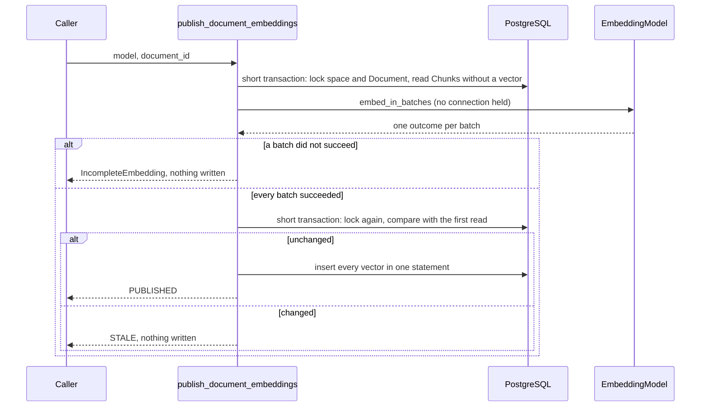

# M04-T05 — Publish embeddings atomically

Source task: [M04-T05](../curriculum/milestones/M04-dense-retrieval/M04-T05-publish-embeddings-atomically.md)

## What you will do

You will write `publish_document_embeddings`, which gives a Document's Chunks their vectors. It calls the model with no database transaction open, then writes every vector at once, and only if the Document has not changed in the meantime. A Document therefore has vectors for all of its current Chunks or for none, never for some.

| Requirement | How this lesson meets it |
|---|---|
| Embed changed Chunks | Only Chunks with no vector in the model's Embedding Space are sent. Chunks kept by an access-only change keep their vectors. |
| Outside long transactions | Two short transactions, one before the model call and one after. No connection is held while the model works. |
| Publish a complete version | Every vector is written in one statement, and only when every batch succeeded. |
| Compare-and-swap protection | The write transaction locks the rows and reads them again. Any difference from the first read means nothing is written. |
| Concurrent-update and provider-failure tests | Integration tests against real PostgreSQL. |

This lesson includes coding: Steps 2–6 change code or docs, while Steps 1 and 7 do not.

Terms used in this lesson:

- **Compare-and-swap (CAS):** write only if the stored state still equals the state you read earlier; otherwise write nothing and report it.
- **Atomic:** the whole write lands, or none of it does.
- **Row lock (`FOR UPDATE`, `FOR SHARE`):** a `SELECT ... FOR UPDATE` keeps other writers that lock the same row waiting until your transaction ends. `FOR SHARE` lets other readers lock the row too, but blocks deleting or changing it.
- **Stale:** the result was computed from a state that no longer exists.

## Before you begin

- **Every writer that changes Chunks already locks the Document's row first:** `reconcile_document`, `tombstone_missing`, and `purge_document_chunks` use `load_document_by_id(..., for_update=True)` or `load_document(..., for_update=True)`. `publish_document` takes the same lock through `ON CONFLICT DO UPDATE`. So holding that lock is enough to stop the Chunks from changing under you.
- **A changed Document gets new Chunk IDs.** `reconcile_document` builds new Chunks with `ChunkId.new()`, and the M04-T04 cascade removes the old Chunks' vectors. "Changed Chunks" therefore means "Chunks with no vector yet". You don't need to compare any text against older text.
- **The model call can be long.** `embed_in_batches` (M04-T03) may run many requests. Holding a transaction during it would hold a pooled connection and the row lock, so every reconcile of that Document would wait.
- **Why the text is part of the comparison.** `publish_document` keeps the Chunk IDs its caller gives and accepts an equal content version. A caller could therefore rewrite a Chunk's text under the same ID. Comparing `(chunk_id, text)` catches that; comparing IDs alone would attach old vectors to new text.
- **No resume, on purpose.** When a batch fails, nothing is written, so the next run pays for every batch again. That costs money but keeps the rule simple: vectors never land for part of a Document.
- **What the adversarial review found.** An independent review attacked an earlier version on the real database and confirmed three breaks, all fixed below with a regression test each:
  - Comparing Chunk IDs without their text let `publish_document` swap the text under the same IDs: old vectors were published on new text.
  - The first read took no lock, so a tombstone committing between reading the Document and reading its Chunks let a tombstoned Document's text reach the provider.
  - A space deleted or recreated during the model call made the insert fail with a raw `IntegrityError`; it now returns `STALE`.

  The closing standards review then found that `_Snapshot.chunks` still showed Chunk text in its `repr`; it now has `repr=False` too, with a test.

  It also confirmed what held: cancellation mid-call or while waiting for the lock leaves no connection or lock behind, no Chunk text appears in errors, tracebacks, or logs, and a 5000-Chunk Document publishes in one statement.
- **Files you will touch:**
  - `src/knowledge_service/identifiers.py`
  - `src/knowledge_service/persistence.py`
  - new `src/knowledge_service/embedding_publication.py`
  - new `tests/test_embedding_publication_integration.py`
  - `docs/architecture.md`
  - a new evidence file

  Leave the task spec and `PROGRESS.md` alone.

## Walkthrough

### Step 1 — No coding in this step: write the invariant and the expected failing check

**Invariant:** a Document's Chunks have vectors in a space for all of them or for none of them. Each vector was computed from the text its Chunk holds now. No connection is held while the model works. The text of a Document that was not available when read is never sent.

**Action:** create `docs/evidence/M04-T05-embedding-publication.md`:

```markdown
# M04-T05 — Embedding publication evidence

Completed: pending

## Invariant

Pending.

## Expected failing check

Before writing the module, predict what happens in each case, and which
status or error you expect: a Document published twice; an access-only
change; a text change; a text change committed while the model works; a
tombstone committed while the model works; two publishers of one Document at
once; the second of three batches failing; a rate limit on the second batch;
a model with no Embedding Space; a tombstoned Document; and a space replaced
while the model works.

## Design

Pending.

## Verification

Pending.

## Reflection

Pending.
```

**Check:** the file holds your invariant and a prediction for every case.

### Step 2 — Coding step: name the space's identity

The space ID becomes a typed identifier, like every other ID in the repository, so a space ID cannot be passed where a Document ID is expected.

**Action:** in `src/knowledge_service/identifiers.py`, add after `class ChunkId`:

```python
class EmbeddingSpaceId(StableIdentifier):
    """Internal identity of an Embedding Space."""
```

**Check:** `uv run pyright` passes.

### Step 3 — Coding step: three persistence helpers

| Function | What it does |
|---|---|
| `load_embedding_space_id` | Finds the space for a model's `(provider, model, dimensions)`, or `None`. It share-locks the row (`with_for_update(read=True)`), so the space cannot be deleted or changed until the transaction ends. |
| `load_embedded_chunk_ids` | The Document's Chunks that already have a vector in the space. |
| `insert_chunk_embeddings` | Writes every vector in one `INSERT` with many rows. It converts each vector with `list(...)`, because pgvector's type refuses the port's tuple (M04-T04). The database still refuses a wrong length. |

**Action:** in `src/knowledge_service/persistence.py`, add `from knowledge_service.embeddings import EmbeddingModelIdentity` before the `from knowledge_service.evaluation import (` line. Add `EmbeddingSpaceId,` after `DocumentId,` in the `knowledge_service.identifiers` import. Then add these functions right before `async def replace_access_grants(`:

```python
async def load_embedding_space_id(
    connection: AsyncConnection, identity: EmbeddingModelIdentity
) -> EmbeddingSpaceId | None:
    """Return the Embedding Space that holds this model identity's vectors.

    The space's row stays share-locked until the transaction ends, so it
    cannot be deleted or changed while vectors are written into it.
    """
    space_id = await connection.scalar(
        sa.select(embedding_spaces.c.space_id)
        .where(
            embedding_spaces.c.provider == identity.provider,
            embedding_spaces.c.model == identity.model,
            embedding_spaces.c.dimensions == identity.dimensions,
        )
        .with_for_update(read=True)
    )
    return None if space_id is None else EmbeddingSpaceId(cast(UUID, space_id))


async def load_embedded_chunk_ids(
    connection: AsyncConnection,
    *,
    document_id: DocumentId,
    space_id: EmbeddingSpaceId,
) -> frozenset[ChunkId]:
    """Return the Chunks of a Document that already have a vector in the space."""
    statement = (
        sa.select(chunk_embeddings.c.chunk_id)
        .join(chunks, chunks.c.chunk_id == chunk_embeddings.c.chunk_id)
        .where(
            chunks.c.document_id == document_id.value,
            chunk_embeddings.c.space_id == space_id.value,
        )
    )
    chunk_ids = await connection.scalars(statement)
    return frozenset(ChunkId(cast(UUID, chunk_id)) for chunk_id in chunk_ids)


async def insert_chunk_embeddings(
    connection: AsyncConnection,
    *,
    space_id: EmbeddingSpaceId,
    dimensions: int,
    vectors: Mapping[ChunkId, Sequence[float]],
    created_at: datetime,
) -> None:
    """Store one vector per Chunk in the space, in one statement.

    The database refuses a vector whose length is not the space's dimensions,
    and pgvector's type needs a list, so each vector is converted here.
    """
    if not vectors:
        return
    await connection.execute(
        sa.insert(chunk_embeddings),
        [
            {
                "chunk_id": chunk_id.value,
                "space_id": space_id.value,
                "dimensions": dimensions,
                "embedding": list(vector),
                "created_at": created_at,
            }
            for chunk_id, vector in vectors.items()
        ],
    )
```

**Check:** `make typecheck lint` passes.

### Step 4 — Coding step: the publication module

The module runs in three parts:

| Part | What happens |
|---|---|
| Read | One short transaction: share-lock the space, lock the Document's row, and take a `_Snapshot`: content version, every Chunk as `(chunk_id, text)`, the Chunks already embedded, and the pending Chunks. A missing or tombstoned Document returns `UNAVAILABLE`, and nothing pending returns `UNCHANGED`. Either way the model is never called. |
| Embed | `embed_in_batches` with no connection held. Any batch that did not succeed raises `IncompleteEmbedding` with counts and error class names only. |
| Publish | A second short transaction locks the same rows and takes a new snapshot. If the space ID or the snapshot differs, it returns `STALE` and writes nothing. Otherwise it inserts every vector and returns `PUBLISHED`. |

Decisions:

- **The snapshot is the CAS key.** `_Snapshot` is a frozen dataclass, so `current != snapshot` compares its fields. `pending` is left out with `compare=False` because it follows from the other fields. Both `chunks` and `pending` hold Chunk text, so both have `repr=False`: no log of a snapshot can show it.
- **The first read locks the row too.** Without the lock, its three `SELECT`s could see three states of the Document. A tombstone can still commit after the read; the publish step catches that.
- **A stale result is a status, not an error.** Under concurrent edits it is expected, and the next run embeds the new Chunks. A failed batch, a missing space, and a Chunk the model can't take (`EmbeddingInputRejected`, from the batcher) are errors.
- **The module does not care whether the space is current.** M04-T10 will fill a new, not-yet-current space the same way.

**Action:** create `src/knowledge_service/embedding_publication.py`:

```python
"""Embed a Document's new Chunks, then publish all their vectors at once.

Calling an embedding model takes seconds, so it never runs inside a database
transaction: a transaction held open that long would keep a pooled
connection busy and block every writer waiting for the Document's row. The
work is therefore split in three:

1. **Read.** A short transaction locks the Document's row and records what
   it looks like now: its content version, its Chunks with their text, and
   which of them still lack a vector in the model's Embedding Space. Only an
   available Document is read, so the text of a Document tombstoned before
   the read is never sent to the provider.
2. **Embed.** With no connection held, the Chunks' texts go to the model in
   batches.
3. **Publish.** A second short transaction locks the Document's row and the
   space's row again and compares them with what step 1 saw. If anything
   changed, nothing is written and the caller is told the result is stale;
   otherwise every vector is written in one statement. This is
   compare-and-swap: the write happens only if the state is still the one it
   was computed from.

A Document is therefore never left with vectors for some of its Chunks: when
any batch fails, nothing is written, and the next run embeds them all again.
"""

from collections.abc import Mapping, Sequence
from dataclasses import dataclass, field
from datetime import datetime
from enum import StrEnum
from uuid import UUID

from sqlalchemy.ext.asyncio import AsyncConnection

from knowledge_service.chunks import Chunk
from knowledge_service.database import DatabaseRuntime
from knowledge_service.documents import ContentVersion, DocumentAvailability
from knowledge_service.embedding_batches import (
    BatchStatus,
    embed_in_batches,
    vectors_by_position,
)
from knowledge_service.embeddings import EmbeddingModel, Vector
from knowledge_service.identifiers import ChunkId, DocumentId, EmbeddingSpaceId
from knowledge_service.persistence import (
    insert_chunk_embeddings,
    load_chunks,
    load_document_by_id,
    load_embedded_chunk_ids,
    load_embedding_space_id,
)


class EmbeddingPublicationError(Exception):
    """Base error for publishing a Document's embeddings."""


class UnknownEmbeddingSpace(EmbeddingPublicationError):
    """No Embedding Space matches the model's identity; nothing was sent."""


class IncompleteEmbedding(EmbeddingPublicationError):
    """At least one batch did not succeed, so no vector was written.

    `errors` holds error class names only, never text, so it is safe to log.
    """

    def __init__(self, *, failed: int, deferred: int, errors: Sequence[str]) -> None:
        self.failed = failed
        self.deferred = deferred
        self.errors = tuple(sorted(set(errors)))
        super().__init__(
            f"embedding incomplete: {failed} batches failed, {deferred} deferred"
            f" ({', '.join(self.errors) or 'no error'})"
        )


class EmbeddingPublicationStatus(StrEnum):
    """How one publication attempt ended."""

    PUBLISHED = "published"
    UNCHANGED = "unchanged"
    STALE = "stale"
    UNAVAILABLE = "unavailable"


@dataclass(frozen=True, slots=True)
class EmbeddingPublication:
    """What one attempt did; `embedded` counts the vectors written."""

    document_id: DocumentId
    status: EmbeddingPublicationStatus
    embedded: int = 0


@dataclass(frozen=True, slots=True)
class _Snapshot:
    """The state the vectors are computed from, compared again before writing.

    Two snapshots are equal when the version, the Chunks with their text, and
    the embedded Chunks are; `pending` follows from those.
    """

    content_version: ContentVersion
    # The text is part of the key: vectors are only valid for the text they
    # were computed from, even if a Chunk ID were reused. `chunks` and
    # `pending` hold Document text, so both are kept out of repr, and logging
    # a snapshot never shows it.
    chunks: frozenset[tuple[ChunkId, str]] = field(repr=False)
    embedded: frozenset[ChunkId]
    pending: tuple[Chunk, ...] = field(repr=False, compare=False)


async def publish_document_embeddings(
    runtime: DatabaseRuntime,
    model: EmbeddingModel,
    *,
    document_id: DocumentId,
    concurrency: int,
    request_id: UUID,
    timeout_seconds: float,
    now: datetime,
) -> EmbeddingPublication:
    """Embed the Document's Chunks that lack a vector, then publish them together.

    Raises `UnknownEmbeddingSpace` before sending anything when no space holds
    the model's identity, `EmbeddingInputRejected` when a Chunk is too long
    for the model, and `IncompleteEmbedding` when any batch fails; in every
    case nothing is written.
    """
    async with runtime.transaction() as connection:
        space_id = await load_embedding_space_id(connection, model.identity)
        if space_id is None:
            raise UnknownEmbeddingSpace("no embedding space matches the model")
        snapshot = await _snapshot(
            connection, document_id=document_id, space_id=space_id
        )
    if snapshot is None:
        return EmbeddingPublication(
            document_id=document_id, status=EmbeddingPublicationStatus.UNAVAILABLE
        )
    if not snapshot.pending:
        return EmbeddingPublication(
            document_id=document_id, status=EmbeddingPublicationStatus.UNCHANGED
        )

    vectors = await _embed(
        model,
        snapshot.pending,
        concurrency=concurrency,
        request_id=request_id,
        timeout_seconds=timeout_seconds,
    )

    # Compare-and-swap: lock and read again, and write only if nothing changed.
    async with runtime.transaction() as connection:
        current_space = await load_embedding_space_id(connection, model.identity)
        current = await _snapshot(
            connection, document_id=document_id, space_id=space_id
        )
        if current_space != space_id or current is None or current != snapshot:
            return EmbeddingPublication(
                document_id=document_id, status=EmbeddingPublicationStatus.STALE
            )
        await insert_chunk_embeddings(
            connection,
            space_id=space_id,
            dimensions=model.identity.dimensions,
            vectors=vectors,
            created_at=now,
        )
    return EmbeddingPublication(
        document_id=document_id,
        status=EmbeddingPublicationStatus.PUBLISHED,
        embedded=len(vectors),
    )


async def _snapshot(
    connection: AsyncConnection,
    *,
    document_id: DocumentId,
    space_id: EmbeddingSpaceId,
) -> _Snapshot | None:
    """Read the Document's embedding state, or None if it is not available.

    The row stays locked until the transaction ends. Reconciling, tombstoning,
    and purging lock it too before they touch Chunks, so all three reads see
    one state of the Document.
    """
    document = await load_document_by_id(
        connection, document_id=document_id, for_update=True
    )
    if document is None or document.availability is not DocumentAvailability.AVAILABLE:
        return None
    stored = await load_chunks(connection, document_id=document_id)
    embedded = await load_embedded_chunk_ids(
        connection, document_id=document_id, space_id=space_id
    )
    return _Snapshot(
        content_version=document.content_version,
        chunks=frozenset((chunk.chunk_id, chunk.text) for chunk in stored),
        embedded=embedded,
        pending=tuple(chunk for chunk in stored if chunk.chunk_id not in embedded),
    )


async def _embed(
    model: EmbeddingModel,
    pending: Sequence[Chunk],
    *,
    concurrency: int,
    request_id: UUID,
    timeout_seconds: float,
) -> Mapping[ChunkId, Vector]:
    """Return one vector per pending Chunk, or raise if any batch did not succeed."""
    outcomes = await embed_in_batches(
        model,
        [chunk.text for chunk in pending],
        concurrency=concurrency,
        request_id=request_id,
        timeout_seconds=timeout_seconds,
    )
    unfinished = [o for o in outcomes if o.status is not BatchStatus.SUCCEEDED]
    if unfinished:
        raise IncompleteEmbedding(
            failed=sum(o.status is BatchStatus.FAILED for o in unfinished),
            deferred=sum(o.status is BatchStatus.DEFERRED for o in unfinished),
            errors=[o.error for o in unfinished if o.error is not None],
        )
    by_position = vectors_by_position(outcomes)
    return {chunk.chunk_id: by_position[index] for index, chunk in enumerate(pending)}
```

**Check:** `make typecheck lint` passes, and `uv run pytest -m "not integration and not live" -q` still passes.

### Step 5 — Coding step: tests

`ControlledModel` wraps the existing `FakeEmbeddingModel`. It sends one Chunk per call, and it can pause every call until the test sets `release`, or fail one chosen call. Pausing lets a test change the database while the model "works". `HANDBOOK` has three long sections, so the Document has three Chunks and three batches. `MARKER` is planted in the first section and must never show up in an error or a log.

| Test | What it proves |
|---|---|
| `test_every_chunk_gets_its_vector_in_one_publication` | Success: each stored vector is the model's vector for that Chunk's text, within 32-bit precision. |
| `test_a_published_document_is_not_embedded_again`, `test_only_changed_text_is_embedded_again` | Only changed Chunks are sent; an access-only change sends nothing. |
| `test_no_connection_is_held_while_the_model_works` | The pool has no connection checked out while the model works. |
| `test_a_content_change_during_embedding_publishes_nothing`, `test_a_tombstone_during_embedding_publishes_nothing`, `test_two_publishers_of_one_document_write_one_set_of_vectors` | Concurrent updates: `STALE`, nothing written, and the edit did not wait for a lock. |
| `test_new_text_under_the_same_chunk_ids_publishes_nothing`, `test_a_tombstone_waits_until_the_snapshot_is_read`, `test_a_space_replaced_during_embedding_publishes_nothing` | The three review breaks. |
| `test_a_failed_batch_publishes_no_vector` | Provider failure: the first batch succeeded, yet nothing is stored. |
| `test_a_model_without_a_space_is_refused_before_sending`, `test_a_tombstoned_document_is_never_sent` | Typed denial and the authorization rule: the model is never called. |
| `test_errors_and_logs_carry_no_chunk_text`, `test_a_snapshot_never_shows_chunk_text` | Telemetry: the marker is in no error, no log record, and no printed snapshot. |

`test_a_tombstone_waits_until_the_snapshot_is_read` swaps in a `load_chunks` that starts a tombstone and gives it 0.3 seconds. With the lock, the tombstone is still waiting; without the lock, it commits in milliseconds and the assertion fails.

**Action:** create `tests/test_embedding_publication_integration.py`:

```python
"""Real PostgreSQL tests for publishing a Document's embeddings atomically."""

import asyncio
import logging
from collections.abc import AsyncIterator, Sequence
from dataclasses import replace
from datetime import UTC, datetime, timedelta
from typing import cast
from uuid import UUID, uuid4

import pytest
import sqlalchemy as sa
from pydantic import SecretStr
from sqlalchemy.ext.asyncio import AsyncConnection
from sqlalchemy.pool import QueuePool

import knowledge_service.embedding_publication as embedding_publication
from fakes import FakeEmbeddingModel
from knowledge_service.access import Subject
from knowledge_service.database import DatabaseRuntime, create_database_runtime
from knowledge_service.deletions import tombstone_missing
from knowledge_service.embedding_publication import (
    EmbeddingPublication,
    EmbeddingPublicationStatus,
    IncompleteEmbedding,
    UnknownEmbeddingSpace,
    publish_document_embeddings,
)
from knowledge_service.embeddings import (
    EmbeddingBatch,
    EmbeddingError,
    EmbeddingLimits,
    EmbeddingModelIdentity,
    EmbeddingRateLimited,
    EmbeddingUnavailable,
)
from knowledge_service.identifiers import DocumentId, EmbeddingSpaceId, SourceId
from knowledge_service.normalization import NormalizedDocument, normalize
from knowledge_service.persistence import (
    chunk_embeddings,
    chunks,
    embedding_spaces,
    load_chunks,
    load_document_by_id,
)
from knowledge_service.publishing import Publication, publish_document
from knowledge_service.reconciliation import reconcile_document
from knowledge_service.settings import Settings
from knowledge_service.sources import SourceAccess, SourceRecord

SOURCE_ID = SourceId.parse("00000000-0000-0000-0000-000000000011")
OBSERVED_AT = datetime(2026, 10, 23, 9, 0, tzinfo=UTC)
NOW = OBSERVED_AT + timedelta(minutes=5)
# Planted in the text; it must never appear in an error or a log record.
MARKER = "zebramarker"

INSERT_SOURCE = sa.text(
    "INSERT INTO sources (source_id, kind, location, display_name, enabled,"
    " created_at, updated_at) VALUES (:source_id, 'local_directory',"
    " '/srv/handbook', 'Handbook', true, now(), now())"
)


def section(heading: str, word: str) -> str:
    return f"## {heading}\n\n" + " ".join(f"{word}{i}" for i in range(150)) + ".\n\n"


# Three sections long enough to become three Chunks.
HANDBOOK = (
    "# Handbook\n\n"
    + section("Leave", MARKER)
    + section("Equipment", "laptop")
    + section("Travel", "trip")
)
EDITED = HANDBOOK.replace("trip149", "flight")


class ControlledModel:
    """The fake model, one Chunk per call, that can pause and fail one call.

    `started` is set when a call reaches the model. With `paused`, every call
    then waits for `release`, so a test can act while the model works.
    """

    def __init__(
        self,
        *,
        dimensions: int = 8,
        paused: bool = False,
        fail_on: int | None = None,
        error: EmbeddingError | None = None,
    ) -> None:
        self._model = FakeEmbeddingModel(
            dimensions=dimensions,
            limits=EmbeddingLimits(
                max_inputs=1, max_input_tokens=200, max_batch_tokens=200
            ),
        )
        self._fail_on = fail_on
        self._error = error
        self.started = asyncio.Event()
        self.release = asyncio.Event()
        if not paused:
            self.release.set()
        self.calls: list[tuple[str, ...]] = []

    @property
    def identity(self) -> EmbeddingModelIdentity:
        return self._model.identity

    @property
    def limits(self) -> EmbeddingLimits:
        return self._model.limits

    def count_tokens(self, text: str) -> int:
        return self._model.count_tokens(text)

    async def embed(
        self, texts: Sequence[str], *, request_id: UUID, timeout_seconds: float
    ) -> EmbeddingBatch:
        self.calls.append(tuple(texts))
        self.started.set()
        await self.release.wait()
        if len(self.calls) == self._fail_on and self._error is not None:
            raise self._error
        return await self._model.embed(
            texts, request_id=request_id, timeout_seconds=timeout_seconds
        )


@pytest.fixture
async def runtime(migrated_database: str) -> AsyncIterator[DatabaseRuntime]:
    runtime = create_database_runtime(
        Settings(database_url=SecretStr(migrated_database))
    )
    async with runtime.transaction() as connection:
        await connection.execute(INSERT_SOURCE, {"source_id": SOURCE_ID.value})
        await connection.execute(
            sa.insert(embedding_spaces).values(
                space_id=uuid4(),
                provider="fake",
                model="fake-embedding",
                dimensions=8,
                is_current=True,
                created_at=OBSERVED_AT,
            )
        )
    try:
        yield runtime
    finally:
        await runtime.dispose()


def markdown(text: str) -> NormalizedDocument:
    outcome = normalize(
        SourceRecord.present(
            external_id="handbook.md",
            version="v1",
            media_type="text/markdown",
            content=text.encode(),
            access=SourceAccess(public=True),
        ),
        source_id=SOURCE_ID,
    )
    assert isinstance(outcome, NormalizedDocument)
    return outcome


async def a_document(
    runtime: DatabaseRuntime,
    text: str = HANDBOOK,
    *,
    hours_later: int = 0,
) -> DocumentId:
    reconciled = await reconcile_document(
        runtime,
        markdown(text),
        readers=[Subject.public()],
        observed_at=OBSERVED_AT + timedelta(hours=hours_later),
    )
    return reconciled.document.document_id


async def publish(
    runtime: DatabaseRuntime, model: ControlledModel, document_id: DocumentId
) -> EmbeddingPublication:
    return await publish_document_embeddings(
        runtime,
        model,
        document_id=document_id,
        concurrency=1,
        request_id=UUID(int=1),
        timeout_seconds=5.0,
        now=NOW,
    )


async def stored(runtime: DatabaseRuntime) -> dict[str, list[float]]:
    """Map the text of each Chunk that has a vector to that vector."""
    async with runtime.transaction() as connection:
        rows = await connection.execute(
            sa.select(chunks.c.text, chunk_embeddings.c.embedding).join(
                chunks, chunks.c.chunk_id == chunk_embeddings.c.chunk_id
            )
        )
        return {text: [float(x) for x in vector] for text, vector in rows}


async def chunk_texts(runtime: DatabaseRuntime) -> set[str]:
    async with runtime.transaction() as connection:
        return set(await connection.scalars(sa.select(chunks.c.text)))


@pytest.mark.integration
async def test_every_chunk_gets_its_vector_in_one_publication(
    runtime: DatabaseRuntime,
) -> None:
    document_id = await a_document(runtime)
    model = ControlledModel()

    result = await publish(runtime, model, document_id)

    texts = await chunk_texts(runtime)
    vectors = await stored(runtime)
    assert len(texts) == 3
    assert result.status is EmbeddingPublicationStatus.PUBLISHED
    assert result.embedded == 3
    assert set(vectors) == texts
    for text in texts:
        (expected,) = (
            await model.embed([text], request_id=UUID(int=2), timeout_seconds=5.0)
        ).vectors
        # pgvector stores 32-bit floats, so compare within their precision.
        assert vectors[text] == pytest.approx(expected, abs=1e-6)


@pytest.mark.integration
async def test_a_published_document_is_not_embedded_again(
    runtime: DatabaseRuntime,
) -> None:
    document_id = await a_document(runtime)
    await publish(runtime, ControlledModel(), document_id)
    model = ControlledModel()

    result = await publish(runtime, model, document_id)

    assert result.status is EmbeddingPublicationStatus.UNCHANGED
    assert model.calls == []


@pytest.mark.integration
async def test_only_changed_text_is_embedded_again(runtime: DatabaseRuntime) -> None:
    document_id = await a_document(runtime)
    await publish(runtime, ControlledModel(), document_id)

    # Only who may read it changes: the Chunks and their vectors stay.
    await reconcile_document(
        runtime,
        markdown(HANDBOOK),
        readers=[],
        observed_at=OBSERVED_AT + timedelta(hours=1),
    )
    access_only = ControlledModel()
    unchanged = await publish(runtime, access_only, document_id)
    # The text changes: new Chunks replace the old ones and their vectors.
    await a_document(runtime, EDITED, hours_later=2)
    edited = ControlledModel()
    republished = await publish(runtime, edited, document_id)

    assert unchanged.status is EmbeddingPublicationStatus.UNCHANGED
    assert access_only.calls == []
    assert republished.status is EmbeddingPublicationStatus.PUBLISHED
    assert len(edited.calls) == 3
    assert set(await stored(runtime)) == await chunk_texts(runtime)


@pytest.mark.integration
async def test_no_connection_is_held_while_the_model_works(
    runtime: DatabaseRuntime,
) -> None:
    document_id = await a_document(runtime)
    model = ControlledModel(paused=True)

    task = asyncio.create_task(publish(runtime, model, document_id))
    await model.started.wait()
    held = cast(QueuePool, runtime.engine.pool).checkedout()
    model.release.set()
    result = await task

    assert held == 0
    assert result.status is EmbeddingPublicationStatus.PUBLISHED


@pytest.mark.integration
async def test_a_content_change_during_embedding_publishes_nothing(
    runtime: DatabaseRuntime,
) -> None:
    document_id = await a_document(runtime)
    model = ControlledModel(paused=True)

    task = asyncio.create_task(publish(runtime, model, document_id))
    await model.started.wait()
    # The edit commits while the model works: no lock is held to wait for.
    async with asyncio.timeout(5):
        await a_document(runtime, EDITED, hours_later=1)
    model.release.set()
    result = await task

    assert result.status is EmbeddingPublicationStatus.STALE
    assert await stored(runtime) == {}
    # The next run embeds the new text.
    retry = await publish(runtime, ControlledModel(), document_id)
    assert retry.status is EmbeddingPublicationStatus.PUBLISHED
    assert set(await stored(runtime)) == await chunk_texts(runtime)


@pytest.mark.integration
async def test_a_tombstone_during_embedding_publishes_nothing(
    runtime: DatabaseRuntime,
) -> None:
    document_id = await a_document(runtime)
    model = ControlledModel(paused=True)

    task = asyncio.create_task(publish(runtime, model, document_id))
    await model.started.wait()
    await tombstone_missing(
        runtime,
        source_id=SOURCE_ID,
        seen=set(),
        observed_at=OBSERVED_AT + timedelta(hours=1),
    )
    model.release.set()

    assert (await task).status is EmbeddingPublicationStatus.STALE
    assert await stored(runtime) == {}


@pytest.mark.integration
async def test_two_publishers_of_one_document_write_one_set_of_vectors(
    runtime: DatabaseRuntime,
) -> None:
    document_id = await a_document(runtime)
    first, second = ControlledModel(paused=True), ControlledModel(paused=True)

    tasks = [
        asyncio.create_task(publish(runtime, first, document_id)),
        asyncio.create_task(publish(runtime, second, document_id)),
    ]
    await first.started.wait()
    await second.started.wait()
    first.release.set()
    second.release.set()
    results = await asyncio.gather(*tasks)

    assert sorted(result.status for result in results) == [
        EmbeddingPublicationStatus.PUBLISHED,
        EmbeddingPublicationStatus.STALE,
    ]
    assert set(await stored(runtime)) == await chunk_texts(runtime)


@pytest.mark.integration
async def test_new_text_under_the_same_chunk_ids_publishes_nothing(
    runtime: DatabaseRuntime,
) -> None:
    document_id = await a_document(runtime)
    model = ControlledModel(paused=True)

    task = asyncio.create_task(publish(runtime, model, document_id))
    await model.started.wait()
    # `publish_document` keeps the caller's Chunk IDs and accepts the same
    # content version, so only the text tells the old Chunks from the new.
    async with runtime.transaction() as connection:
        document = await load_document_by_id(connection, document_id=document_id)
        assert document is not None
        rewritten = tuple(
            replace(chunk, text=f"Rewritten section {chunk.ordinal}.")
            for chunk in await load_chunks(connection, document_id=document_id)
        )
        await publish_document(
            connection, Publication(document=document, chunks=rewritten)
        )
    model.release.set()

    assert (await task).status is EmbeddingPublicationStatus.STALE
    assert await stored(runtime) == {}


@pytest.mark.integration
async def test_a_tombstone_waits_until_the_snapshot_is_read(
    runtime: DatabaseRuntime,
    monkeypatch: pytest.MonkeyPatch,
) -> None:
    document_id = await a_document(runtime)
    tombstoning: list[asyncio.Task[object]] = []

    async def load_chunks_while_tombstoning(
        connection: AsyncConnection, *, document_id: DocumentId
    ) -> object:
        if not tombstoning:
            tombstoning.append(
                asyncio.create_task(
                    tombstone_missing(
                        runtime,
                        source_id=SOURCE_ID,
                        seen=set(),
                        observed_at=OBSERVED_AT + timedelta(hours=1),
                    )
                )
            )
            # Give the tombstone time to commit, if nothing holds it back.
            await asyncio.sleep(0.3)
            assert not tombstoning[0].done(), "the tombstone did not wait"
        return await load_chunks(connection, document_id=document_id)

    monkeypatch.setattr(
        embedding_publication, "load_chunks", load_chunks_while_tombstoning
    )
    result = await publish(runtime, ControlledModel(), document_id)
    await tombstoning[0]

    # The text was read while the Document was available; the write saw the
    # tombstone and published nothing.
    assert result.status is EmbeddingPublicationStatus.STALE
    assert await stored(runtime) == {}


@pytest.mark.integration
async def test_a_space_replaced_during_embedding_publishes_nothing(
    runtime: DatabaseRuntime,
) -> None:
    document_id = await a_document(runtime)
    model = ControlledModel(paused=True)

    task = asyncio.create_task(publish(runtime, model, document_id))
    await model.started.wait()
    # The space is deleted and created again for the same model identity.
    async with runtime.transaction() as connection:
        await connection.execute(sa.delete(embedding_spaces))
        await connection.execute(
            sa.insert(embedding_spaces).values(
                space_id=uuid4(),
                provider="fake",
                model="fake-embedding",
                dimensions=8,
                is_current=True,
                created_at=OBSERVED_AT,
            )
        )
    model.release.set()

    assert (await task).status is EmbeddingPublicationStatus.STALE
    assert await stored(runtime) == {}


@pytest.mark.integration
@pytest.mark.parametrize(
    ("error", "deferred"),
    [(EmbeddingUnavailable(), 0), (EmbeddingRateLimited(), 1)],
    ids=["one-batch-fails", "the-rest-are-deferred"],
)
async def test_a_failed_batch_publishes_no_vector(
    runtime: DatabaseRuntime,
    error: EmbeddingError,
    deferred: int,
) -> None:
    document_id = await a_document(runtime)
    model = ControlledModel(fail_on=2, error=error)

    with pytest.raises(IncompleteEmbedding) as raised:
        await publish(runtime, model, document_id)

    # The first batch succeeded, yet none of its vectors were stored.
    assert raised.value.failed == 1
    assert raised.value.deferred == deferred
    assert raised.value.errors == (type(error).__name__,)
    assert await stored(runtime) == {}


@pytest.mark.integration
async def test_a_model_without_a_space_is_refused_before_sending(
    runtime: DatabaseRuntime,
) -> None:
    document_id = await a_document(runtime)
    model = ControlledModel(dimensions=4)

    with pytest.raises(UnknownEmbeddingSpace):
        await publish(runtime, model, document_id)

    assert model.calls == []


@pytest.mark.integration
async def test_a_tombstoned_document_is_never_sent(runtime: DatabaseRuntime) -> None:
    document_id = await a_document(runtime)
    await tombstone_missing(
        runtime,
        source_id=SOURCE_ID,
        seen=set(),
        observed_at=OBSERVED_AT + timedelta(hours=1),
    )
    model = ControlledModel()

    result = await publish(runtime, model, document_id)

    assert result.status is EmbeddingPublicationStatus.UNAVAILABLE
    assert model.calls == []


@pytest.mark.integration
async def test_errors_and_logs_carry_no_chunk_text(
    runtime: DatabaseRuntime,
    caplog: pytest.LogCaptureFixture,
) -> None:
    document_id = await a_document(runtime)
    caplog.set_level(logging.DEBUG)

    with pytest.raises(IncompleteEmbedding) as raised:
        await publish(
            runtime,
            ControlledModel(fail_on=1, error=EmbeddingUnavailable()),
            document_id,
        )

    assert MARKER not in str(raised.value)
    assert MARKER not in repr(raised.value)
    assert MARKER not in caplog.text


@pytest.mark.integration
async def test_a_snapshot_never_shows_chunk_text(
    runtime: DatabaseRuntime,
    monkeypatch: pytest.MonkeyPatch,
) -> None:
    document_id = await a_document(runtime)
    # The snapshot is private, so record the ones the real call takes.
    take_snapshot = embedding_publication._snapshot  # pyright: ignore[reportPrivateUsage]
    snapshots: list[object] = []

    async def recording(
        connection: AsyncConnection,
        *,
        document_id: DocumentId,
        space_id: EmbeddingSpaceId,
    ) -> object:
        snapshot = await take_snapshot(
            connection, document_id=document_id, space_id=space_id
        )
        snapshots.append(snapshot)
        return snapshot

    monkeypatch.setattr(embedding_publication, "_snapshot", recording)
    await publish(runtime, ControlledModel(), document_id)

    assert len(snapshots) == 2
    assert all(MARKER not in repr(snapshot) for snapshot in snapshots)
```

**Check:** with the database URL set, `uv run pytest tests/test_embedding_publication_integration.py -q` gives 16 passed. `make test-integration` finds the URL itself.

Then break the module on purpose, one change at a time, and undo each:

| Break | Test that must fail |
|---|---|
| In `_snapshot`, build `chunks` from `(chunk.chunk_id, "")` | `test_new_text_under_the_same_chunk_ids_publishes_nothing` |
| In `_snapshot`, pass `for_update=False` | `test_a_tombstone_waits_until_the_snapshot_is_read` |
| Drop `current_space != space_id or` from the publish check | `test_a_space_replaced_during_embedding_publishes_nothing` |
| Replace the whole publish check's condition with `False` | `test_a_content_change_during_embedding_publishes_nothing` |
| In `_embed`, skip the `raise` and keep only the vectors that exist | `test_a_failed_batch_publishes_no_vector` |

### Step 6 — Coding step: update the architecture doc

The target diagram under `### Synchronization` already shows "embed changed chunks only", and the M03 section says nothing embeds yet. Add what now exists.

**Action:** in `docs/architecture.md`, add this section right before `### Answering`:

````markdown
#### Embedding publication as built in M04

`publish_document_embeddings` runs after a Document is reconciled. It embeds
the Chunks that lack a vector in the model's Embedding Space with no
database connection held, then writes all their vectors only if the
Document is still as it was read.



Between a content change and the next publication, the Document's new Chunks
have no vectors, so dense search does not find it yet; it never finds some
of its Chunks and not others.
````

**Check:** `make docs-check` passes.

### Step 7 — No coding in this step: run the gates, then record evidence

**Action:** with `KNOWLEDGE_SERVICE_TEST_DATABASE_URL` set (or through `make`, which finds it), run in order:

```bash
uv run pytest tests/test_embedding_publication_integration.py -q
make format-check lint typecheck
uv run pytest -m "not integration and not live" -q
make test-integration
make check
make docs-check
git diff --check
```

Fill in `## Design`, `## Verification`, and `## Reflection`. In Design, record these limits for later lessons:

- **A gap after every edit.** Between a reconcile and the next publication, the new Chunks have no vectors, so dense search won't find the Document. M04-T06 should know that "no vectors" can mean "not published yet".
- **No resume.** A failed batch or a stale result throws away vectors already paid for. Under constant edits a large Document may never finish. A later lesson could store finished batches outside the current state.
- **One Chunk the model cannot take blocks its Document on every run,** and `EmbeddingInputRejected.index` counts pending Chunks, not ordinals.
- **Memory grows with the Document:** all its texts and vectors are held at once.
- **Nothing calls this yet.** `synchronize_source` does not embed; a scheduler or worker will.

Answer these in your own words:

1. Why does the model call happen between two transactions instead of inside one? What would go wrong for a reconcile of the same Document if it were inside one?
2. The publish step reads the Document again and compares. Why is checking the content version alone not enough? Give a case from the tests where the version stayed the same.
3. Why does the first read lock the Document's row when the second read checks everything again anyway?
4. When one of three batches fails, the other two vectors are thrown away. Why is that better here than storing two of three? What does it cost?
5. Why is `STALE` a status while a failed batch raises an error? Who reacts to each, and how?
6. Which test would let a real bug reach production if you deleted it? Name it and describe the bug.

**Check:** every command passes, and the evidence explains the workflow in your words.

## Completion checklist

- [ ] `EmbeddingSpaceId` exists, and the three persistence helpers are in `persistence.py`.
- [ ] `publish_document_embeddings` embeds only Chunks without a vector, with no connection held during the model call.
- [ ] It writes every vector in one statement, only when every batch succeeded and the Document, its Chunk texts, and the space are unchanged.
- [ ] A changed, tombstoned, or concurrently published Document gives `STALE`; a failed batch gives `IncompleteEmbedding`; a missing space gives `UnknownEmbeddingSpace`; a tombstoned Document is never sent.
- [ ] The 16 integration tests pass, and each deliberate break fails its named test.
- [ ] `docs/architecture.md` shows the embedding publication flow.
- [ ] Format, lint, types, the deterministic suite, the integration suite, `make check`, and `make docs-check` pass.
- [ ] The evidence file holds your invariant, predictions, design, verification, and your own reflection.

When you're done, share your work or any error you hit, and I'll review it.
