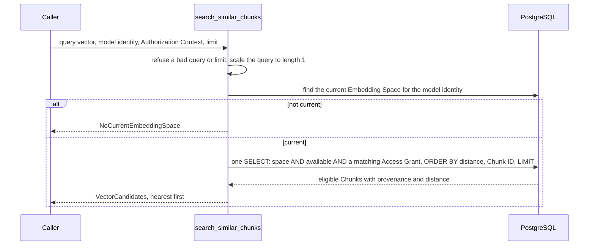

# M04-T06 — Implement authorizable vector search

Source task: [M04-T06](../curriculum/milestones/M04-dense-retrieval/M04-T06-implement-authorizable-vector-search.md)

## What you will do

You will write `search_similar_chunks`. It takes a query vector and the reader's identity and returns the nearest Chunks that reader may see, with their provenance and distance. The database drops every Chunk the reader may not see in the same SQL statement that ranks the rest, so a forbidden Chunk is never ranked and never leaves PostgreSQL.

| Requirement | How this lesson meets it |
|---|---|
| Query nearest Chunk vectors | One `SELECT` orders the current Embedding Space's vectors by cosine distance and cuts to `limit`. |
| A parameterized predicate slot | `eligible_chunks_predicate(context)` builds the eligibility condition from bound parameters. `vector_search_statement` takes it as its `eligibility` argument and puts it in the `WHERE`. |
| Availability and Access Grants before ranking | The predicate requires an available Document and a matching grant. It sits in the same `WHERE` as the space, so PostgreSQL applies it before `ORDER BY` and `LIMIT`. |
| Tests: success, highest-risk edge, typed failure or denial | Real-database tests for ranking with provenance, a nearer forbidden Chunk with `limit=1`, every grant kind, revocation and tombstones, and `NoCurrentEmbeddingSpace`. |
| Stable provenance with distance | `VectorCandidate` carries Chunk, Document and Source IDs, external ID, title, version, ordinal, heading path, anchor, text and distance. Ties are ordered by Chunk ID. |
| No sensitive text in telemetry | Text fields are kept out of `repr`, and errors carry no text. A unit test plants a marker. |

This lesson includes coding: Steps 2–7 change code or docs, while Steps 1 and 8 do not.

Terms used in this lesson:

- **Eligible:** a Chunk the reader may receive. Its Document is available and at least one of its Access Grants names everyone, the reader, or one of the reader's Groups.
- **Predicate:** a condition in a SQL `WHERE`, here built as a SQLAlchemy expression.
- **Bound parameter:** a value sent to the database separately from the SQL text. It can never change what the SQL means.
- **Cosine distance:** `1 - cos(angle)` between two vectors. It is 0 for the same direction and up to 2 for the opposite one, and it ignores length. pgvector writes it as `<=>`.
- **Authorization Context:** the verified User and their Groups for one request (see `CONTEXT.md`).

## Before you begin

- **There is no `AuthorizationContext` type yet.** `CONTEXT.md` names it and `docs/security.md` relies on it. You add it to `access.py` next to `Subject`. Real identity verification arrives with OIDC in M07; here the caller builds the context.
- **Access Grants already exist.** `access_grants` holds one row per Document and subject: `subject_kind` is `public`, `user` or `group`, and `subject_id` is null only for `public`. User and Group IDs are both UUIDs, so the predicate must check the kind as well as the ID.
- **The search takes a connection, not the runtime.** ADR 0012 says repository functions take an `AsyncConnection` and the workflow owns the transaction. Later, lexical and dense search can then run in one transaction.
- **No vector index exists yet.** Without one, PostgreSQL scans every vector of the space, filters, sorts and cuts, so the filter really runs before ranking and the results are exact. An approximate index (HNSW) can return fewer than `limit` rows after filtering. That trade-off is M04-T11's to measure; this lesson keeps the exact scan.
- **Scope.** Limit and distance semantics are M04-T07, and Source, language and recency filters are M04-T08. This lesson only caps `limit` at `MAX_CANDIDATES = 100` so one search stays bounded.
- **What the adversarial review found.** An independent review attacked an earlier version against the real database. It confirmed three breaks, all in query checking, and all are fixed below with regression tests that fail against the old code:
  - `(1e39, 0, 0)` is a finite Python float but overflows pgvector's 32-bit floats. It raised a raw `DataError` whose message included the bound user and group IDs.
  - Tiny or huge but finite queries such as `(1e-46, 0, 0)` and `(1e20, 1e20, 0)` returned NaN or wrong distances, because pgvector computes lengths in 32-bit floats.
  - `(10**400, 0, 0)`, `("1", 0, 0)`, `None`, or an iterator crashed with `OverflowError` or `TypeError`.

  The fix scales every query to length 1 in Python, which leaves cosine distance unchanged, and refuses anything that is not a tuple of finite numbers.

  It also confirmed what held. A fuzz test with random grants, contexts, tombstones, revocations, ties and limits, checked against a plain-Python model of the rules, returned only eligible Chunks. It always returned `min(limit, eligible)` of them, in the right order, with correct distances. No text appeared in a `repr`, an error or a log, and no value appeared as a literal in the SQL.
- **Known limit, not fixed here.** A stored vector can still produce wrong distances: an all-zero vector gives NaN, and one with values near 3e38 gives a wrong distance. `_checked_vector` in `embeddings.py` already refuses all-zero provider vectors, and real embedding values are small. Record it as a risk in your evidence.

## Walkthrough

### Step 1 — No coding in this step: write the invariant and the expected failing check

Create `docs/evidence/M04-T06-vector-search.md` before editing any code. Start it with this text, then adjust the wording to your own:

```markdown
# M04-T06 — Authorizable vector search evidence

## Invariant

Vector search returns a Chunk only if its Document is available and at least
one of its Access Grants names everyone, the reader's User, or one of the
reader's Groups. That check runs in the same SQL statement as the ranking,
before ORDER BY and LIMIT, so an ineligible Chunk is never ranked, never
counts toward the limit, and never leaves the database. Only vectors of the
current Embedding Space are compared, and only with a query from its model.

## Expected failing check

Before the module exists, `tests/test_vector_search.py` and
`tests/test_vector_search_integration.py` fail to import
`knowledge_service.vector_search`, so pytest reports collection errors.

Predictions once it exists:

- A forbidden Chunk that matches the query exactly, plus an allowed one
  farther away, with `limit=1`: the allowed one is returned. A filter
  applied after ranking would return nothing.
- A group grant whose UUID equals the reader's user ID: not visible.
- A Document whose readers become empty, or which is tombstoned: gone from
  the next search, although its vector is still stored.
- A query from a model that is not the current space's: `NoCurrentEmbeddingSpace`.
- A query of the wrong length, NaN, all zeros, or a limit of 0 or 101:
  `InvalidVectorQuery`, before the database is touched.

## Design

## Verification

## Reflection
```

Check: the file exists, and the predictions say what you expect before you run anything.

### Step 2 — Coding step: name the reader

Add `AuthorizationContext` to `src/knowledge_service/access.py`. This is the reader identity every search must carry.

- **Holds:** one `UserId` and a `frozenset` of `GroupId`s (empty by default).
- **Must refuse:** a plain `UUID`, a `GroupId` as the user, a list instead of a frozenset, or a `UserId` among the groups. Each would let an ID match a grant meant for another kind of subject.
- **Why `type(...) is not`:** it matches `Subject`'s style, and pyright strict does not flag it as an unnecessary check.

Add the error class under `InvalidGrant`:

```python
class InvalidAuthorizationContext(ValueError):
    """An Authorization Context does not name one User and only Groups."""
```

Add the class after `Subject`, before `_require_utc`:

```python
@dataclass(frozen=True, slots=True)
class AuthorizationContext:
    """The verified User and their Groups for one request or workflow.

    It may read a Document granted to everyone, to this User, or to one of
    these Groups.
    """

    user_id: UserId
    group_ids: frozenset[GroupId] = frozenset()

    def __post_init__(self) -> None:
        # A plain UUID, or a UserId passed as a group, would match a grant
        # meant for another subject kind, so the exact types are required.
        if type(self.user_id) is not UserId:
            raise InvalidAuthorizationContext("the user must be a UserId")
        if type(self.group_ids) is not frozenset:
            raise InvalidAuthorizationContext("the groups must be a frozenset")
        if any(type(group_id) is not GroupId for group_id in self.group_ids):
            raise InvalidAuthorizationContext("every group must be a GroupId")
```

Check: `uv run pyright src/knowledge_service/access.py` reports 0 errors.

### Step 3 — Coding step: the eligibility predicate and the current space

Add two helpers to `src/knowledge_service/persistence.py`. All SQL in the repo lives here, and M05's lexical search will reuse the predicate.

| Helper | What it does |
|---|---|
| `eligible_chunks_predicate(context)` | Returns the `WHERE` condition: the Document is available, and an `EXISTS` finds a grant that is public, or of kind `user` with the reader's ID, or of kind `group` with an ID in the reader's Groups. |
| `load_current_embedding_space_id(connection, identity)` | Returns the space only if it is current and holds that model identity, otherwise `None`. Unlike `load_embedding_space_id`, it takes no lock, because a search writes nothing. |

The Groups go in as **one array parameter** compared with `= ANY(...)`. A plain `IN (...)` would send one parameter per Group, and PostgreSQL's protocol refuses more than 65,535 parameters. `unique=True` lets two copies of the predicate sit in one statement without a name clash.

Change two imports:

```python
from sqlalchemy.dialects.postgresql import ARRAY, JSONB, insert
```

```python
from knowledge_service.access import (
    AccessGrant,
    AuthorizationContext,
    InvalidGrant,
    Subject,
    SubjectKind,
    granted_subjects,
)
```

Add the predicate after `load_searchable_chunks`:

```python
def eligible_chunks_predicate(context: AuthorizationContext) -> sa.ColumnElement[bool]:
    """The condition a Chunk must meet before retrieval may rank it.

    Its Document is available, and at least one of its Access Grants names
    everyone, the context's User, or one of the context's Groups. The
    statement using it must join `chunks` to `documents`. Every value is a
    bound parameter, never text spliced into the SQL.
    """
    group_ids = sorted(group_id.value for group_id in context.group_ids)
    granted = sa.exists().where(
        access_grants.c.document_id == documents.c.document_id,
        sa.or_(
            access_grants.c.subject_kind == SubjectKind.PUBLIC.value,
            sa.and_(
                access_grants.c.subject_kind == SubjectKind.USER.value,
                access_grants.c.subject_id == context.user_id.value,
            ),
            sa.and_(
                access_grants.c.subject_kind == SubjectKind.GROUP.value,
                # One array parameter, however many Groups the User has.
                access_grants.c.subject_id
                == sa.any_(
                    sa.bindparam(
                        "group_ids", group_ids, type_=ARRAY(sa.Uuid()), unique=True
                    )
                ),
            ),
        ),
    )
    return sa.and_(
        documents.c.availability == DocumentAvailability.AVAILABLE.value,
        granted,
    )
```

Add the loader after `load_embedding_space_id`:

```python
async def load_current_embedding_space_id(
    connection: AsyncConnection,
    identity: EmbeddingModelIdentity,
) -> EmbeddingSpaceId | None:
    """Return the current Embedding Space if it holds this model identity."""
    space_id = await connection.scalar(
        sa.select(embedding_spaces.c.space_id).where(
            embedding_spaces.c.provider == identity.provider,
            embedding_spaces.c.model == identity.model,
            embedding_spaces.c.dimensions == identity.dimensions,
            embedding_spaces.c.is_current,
        )
    )
    return None if space_id is None else EmbeddingSpaceId(cast(UUID, space_id))
```

Check: `uv run pyright src/knowledge_service/persistence.py` reports 0 errors.

### Step 4 — Coding step: the vector search module

Create `src/knowledge_service/vector_search.py`. This is the module callers use.

| Part | What it does |
|---|---|
| `VectorCandidate` | One eligible Chunk with its provenance and `distance`. The text fields have `repr=False`. |
| `search_similar_chunks` | Checks the query and limit, finds the current space for the query's model, builds the statement, and turns rows into Candidates. |
| `vector_search_statement` | The single `SELECT`. It joins `chunk_embeddings` → `chunks` → `documents`, keeps one space plus `eligibility` in the `WHERE`, and orders by distance, then Chunk ID. |
| `_unit_query` / `_finite` | Refuses a bad limit or query with `InvalidVectorQuery`, then scales the query to length 1. |

How the scaling works: divide by the largest absolute value first, so the length cannot overflow, then divide by the length. Every value ends up between -1 and 1, which pgvector's 32-bit floats can hold, and the direction, and so the cosine distance, is unchanged.

The return type `sa.Select[*tuple[Any, ...]]` is needed because the statement selects eleven columns. `sa.Select[Any]` only fits one.

```python
"""Find the Chunks nearest to a query vector that one reader may see.

Eligibility is part of the same SQL statement as the ranking: the database
drops every Chunk whose Document is unavailable or not granted to the reader
before it orders the rest by distance. An ineligible Chunk is therefore never
ranked, never counted toward the limit, and never leaves the database.
"""

import math
from collections.abc import Mapping
from dataclasses import dataclass, field
from typing import Any, cast
from uuid import UUID

import sqlalchemy as sa
from sqlalchemy.ext.asyncio import AsyncConnection

from knowledge_service.access import AuthorizationContext
from knowledge_service.documents import ContentVersion
from knowledge_service.embeddings import EmbeddingModelIdentity, Vector
from knowledge_service.identifiers import (
    ChunkId,
    DocumentId,
    EmbeddingSpaceId,
    SourceId,
)
from knowledge_service.persistence import (
    chunk_embeddings,
    chunks,
    documents,
    eligible_chunks_predicate,
    load_current_embedding_space_id,
)

# Bounds the rows one search reads. M04-T07 settles the limit semantics.
MAX_CANDIDATES = 100


class VectorSearchError(Exception):
    """Base error for a vector search."""


class InvalidVectorQuery(VectorSearchError):
    """The query vector or the limit cannot be searched; nothing was read."""


class NoCurrentEmbeddingSpace(VectorSearchError):
    """The current Embedding Space does not hold the query's model identity."""


@dataclass(frozen=True, slots=True)
class VectorCandidate:
    """One eligible Chunk, where it came from, and its distance to the query.

    `distance` is the cosine distance: 0 for the same direction, up to 2 for
    the opposite one. The fields holding Document text are kept out of repr,
    so logging a Candidate never shows them.
    """

    chunk_id: ChunkId
    document_id: DocumentId
    source_id: SourceId
    content_version: ContentVersion
    ordinal: int
    distance: float
    external_id: str = field(repr=False)
    title: str = field(repr=False)
    heading_path: str | None = field(repr=False)
    source_anchor: str | None = field(repr=False)
    text: str = field(repr=False)


async def search_similar_chunks(
    connection: AsyncConnection,
    *,
    identity: EmbeddingModelIdentity,
    query: Vector,
    context: AuthorizationContext,
    limit: int,
) -> tuple[VectorCandidate, ...]:
    """Return up to `limit` eligible Chunks, nearest first.

    `identity` names the model that embedded the query; only vectors of the
    current Embedding Space are compared, and it must hold that identity.
    Raises `InvalidVectorQuery` for a bad vector or limit and
    `NoCurrentEmbeddingSpace` when the spaces differ.
    """
    unit_query = _unit_query(query, dimensions=identity.dimensions, limit=limit)
    space_id = await load_current_embedding_space_id(connection, identity)
    if space_id is None:
        raise NoCurrentEmbeddingSpace("the current embedding space is another model")
    statement = vector_search_statement(
        space_id=space_id,
        query=unit_query,
        eligibility=eligible_chunks_predicate(context),
        limit=limit,
    )
    records = (await connection.execute(statement)).mappings().all()
    return tuple(_candidate_from(dict(record)) for record in records)


def vector_search_statement(
    *,
    space_id: EmbeddingSpaceId,
    query: Vector,
    eligibility: sa.ColumnElement[bool],
    limit: int,
) -> sa.Select[*tuple[Any, ...]]:
    """Select the nearest Chunks of one space that meet `eligibility`.

    The predicate sits in the same WHERE as the space, so PostgreSQL applies
    it before ORDER BY and LIMIT. Ties in distance are broken by Chunk ID so
    that equal inputs always return the same order.
    """
    distance = chunk_embeddings.c.embedding.cosine_distance(list(query))
    return (
        sa.select(
            chunks.c.chunk_id,
            chunks.c.document_id,
            documents.c.source_id,
            chunks.c.content_version,
            chunks.c.ordinal,
            distance.label("distance"),
            documents.c.external_id,
            documents.c.title,
            chunks.c.heading_path,
            chunks.c.source_anchor,
            chunks.c.text,
        )
        .select_from(chunk_embeddings)
        .join(chunks, chunks.c.chunk_id == chunk_embeddings.c.chunk_id)
        .join(documents, documents.c.document_id == chunks.c.document_id)
        .where(chunk_embeddings.c.space_id == space_id.value, eligibility)
        .order_by(distance, chunks.c.chunk_id)
        .limit(limit)
    )


def _unit_query(query: Vector, *, dimensions: int, limit: int) -> Vector:
    """Check the query and the limit, and return the query scaled to length 1.

    pgvector computes in 32-bit floats, where a value that is finite here can
    overflow or round to zero and make distances NaN or wrong. Cosine distance
    ignores length, so scaling to length 1 keeps the ranking and keeps every
    value in range.
    """
    # bool is an int, so `True` would otherwise pass as a limit of 1.
    if type(limit) is not int or not 1 <= limit <= MAX_CANDIDATES:
        raise InvalidVectorQuery(f"limit must be between 1 and {MAX_CANDIDATES}")
    if type(query) is not tuple:
        raise InvalidVectorQuery("query must be a tuple of numbers")
    if len(query) != dimensions:
        raise InvalidVectorQuery(
            f"query has {len(query)} dimensions, expected {dimensions}"
        )
    values = [_finite(value) for value in query]
    largest = max(abs(value) for value in values)
    # Cosine distance to a zero vector is undefined, so every row would tie.
    if largest == 0.0:
        raise InvalidVectorQuery("query must not be all zeros")
    # Dividing by the largest value first keeps the length from overflowing.
    scaled = [value / largest for value in values]
    length = math.hypot(*scaled)
    return tuple(value / length for value in scaled)


def _finite(value: object) -> float:
    # bool is an int, and a string may look numeric; neither is a number here.
    if type(value) is not float and type(value) is not int:
        raise InvalidVectorQuery("query must hold numbers")
    try:
        number = float(value)
    except OverflowError:
        raise InvalidVectorQuery("query must hold finite numbers") from None
    if not math.isfinite(number):
        raise InvalidVectorQuery("query must hold finite numbers")
    return number


def _candidate_from(record: Mapping[str, object]) -> VectorCandidate:
    return VectorCandidate(
        chunk_id=ChunkId(cast(UUID, record["chunk_id"])),
        document_id=DocumentId(cast(UUID, record["document_id"])),
        source_id=SourceId(cast(UUID, record["source_id"])),
        content_version=ContentVersion(cast(int, record["content_version"])),
        ordinal=cast(int, record["ordinal"]),
        distance=cast(float, record["distance"]),
        external_id=cast(str, record["external_id"]),
        title=cast(str, record["title"]),
        heading_path=cast("str | None", record["heading_path"]),
        source_anchor=cast("str | None", record["source_anchor"]),
        text=cast(str, record["text"]),
    )
```

Check: `uv run ruff check src && uv run pyright` reports no errors.

### Step 5 — Coding step: unit tests

Create `tests/test_vector_search.py`. These tests need no database.

- **Context types:** every wrong type raises `InvalidAuthorizationContext`.
- **Bad queries:** each is refused before the connection is used. The connection is a bare `object()`, so any use of it would raise `AttributeError` and fail the test. The last seven cases are the review's crashes.
- **Bound parameters:** the compiled SQL contains no user ID, group ID or vector value, and the parameters do. This is the "filtering occurs in SQL, parameterized" proof.
- **No text in `repr`:** a planted marker never shows.

```python
"""Vector search checks that need no database."""

from typing import cast
from uuid import UUID

import pytest
from sqlalchemy.dialects import postgresql
from sqlalchemy.ext.asyncio import AsyncConnection

from knowledge_service.access import AuthorizationContext, InvalidAuthorizationContext
from knowledge_service.documents import ContentVersion
from knowledge_service.embeddings import EmbeddingModelIdentity, Vector
from knowledge_service.identifiers import (
    ChunkId,
    DocumentId,
    EmbeddingSpaceId,
    GroupId,
    SourceId,
    UserId,
)
from knowledge_service.persistence import eligible_chunks_predicate
from knowledge_service.vector_search import (
    MAX_CANDIDATES,
    InvalidVectorQuery,
    VectorCandidate,
    search_similar_chunks,
    vector_search_statement,
)

IDENTITY = EmbeddingModelIdentity(provider="fake", model="fake-embedding", dimensions=3)
USER = UserId.parse("00000000-0000-0000-0000-0000000000a1")
GROUP = GroupId.parse("00000000-0000-0000-0000-0000000000b1")
MARKER = "zebramarker"


def test_a_context_names_one_user_and_only_groups() -> None:
    context = AuthorizationContext(user_id=USER, group_ids=frozenset({GROUP}))

    assert context.group_ids == {GROUP}
    assert AuthorizationContext(user_id=USER).group_ids == frozenset()


@pytest.mark.parametrize(
    ("user_id", "group_ids"),
    [
        (USER.value, frozenset[GroupId]()),
        (GroupId(USER.value), frozenset[GroupId]()),
        (USER, [GROUP]),
        (USER, frozenset({USER})),
        (USER, frozenset({GROUP.value})),
    ],
)
def test_a_context_refuses_other_types(user_id: object, group_ids: object) -> None:
    with pytest.raises(InvalidAuthorizationContext):
        AuthorizationContext(
            user_id=cast(UserId, user_id),
            group_ids=cast(frozenset[GroupId], group_ids),
        )


@pytest.mark.parametrize(
    ("query", "limit"),
    [
        ((1.0, 0.0), 5),
        ((1.0, 0.0, 0.0, 0.0), 5),
        ((float("nan"), 0.0, 0.0), 5),
        ((float("inf"), 0.0, 0.0), 5),
        ((0.0, 0.0, 0.0), 5),
        ((1.0, 0.0, 0.0), 0),
        ((1.0, 0.0, 0.0), MAX_CANDIDATES + 1),
        ((1.0, 0.0, 0.0), True),
        # Each of these once crashed with a TypeError or an OverflowError.
        ((10**400, 0.0, 0.0), 5),
        (("1", 0.0, 0.0), 5),
        ((None, 0.0, 0.0), 5),
        ((True, 0.0, 0.0), 5),
        ([1.0, 0.0, 0.0], 5),
        (None, 5),
        (iter((1.0, 0.0, 0.0)), 5),
    ],
)
async def test_a_bad_query_is_refused_before_the_database(
    query: object, limit: int
) -> None:
    # Any use of the connection would fail: the check must come first.
    unused = cast(AsyncConnection, object())

    with pytest.raises(InvalidVectorQuery):
        await search_similar_chunks(
            unused,
            identity=IDENTITY,
            query=cast(Vector, query),
            context=AuthorizationContext(user_id=USER),
            limit=limit,
        )


def test_the_reader_and_the_query_are_bound_parameters() -> None:
    statement = vector_search_statement(
        space_id=EmbeddingSpaceId.new(),
        query=(0.25, 0.5, 0.75),
        eligibility=eligible_chunks_predicate(
            AuthorizationContext(user_id=USER, group_ids=frozenset({GROUP}))
        ),
        limit=5,
    )

    compiled = statement.compile(dialect=postgresql.dialect())
    sql = str(compiled)
    values = list(compiled.params.values())

    assert str(USER.value) not in sql
    assert str(GROUP.value) not in sql
    assert "0.25" not in sql
    assert USER.value in values
    assert [GROUP.value] in values


def test_a_candidate_repr_shows_no_document_text() -> None:
    candidate = VectorCandidate(
        chunk_id=ChunkId(UUID(int=1)),
        document_id=DocumentId(UUID(int=2)),
        source_id=SourceId(UUID(int=3)),
        content_version=ContentVersion(1),
        ordinal=0,
        distance=0.5,
        external_id=f"{MARKER}.txt",
        title=MARKER,
        heading_path=MARKER,
        source_anchor=MARKER,
        text=MARKER,
    )

    assert MARKER not in repr(candidate)
```

Check: `uv run pytest tests/test_vector_search.py -q` passes. Before Step 4 it fails to import, as Step 1 predicted.

### Step 6 — Coding step: real-database tests

Create `tests/test_vector_search_integration.py`. Each Document is one short plain-text Chunk. `a_document` reconciles it with the given readers, then stores a vector you choose, so the geometry is known: `[1, 0, 0]` matches the query exactly, `[1, 1, 0]` is at distance `1 - 1/√2 ≈ 0.292893`, and `[0, 1, 0]` is at 1.

| Test | What it proves |
|---|---|
| `test_nearest_chunks_come_first_with_provenance_and_distance` | Success: order, distances, and every provenance field. |
| `test_a_nearer_chunk_the_reader_may_not_see_is_never_ranked` | Highest-risk edge: filtering happens before `LIMIT`. |
| `test_only_a_matching_access_grant_makes_a_chunk_eligible` | Denial: each grant kind, including a user ID granted as a group. |
| `test_a_reader_without_groups_sees_only_public_and_own_grants` | An empty group set matches no group grant. |
| `test_revoked_and_tombstoned_documents_disappear_at_once` | The vectors stay, but eligibility is read at query time. |
| `test_only_vectors_of_the_current_space_are_compared` | An exact match in an old space is ignored. |
| `test_a_query_from_a_model_that_is_not_current_is_refused` | Typed failure: `NoCurrentEmbeddingSpace`. |
| `test_equal_distances_are_ordered_by_chunk_id` | A stable tie-break. |
| `test_a_reader_with_many_groups_is_one_parameter` | 70,001 Groups work, which would exceed the parameter limit as separate parameters. |
| `test_distance_depends_on_direction_not_length` | Review regressions: extreme magnitudes give the same results as a plain direction. |

```python
"""Real PostgreSQL tests for vector search filtered by eligibility in SQL."""

import math
from collections.abc import AsyncIterator, Sequence
from datetime import UTC, datetime, timedelta
from uuid import uuid4

import pytest
import sqlalchemy as sa
from pydantic import SecretStr

from knowledge_service.access import AuthorizationContext, Subject
from knowledge_service.database import DatabaseRuntime, create_database_runtime
from knowledge_service.deletions import tombstone_missing
from knowledge_service.embeddings import EmbeddingModelIdentity
from knowledge_service.identifiers import (
    ChunkId,
    DocumentId,
    EmbeddingSpaceId,
    GroupId,
    SourceId,
    UserId,
)
from knowledge_service.normalization import NormalizedDocument, normalize
from knowledge_service.persistence import (
    embedding_spaces,
    insert_chunk_embeddings,
    load_chunks,
    load_document_by_id,
    load_embedding_space_id,
)
from knowledge_service.reconciliation import reconcile_document
from knowledge_service.settings import Settings
from knowledge_service.sources import SourceAccess, SourceRecord
from knowledge_service.vector_search import (
    NoCurrentEmbeddingSpace,
    VectorCandidate,
    search_similar_chunks,
)

SOURCE_ID = SourceId.parse("00000000-0000-0000-0000-000000000012")
OBSERVED_AT = datetime(2026, 10, 26, 9, 0, tzinfo=UTC)
IDENTITY = EmbeddingModelIdentity(provider="fake", model="fake-embedding", dimensions=3)
OTHER_IDENTITY = EmbeddingModelIdentity(
    provider="fake", model="older-embedding", dimensions=3
)
READER = UserId.parse("00000000-0000-0000-0000-0000000000a1")
OTHER_USER = UserId.parse("00000000-0000-0000-0000-0000000000a2")
READERS_GROUP = GroupId.parse("00000000-0000-0000-0000-0000000000b1")
OTHER_GROUP = GroupId.parse("00000000-0000-0000-0000-0000000000b2")
CONTEXT = AuthorizationContext(user_id=READER, group_ids=frozenset({READERS_GROUP}))
QUERY = (1.0, 0.0, 0.0)

INSERT_SOURCE = sa.text(
    "INSERT INTO sources (source_id, kind, location, display_name, enabled,"
    " created_at, updated_at) VALUES (:source_id, 'local_directory',"
    " '/srv/handbook', 'Handbook', true, now(), now())"
)


@pytest.fixture
async def runtime(migrated_database: str) -> AsyncIterator[DatabaseRuntime]:
    runtime = create_database_runtime(
        Settings(database_url=SecretStr(migrated_database))
    )
    async with runtime.transaction() as connection:
        await connection.execute(INSERT_SOURCE, {"source_id": SOURCE_ID.value})
    await a_space(runtime, IDENTITY, is_current=True)
    try:
        yield runtime
    finally:
        await runtime.dispose()


async def a_space(
    runtime: DatabaseRuntime, identity: EmbeddingModelIdentity, *, is_current: bool
) -> EmbeddingSpaceId:
    space_id = EmbeddingSpaceId.new()
    async with runtime.transaction() as connection:
        await connection.execute(
            sa.insert(embedding_spaces).values(
                space_id=space_id.value,
                provider=identity.provider,
                model=identity.model,
                dimensions=identity.dimensions,
                is_current=is_current,
                created_at=OBSERVED_AT,
            )
        )
    return space_id


def plain_text(external_id: str) -> NormalizedDocument:
    outcome = normalize(
        SourceRecord.present(
            external_id=external_id,
            version="v1",
            media_type="text/plain",
            content=f"The {external_id} policy.".encode(),
            access=SourceAccess(public=True),
        ),
        source_id=SOURCE_ID,
    )
    assert isinstance(outcome, NormalizedDocument)
    return outcome


async def a_document(
    runtime: DatabaseRuntime,
    external_id: str,
    *,
    readers: Sequence[Subject],
    vector: Sequence[float],
    space: EmbeddingModelIdentity = IDENTITY,
) -> DocumentId:
    """Store a one-Chunk Document and give its Chunk the given vector."""
    reconciled = await reconcile_document(
        runtime, plain_text(external_id), readers=readers, observed_at=OBSERVED_AT
    )
    document_id = reconciled.document.document_id
    async with runtime.transaction() as connection:
        space_id = await load_embedding_space_id(connection, space)
        assert space_id is not None
        (chunk,) = await load_chunks(connection, document_id=document_id)
        await insert_chunk_embeddings(
            connection,
            space_id=space_id,
            dimensions=space.dimensions,
            vectors={chunk.chunk_id: vector},
            created_at=OBSERVED_AT,
        )
    return document_id


async def search(
    runtime: DatabaseRuntime,
    *,
    context: AuthorizationContext = CONTEXT,
    limit: int = 10,
    identity: EmbeddingModelIdentity = IDENTITY,
    query: tuple[float, ...] = QUERY,
) -> tuple[VectorCandidate, ...]:
    async with runtime.transaction() as connection:
        return await search_similar_chunks(
            connection, identity=identity, query=query, context=context, limit=limit
        )


def documents_of(candidates: Sequence[VectorCandidate]) -> list[DocumentId]:
    return [candidate.document_id for candidate in candidates]


@pytest.mark.integration
async def test_nearest_chunks_come_first_with_provenance_and_distance(
    runtime: DatabaseRuntime,
) -> None:
    far = await a_document(
        runtime, "far.txt", readers=[Subject.public()], vector=[0.0, 1.0, 0.0]
    )
    near = await a_document(
        runtime, "near.txt", readers=[Subject.public()], vector=[1.0, 0.0, 0.0]
    )
    middle = await a_document(
        runtime, "middle.txt", readers=[Subject.public()], vector=[1.0, 1.0, 0.0]
    )

    found = await search(runtime)

    assert documents_of(found) == [near, middle, far]
    assert [round(c.distance, 6) for c in found] == [0.0, 0.292893, 1.0]
    async with runtime.transaction() as connection:
        document = await load_document_by_id(connection, document_id=near)
        (chunk,) = await load_chunks(connection, document_id=near)
    assert document is not None
    first = found[0]
    assert first.chunk_id == chunk.chunk_id
    assert first.source_id == SOURCE_ID
    assert first.external_id == "near.txt"
    assert first.title == document.title
    assert first.content_version == chunk.content_version
    assert first.ordinal == chunk.ordinal
    assert first.heading_path == chunk.heading_path
    assert first.source_anchor == chunk.source_anchor
    assert first.text == chunk.text


@pytest.mark.integration
async def test_a_nearer_chunk_the_reader_may_not_see_is_never_ranked(
    runtime: DatabaseRuntime,
) -> None:
    # The hidden Chunk is an exact match. If it were dropped only after
    # ranking, limit=1 would leave nothing to return.
    await a_document(
        runtime,
        "hidden.txt",
        readers=[Subject.user(OTHER_USER)],
        vector=[1.0, 0.0, 0.0],
    )
    granted = await a_document(
        runtime,
        "granted.txt",
        readers=[Subject.user(READER)],
        vector=[0.0, 1.0, 0.0],
    )

    found = await search(runtime, limit=1)

    assert documents_of(found) == [granted]


@pytest.mark.integration
@pytest.mark.parametrize(
    ("readers", "visible"),
    [
        ([Subject.public()], True),
        ([Subject.user(READER)], True),
        ([Subject.group(READERS_GROUP)], True),
        ([Subject.user(OTHER_USER), Subject.group(READERS_GROUP)], True),
        ([Subject.user(OTHER_USER)], False),
        ([Subject.group(OTHER_GROUP)], False),
        # The reader's own UUID, granted as a group, is another subject.
        ([Subject.group(GroupId(READER.value))], False),
        ([Subject.user(UserId(READERS_GROUP.value))], False),
        ([], False),
    ],
)
async def test_only_a_matching_access_grant_makes_a_chunk_eligible(
    runtime: DatabaseRuntime,
    readers: list[Subject],
    visible: bool,
) -> None:
    document_id = await a_document(
        runtime, "policy.txt", readers=readers, vector=[1.0, 0.0, 0.0]
    )

    found = await search(runtime)

    assert documents_of(found) == ([document_id] if visible else [])


@pytest.mark.integration
async def test_a_reader_without_groups_sees_only_public_and_own_grants(
    runtime: DatabaseRuntime,
) -> None:
    public = await a_document(
        runtime, "public.txt", readers=[Subject.public()], vector=[1.0, 0.0, 0.0]
    )
    await a_document(
        runtime,
        "group.txt",
        readers=[Subject.group(READERS_GROUP)],
        vector=[1.0, 0.0, 0.0],
    )

    found = await search(runtime, context=AuthorizationContext(user_id=READER))

    assert documents_of(found) == [public]


@pytest.mark.integration
async def test_revoked_and_tombstoned_documents_disappear_at_once(
    runtime: DatabaseRuntime,
) -> None:
    revoked = await a_document(
        runtime, "revoked.txt", readers=[Subject.public()], vector=[1.0, 0.0, 0.0]
    )
    tombstoned = await a_document(
        runtime, "gone.txt", readers=[Subject.public()], vector=[1.0, 0.0, 0.0]
    )
    kept = await a_document(
        runtime, "kept.txt", readers=[Subject.public()], vector=[0.0, 1.0, 0.0]
    )
    assert set(documents_of(await search(runtime))) == {revoked, tombstoned, kept}

    later = OBSERVED_AT + timedelta(hours=1)
    # Only the readers change, so the Chunk and its vector stay.
    await reconcile_document(
        runtime, plain_text("revoked.txt"), readers=[], observed_at=later
    )
    await tombstone_missing(
        runtime,
        source_id=SOURCE_ID,
        seen={"revoked.txt", "kept.txt"},
        observed_at=later,
    )

    assert documents_of(await search(runtime)) == [kept]


@pytest.mark.integration
async def test_only_vectors_of_the_current_space_are_compared(
    runtime: DatabaseRuntime,
) -> None:
    await a_space(runtime, OTHER_IDENTITY, is_current=False)
    await a_document(
        runtime,
        "old-model.txt",
        readers=[Subject.public()],
        vector=[1.0, 0.0, 0.0],
        space=OTHER_IDENTITY,
    )
    current = await a_document(
        runtime, "new-model.txt", readers=[Subject.public()], vector=[0.0, 1.0, 0.0]
    )

    assert documents_of(await search(runtime)) == [current]


@pytest.mark.integration
async def test_a_query_from_a_model_that_is_not_current_is_refused(
    runtime: DatabaseRuntime,
) -> None:
    await a_space(runtime, OTHER_IDENTITY, is_current=False)

    with pytest.raises(NoCurrentEmbeddingSpace):
        await search(runtime, identity=OTHER_IDENTITY)


@pytest.mark.integration
async def test_equal_distances_are_ordered_by_chunk_id(
    runtime: DatabaseRuntime,
) -> None:
    for name in ("a.txt", "b.txt", "c.txt"):
        await a_document(
            runtime, name, readers=[Subject.public()], vector=[1.0, 0.0, 0.0]
        )

    found = await search(runtime)

    chunk_ids: list[ChunkId] = [candidate.chunk_id for candidate in found]
    assert chunk_ids == sorted(chunk_ids, key=lambda chunk_id: chunk_id.value)
    assert [c.chunk_id for c in await search(runtime)] == chunk_ids


@pytest.mark.integration
async def test_a_reader_with_many_groups_is_one_parameter(
    runtime: DatabaseRuntime,
) -> None:
    document_id = await a_document(
        runtime,
        "policy.txt",
        readers=[Subject.group(READERS_GROUP)],
        vector=[1.0, 0.0, 0.0],
    )
    many = frozenset({READERS_GROUP} | {GroupId(uuid4()) for _ in range(70_000)})

    found = await search(
        runtime, context=AuthorizationContext(user_id=READER, group_ids=many)
    )

    assert documents_of(found) == [document_id]


@pytest.mark.integration
@pytest.mark.parametrize(
    "query",
    [
        # pgvector computes in 32-bit floats: these once raised a DataError,
        # returned NaN distances, or returned wrong ones.
        (1e39, 0.0, 0.0),
        (3e38, 3e38, 0.0),
        (1e20, 1e20, 0.0),
        (1e-30, 1e-30, 0.0),
        (1e-46, 0.0, 0.0),
        (1e-320, 0.0, 0.0),
    ],
)
async def test_distance_depends_on_direction_not_length(
    runtime: DatabaseRuntime, query: tuple[float, ...]
) -> None:
    await a_document(
        runtime, "slanted.txt", readers=[Subject.public()], vector=[1.0, 0.5, 0.0]
    )
    await a_document(
        runtime, "upright.txt", readers=[Subject.public()], vector=[0.0, 1.0, 0.0]
    )
    direction = tuple(1.0 if value else 0.0 for value in query)

    expected = await search(runtime, query=direction)
    found = await search(runtime, query=query)

    assert [c.chunk_id for c in found] == [c.chunk_id for c in expected]
    assert [c.distance for c in found] == pytest.approx(
        [c.distance for c in expected], abs=1e-6
    )
    assert all(math.isfinite(c.distance) for c in found)
```

Check: `make test-integration` passes. To run only this file:

```bash
KNOWLEDGE_SERVICE_TEST_DATABASE_URL="$(uv run python scripts/test_database_url.py knowledge-service-postgres)" uv run pytest tests/test_vector_search_integration.py -q
```

### Step 7 — Coding step: update the architecture doc

In `docs/architecture.md`, add this section after "Embedding publication as built in M04" and before "### Answering". It shows the search as it now exists. The "Answering" diagram stays as the target design.

````markdown
#### Vector search as built in M04

`search_similar_chunks` returns the Chunks nearest to a query vector that
one reader may see. Eligibility is part of the same SQL statement as the
ranking, so a Chunk the reader may not see is never ranked and never leaves
the database.


````

Check: `make docs-check` passes.

### Step 8 — No coding in this step: run the gates, then record evidence

Run these in order and keep the outputs:

```bash
uv run pytest tests/test_vector_search.py -q
make test-integration
make format-check
make lint
make typecheck
make check
make docs-check
```

Expected: everything passes. On the reference run there were 791 passed tests including integration, and pyright and ruff reported nothing.

Then complete the evidence file from Step 1:

- **Design:** the changed files (`access.py`, `persistence.py`, new `vector_search.py`, two test files, `architecture.md`) and a short table of how the search works.
- **Verification:** the commands and their pass counts.
- **Risks:** the stored-vector float32 limit from "Before you begin", and that an HNSW index (M04-T11) can return fewer than `limit` rows after filtering.
- **Reflection:** your answers to the questions below.

Finally, add the M04-T06 row to `docs/curriculum/PROGRESS.md` and commit with `m04-t06: implement authorizable vector search`.

## Reflection questions

1. A caller of `search_similar_chunks` passes a vector and a reader. Which things do they never have to think about, such as grants, tombstones, which space is current, or 32-bit float limits? What would go wrong if each caller had to handle them?
2. Imagine a later change for speed: fetch the 100 nearest vectors first, then remove the ones the reader may not see in Python. Which test in this lesson would fail? What could a user notice or learn from the results even if no forbidden text were returned?
3. A Document's grants are revoked, but its vectors stay in `chunk_embeddings` until a later cleanup. Why is it still safe to search right after the revocation?
4. Today the search scans every vector, so filtering before ranking is exact. If an approximate index later returns only the 40 nearest rows before filtering, what would a reader with access to few Documents see? How would you measure that?
5. Why does the predicate check `subject_kind` as well as `subject_id`? Describe a concrete case where checking only the ID would show a Document to the wrong person.

## Completion checklist

- [ ] The evidence file has the invariant and predictions, written before the code.
- [ ] `AuthorizationContext` refuses wrong types.
- [ ] `eligible_chunks_predicate` checks availability and all three grant kinds, with Groups as one array parameter.
- [ ] `search_similar_chunks` compares only the current space and refuses a bad query or limit before the database.
- [ ] A forbidden nearer Chunk never displaces an allowed one (`limit=1` test).
- [ ] Results carry provenance and distance and are ordered by distance, then Chunk ID.
- [ ] No Document text in a `repr` or an error.
- [ ] All gates pass: format, lint, types, unit, integration, docs.
- [ ] `docs/architecture.md` has the vector search flow.
- [ ] The evidence file has the design, verification, risks and your reflection.
- [ ] The PROGRESS row is added and the commit is made.

When you have written the code, share it or any error output, and I will review it against this checklist.
