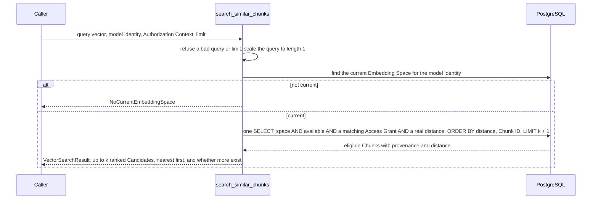

# M04-T07 — Define top-k and distance semantics

Source task: [M04-T07](../curriculum/milestones/M04-dense-retrieval/M04-T07-define-top-k-and-distance-semantics.md)

## What you will do

In M04-T06 the search returned a bare tuple of Candidates. A caller had to guess how many it may ask for, whether a bigger distance means nearer or farther, what happens with equal distances, and whether a short list means "nothing more exists". In this lesson the search returns a `VectorSearchResult` that answers each of those questions in one documented contract.

| Requirement | How this lesson meets it |
|---|---|
| Candidate limits | `limit` is top-k, an int from 1 to `MAX_CANDIDATES` (100). Anything else raises the new `InvalidCandidateLimit` before the database is used. |
| Distance direction | `metric` is `DistanceMetric.COSINE`; `distance` runs from 0 (same direction) to 2 (opposite), and lower is nearer. |
| Tie-breaking | Equal distances are ordered by Chunk ID; `rank` counts 1, 2, 3 and so on. |
| Fewer than k, empty | All eligible Chunks are returned. `truncated` is True only when more eligible Chunks exist beyond k. No eligible Chunk is an empty result, not an error. |
| Table-driven tests | One test table runs k = 1, 2, 3, 4, 5, 6 and 100 over the same five Documents; other tables cover invalid k, insertion order, and stored vector sizes. |

This lesson includes coding: Steps 2–5 change code or docs, while Steps 1 and 6 do not.

Terms used in this lesson:

- **Top-k:** "give me the k nearest results". Here k is the `limit` argument.
- **Contract:** the promises a function makes to its callers, written down and tested, so callers don't need to read its code.
- **Truncated:** the result was cut at k, and more eligible Chunks exist.
- **Unit length:** a vector scaled so its length is 1. Its direction, and so its cosine distance, does not change.

## Before you begin

- **Where things stand.** `search_similar_chunks` in `src/knowledge_service/vector_search.py` returns `tuple[VectorCandidate, ...]`, checks `limit` inside `_unit_query`, and raises `InvalidVectorQuery` for a bad limit. Nothing else in `src` calls it yet, so changing its return type only touches the two test files.
- **How `truncated` is found.** The search asks the database for k + 1 rows and returns the first k. If the extra row exists, more eligible Chunks exist. Because the permission filter runs before `LIMIT`, hidden Chunks never count, so `truncated` cannot reveal that a hidden Document matched.
- **Why a zero vector is excluded.** A stored vector of all zeros has no direction, so pgvector returns NaN (not a number) as its distance. NaN is not between 0 and 2, so the statement leaves such rows out.
- **What the adversarial review found.** An independent review attacked the first version of this contract on the real database, with a fuzz test against a plain-Python model of the rules. It confirmed one break, fixed below with regression tests that fail against the unfixed code:
  - Only the query was scaled to length 1 (M04-T06). Stored vectors were saved as given. pgvector squares values in 32-bit floats, so a stored `[3e38, 3e38, 0]` vanished from results (NaN), `[2e19, 2e19, 0]` got distance 1 instead of 0, and a tiny sideways vector `[1e-30, 1e-25, 0]` took rank 1 with distance 0 ahead of a truly near Chunk.
  - The fix: a shared `unit_length` function in `embeddings.py`, used for the query and inside `insert_chunk_embeddings`, so every stored vector has length 1 too. A vector with no direction is refused when it is written.

  A self-check on `unit_length` then found that NaN in a later position slipped past its first version; it now checks every value, with a test.

  It also confirmed what held. Limits such as `IntEnum(5)`, `b"5"`, `2**63` and `5+0j` were refused before the database. Distances never went below 0 or above 2. The order always matched (distance, Chunk ID), and repeating a search gave an identical result. `truncated` matched "more eligible Chunks exist" exactly, hidden Chunks never changed rank, count or `truncated`, and no Document text appeared in a `repr`.
- **Ties are exact.** Two vectors in the same direction can differ in their last digits of distance after 32-bit rounding (the review saw differences up to about 4e-8). They are then ordered by those digits, not by Chunk ID. The contract says so; it does not round distances.
- **Old rows.** Vectors stored before this lesson keep their old length. Real OpenAI vectors already have length 1, and the test databases start empty, so nothing needs migrating. Note it as a risk.

## Walkthrough

### Step 1 — No coding in this step: write the invariant and the expected failing check

Create `docs/evidence/M04-T07-top-k-and-distance.md` before editing any code. Start it with this text, then adjust the wording to your own:

```markdown
# M04-T07 — Top-k and distance semantics evidence

## Invariant

A vector search returns at most k Candidates, nearest first, where k is an
int from 1 to 100. Distance is cosine, between 0 and 2, lower is nearer,
and equal distances are ordered by Chunk ID, so the same data and query
always give the same result. `truncated` is True only when more eligible
Chunks exist beyond k; hidden Chunks never change it. No eligible Chunk is
an empty result, not an error.

## Expected failing check

Before the change, the updated test files fail to import `DistanceMetric`,
`InvalidCandidateLimit` and `VectorSearchResult`, and `tests/test_embeddings.py`
fails to import `unit_length`, so pytest reports collection errors.

Predictions once it exists:

- Five Documents at distances 0, 0, 0.29, 1 and 2: k=1 returns the first
  tie with `truncated` True; k=5 returns all five with `truncated` False;
  k=100 returns the same five.
- The two Chunks at distance 0 come back in Chunk ID order, whatever order
  the Documents were stored in.
- k of 0, 101, `True`, 1.0 or `"5"`: `InvalidCandidateLimit`, before the
  database is touched.
- One visible Chunk and three hidden ones nearer, k=1: the visible one,
  with `truncated` False.
- A stored vector of `[3e38, 3e38, 0]`: its true distance, not missing.

## Design

## Verification

## Reflection
```

Check: the file exists, and the predictions say what you expect before you run anything.

### Step 2 — Coding step: store every vector at length 1

**In plain words:** Before a vector is saved, it is shrunk or stretched to length 1 without changing where it points. The search from M04-T06 already does this to the question; now the stored side matches. After this step, a vector that is huge or tiny can no longer confuse the database's rounding, and a vector that points nowhere is refused instead of saved.

| Change | File | What it does |
|---|---|---|
| `unit_length(vector)` | `src/knowledge_service/embeddings.py` | Refuses non-finite or all-zero values with `InvalidEmbedding`; divides by the largest value, then by the length. |
| Store at length 1 | `src/knowledge_service/persistence.py` | `insert_chunk_embeddings` stores `unit_length(vector)` instead of `vector`. |

`unit_length` lives in `embeddings.py` because it is about vectors, not the database, and both `persistence.py` and `vector_search.py` can import it from there without a cycle. It checks every value first: checking only the largest value missed `[1.0, nan]`, because `max` skips past NaN.

In `src/knowledge_service/embeddings.py`, add this function just before `check_inputs` (`math` and `Sequence` are already imported):

```python
def unit_length(vector: Sequence[float]) -> Vector:
    """Return the vector scaled to length 1, keeping its direction.

    pgvector computes distances in 32-bit floats, where squaring a value that
    is finite here can overflow or round to zero and make the distance NaN or
    wrong. Cosine distance ignores length, so storing and querying only
    vectors of length 1 keeps every distance right and every value between
    -1 and 1. Raises `InvalidEmbedding` for a vector with no direction.
    """
    if not all(math.isfinite(value) for value in vector):
        raise InvalidEmbedding("a vector must hold finite values")
    largest = max((abs(value) for value in vector), default=0.0)
    if largest == 0.0:
        raise InvalidEmbedding("a vector must not be all zeros")
    # Dividing by the largest value first keeps the length from overflowing.
    scaled = [value / largest for value in vector]
    length = math.hypot(*scaled)
    return tuple(value / length for value in scaled)
```

In `src/knowledge_service/persistence.py`, change the import:

```python
from knowledge_service.embeddings import EmbeddingModelIdentity, unit_length
```

and replace `insert_chunk_embeddings` with:

```python
async def insert_chunk_embeddings(
    connection: AsyncConnection,
    *,
    space_id: EmbeddingSpaceId,
    dimensions: int,
    vectors: Mapping[ChunkId, Sequence[float]],
    created_at: datetime,
) -> None:
    """Store one vector per Chunk in the space, in one statement.

    Each vector is stored scaled to length 1 (see `unit_length`), so search
    distances stay right in pgvector's 32-bit floats; a vector with no
    direction raises `InvalidEmbedding` and nothing is stored. The database
    refuses a vector whose length is not the space's dimensions, and
    pgvector's type needs a list, so each vector is converted here.
    """
    if not vectors:
        return
    await connection.execute(
        sa.insert(chunk_embeddings),
        [
            {
                "chunk_id": chunk_id.value,
                "space_id": space_id.value,
                "dimensions": dimensions,
                "embedding": list(unit_length(vector)),
                "created_at": created_at,
            }
            for chunk_id, vector in vectors.items()
        ],
    )
```

The M04-T05 tests keep passing: the fake model already returns vectors of length 1, so scaling them again changes nothing beyond the last digit.

Check: `uv run pyright` reports 0 errors, and `uv run pytest tests/test_embeddings.py -q` still passes.

### Step 3 — Coding step: the result contract in the search module

**In plain words:** The search now hands back one result object instead of a plain list. It says how distance is measured, how many results were asked for, gives each result its place number, and says whether more results exist beyond the ones returned. A wrong "how many" is now reported as its own error, and the question is scaled with the same function the stored vectors use.

| Change | What it does |
|---|---|
| Module docstring | Writes the contract down: limit, distance, order, fewer than k, empty. |
| `InvalidCandidateLimit` | A subclass of `InvalidVectorQuery`: M04-T06 code that catches the parent still works, and a caller that sets k can tell this case apart. |
| `DistanceMetric` | One value, `COSINE`, so the result names its own metric. |
| `VectorCandidate.rank` | The 1-based position in the result. |
| `VectorSearchResult` | `metric`, `limit`, `candidates`, `truncated`. |
| `search_similar_chunks` | Checks the limit first, asks for `limit + 1` rows, and builds the result. |
| `vector_search_statement` | Adds `distance != NaN` to the `WHERE`, so a vector with no direction is never a Candidate. |
| `_check_limit` / `_unit_query` | The limit check moves into its own function; `_unit_query` now calls `unit_length`. |

Two details. First, `distance != float("nan")` works in PostgreSQL because, unlike Python, PostgreSQL treats NaN as equal to NaN, so the condition is false only for NaN rows. Second, the limit is checked before the query, so a call with both wrong reports the limit, which is the part a caller configures.

Replace `src/knowledge_service/vector_search.py` with:

```python
"""Find the Chunks nearest to a query vector that one reader may see.

Eligibility is part of the same SQL statement as the ranking: the database
drops every Chunk whose Document is unavailable or not granted to the reader
before it orders the rest by distance. An ineligible Chunk is therefore never
ranked, never counted toward the limit, and never leaves the database.

What a caller can rely on in a `VectorSearchResult`:

- **Limit.** `limit` is top-k: an int from 1 to `MAX_CANDIDATES`. Anything
  else raises `InvalidCandidateLimit` before the database is used.
- **Distance.** Cosine distance, between 0 and 2; lower is nearer. 0 is the
  same direction as the query, 1 is unrelated, 2 is the opposite one.
- **Order.** Nearest first, then by Chunk ID when distances are equal, so
  the same data and query always give the same order. `rank` counts from 1.
- **Fewer than k.** When fewer eligible Chunks exist, all of them are
  returned and `truncated` is False. `truncated` is True only when more
  eligible Chunks exist beyond the limit.
- **Empty.** No eligible Chunk is a normal, empty result, not an error.
  A Chunk whose stored vector has no direction (all zeros) has no distance,
  so it is never a Candidate.

Every stored vector and every query has length 1, so distances are right
in pgvector's 32-bit floats. Ties are exact: two vectors in the same
direction can still differ in the last digits of their distances, and are
then ordered by those digits, not by Chunk ID.
"""

import math
from collections.abc import Mapping
from dataclasses import dataclass, field
from enum import StrEnum
from typing import Any, cast
from uuid import UUID

import sqlalchemy as sa
from sqlalchemy.ext.asyncio import AsyncConnection

from knowledge_service.access import AuthorizationContext
from knowledge_service.documents import ContentVersion
from knowledge_service.embeddings import EmbeddingModelIdentity, Vector, unit_length
from knowledge_service.identifiers import (
    ChunkId,
    DocumentId,
    EmbeddingSpaceId,
    SourceId,
)
from knowledge_service.persistence import (
    chunk_embeddings,
    chunks,
    documents,
    eligible_chunks_predicate,
    load_current_embedding_space_id,
)

# The largest top-k one search may ask for, so its rows stay bounded.
MAX_CANDIDATES = 100


class VectorSearchError(Exception):
    """Base error for a vector search."""


class InvalidVectorQuery(VectorSearchError):
    """The query vector or the limit cannot be searched; nothing was read."""


class InvalidCandidateLimit(InvalidVectorQuery):
    """The limit is not an int from 1 to `MAX_CANDIDATES`; nothing was read."""


class NoCurrentEmbeddingSpace(VectorSearchError):
    """The current Embedding Space does not hold the query's model identity."""


class DistanceMetric(StrEnum):
    """How `distance` is measured; lower is always nearer."""

    COSINE = "cosine"


@dataclass(frozen=True, slots=True)
class VectorCandidate:
    """One eligible Chunk, where it came from, and its distance to the query.

    `rank` is its 1-based position in the result. `distance` is the cosine
    distance, from 0 for the same direction to 2 for the opposite one. The
    fields holding Document text are kept out of repr, so logging a
    Candidate never shows them.
    """

    rank: int
    chunk_id: ChunkId
    document_id: DocumentId
    source_id: SourceId
    content_version: ContentVersion
    ordinal: int
    distance: float
    external_id: str = field(repr=False)
    title: str = field(repr=False)
    heading_path: str | None = field(repr=False)
    source_anchor: str | None = field(repr=False)
    text: str = field(repr=False)


@dataclass(frozen=True, slots=True)
class VectorSearchResult:
    """The Candidates of one search and how to read them.

    See the module docstring for the guarantees on order, distance, and
    fewer-than-k results.
    """

    metric: DistanceMetric
    limit: int
    candidates: tuple[VectorCandidate, ...]
    truncated: bool


async def search_similar_chunks(
    connection: AsyncConnection,
    *,
    identity: EmbeddingModelIdentity,
    query: Vector,
    context: AuthorizationContext,
    limit: int,
) -> VectorSearchResult:
    """Return up to `limit` eligible Chunks, nearest first.

    `identity` names the model that embedded the query; only vectors of the
    current Embedding Space are compared, and it must hold that identity.
    Raises `InvalidCandidateLimit` for a bad limit, `InvalidVectorQuery` for
    a bad vector, and `NoCurrentEmbeddingSpace` when the spaces differ.
    """
    _check_limit(limit)
    unit_query = _unit_query(query, dimensions=identity.dimensions)
    space_id = await load_current_embedding_space_id(connection, identity)
    if space_id is None:
        raise NoCurrentEmbeddingSpace("the current embedding space is another model")
    statement = vector_search_statement(
        space_id=space_id,
        query=unit_query,
        eligibility=eligible_chunks_predicate(context),
        # One row more than asked shows whether more eligible Chunks exist.
        limit=limit + 1,
    )
    records = (await connection.execute(statement)).mappings().all()
    return VectorSearchResult(
        metric=DistanceMetric.COSINE,
        limit=limit,
        candidates=tuple(
            _candidate_from(dict(record), rank=index)
            for index, record in enumerate(records[:limit], start=1)
        ),
        truncated=len(records) > limit,
    )


def vector_search_statement(
    *,
    space_id: EmbeddingSpaceId,
    query: Vector,
    eligibility: sa.ColumnElement[bool],
    limit: int,
) -> sa.Select[*tuple[Any, ...]]:
    """Select the nearest Chunks of one space that meet `eligibility`.

    The predicate sits in the same WHERE as the space, so PostgreSQL applies
    it before ORDER BY and LIMIT. Ties in distance are broken by Chunk ID so
    that equal inputs always return the same order. A stored vector with no
    direction gives a NaN distance, which is not a distance, so its row is
    left out; PostgreSQL treats NaN as equal to NaN.
    """
    distance = chunk_embeddings.c.embedding.cosine_distance(list(query))
    return (
        sa.select(
            chunks.c.chunk_id,
            chunks.c.document_id,
            documents.c.source_id,
            chunks.c.content_version,
            chunks.c.ordinal,
            distance.label("distance"),
            documents.c.external_id,
            documents.c.title,
            chunks.c.heading_path,
            chunks.c.source_anchor,
            chunks.c.text,
        )
        .select_from(chunk_embeddings)
        .join(chunks, chunks.c.chunk_id == chunk_embeddings.c.chunk_id)
        .join(documents, documents.c.document_id == chunks.c.document_id)
        .where(
            chunk_embeddings.c.space_id == space_id.value,
            eligibility,
            distance != float("nan"),
        )
        .order_by(distance, chunks.c.chunk_id)
        .limit(limit)
    )


def _check_limit(limit: int) -> None:
    # bool is an int, so `True` would otherwise pass as a limit of 1.
    if type(limit) is not int or not 1 <= limit <= MAX_CANDIDATES:
        raise InvalidCandidateLimit(
            f"limit must be an int between 1 and {MAX_CANDIDATES}"
        )


def _unit_query(
    query: Vector,
    *,
    dimensions: int,
) -> Vector:
    """Check the query and return it scaled to length 1, like stored vectors."""
    if type(query) is not tuple:
        raise InvalidVectorQuery("query must be a tuple of numbers")
    if len(query) != dimensions:
        raise InvalidVectorQuery(
            f"query has {len(query)} dimensions, expected {dimensions}"
        )
    values = [_finite(value) for value in query]
    # Cosine distance to a zero vector is undefined, so every row would tie.
    if not any(values):
        raise InvalidVectorQuery("query must not be all zeros")
    return unit_length(values)


def _finite(value: object) -> float:
    # bool is an int, and a string may look numeric; neither is a number here.
    if type(value) is not float and type(value) is not int:
        raise InvalidVectorQuery("query must hold numbers")
    try:
        number = float(value)
    except OverflowError:
        raise InvalidVectorQuery("query must hold finite numbers") from None
    if not math.isfinite(number):
        raise InvalidVectorQuery("query must hold finite numbers")
    return number


def _candidate_from(record: Mapping[str, object], *, rank: int) -> VectorCandidate:
    return VectorCandidate(
        rank=rank,
        chunk_id=ChunkId(cast(UUID, record["chunk_id"])),
        document_id=DocumentId(cast(UUID, record["document_id"])),
        source_id=SourceId(cast(UUID, record["source_id"])),
        content_version=ContentVersion(cast(int, record["content_version"])),
        ordinal=cast(int, record["ordinal"]),
        distance=cast(float, record["distance"]),
        external_id=cast(str, record["external_id"]),
        title=cast(str, record["title"]),
        heading_path=cast("str | None", record["heading_path"]),
        source_anchor=cast("str | None", record["source_anchor"]),
        text=cast(str, record["text"]),
    )
```

Check: `uv run ruff check src && uv run pyright` reports no errors. The test files fail until Step 4, because `search_similar_chunks` now returns a result instead of a tuple.

### Step 4 — Coding step: tests

**In plain words:** These tests pin the contract down so a later change cannot quietly break it. One table asks for results of several sizes, from 1 up to 100, over the same five Documents and checks the order, the place numbers, the distances and the "more exist" flag. Others check that wrong sizes are refused, that storing order doesn't matter, that hidden Documents never show through, and that vectors of any size get their true distance.

Three files change.

**`tests/test_embeddings.py`** gets `unit_length` tests: a Hypothesis property test (random vectors keep their direction and get length 1) and a table of vectors with no direction. Add `unit_length,` to the `from knowledge_service.embeddings import (...)` list, then append:

```python
finite_floats = st.floats(allow_nan=False, allow_infinity=False)


@given(st.lists(finite_floats, min_size=1, max_size=64).filter(any))
def test_unit_length_keeps_the_direction_at_length_one(values: list[float]) -> None:
    unit = unit_length(values)

    assert math.hypot(*unit) == pytest.approx(1.0, abs=1e-9)
    assert all(abs(value) <= 1.0 for value in unit)
    # Same direction: every sign is kept, and the largest value stays largest.
    assert [math.copysign(1, u) for u, v in zip(unit, values, strict=True) if v] == [
        math.copysign(1, v) for v in values if v
    ]
    largest = max(range(len(values)), key=lambda i: abs(values[i]))
    assert abs(unit[largest]) == max(abs(value) for value in unit)


@pytest.mark.parametrize(
    "values",
    [
        [],
        [0.0, 0.0],
        [-0.0],
        [math.nan, 1.0],
        [1.0, math.nan],
        [math.inf, 1.0],
        [1.0, -math.inf],
    ],
)
def test_unit_length_refuses_a_vector_with_no_direction(values: list[float]) -> None:
    with pytest.raises(InvalidEmbedding):
        unit_length(values)
```

**`tests/test_vector_search.py`** imports the new names, gives the `repr` test a `rank` and a `VectorSearchResult`, and adds two tests: a table of invalid k values (each must raise `InvalidCandidateLimit` before the connection is used), and a check that a bad limit is reported before a bad query. Replace the file with:

```python
"""Vector search checks that need no database."""

from typing import cast
from uuid import UUID

import pytest
from sqlalchemy.dialects import postgresql
from sqlalchemy.ext.asyncio import AsyncConnection

from knowledge_service.access import AuthorizationContext, InvalidAuthorizationContext
from knowledge_service.documents import ContentVersion
from knowledge_service.embeddings import EmbeddingModelIdentity, Vector
from knowledge_service.identifiers import (
    ChunkId,
    DocumentId,
    EmbeddingSpaceId,
    GroupId,
    SourceId,
    UserId,
)
from knowledge_service.persistence import eligible_chunks_predicate
from knowledge_service.vector_search import (
    MAX_CANDIDATES,
    DistanceMetric,
    InvalidCandidateLimit,
    InvalidVectorQuery,
    VectorCandidate,
    VectorSearchResult,
    search_similar_chunks,
    vector_search_statement,
)

IDENTITY = EmbeddingModelIdentity(provider="fake", model="fake-embedding", dimensions=3)
USER = UserId.parse("00000000-0000-0000-0000-0000000000a1")
GROUP = GroupId.parse("00000000-0000-0000-0000-0000000000b1")
MARKER = "zebramarker"


def test_a_context_names_one_user_and_only_groups() -> None:
    context = AuthorizationContext(user_id=USER, group_ids=frozenset({GROUP}))

    assert context.group_ids == {GROUP}
    assert AuthorizationContext(user_id=USER).group_ids == frozenset()


@pytest.mark.parametrize(
    ("user_id", "group_ids"),
    [
        (USER.value, frozenset[GroupId]()),
        (GroupId(USER.value), frozenset[GroupId]()),
        (USER, [GROUP]),
        (USER, frozenset({USER})),
        (USER, frozenset({GROUP.value})),
    ],
)
def test_a_context_refuses_other_types(user_id: object, group_ids: object) -> None:
    with pytest.raises(InvalidAuthorizationContext):
        AuthorizationContext(
            user_id=cast(UserId, user_id),
            group_ids=cast(frozenset[GroupId], group_ids),
        )


@pytest.mark.parametrize(
    ("query", "limit"),
    [
        ((1.0, 0.0), 5),
        ((1.0, 0.0, 0.0, 0.0), 5),
        ((float("nan"), 0.0, 0.0), 5),
        ((float("inf"), 0.0, 0.0), 5),
        ((0.0, 0.0, 0.0), 5),
        ((1.0, 0.0, 0.0), 0),
        ((1.0, 0.0, 0.0), MAX_CANDIDATES + 1),
        ((1.0, 0.0, 0.0), True),
        # Each of these once crashed with a TypeError or an OverflowError.
        ((10**400, 0.0, 0.0), 5),
        (("1", 0.0, 0.0), 5),
        ((None, 0.0, 0.0), 5),
        ((True, 0.0, 0.0), 5),
        ([1.0, 0.0, 0.0], 5),
        (None, 5),
        (iter((1.0, 0.0, 0.0)), 5),
    ],
)
async def test_a_bad_query_is_refused_before_the_database(
    query: object, limit: int
) -> None:
    # Any use of the connection would fail: the check must come first.
    unused = cast(AsyncConnection, object())

    with pytest.raises(InvalidVectorQuery):
        await search_similar_chunks(
            unused,
            identity=IDENTITY,
            query=cast(Vector, query),
            context=AuthorizationContext(user_id=USER),
            limit=limit,
        )


def test_the_reader_and_the_query_are_bound_parameters() -> None:
    statement = vector_search_statement(
        space_id=EmbeddingSpaceId.new(),
        query=(0.25, 0.5, 0.75),
        eligibility=eligible_chunks_predicate(
            AuthorizationContext(user_id=USER, group_ids=frozenset({GROUP}))
        ),
        limit=5,
    )

    compiled = statement.compile(dialect=postgresql.dialect())
    sql = str(compiled)
    values = list(compiled.params.values())

    assert str(USER.value) not in sql
    assert str(GROUP.value) not in sql
    assert "0.25" not in sql
    assert USER.value in values
    assert [GROUP.value] in values


def test_a_candidate_repr_shows_no_document_text() -> None:
    candidate = VectorCandidate(
        rank=1,
        chunk_id=ChunkId(UUID(int=1)),
        document_id=DocumentId(UUID(int=2)),
        source_id=SourceId(UUID(int=3)),
        content_version=ContentVersion(1),
        ordinal=0,
        distance=0.5,
        external_id=f"{MARKER}.txt",
        title=MARKER,
        heading_path=MARKER,
        source_anchor=MARKER,
        text=MARKER,
    )

    result = VectorSearchResult(
        metric=DistanceMetric.COSINE,
        limit=1,
        candidates=(candidate,),
        truncated=False,
    )

    assert MARKER not in repr(candidate)
    assert MARKER not in repr(result)


@pytest.mark.parametrize(
    "limit",
    [0, -1, MAX_CANDIDATES + 1, 10**30, True, False, 1.0, 5.5, None, "5"],
)
async def test_an_invalid_k_is_refused_before_the_database(limit: object) -> None:
    unused = cast(AsyncConnection, object())

    with pytest.raises(InvalidCandidateLimit):
        await search_similar_chunks(
            unused,
            identity=IDENTITY,
            query=(1.0, 0.0, 0.0),
            context=AuthorizationContext(user_id=USER),
            limit=cast(int, limit),
        )


async def test_a_bad_limit_is_reported_before_a_bad_query() -> None:
    unused = cast(AsyncConnection, object())

    # InvalidCandidateLimit is an InvalidVectorQuery, so T06 callers still
    # catch it; a caller that sets k can tell it apart.
    with pytest.raises(InvalidCandidateLimit):
        await search_similar_chunks(
            unused,
            identity=IDENTITY,
            query=(0.0, 0.0, 0.0),
            context=AuthorizationContext(user_id=USER),
            limit=0,
        )
```

**`tests/test_vector_search_integration.py`** keeps every M04-T06 test. Its `search` helper now returns `result.candidates`, so they need no other change, and a new `search_result` helper returns the whole result.

| New test | What it proves |
|---|---|
| `test_top_k_returns_the_nearest_k_in_order` | The table: k = 1, 2, 3, 4, 5, 6, 100 over five Documents at distances 0, 0, 0.29, 1, 2. Order, ranks, distances, `limit`, `metric`, and `truncated` (True up to k=4, False from k=5). |
| `test_the_order_depends_only_on_distance_and_chunk_id` | Three insertion orders give the same order, and searching twice gives an equal result. |
| `test_distances_stay_between_zero_and_two` | The ends of the range are exactly 0 and 2. |
| `test_no_eligible_chunk_is_an_empty_result` | Empty, not an error, and `truncated` False. |
| `test_truncated_counts_only_chunks_the_reader_may_see` | Three nearer hidden Chunks do not make `truncated` True. |
| `test_a_chunk_whose_vector_has_no_direction_is_never_a_candidate` | A zero vector written directly to the table (the app refuses to write one) is left out. |
| `test_a_stored_vector_of_any_size_gets_its_true_distance` | Review regressions: huge and tiny stored vectors get their true distance. |
| `test_a_tiny_sideways_vector_does_not_outrank_a_near_one` | Review regression: the tiny sideways vector no longer takes rank 1. |

`a_corpus` stores the five Documents in the order given and returns their names in the order the search must return them: sorted by known distance, then Chunk ID. That way the expected order is computed, not guessed, because Chunk IDs are new each run.

Replace the file with:

```python
"""Real PostgreSQL tests for vector search filtered by eligibility in SQL."""

import math
from collections.abc import AsyncIterator, Sequence
from datetime import UTC, datetime, timedelta
from uuid import uuid4

import pytest
import sqlalchemy as sa
from pydantic import SecretStr

from knowledge_service.access import AuthorizationContext, Subject
from knowledge_service.database import DatabaseRuntime, create_database_runtime
from knowledge_service.deletions import tombstone_missing
from knowledge_service.embeddings import EmbeddingModelIdentity
from knowledge_service.identifiers import (
    ChunkId,
    DocumentId,
    EmbeddingSpaceId,
    GroupId,
    SourceId,
    UserId,
)
from knowledge_service.normalization import NormalizedDocument, normalize
from knowledge_service.persistence import (
    chunk_embeddings,
    embedding_spaces,
    insert_chunk_embeddings,
    load_chunks,
    load_document_by_id,
    load_embedding_space_id,
)
from knowledge_service.reconciliation import reconcile_document
from knowledge_service.settings import Settings
from knowledge_service.sources import SourceAccess, SourceRecord
from knowledge_service.vector_search import (
    DistanceMetric,
    NoCurrentEmbeddingSpace,
    VectorCandidate,
    VectorSearchResult,
    search_similar_chunks,
)

SOURCE_ID = SourceId.parse("00000000-0000-0000-0000-000000000012")
OBSERVED_AT = datetime(2026, 10, 26, 9, 0, tzinfo=UTC)
IDENTITY = EmbeddingModelIdentity(provider="fake", model="fake-embedding", dimensions=3)
OTHER_IDENTITY = EmbeddingModelIdentity(
    provider="fake", model="older-embedding", dimensions=3
)
READER = UserId.parse("00000000-0000-0000-0000-0000000000a1")
OTHER_USER = UserId.parse("00000000-0000-0000-0000-0000000000a2")
READERS_GROUP = GroupId.parse("00000000-0000-0000-0000-0000000000b1")
OTHER_GROUP = GroupId.parse("00000000-0000-0000-0000-0000000000b2")
CONTEXT = AuthorizationContext(user_id=READER, group_ids=frozenset({READERS_GROUP}))
QUERY = (1.0, 0.0, 0.0)

INSERT_SOURCE = sa.text(
    "INSERT INTO sources (source_id, kind, location, display_name, enabled,"
    " created_at, updated_at) VALUES (:source_id, 'local_directory',"
    " '/srv/handbook', 'Handbook', true, now(), now())"
)


@pytest.fixture
async def runtime(migrated_database: str) -> AsyncIterator[DatabaseRuntime]:
    runtime = create_database_runtime(
        Settings(database_url=SecretStr(migrated_database))
    )
    async with runtime.transaction() as connection:
        await connection.execute(INSERT_SOURCE, {"source_id": SOURCE_ID.value})
    await a_space(runtime, IDENTITY, is_current=True)
    try:
        yield runtime
    finally:
        await runtime.dispose()


async def a_space(
    runtime: DatabaseRuntime, identity: EmbeddingModelIdentity, *, is_current: bool
) -> EmbeddingSpaceId:
    space_id = EmbeddingSpaceId.new()
    async with runtime.transaction() as connection:
        await connection.execute(
            sa.insert(embedding_spaces).values(
                space_id=space_id.value,
                provider=identity.provider,
                model=identity.model,
                dimensions=identity.dimensions,
                is_current=is_current,
                created_at=OBSERVED_AT,
            )
        )
    return space_id


def plain_text(external_id: str) -> NormalizedDocument:
    outcome = normalize(
        SourceRecord.present(
            external_id=external_id,
            version="v1",
            media_type="text/plain",
            content=f"The {external_id} policy.".encode(),
            access=SourceAccess(public=True),
        ),
        source_id=SOURCE_ID,
    )
    assert isinstance(outcome, NormalizedDocument)
    return outcome


async def a_document(
    runtime: DatabaseRuntime,
    external_id: str,
    *,
    readers: Sequence[Subject],
    vector: Sequence[float],
    space: EmbeddingModelIdentity = IDENTITY,
) -> DocumentId:
    """Store a one-Chunk Document and give its Chunk the given vector.

    The vector is stored at length 1, as every published vector is.
    """
    reconciled = await reconcile_document(
        runtime, plain_text(external_id), readers=readers, observed_at=OBSERVED_AT
    )
    document_id = reconciled.document.document_id
    async with runtime.transaction() as connection:
        space_id = await load_embedding_space_id(connection, space)
        assert space_id is not None
        (chunk,) = await load_chunks(connection, document_id=document_id)
        await insert_chunk_embeddings(
            connection,
            space_id=space_id,
            dimensions=space.dimensions,
            vectors={chunk.chunk_id: vector},
            created_at=OBSERVED_AT,
        )
    return document_id


async def search_result(
    runtime: DatabaseRuntime,
    *,
    context: AuthorizationContext = CONTEXT,
    limit: int = 10,
    identity: EmbeddingModelIdentity = IDENTITY,
    query: tuple[float, ...] = QUERY,
) -> VectorSearchResult:
    async with runtime.transaction() as connection:
        return await search_similar_chunks(
            connection, identity=identity, query=query, context=context, limit=limit
        )


async def search(
    runtime: DatabaseRuntime,
    *,
    context: AuthorizationContext = CONTEXT,
    limit: int = 10,
    identity: EmbeddingModelIdentity = IDENTITY,
    query: tuple[float, ...] = QUERY,
) -> tuple[VectorCandidate, ...]:
    result = await search_result(
        runtime, context=context, limit=limit, identity=identity, query=query
    )
    return result.candidates


def documents_of(candidates: Sequence[VectorCandidate]) -> list[DocumentId]:
    return [candidate.document_id for candidate in candidates]


@pytest.mark.integration
async def test_nearest_chunks_come_first_with_provenance_and_distance(
    runtime: DatabaseRuntime,
) -> None:
    far = await a_document(
        runtime, "far.txt", readers=[Subject.public()], vector=[0.0, 1.0, 0.0]
    )
    near = await a_document(
        runtime, "near.txt", readers=[Subject.public()], vector=[1.0, 0.0, 0.0]
    )
    middle = await a_document(
        runtime, "middle.txt", readers=[Subject.public()], vector=[1.0, 1.0, 0.0]
    )

    found = await search(runtime)

    assert documents_of(found) == [near, middle, far]
    assert [round(c.distance, 6) for c in found] == [0.0, 0.292893, 1.0]
    async with runtime.transaction() as connection:
        document = await load_document_by_id(connection, document_id=near)
        (chunk,) = await load_chunks(connection, document_id=near)
    assert document is not None
    first = found[0]
    assert first.chunk_id == chunk.chunk_id
    assert first.source_id == SOURCE_ID
    assert first.external_id == "near.txt"
    assert first.title == document.title
    assert first.content_version == chunk.content_version
    assert first.ordinal == chunk.ordinal
    assert first.heading_path == chunk.heading_path
    assert first.source_anchor == chunk.source_anchor
    assert first.text == chunk.text


@pytest.mark.integration
async def test_a_nearer_chunk_the_reader_may_not_see_is_never_ranked(
    runtime: DatabaseRuntime,
) -> None:
    # The hidden Chunk is an exact match. If it were dropped only after
    # ranking, limit=1 would leave nothing to return.
    await a_document(
        runtime,
        "hidden.txt",
        readers=[Subject.user(OTHER_USER)],
        vector=[1.0, 0.0, 0.0],
    )
    granted = await a_document(
        runtime,
        "granted.txt",
        readers=[Subject.user(READER)],
        vector=[0.0, 1.0, 0.0],
    )

    found = await search(runtime, limit=1)

    assert documents_of(found) == [granted]


@pytest.mark.integration
@pytest.mark.parametrize(
    ("readers", "visible"),
    [
        ([Subject.public()], True),
        ([Subject.user(READER)], True),
        ([Subject.group(READERS_GROUP)], True),
        ([Subject.user(OTHER_USER), Subject.group(READERS_GROUP)], True),
        ([Subject.user(OTHER_USER)], False),
        ([Subject.group(OTHER_GROUP)], False),
        # The reader's own UUID, granted as a group, is another subject.
        ([Subject.group(GroupId(READER.value))], False),
        ([Subject.user(UserId(READERS_GROUP.value))], False),
        ([], False),
    ],
)
async def test_only_a_matching_access_grant_makes_a_chunk_eligible(
    runtime: DatabaseRuntime,
    readers: list[Subject],
    visible: bool,
) -> None:
    document_id = await a_document(
        runtime, "policy.txt", readers=readers, vector=[1.0, 0.0, 0.0]
    )

    found = await search(runtime)

    assert documents_of(found) == ([document_id] if visible else [])


@pytest.mark.integration
async def test_a_reader_without_groups_sees_only_public_and_own_grants(
    runtime: DatabaseRuntime,
) -> None:
    public = await a_document(
        runtime, "public.txt", readers=[Subject.public()], vector=[1.0, 0.0, 0.0]
    )
    await a_document(
        runtime,
        "group.txt",
        readers=[Subject.group(READERS_GROUP)],
        vector=[1.0, 0.0, 0.0],
    )

    found = await search(runtime, context=AuthorizationContext(user_id=READER))

    assert documents_of(found) == [public]


@pytest.mark.integration
async def test_revoked_and_tombstoned_documents_disappear_at_once(
    runtime: DatabaseRuntime,
) -> None:
    revoked = await a_document(
        runtime, "revoked.txt", readers=[Subject.public()], vector=[1.0, 0.0, 0.0]
    )
    tombstoned = await a_document(
        runtime, "gone.txt", readers=[Subject.public()], vector=[1.0, 0.0, 0.0]
    )
    kept = await a_document(
        runtime, "kept.txt", readers=[Subject.public()], vector=[0.0, 1.0, 0.0]
    )
    assert set(documents_of(await search(runtime))) == {revoked, tombstoned, kept}

    later = OBSERVED_AT + timedelta(hours=1)
    # Only the readers change, so the Chunk and its vector stay.
    await reconcile_document(
        runtime, plain_text("revoked.txt"), readers=[], observed_at=later
    )
    await tombstone_missing(
        runtime,
        source_id=SOURCE_ID,
        seen={"revoked.txt", "kept.txt"},
        observed_at=later,
    )

    assert documents_of(await search(runtime)) == [kept]


@pytest.mark.integration
async def test_only_vectors_of_the_current_space_are_compared(
    runtime: DatabaseRuntime,
) -> None:
    await a_space(runtime, OTHER_IDENTITY, is_current=False)
    await a_document(
        runtime,
        "old-model.txt",
        readers=[Subject.public()],
        vector=[1.0, 0.0, 0.0],
        space=OTHER_IDENTITY,
    )
    current = await a_document(
        runtime, "new-model.txt", readers=[Subject.public()], vector=[0.0, 1.0, 0.0]
    )

    assert documents_of(await search(runtime)) == [current]


@pytest.mark.integration
async def test_a_query_from_a_model_that_is_not_current_is_refused(
    runtime: DatabaseRuntime,
) -> None:
    await a_space(runtime, OTHER_IDENTITY, is_current=False)

    with pytest.raises(NoCurrentEmbeddingSpace):
        await search(runtime, identity=OTHER_IDENTITY)


@pytest.mark.integration
async def test_equal_distances_are_ordered_by_chunk_id(
    runtime: DatabaseRuntime,
) -> None:
    for name in ("a.txt", "b.txt", "c.txt"):
        await a_document(
            runtime, name, readers=[Subject.public()], vector=[1.0, 0.0, 0.0]
        )

    found = await search(runtime)

    chunk_ids: list[ChunkId] = [candidate.chunk_id for candidate in found]
    assert chunk_ids == sorted(chunk_ids, key=lambda chunk_id: chunk_id.value)
    assert [c.chunk_id for c in await search(runtime)] == chunk_ids


@pytest.mark.integration
async def test_a_reader_with_many_groups_is_one_parameter(
    runtime: DatabaseRuntime,
) -> None:
    document_id = await a_document(
        runtime,
        "policy.txt",
        readers=[Subject.group(READERS_GROUP)],
        vector=[1.0, 0.0, 0.0],
    )
    many = frozenset({READERS_GROUP} | {GroupId(uuid4()) for _ in range(70_000)})

    found = await search(
        runtime, context=AuthorizationContext(user_id=READER, group_ids=many)
    )

    assert documents_of(found) == [document_id]


@pytest.mark.integration
@pytest.mark.parametrize(
    "query",
    [
        # pgvector computes in 32-bit floats: these once raised a DataError,
        # returned NaN distances, or returned wrong ones.
        (1e39, 0.0, 0.0),
        (3e38, 3e38, 0.0),
        (1e20, 1e20, 0.0),
        (1e-30, 1e-30, 0.0),
        (1e-46, 0.0, 0.0),
        (1e-320, 0.0, 0.0),
    ],
)
async def test_distance_depends_on_direction_not_length(
    runtime: DatabaseRuntime, query: tuple[float, ...]
) -> None:
    await a_document(
        runtime, "slanted.txt", readers=[Subject.public()], vector=[1.0, 0.5, 0.0]
    )
    await a_document(
        runtime, "upright.txt", readers=[Subject.public()], vector=[0.0, 1.0, 0.0]
    )
    direction = tuple(1.0 if value else 0.0 for value in query)

    expected = await search(runtime, query=direction)
    found = await search(runtime, query=query)

    assert [c.chunk_id for c in found] == [c.chunk_id for c in expected]
    assert [c.distance for c in found] == pytest.approx(
        [c.distance for c in expected], abs=1e-6
    )
    assert all(math.isfinite(c.distance) for c in found)


# Five public Documents around QUERY = (1, 0, 0): two exact matches that tie,
# then one at 45 degrees, one at a right angle, and one opposite.
CORPUS = {
    "tie-a.txt": [1.0, 0.0, 0.0],
    "tie-b.txt": [2.0, 0.0, 0.0],
    "diagonal.txt": [1.0, 1.0, 0.0],
    "right-angle.txt": [0.0, 1.0, 0.0],
    "opposite.txt": [-1.0, 0.0, 0.0],
}
DISTANCES = {
    "tie-a.txt": 0.0,
    "tie-b.txt": 0.0,
    "diagonal.txt": 1 - 1 / math.sqrt(2),
    "right-angle.txt": 1.0,
    "opposite.txt": 2.0,
}


async def a_corpus(runtime: DatabaseRuntime, names: Sequence[str]) -> list[str]:
    """Store the named Documents in this order; return them in result order.

    The result order is by distance, then by Chunk ID.
    """
    chunk_ids: dict[str, ChunkId] = {}
    for name in names:
        document_id = await a_document(
            runtime, name, readers=[Subject.public()], vector=CORPUS[name]
        )
        async with runtime.transaction() as connection:
            (chunk,) = await load_chunks(connection, document_id=document_id)
        chunk_ids[name] = chunk.chunk_id
    return sorted(names, key=lambda name: (DISTANCES[name], chunk_ids[name].value))


@pytest.mark.integration
@pytest.mark.parametrize(
    ("limit", "returned", "truncated"),
    [
        (1, 1, True),
        (2, 2, True),
        (3, 3, True),
        (4, 4, True),
        (5, 5, False),
        (6, 5, False),
        (100, 5, False),
    ],
)
async def test_top_k_returns_the_nearest_k_in_order(
    runtime: DatabaseRuntime, limit: int, returned: int, truncated: bool
) -> None:
    expected = await a_corpus(runtime, list(CORPUS))

    result = await search_result(runtime, limit=limit)

    assert result.metric is DistanceMetric.COSINE
    assert result.limit == limit
    assert result.truncated is truncated
    assert [c.external_id for c in result.candidates] == expected[:returned]
    assert [c.rank for c in result.candidates] == list(range(1, returned + 1))
    assert [c.distance for c in result.candidates] == pytest.approx(
        [DISTANCES[name] for name in expected[:returned]], abs=1e-6
    )


@pytest.mark.integration
@pytest.mark.parametrize(
    "names",
    [
        list(CORPUS),
        list(reversed(CORPUS)),
        ["diagonal.txt", "tie-b.txt", "opposite.txt", "tie-a.txt", "right-angle.txt"],
    ],
)
async def test_the_order_depends_only_on_distance_and_chunk_id(
    runtime: DatabaseRuntime, names: list[str]
) -> None:
    expected = await a_corpus(runtime, names)

    first = await search_result(runtime)
    second = await search_result(runtime)

    assert [c.external_id for c in first.candidates] == expected
    assert first == second


@pytest.mark.integration
async def test_distances_stay_between_zero_and_two(runtime: DatabaseRuntime) -> None:
    await a_corpus(runtime, list(CORPUS))

    result = await search_result(runtime)

    assert result.candidates[0].distance == 0.0
    assert result.candidates[-1].distance == 2.0
    assert all(0.0 <= c.distance <= 2.0 for c in result.candidates)


@pytest.mark.integration
async def test_no_eligible_chunk_is_an_empty_result(runtime: DatabaseRuntime) -> None:
    await a_document(
        runtime,
        "private.txt",
        readers=[Subject.user(OTHER_USER)],
        vector=[1.0, 0.0, 0.0],
    )

    result = await search_result(runtime, limit=1)

    assert result.candidates == ()
    assert result.truncated is False


@pytest.mark.integration
async def test_truncated_counts_only_chunks_the_reader_may_see(
    runtime: DatabaseRuntime,
) -> None:
    # Hidden Chunks beyond the limit must not show through `truncated`.
    for name in ("hidden-1.txt", "hidden-2.txt", "hidden-3.txt"):
        await a_document(
            runtime, name, readers=[Subject.user(OTHER_USER)], vector=[1.0, 0.0, 0.0]
        )
    visible = await a_document(
        runtime, "visible.txt", readers=[Subject.public()], vector=[0.0, 1.0, 0.0]
    )

    result = await search_result(runtime, limit=1)

    assert documents_of(result.candidates) == [visible]
    assert result.truncated is False


@pytest.mark.integration
async def test_a_chunk_whose_vector_has_no_direction_is_never_a_candidate(
    runtime: DatabaseRuntime,
) -> None:
    # The application refuses to store such a vector, so write the row
    # directly, as a bug or a manual fix could.
    zero = await a_document(
        runtime, "zero.txt", readers=[Subject.public()], vector=[1.0, 0.0, 0.0]
    )
    async with runtime.transaction() as connection:
        (chunk,) = await load_chunks(connection, document_id=zero)
        await connection.execute(
            sa.update(chunk_embeddings)
            .where(chunk_embeddings.c.chunk_id == chunk.chunk_id.value)
            .values(embedding=[0.0, 0.0, 0.0])
        )
    kept = await a_document(
        runtime, "kept.txt", readers=[Subject.public()], vector=[0.0, 1.0, 0.0]
    )

    result = await search_result(runtime, limit=1)

    assert documents_of(result.candidates) == [kept]
    assert result.truncated is False


@pytest.mark.integration
@pytest.mark.parametrize(
    ("stored", "expected"),
    [
        # Once wrong in pgvector's 32-bit floats: squaring overflowed or
        # rounded to zero before vectors were stored at length 1.
        ([3e38, 3e38, 0.0], 1 - 1 / math.sqrt(2)),
        ([2e19, 2e19, 0.0], 1 - 1 / math.sqrt(2)),
        ([1e-30, 1e-30, 0.0], 1 - 1 / math.sqrt(2)),
        ([1e-40, 1e-40, 0.0], 1 - 1 / math.sqrt(2)),
        ([1e-30, 1e-25, 0.0], 1.0 - 1e-5 / math.sqrt(1 + 1e-10)),
    ],
)
async def test_a_stored_vector_of_any_size_gets_its_true_distance(
    runtime: DatabaseRuntime, stored: list[float], expected: float
) -> None:
    await a_document(runtime, "sized.txt", readers=[Subject.public()], vector=stored)

    result = await search_result(runtime)

    (candidate,) = result.candidates
    assert candidate.distance == pytest.approx(expected, abs=1e-6)


@pytest.mark.integration
async def test_a_tiny_sideways_vector_does_not_outrank_a_near_one(
    runtime: DatabaseRuntime,
) -> None:
    near = await a_document(
        runtime, "near.txt", readers=[Subject.public()], vector=[1.0, 0.01, 0.0]
    )
    await a_document(
        runtime, "tiny.txt", readers=[Subject.public()], vector=[1e-30, 1e-25, 0.0]
    )

    result = await search_result(runtime, limit=1)

    assert documents_of(result.candidates) == [near]
    assert result.truncated is True
```

Check: `uv run pytest tests/test_embeddings.py tests/test_vector_search.py -q` passes, then:

```bash
KNOWLEDGE_SERVICE_TEST_DATABASE_URL="$(uv run python scripts/test_database_url.py knowledge-service-postgres)" uv run pytest tests/test_vector_search_integration.py tests/test_embedding_publication_integration.py -q
```

### Step 5 — Coding step: update the architecture doc

**In plain words:** The diagram of the search from M04-T06 now says less than the code does. This step adds that vectors have length 1, that the database is asked for one row more than k, and that the caller gets a result that says whether more exist.

In `docs/architecture.md`, replace the whole "Vector search as built in M04" section, up to "### Answering", with:

````markdown
#### Vector search as built in M04

`search_similar_chunks` returns the Chunks nearest to a query vector that
one reader may see. Eligibility is part of the same SQL statement as the
ranking, so a Chunk the reader may not see is never ranked and never leaves
the database. Stored vectors and the query both have length 1, and cosine
distance runs from 0 (same direction) to 2 (opposite).


````

Check: `make docs-check` passes.

### Step 6 — No coding in this step: run the gates, then record evidence

Run these in order and keep the outputs:

```bash
uv run pytest tests/test_vector_search.py tests/test_embeddings.py -q
make test-integration
make format-check
make lint
make typecheck
make check
make docs-check
```

Expected: everything passes. On the reference run, `make check` reported 830 passed and 3 deselected, with `vector_search.py` and `embeddings.py` fully covered.

Then complete the evidence file from Step 1:

- **Design:** the changed files (`embeddings.py`, `persistence.py`, `vector_search.py`, three test files, `architecture.md`) and a short table of the contract.
- **Verification:** the commands and their pass counts. Optionally, break one thing at a time (ask for `limit` rows instead of `limit + 1`; remove `unit_length` from `insert_chunk_embeddings`; remove the NaN condition) and record which test fails.
- **Risks:** ties are exact, not rounded; vectors stored before this lesson keep their old length; with an approximate index (M04-T11), `truncated` and fewer-than-k may no longer mean "no more eligible Chunks exist".
- **Reflection:** your answers to the questions below.

Finally, add the M04-T07 row to `docs/curriculum/PROGRESS.md`, set the next task to M04-T08, and commit with `m04-t07: define top k and distance semantics`.

## Reflection questions

1. A caller now gets a result object with `metric`, `limit`, `candidates` and `truncated` instead of a plain list. Which mistakes could a caller make with the plain list that the result object prevents? Think about which way distance points and what a short list means.
2. The search asks the database for k + 1 rows to fill in `truncated`. Why would counting all matching rows instead be worse, for speed and for privacy?
3. Imagine a later change that rounds distances to 6 digits so that "almost equal" distances count as ties. What would get better, and what new problem could it cause in the order of results?
4. Every stored vector is now saved at length 1. If a future embedding model returned vectors that were not length 1, what would happen to them on the way into the database, and why is that safe for cosine distance but not for other distance measures such as plain straight-line distance?
5. Which test in this lesson would catch someone changing `limit + 1` back to `limit`? Which would catch hidden Documents showing through `truncated`?

## Completion checklist

- [ ] The evidence file has the invariant and predictions, written before the code.
- [ ] `unit_length` exists, refuses NaN, infinity and all zeros, and every stored vector goes through it.
- [ ] `search_similar_chunks` returns a `VectorSearchResult` with `metric`, `limit`, `candidates` (with `rank`) and `truncated`.
- [ ] An invalid k raises `InvalidCandidateLimit` before the database is used.
- [ ] The table test passes for k = 1–6 and 100, including ties and fewer-than-k.
- [ ] Hidden Chunks never change `truncated`; a zero vector is never a Candidate.
- [ ] All gates pass: format, lint, types, unit, integration, docs.
- [ ] `docs/architecture.md` describes the new result.
- [ ] The evidence file has the design, verification, risks and your reflection.
- [ ] The PROGRESS row is added and the commit is made.

When you have written the code, share it or any error output, and I will review it against this checklist.
