# M04-T10 — Migrate embedding models safely

Source task: [M04-T10](../curriculum/milestones/M04-dense-retrieval/M04-T10-migrate-embedding-models-safely.md)

## What you will do

Search reads one Embedding Space: the current one. To move to a new embedding model, you cannot just delete the old vectors and start embedding again: until every Document is re-embedded, search would find little or nothing. You will build a migration that keeps search working the whole time, in four steps:

1. **Dual-write.** Create the new (target) space, not current. From now on, every publication embeds into both spaces.
2. **Backfill.** Embed the Documents published before the start into the target, a few at a time.
3. **Switch.** Once the target has a vector for everything the old space has, make it current in one transaction.
4. **Clean up.** Delete the old space and its vectors.

| Requirement | How this lesson meets it |
|---|---|
| Dual-write / backfill / switch / cleanup states | Stored states `dual_writing`, `switched`, `cleaned` in a new `embedding_migrations` table; backfill runs while `dual_writing`. A pure state machine allows only `dual_writing → switched → cleaned`. |
| No downtime | Exactly one space is current at every moment. The switch flips `is_current` from source to target in one transaction, so search sees the old space until the commit and the new one after it. |
| Queries never mix incompatible dimensions | Search reads only the current space, and its statement checks that the space is still current. A query from the other model raises `NoCurrentEmbeddingSpace`. |
| State-machine test | A table covers every state and step. |
| Small integration migration | A real-database test moves 4 Documents from an 8-dimension model to a 4-dimension one and checks search after every step. |
| Typed failure | `IncompleteBackfill` when switching too early, `InvalidMigrationTransition` for steps out of order, and more. |

This lesson includes coding: Steps 2–7 change code or docs, while Steps 1 and 8 do not.

Terms used in this lesson:

- **Source space / target space:** the old model's space and the new model's space.
- **Dual-write:** writing every new vector to both spaces, so the target does not fall behind while the backfill runs.
- **Backfill:** filling the target with vectors for Documents that were published before the migration started.
- **Cutover:** the moment search moves from the old space to the new one; here, the switch's commit.
- **Row lock (`FOR UPDATE`, `FOR SHARE`):** as in M04-T05. Publication holds the space's row `FOR SHARE` while it writes; the switch takes it `FOR UPDATE`, so it waits for those writes and blocks new ones until it commits.

## Before you begin

- **What already exists.** `embedding_spaces` has one row per model identity and `is_current`, with a unique index allowing one current space (M04-T04). `publish_document_embeddings` (M04-T05) writes into the space of whatever model it is given, current or not, all of a Document's vectors or none. `search_similar_chunks` (M04-T06) reads only the current space. `ensure_index_configuration` (M04-T09) gives each set of settings an ID.
- **Why a separate table.** Many tests set `is_current` directly, so the space table stays as it is. `embedding_migrations` records which space moves to which, the target's index configuration (linking M04-T09), and the state. Its three foreign keys each need an index, because `tests/test_indexes.py` checks that every foreign key leads one, so three names join `ACCESS_PATTERN_INDEXES`.
- **Two new modules, like `documents.py` and `reconciliation.py`.** `embedding_migration.py` is the pure state machine and the domain values, with no database. `embedding_migration_workflow.py` runs the steps against the database. `persistence.py` needs the domain values and the workflow imports `persistence.py`, so one module would be an import cycle.
- **"Complete" means complete for search.** The switch requires that no Chunk of an available Document has a source vector but no target vector. Tombstoned Documents do not count; they are not searchable anyway.
- **Who calls dual-write.** Nothing in `src` calls publication yet. `embedding_models_to_write` tells a caller which models to publish with: the current one, plus the target while `dual_writing`. The tests act as that caller.
- **What the adversarial review found.** An independent review attacked the first version against the real database, with real concurrency (paused models, parallel searches and switches). It confirmed three breaks and several smaller gaps, all fixed below with regression tests that fail when their fix is removed:
  - **One failing Document stopped the backfill forever.** Documents came back ordered by ID, and the first error ended the call, so a Document the new model could not embed was always met first. Backfill now records it in `failed` and goes on, and a cursor (`after` / `resume_after`) moves past it.
  - **A search across the cutover returned nothing, silently.** Search reads the current space's ID, then runs the vector query. If the switch and the clean-up committed in between, the query read a deleted space and found 0 rows. The query now requires its space to be current, and an empty result re-checks and raises `NoCurrentEmbeddingSpace`.
  - **A late write into the old space was lost.** A publisher that chose the old model just before the switch committed its vectors into the retired space, where nothing reads them, and the migration tools could no longer help. Publication now returns `STALE` instead of writing into a space that is neither current nor a `dual_writing` target.
  - Smaller: bad `concurrency` or `timeout_seconds` slipped through when there was nothing to backfill; a target model no index configuration can describe raised an error outside the migration errors; a step dated before the previous one was accepted.

  It also confirmed what held. Four parallel searches plus a poller, during switch and clean-up, always saw exactly one current space and never a raw database error. Publications wait during the switch instead of failing. Thirty dual-writing publishers racing switch attempts caused no errors. Concurrent switch, clean-up, and start calls gave only typed results, and five parallel starts opened exactly one migration. Clean-up deleted only the old space and kept the history row.
- **Known limits, not fixed here.**
  - The database does not itself stop two open migrations; `start` locks the current space's row so starts run one at a time.
  - The switch counts missing vectors over the whole corpus while holding both spaces' rows, which pauses publication meanwhile, and clean-up deletes the old vectors in one transaction. Both are fine at this size; M04-T11 measures query plans.
  - A Document the new model can never embed keeps the switch blocked. That is deliberate (switching would hide it), but someone must fix it.

## Walkthrough

### Step 1 — No coding in this step: write the invariant and the expected failing check

Create `docs/evidence/M04-T10-embedding-migration.md` before editing any code. Start it with this text, then adjust the wording to your own:

```markdown
# M04-T10 — Embedding migration evidence

## Invariant

At every moment exactly one Embedding Space is current, and search reads
only that space, so a query is never compared with vectors of another
model or length, and search is never without a space. A migration moves
only `dual_writing → switched → cleaned`. While dual-writing, publication
writes to both spaces and search reads the source. The switch makes the
target current in one transaction, and only once the target has a vector
for every searchable Chunk the source has. Clean-up deletes only the old
space. No vector is written into a space search will never read again.

## Expected failing check

Before the change, the new test files fail to import
`knowledge_service.embedding_migration` and
`knowledge_service.embedding_migration_workflow`, and the migration drift
test would fail once `embedding_migrations` is declared without its
migration.

Predictions once it exists:

- Moving 3 Documents from an 8-dimension model to a 4-dimension one: after
  every step, a search with the current model's query finds them all, and a
  query of the other length raises `NoCurrentEmbeddingSpace`.
- A Document published while dual-writing has vectors in both spaces.
- Switching before the backfill: `IncompleteBackfill` with the number of
  missing vectors, and the old space stays current.
- Cleaning up before switching, or switching twice:
  `InvalidMigrationTransition`.
- Two starts at once: one migration, one `MigrationInProgress`.
- A Document the new model cannot embed: listed in `failed`; the others are
  still backfilled.

## Design

## Verification

## Reflection
```

Check: the file exists, and the predictions say what you expect before you run anything.

### Step 2 — Coding step: the migration's states

**In plain words:** This file describes a migration without touching the database: which states exist, which step leads from one to the next, and which spaces publication must write to in each state. Asking for a step in the wrong state gives a clear error. Everything else in this lesson follows these rules.

| Part | What it does |
|---|---|
| `MigrationState`, `MigrationStep`, `SpaceRole` | `dual_writing`, `switched`, `cleaned`; the steps `switch` and `clean_up`; source and target. |
| `next_state(state, step)` | The only moves: `dual_writing --switch--> switched --clean_up--> cleaned`. Anything else raises `InvalidMigrationTransition`. |
| `written_spaces(state)` | Source and target while `dual_writing`; target only after. |
| `EmbeddingSpace` | A stored space: ID, model identity, `is_current`. |
| `EmbeddingMigration` | The stored migration: its spaces (None once deleted), the target's index configuration, the state, and two UTC times. |

Add to `src/knowledge_service/identifiers.py`, before `class EvaluationDatasetId`:

```python
class EmbeddingMigrationId(StableIdentifier):
    """Internal identity of an Embedding Migration."""
```

Create `src/knowledge_service/embedding_migration.py`:

```python
"""The states of moving search from one embedding model to another.

Vectors of different models, or of one model at different dimensions, can
never be compared, so search reads exactly one Embedding Space: the current
one. Moving to a new model goes through these states, and search keeps
working in every one of them:

| State | Publication writes to | Search reads |
|---|---|---|
| `DUAL_WRITING` | the source and the target space | the source space |
| `SWITCHED` | the target space | the target space |
| `CLEANED` | the target space | the target space |

1. **Dual-write.** Starting creates the target space, not current, and from
   then on every publication embeds into both spaces.
2. **Backfill.** While dual-writing, Documents published before the start
   are embedded into the target space too, a few at a time.
3. **Switch.** Once the target has a vector for every searchable Chunk the
   source has, one transaction makes the target current. Search moves from
   the old vectors to the new ones at that commit, never to a mixture.
4. **Clean up.** The source space, no longer read or written, is deleted
   with its vectors.

Only these moves exist; any other raises `InvalidMigrationTransition`.
"""

from dataclasses import dataclass
from datetime import datetime, timedelta
from enum import StrEnum

from knowledge_service.embeddings import EmbeddingModelIdentity
from knowledge_service.identifiers import (
    EmbeddingMigrationId,
    EmbeddingSpaceId,
    IndexConfigurationId,
)


class EmbeddingMigrationError(Exception):
    """Base error for moving search to another embedding model."""


class InvalidMigrationTransition(EmbeddingMigrationError):
    """The migration is not in a state that allows this step."""


class MigrationState(StrEnum):
    """Where one migration is."""

    DUAL_WRITING = "dual_writing"
    SWITCHED = "switched"
    CLEANED = "cleaned"


class MigrationStep(StrEnum):
    """A step that moves a migration to its next state."""

    SWITCH = "switch"
    CLEAN_UP = "clean_up"


class SpaceRole(StrEnum):
    """Which of a migration's two spaces."""

    SOURCE = "source"
    TARGET = "target"


_NEXT_STATE = {
    (MigrationState.DUAL_WRITING, MigrationStep.SWITCH): MigrationState.SWITCHED,
    (MigrationState.SWITCHED, MigrationStep.CLEAN_UP): MigrationState.CLEANED,
}

_WRITTEN = {
    MigrationState.DUAL_WRITING: (SpaceRole.SOURCE, SpaceRole.TARGET),
    MigrationState.SWITCHED: (SpaceRole.TARGET,),
    MigrationState.CLEANED: (SpaceRole.TARGET,),
}


def next_state(state: MigrationState, step: MigrationStep) -> MigrationState:
    """Return the state after `step`, or raise if `state` does not allow it."""
    after = _NEXT_STATE.get((state, step))
    if after is None:
        raise InvalidMigrationTransition(
            f"a {state.value} migration cannot {step.value}"
        )
    return after


def written_spaces(state: MigrationState) -> tuple[SpaceRole, ...]:
    """The spaces every publication must write to in this state."""
    return _WRITTEN[state]


@dataclass(frozen=True, slots=True)
class EmbeddingSpace:
    """One stored Embedding Space: its identity and whether search reads it."""

    space_id: EmbeddingSpaceId
    identity: EmbeddingModelIdentity
    is_current: bool


@dataclass(frozen=True, slots=True)
class EmbeddingMigration:
    """One move from a source Embedding Space to a target one.

    A space is None once it has been deleted; cleaning up deletes the source.
    `target_configuration_id` names the index configuration the target space
    is built for.
    """

    migration_id: EmbeddingMigrationId
    source_space_id: EmbeddingSpaceId | None
    target_space_id: EmbeddingSpaceId | None
    target_configuration_id: IndexConfigurationId
    state: MigrationState
    started_at: datetime
    updated_at: datetime

    def __post_init__(self) -> None:
        for value, name in (
            (self.started_at, "started_at"),
            (self.updated_at, "updated_at"),
        ):
            if value.utcoffset() != timedelta(0):
                raise EmbeddingMigrationError(f"{name} must be a UTC-aware timestamp")
        if self.updated_at < self.started_at:
            raise EmbeddingMigrationError("updated_at must not precede started_at")
```

Check: `uv run pyright src/knowledge_service/embedding_migration.py` reports 0 errors.

### Step 3 — Coding step: the table and its helpers

**In plain words:** This step stores migrations and gives the workflow the small database operations it needs: create a space, read or lock a space, move "current" from one space to another, delete a space, count the vectors the new space is still missing, and find the Documents it still needs. Each operation is one short, plain query.

| Helper | What it does |
|---|---|
| `embedding_migrations` table | `source_space_id` and `target_space_id` (set to null when a space is deleted), `target_configuration_id`, `state` (checked), `started_at`, `updated_at`, and three indexes for the foreign keys. |
| `insert_embedding_space` | Creates a space for a model identity. |
| `load_embedding_space`, `load_current_embedding_space` | Read a space; with `for_update=True`, lock its row. |
| `space_accepts_writes` | True only for the current space or the target of a `dual_writing` migration. |
| `make_embedding_space_current` | Clears the old current space, then sets the new one, in the caller's transaction. |
| `delete_embedding_space` | Deletes a space; its vectors follow by cascade. |
| `count_chunks_missing_from_target`, `load_documents_missing_from_target` | Chunks of available Documents with a source vector and no target vector; the second returns their Documents in ID order, after a cursor. |
| `insert_embedding_migration`, `load_embedding_migration`, `load_open_embedding_migration`, `save_embedding_migration` | Store, read (optionally locked), find the one not yet `cleaned`, and save a new state. |

Why clear first, then set: the unique index on `is_current` is checked row by row, so setting the new space first would briefly have two current rows and fail.

In `src/knowledge_service/persistence.py`, add `EmbeddingMigrationId,` to the `knowledge_service.identifiers` import, and add before the `knowledge_service.embeddings` import:

```python
from knowledge_service.embedding_migration import (
    EmbeddingMigration,
    EmbeddingMigrationError,
    EmbeddingSpace,
    MigrationState,
)
```

Add the table just before `access_grants = sa.Table(`:

```python
# One row per move from one Embedding Space to another. The spaces are kept
# by reference only while they exist: cleaning up deletes the old one.
embedding_migrations = sa.Table(
    "embedding_migrations",
    metadata,
    sa.Column("migration_id", sa.Uuid(), primary_key=True),
    sa.Column(
        "source_space_id",
        sa.Uuid(),
        sa.ForeignKey("embedding_spaces.space_id", ondelete="SET NULL"),
        nullable=True,
    ),
    sa.Column(
        "target_space_id",
        sa.Uuid(),
        sa.ForeignKey("embedding_spaces.space_id", ondelete="SET NULL"),
        nullable=True,
    ),
    sa.Column(
        "target_configuration_id",
        sa.Uuid(),
        sa.ForeignKey("index_configurations.configuration_id"),
        nullable=False,
    ),
    sa.Column("state", sa.String(length=16), nullable=False),
    sa.Column("started_at", sa.DateTime(timezone=True), nullable=False),
    sa.Column("updated_at", sa.DateTime(timezone=True), nullable=False),
    sa.CheckConstraint(
        "state in ('dual_writing', 'switched', 'cleaned')",
        name="ck_embedding_migrations_state",
    ),
    sa.CheckConstraint(
        "updated_at >= started_at", name="ck_embedding_migrations_updated_at"
    ),
    # Serve the foreign keys, so deleting a space or configuration does not
    # scan every migration.
    sa.Index("ix_embedding_migrations_source_space_id", "source_space_id"),
    sa.Index("ix_embedding_migrations_target_space_id", "target_space_id"),
    sa.Index(
        "ix_embedding_migrations_target_configuration_id", "target_configuration_id"
    ),
)
```

Add these functions just before `async def load_embedded_chunk_ids(`:

```python
async def insert_embedding_space(
    connection: AsyncConnection,
    *,
    space_id: EmbeddingSpaceId,
    identity: EmbeddingModelIdentity,
    is_current: bool,
    created_at: datetime,
) -> None:
    """Store a new Embedding Space for one model identity."""
    await connection.execute(
        sa.insert(embedding_spaces).values(
            space_id=space_id.value,
            provider=identity.provider,
            model=identity.model,
            dimensions=identity.dimensions,
            is_current=is_current,
            created_at=created_at,
        )
    )


def _space_from(record: Mapping[str, object]) -> EmbeddingSpace:
    return EmbeddingSpace(
        space_id=EmbeddingSpaceId(cast(UUID, record["space_id"])),
        identity=EmbeddingModelIdentity(
            provider=cast(str, record["provider"]),
            model=cast(str, record["model"]),
            dimensions=cast(int, record["dimensions"]),
        ),
        is_current=cast(bool, record["is_current"]),
    )


async def load_embedding_space(
    connection: AsyncConnection,
    space_id: EmbeddingSpaceId,
    *,
    for_update: bool = False,
) -> EmbeddingSpace | None:
    """Read one space; `for_update` locks its row until the commit.

    The lock waits for every publication holding the row `FOR SHARE` and
    keeps new ones out, so no vector is written into the space meanwhile.
    """
    statement = sa.select(embedding_spaces).where(
        embedding_spaces.c.space_id == space_id.value
    )
    if for_update:
        statement = statement.with_for_update()
    record = (await connection.execute(statement)).mappings().one_or_none()
    return None if record is None else _space_from(dict(record))


async def load_current_embedding_space(
    connection: AsyncConnection, *, for_update: bool = False
) -> EmbeddingSpace | None:
    """Read the space search reads now, if there is one."""
    statement = sa.select(embedding_spaces).where(embedding_spaces.c.is_current)
    if for_update:
        statement = statement.with_for_update()
    record = (await connection.execute(statement)).mappings().one_or_none()
    return None if record is None else _space_from(dict(record))


async def space_accepts_writes(
    connection: AsyncConnection, space_id: EmbeddingSpaceId
) -> bool:
    """Whether publication may still write vectors into this space.

    Only the current space, and the target of a migration still
    dual-writing, are ever read again; vectors written anywhere else would
    be lost.
    """
    current = sa.exists().where(
        embedding_spaces.c.space_id == space_id.value, embedding_spaces.c.is_current
    )
    building = sa.exists().where(
        embedding_migrations.c.target_space_id == space_id.value,
        embedding_migrations.c.state == MigrationState.DUAL_WRITING.value,
    )
    return bool(await connection.scalar(sa.select(sa.or_(current, building))))


async def make_embedding_space_current(
    connection: AsyncConnection,
    *,
    retired: EmbeddingSpaceId,
    current: EmbeddingSpaceId,
) -> None:
    """Move "current" from one space to another in the same transaction.

    The unique index on `is_current` is checked row by row, so the old space
    is cleared first. Readers see the old space until the commit and the new
    one after it, never neither.
    """
    await connection.execute(
        sa.update(embedding_spaces)
        .where(embedding_spaces.c.space_id == retired.value)
        .values(is_current=False)
    )
    await connection.execute(
        sa.update(embedding_spaces)
        .where(embedding_spaces.c.space_id == current.value)
        .values(is_current=True)
    )


async def delete_embedding_space(
    connection: AsyncConnection, space_id: EmbeddingSpaceId
) -> None:
    """Delete a space; its vectors go with it."""
    await connection.execute(
        sa.delete(embedding_spaces).where(embedding_spaces.c.space_id == space_id.value)
    )


def _missing_from_target(
    source: EmbeddingSpaceId, target: EmbeddingSpaceId
) -> sa.ColumnElement[bool]:
    """A Chunk of an available Document with a source vector and no target one."""
    source_vector = sa.exists().where(
        chunk_embeddings.c.chunk_id == chunks.c.chunk_id,
        chunk_embeddings.c.space_id == source.value,
    )
    target_vector = sa.exists().where(
        chunk_embeddings.c.chunk_id == chunks.c.chunk_id,
        chunk_embeddings.c.space_id == target.value,
    )
    return sa.and_(
        documents.c.availability == DocumentAvailability.AVAILABLE.value,
        source_vector,
        ~target_vector,
    )


async def count_chunks_missing_from_target(
    connection: AsyncConnection,
    *,
    source: EmbeddingSpaceId,
    target: EmbeddingSpaceId,
) -> int:
    """Count the searchable Chunks the target space has no vector for yet."""
    count = await connection.scalar(
        sa.select(sa.func.count())
        .select_from(chunks)
        .join(documents, documents.c.document_id == chunks.c.document_id)
        .where(_missing_from_target(source, target))
    )
    return int(count or 0)


async def load_documents_missing_from_target(
    connection: AsyncConnection,
    *,
    source: EmbeddingSpaceId,
    target: EmbeddingSpaceId,
    after: DocumentId | None,
    limit: int,
) -> tuple[DocumentId, ...]:
    """Return up to `limit` Documents with a Chunk the target still lacks.

    Only Documents ordered after `after` count, so a caller can move past a
    Document that keeps failing instead of meeting it first every time.
    """
    after_clause = sa.true() if after is None else chunks.c.document_id > after.value
    document_ids = await connection.scalars(
        sa.select(chunks.c.document_id)
        .join(documents, documents.c.document_id == chunks.c.document_id)
        .where(_missing_from_target(source, target), after_clause)
        .group_by(chunks.c.document_id)
        .order_by(chunks.c.document_id)
        .limit(limit)
    )
    return tuple(DocumentId(cast(UUID, value)) for value in document_ids)


def _migration_row(migration: EmbeddingMigration) -> dict[str, object]:
    return {
        "migration_id": migration.migration_id.value,
        "source_space_id": _optional_id(migration.source_space_id),
        "target_space_id": _optional_id(migration.target_space_id),
        "target_configuration_id": migration.target_configuration_id.value,
        "state": migration.state.value,
        "started_at": migration.started_at,
        "updated_at": migration.updated_at,
    }


def _optional_id(identifier: EmbeddingSpaceId | None) -> UUID | None:
    return None if identifier is None else identifier.value


def _migration_from(record: Mapping[str, object]) -> EmbeddingMigration:
    try:
        state = MigrationState(cast(str, record["state"]))
    except ValueError:
        raise EmbeddingMigrationError("stored state is not a known value") from None
    source = cast("UUID | None", record["source_space_id"])
    target = cast("UUID | None", record["target_space_id"])
    return EmbeddingMigration(
        migration_id=EmbeddingMigrationId(cast(UUID, record["migration_id"])),
        source_space_id=None if source is None else EmbeddingSpaceId(source),
        target_space_id=None if target is None else EmbeddingSpaceId(target),
        target_configuration_id=IndexConfigurationId(
            cast(UUID, record["target_configuration_id"])
        ),
        state=state,
        started_at=cast(datetime, record["started_at"]),
        updated_at=cast(datetime, record["updated_at"]),
    )


async def insert_embedding_migration(
    connection: AsyncConnection, migration: EmbeddingMigration
) -> None:
    """Store a new Embedding Migration."""
    await connection.execute(
        sa.insert(embedding_migrations).values(_migration_row(migration))
    )


async def load_embedding_migration(
    connection: AsyncConnection,
    migration_id: EmbeddingMigrationId,
    *,
    for_update: bool = False,
) -> EmbeddingMigration | None:
    """Read one migration; `for_update` locks its row until the commit."""
    statement = sa.select(embedding_migrations).where(
        embedding_migrations.c.migration_id == migration_id.value
    )
    if for_update:
        statement = statement.with_for_update()
    record = (await connection.execute(statement)).mappings().one_or_none()
    return None if record is None else _migration_from(dict(record))


async def load_open_embedding_migration(
    connection: AsyncConnection,
) -> EmbeddingMigration | None:
    """Read the migration that still has a step to take, if there is one."""
    record = (
        (
            await connection.execute(
                sa.select(embedding_migrations)
                .where(embedding_migrations.c.state != MigrationState.CLEANED.value)
                .order_by(embedding_migrations.c.started_at)
                .limit(1)
            )
        )
        .mappings()
        .one_or_none()
    )
    return None if record is None else _migration_from(dict(record))


async def save_embedding_migration(
    connection: AsyncConnection, migration: EmbeddingMigration
) -> None:
    """Store a migration's new state and time."""
    await connection.execute(
        sa.update(embedding_migrations)
        .where(embedding_migrations.c.migration_id == migration.migration_id.value)
        .values(state=migration.state.value, updated_at=migration.updated_at)
    )
```

In `tests/test_indexes.py`, add the three index names to `ACCESS_PATTERN_INDEXES`, after `"ix_chunk_embeddings_space_id",`:

```python
    "ix_embedding_migrations_source_space_id",
    "ix_embedding_migrations_target_configuration_id",
    "ix_embedding_migrations_target_space_id",
```

Create the migration with this guide's ID, then replace the generated file's content:

```bash
uv run alembic revision -m "embedding migrations" --rev-id b6c7d8e9f0a1
```

```python
"""embedding migrations

Revision ID: b6c7d8e9f0a1
Revises: a5b6c7d8e9f0
Create Date: 2026-10-27 16:00:00.000000

"""

from collections.abc import Sequence

import sqlalchemy as sa
from alembic import op

# revision identifiers, used by Alembic.
revision: str = "b6c7d8e9f0a1"
down_revision: str | Sequence[str] | None = "a5b6c7d8e9f0"


def upgrade() -> None:
    """Record each move of search from one Embedding Space to another."""
    op.create_table(
        "embedding_migrations",
        sa.Column("migration_id", sa.Uuid(), primary_key=True),
        sa.Column(
            "source_space_id",
            sa.Uuid(),
            sa.ForeignKey("embedding_spaces.space_id", ondelete="SET NULL"),
            nullable=True,
        ),
        sa.Column(
            "target_space_id",
            sa.Uuid(),
            sa.ForeignKey("embedding_spaces.space_id", ondelete="SET NULL"),
            nullable=True,
        ),
        sa.Column(
            "target_configuration_id",
            sa.Uuid(),
            sa.ForeignKey("index_configurations.configuration_id"),
            nullable=False,
        ),
        sa.Column("state", sa.String(length=16), nullable=False),
        sa.Column("started_at", sa.DateTime(timezone=True), nullable=False),
        sa.Column("updated_at", sa.DateTime(timezone=True), nullable=False),
        sa.CheckConstraint(
            "state in ('dual_writing', 'switched', 'cleaned')",
            name="ck_embedding_migrations_state",
        ),
        sa.CheckConstraint(
            "updated_at >= started_at", name="ck_embedding_migrations_updated_at"
        ),
    )
    op.create_index(
        "ix_embedding_migrations_source_space_id",
        "embedding_migrations",
        ["source_space_id"],
    )
    op.create_index(
        "ix_embedding_migrations_target_space_id",
        "embedding_migrations",
        ["target_space_id"],
    )
    op.create_index(
        "ix_embedding_migrations_target_configuration_id",
        "embedding_migrations",
        ["target_configuration_id"],
    )


def downgrade() -> None:
    """Drop the recorded embedding migrations."""
    op.drop_table("embedding_migrations")
```

Check: `uv run alembic heads` shows `b6c7d8e9f0a1 (head)`, `uv run pyright` reports 0 errors, and `uv run pytest tests/test_indexes.py -q` passes.

### Step 4 — Coding step: guard publication and search

**In plain words:** Two small guards keep the old and new spaces from getting mixed up at the moment of the switch. Publication now refuses to save vectors into a space nobody will read again. Search now makes sure, in the same statement that ranks, that the space it chose is still the current one, and says so instead of quietly returning nothing.

| File | Change |
|---|---|
| `embedding_publication.py` | In the compare-and-swap transaction, also return `STALE` if `space_accepts_writes` is false. The row is already locked `FOR SHARE`, so the switch cannot change it meanwhile. |
| `vector_search.py` | The statement requires an `EXISTS` on the space being current. If the result is empty and the model's space is no longer current, raise `NoCurrentEmbeddingSpace`. |

Why the second read in search: under READ COMMITTED each statement sees the latest commits. Without the guard, a switch and a clean-up committing between "which space is current?" and the vector query left the query reading a deleted space.

In `src/knowledge_service/embedding_publication.py`, add `space_accepts_writes,` to the `knowledge_service.persistence` import, extend the module docstring's step 3 so it ends:

```python
   compare-and-swap: the write happens only if the state is still the one it
   was computed from. Nothing is written into a space search will never read
   again: one neither current nor the target of a running migration.
```

and replace the line `if current_space != space_id or current is None or current != snapshot:` (the compare-and-swap check; the `return` under it stays) with:

```python
        # A migration may have switched away from this space meanwhile; its
        # vectors would never be read again (M04-T10).
        if (
            current_space != space_id
            or current is None
            or current != snapshot
            or not await space_accepts_writes(connection, space_id)
        ):
```

In `src/knowledge_service/vector_search.py`, add `embedding_spaces,` to the `knowledge_service.persistence` import. After `records = (await connection.execute(statement)).mappings().all()`, add:

```python
    # The statement reads the space only while it is still current. If a
    # migration switched away between the two reads, say so instead of
    # returning a silently empty result.
    if (
        not records
        and await load_current_embedding_space_id(connection, identity) != space_id
    ):
        raise NoCurrentEmbeddingSpace("the current embedding space is another model")
```

In `vector_search_statement`, replace the docstring paragraph that starts "The predicate sits in the same WHERE" with the first block below, and add the `sa.exists()` condition right after the space condition at the start of the `WHERE`, as the second block shows:

```python
    The predicate sits in the same WHERE as the space, so PostgreSQL applies
    it before ORDER BY and LIMIT. The space must still be current when the
    statement runs, so it never reads a space a migration has just switched
    away from. Ties in distance are broken by Chunk ID so
    that equal inputs always return the same order. A stored vector with no
    direction gives a NaN distance, which is not a distance, so its row is
    left out; PostgreSQL treats NaN as equal to NaN.
```

```python
        .where(
            chunk_embeddings.c.space_id == space_id.value,
            sa.exists().where(
                embedding_spaces.c.space_id == space_id.value,
                embedding_spaces.c.is_current,
            ),
```

Check: `uv run pytest tests/test_vector_search.py -q` passes, and the M04-T05 and M04-T06 integration tests still pass (Step 6 runs them).

### Step 5 — Coding step: the workflow

**In plain words:** This file runs a migration one step at a time. Start creates the new space and begins dual-writing. Backfill fills the new space with older Documents in small batches and keeps going past Documents that fail. Switch moves search to the new space only when nothing would go missing. Clean-up deletes the old space. Each step refuses with a clear error if it comes out of order or too early.

| Function | What it does |
|---|---|
| `start_embedding_migration(runtime, target, now=)` | Locks the current space's row (so starts run one at a time), refuses if there is none, if the target is the current model, if a migration is still open, or if the target already has a space; stores the target's index configuration, creates the target space, and stores a `dual_writing` migration. |
| `embedding_models_to_write(connection)` | The model identities publication must use now. |
| `backfill_embeddings(runtime, model, migration_id=, after=, limit=, ...)` | Checks its settings and that `model` is the target's; publishes up to `limit` Documents the target lacks, after `after`; returns `BackfillProgress(published, failed, remaining, resume_after)`. |
| `switch_to_target_space(runtime, migration_id=, now=)` | Locks the migration, then both spaces in ID order; checks the source is current and nothing is missing; flips `is_current`; saves `switched`. |
| `clean_up_source_space(runtime, migration_id=, now=)` | From `switched` only: deletes the source space, if it is not current, and saves `cleaned`. |

Why both spaces are locked in ID order: two callers that lock the same two rows in different orders can each wait for the other forever. Why backfill keeps going after an error: one Document the new model cannot embed must not stop all the others; it stays in `remaining`, so the switch still waits for it.

`except EmbeddingError, EmbeddingPublicationError:` without parentheses is valid since Python 3.14 (PEP 758); ruff writes it that way for this project.

Create `src/knowledge_service/embedding_migration_workflow.py`:

```python
"""Move search to a new embedding model in four steps, without downtime.

See `embedding_migration` for the states. Each function here is one step
and opens its own short transactions (ADR 0012):

- `start_embedding_migration` creates the target space and enters
  `DUAL_WRITING`;
- `embedding_models_to_write` tells publication which models to embed with;
- `backfill_embeddings` embeds a few older Documents into the target;
- `switch_to_target_space` makes the target current once it is complete;
- `clean_up_source_space` deletes the old space and its vectors.

Search never needs to know a migration is running: it reads the current
space only, and exactly one space is current at every moment.
"""

import math
from dataclasses import dataclass, replace
from datetime import datetime
from uuid import UUID

from sqlalchemy.ext.asyncio import AsyncConnection

from knowledge_service.database import DatabaseRuntime
from knowledge_service.embedding_migration import (
    EmbeddingMigration,
    EmbeddingMigrationError,
    InvalidMigrationTransition,
    MigrationState,
    MigrationStep,
    SpaceRole,
    next_state,
    written_spaces,
)
from knowledge_service.embedding_publication import (
    EmbeddingPublicationError,
    EmbeddingPublicationStatus,
    publish_document_embeddings,
)
from knowledge_service.embeddings import (
    EmbeddingError,
    EmbeddingModel,
    EmbeddingModelIdentity,
)
from knowledge_service.identifiers import (
    DocumentId,
    EmbeddingMigrationId,
    EmbeddingSpaceId,
)
from knowledge_service.index_configuration import (
    InvalidIndexConfiguration,
    current_index_configuration,
)
from knowledge_service.persistence import (
    count_chunks_missing_from_target,
    delete_embedding_space,
    ensure_index_configuration,
    insert_embedding_migration,
    insert_embedding_space,
    load_current_embedding_space,
    load_documents_missing_from_target,
    load_embedding_migration,
    load_embedding_space,
    load_embedding_space_id,
    load_open_embedding_migration,
    make_embedding_space_current,
    save_embedding_migration,
)

# Bounds the Documents one backfill call embeds.
MAX_BACKFILL_DOCUMENTS = 100


class NothingToMigrate(EmbeddingMigrationError):
    """No space is current, or the target is the current model already."""


class MigrationInProgress(EmbeddingMigrationError):
    """Another migration has not been cleaned up yet."""


class InvalidTarget(EmbeddingMigrationError):
    """The target model cannot be described by a valid index configuration."""


class TargetSpaceExists(EmbeddingMigrationError):
    """A space for the target model exists already."""


class UnknownMigration(EmbeddingMigrationError):
    """No migration has this ID."""


class WrongModel(EmbeddingMigrationError):
    """The model given is not the one the target space holds."""


class IncompleteBackfill(EmbeddingMigrationError):
    """The target still lacks vectors the source has; nothing was switched."""

    def __init__(self, missing: int) -> None:
        self.missing = missing
        super().__init__(f"the target space still lacks {missing} vectors")


@dataclass(frozen=True, slots=True)
class BackfillProgress:
    """What one backfill call did, and what is left.

    `failed` lists the Documents the model could not embed, by ID only.
    `remaining` counts every Chunk vector the target still lacks, failed
    ones included. `resume_after` is where the next call should continue,
    or None once the end was reached.
    """

    published: int
    failed: tuple[DocumentId, ...]
    remaining: int
    resume_after: DocumentId | None


async def start_embedding_migration(
    runtime: DatabaseRuntime,
    target: EmbeddingModelIdentity,
    *,
    now: datetime,
) -> EmbeddingMigration:
    """Create the target space, not current, and start dual-writing.

    The current space's row stays locked until the commit, so two starts run
    one after the other and the second sees the first.
    """
    try:
        configuration = current_index_configuration(target)
    except InvalidIndexConfiguration as error:
        raise InvalidTarget(str(error)) from None
    async with runtime.transaction() as connection:
        current = await load_current_embedding_space(connection, for_update=True)
        if current is None:
            raise NothingToMigrate("no embedding space is current")
        if current.identity == target:
            raise NothingToMigrate("the target model is the current one")
        if await load_open_embedding_migration(connection) is not None:
            raise MigrationInProgress("another migration is not cleaned up yet")
        if await load_embedding_space_id(connection, target) is not None:
            raise TargetSpaceExists("a space for the target model exists")
        configuration_id = await ensure_index_configuration(
            connection, configuration, created_at=now
        )
        target_space_id = EmbeddingSpaceId.new()
        await insert_embedding_space(
            connection,
            space_id=target_space_id,
            identity=target,
            is_current=False,
            created_at=now,
        )
        migration = EmbeddingMigration(
            migration_id=EmbeddingMigrationId.new(),
            source_space_id=current.space_id,
            target_space_id=target_space_id,
            target_configuration_id=configuration_id,
            state=MigrationState.DUAL_WRITING,
            started_at=now,
            updated_at=now,
        )
        await insert_embedding_migration(connection, migration)
    return migration


async def embedding_models_to_write(
    connection: AsyncConnection,
) -> tuple[EmbeddingModelIdentity, ...]:
    """The models every publication must embed with now.

    The current model, and while dual-writing also the target's, so that no
    Document published during a migration is missing from either space.
    """
    current = await load_current_embedding_space(connection)
    migration = await load_open_embedding_migration(connection)
    if migration is None:
        return () if current is None else (current.identity,)
    identities: list[EmbeddingModelIdentity] = []
    for role in written_spaces(migration.state):
        space_id = (
            migration.source_space_id
            if role is SpaceRole.SOURCE
            else migration.target_space_id
        )
        space = (
            None
            if space_id is None
            else await load_embedding_space(connection, space_id)
        )
        if space is not None:
            identities.append(space.identity)
    return tuple(identities)


async def backfill_embeddings(
    runtime: DatabaseRuntime,
    model: EmbeddingModel,
    *,
    migration_id: EmbeddingMigrationId,
    after: DocumentId | None,
    limit: int,
    concurrency: int,
    request_id: UUID,
    timeout_seconds: float,
    now: datetime,
) -> BackfillProgress:
    """Embed up to `limit` Documents, after `after`, that the target lacks.

    Each Document is published as in M04-T05: all its Chunks or none, with
    no connection held while the model works. A Document the model cannot
    embed is listed in `failed` and the rest go on, so one bad Document
    never stops the others. Pass `resume_after` back as `after` until it is
    None, then start again from None until `remaining` is 0.
    """
    _check_backfill(limit, concurrency, timeout_seconds)
    async with runtime.transaction() as connection:
        migration = await _load(connection, migration_id)
        if migration.state is not MigrationState.DUAL_WRITING:
            raise InvalidMigrationTransition("only a dual_writing migration backfills")
        source, target = _spaces(migration)
        target_space = await load_embedding_space(connection, target)
        if target_space is None or target_space.identity != model.identity:
            raise WrongModel("the model is not the target space's")
        document_ids = await load_documents_missing_from_target(
            connection, source=source, target=target, after=after, limit=limit
        )
    published = 0
    failed: list[DocumentId] = []
    for document_id in document_ids:
        try:
            publication = await publish_document_embeddings(
                runtime,
                model,
                document_id=document_id,
                concurrency=concurrency,
                request_id=request_id,
                timeout_seconds=timeout_seconds,
                now=now,
            )
        except EmbeddingError, EmbeddingPublicationError:
            # Only the ID is kept: the error may describe the Document's text.
            failed.append(document_id)
            continue
        if publication.status is EmbeddingPublicationStatus.PUBLISHED:
            published += 1
    async with runtime.transaction() as connection:
        remaining = await count_chunks_missing_from_target(
            connection, source=source, target=target
        )
    return BackfillProgress(
        published=published,
        failed=tuple(failed),
        remaining=remaining,
        resume_after=document_ids[-1] if len(document_ids) == limit else None,
    )


def _check_backfill(limit: int, concurrency: int, timeout_seconds: float) -> None:
    # bool is an int, so `True` would otherwise pass as 1.
    if type(limit) is not int or not 1 <= limit <= MAX_BACKFILL_DOCUMENTS:
        raise EmbeddingMigrationError(
            f"limit must be between 1 and {MAX_BACKFILL_DOCUMENTS}"
        )
    if type(concurrency) is not int or concurrency < 1:
        raise EmbeddingMigrationError("concurrency must be a positive int")
    if (
        type(timeout_seconds) not in (int, float)
        or not math.isfinite(timeout_seconds)
        or timeout_seconds <= 0
    ):
        raise EmbeddingMigrationError("timeout_seconds must be a positive number")


async def switch_to_target_space(
    runtime: DatabaseRuntime,
    *,
    migration_id: EmbeddingMigrationId,
    now: datetime,
) -> EmbeddingMigration:
    """Make the target space current, if it has every vector the source has.

    Both spaces' rows are locked first, so no publication writes into either
    while the check and the switch run; search sees the old space until the
    commit and the new one after it. Raises `IncompleteBackfill`, and
    switches nothing, while any searchable Chunk lacks a target vector.
    """
    async with runtime.transaction() as connection:
        migration = await _load(connection, migration_id, for_update=True)
        after = next_state(migration.state, MigrationStep.SWITCH)
        _check_time(migration, now)
        source, target = _spaces(migration)
        # A fixed order, so two callers locking both rows never wait in a cycle.
        locked = {
            space_id: await load_embedding_space(connection, space_id, for_update=True)
            for space_id in sorted((source, target), key=lambda space: space.value)
        }
        source_space, target_space = locked[source], locked[target]
        if source_space is None or target_space is None or not source_space.is_current:
            raise InvalidMigrationTransition("the source space is no longer current")
        missing = await count_chunks_missing_from_target(
            connection, source=source, target=target
        )
        if missing:
            raise IncompleteBackfill(missing)
        await make_embedding_space_current(connection, retired=source, current=target)
        switched = replace(migration, state=after, updated_at=now)
        await save_embedding_migration(connection, switched)
    return switched


async def clean_up_source_space(
    runtime: DatabaseRuntime,
    *,
    migration_id: EmbeddingMigrationId,
    now: datetime,
) -> EmbeddingMigration:
    """Delete the old space and its vectors once search has switched away."""
    async with runtime.transaction() as connection:
        migration = await _load(connection, migration_id, for_update=True)
        after = next_state(migration.state, MigrationStep.CLEAN_UP)
        _check_time(migration, now)
        if migration.source_space_id is not None:
            source = await load_embedding_space(
                connection, migration.source_space_id, for_update=True
            )
            if source is not None and source.is_current:
                raise InvalidMigrationTransition("the source space is current")
            await delete_embedding_space(connection, migration.source_space_id)
        cleaned = replace(migration, state=after, source_space_id=None, updated_at=now)
        await save_embedding_migration(connection, cleaned)
    return cleaned


async def _load(
    connection: AsyncConnection,
    migration_id: EmbeddingMigrationId,
    *,
    for_update: bool = False,
) -> EmbeddingMigration:
    migration = await load_embedding_migration(
        connection, migration_id, for_update=for_update
    )
    if migration is None:
        raise UnknownMigration("no migration has this ID")
    return migration


def _check_time(migration: EmbeddingMigration, now: datetime) -> None:
    if now < migration.updated_at:
        raise EmbeddingMigrationError("a step cannot happen before the last one")


def _spaces(
    migration: EmbeddingMigration,
) -> tuple[EmbeddingSpaceId, EmbeddingSpaceId]:
    if migration.source_space_id is None or migration.target_space_id is None:
        raise InvalidMigrationTransition("a space of this migration was deleted")
    return migration.source_space_id, migration.target_space_id
```

Check: `uv run ruff check src && uv run pyright` reports no errors.

### Step 6 — Coding step: tests

**In plain words:** These tests prove the migration is safe. One runs a whole migration and, after every step, checks that search finds everything with the current model and refuses the other model's queries. Others check that every step out of order is refused, that switching too early is refused, and that the review's three breaks stay fixed.

**`tests/test_embedding_migration.py`** (new, no database): the state-machine table over every state and step, the only path, which spaces are written in each state, and impossible times.

```python
"""The embedding migration state machine, without a database."""

from datetime import UTC, datetime, timedelta
from uuid import UUID

import pytest

from knowledge_service.embedding_migration import (
    EmbeddingMigration,
    EmbeddingMigrationError,
    InvalidMigrationTransition,
    MigrationState,
    MigrationStep,
    SpaceRole,
    next_state,
    written_spaces,
)
from knowledge_service.identifiers import (
    EmbeddingMigrationId,
    EmbeddingSpaceId,
    IndexConfigurationId,
)

STARTED_AT = datetime(2026, 10, 27, 9, 0, tzinfo=UTC)

# Every state and step: the state after it, or None when it is refused.
TRANSITIONS = {
    (MigrationState.DUAL_WRITING, MigrationStep.SWITCH): MigrationState.SWITCHED,
    (MigrationState.DUAL_WRITING, MigrationStep.CLEAN_UP): None,
    (MigrationState.SWITCHED, MigrationStep.SWITCH): None,
    (MigrationState.SWITCHED, MigrationStep.CLEAN_UP): MigrationState.CLEANED,
    (MigrationState.CLEANED, MigrationStep.SWITCH): None,
    (MigrationState.CLEANED, MigrationStep.CLEAN_UP): None,
}


def test_the_table_covers_every_state_and_step() -> None:
    assert set(TRANSITIONS) == {
        (state, step) for state in MigrationState for step in MigrationStep
    }


@pytest.mark.parametrize(("state", "step"), list(TRANSITIONS))
def test_each_step_is_allowed_only_from_its_state(
    state: MigrationState, step: MigrationStep
) -> None:
    expected = TRANSITIONS[(state, step)]

    if expected is None:
        with pytest.raises(InvalidMigrationTransition):
            next_state(state, step)
    else:
        assert next_state(state, step) is expected


def test_the_only_path_is_dual_write_switch_clean_up() -> None:
    state = MigrationState.DUAL_WRITING
    path = [state]
    for step in (MigrationStep.SWITCH, MigrationStep.CLEAN_UP):
        state = next_state(state, step)
        path.append(state)

    assert path == [
        MigrationState.DUAL_WRITING,
        MigrationState.SWITCHED,
        MigrationState.CLEANED,
    ]


@pytest.mark.parametrize(
    ("state", "written"),
    [
        (MigrationState.DUAL_WRITING, (SpaceRole.SOURCE, SpaceRole.TARGET)),
        (MigrationState.SWITCHED, (SpaceRole.TARGET,)),
        (MigrationState.CLEANED, (SpaceRole.TARGET,)),
    ],
)
def test_publication_writes_to_both_spaces_only_while_dual_writing(
    state: MigrationState, written: tuple[SpaceRole, ...]
) -> None:
    assert written_spaces(state) == written


def test_every_state_writes_to_the_space_search_will_read_next() -> None:
    # The target is written from the start, so it is complete when search
    # moves to it; after the switch nothing writes to the old space.
    for state in MigrationState:
        assert SpaceRole.TARGET in written_spaces(state)


@pytest.mark.parametrize(
    ("started_at", "updated_at"),
    [
        (STARTED_AT, STARTED_AT - timedelta(seconds=1)),
        (datetime(2026, 10, 27, 9, 0), datetime(2026, 10, 27, 9, 0)),
    ],
)
def test_a_migration_refuses_impossible_times(
    started_at: datetime, updated_at: datetime
) -> None:
    with pytest.raises(EmbeddingMigrationError):
        EmbeddingMigration(
            migration_id=EmbeddingMigrationId(UUID(int=1)),
            source_space_id=EmbeddingSpaceId(UUID(int=2)),
            target_space_id=EmbeddingSpaceId(UUID(int=3)),
            target_configuration_id=IndexConfigurationId(UUID(int=4)),
            state=MigrationState.DUAL_WRITING,
            started_at=started_at,
            updated_at=updated_at,
        )
```

**`tests/test_embedding_migration_integration.py`** (new, real database). The fixture makes an 8-dimension space current; `NEW` is a 4-dimension model, so the two spaces really are incomparable.

| Test | What it proves |
|---|---|
| `test_a_migration_moves_search_without_ever_mixing_dimensions` | The whole path. After every step, `assert_search_reads_only` checks the current space's length, finds every Document with that model's query, and refuses the other model's. |
| `test_switching_before_the_backfill_is_done_is_refused` | Typed failure: `IncompleteBackfill(missing=3)`, and the old space stays current. |
| `test_a_vector_written_only_to_the_old_space_blocks_the_switch` | A writer that ignored dual-writing blocks the switch until the backfill catches up. |
| `test_a_tombstoned_document_does_not_block_the_switch` | Only searchable Chunks count. |
| `test_steps_out_of_order_are_refused` | Clean-up before switch, a second switch, backfill after switch, the wrong model, an unknown ID. |
| `test_a_migration_needs_a_new_model_and_no_other_open_migration`, `test_a_model_that_already_has_a_space_is_refused`, `test_without_a_current_space_there_is_nothing_to_migrate`, `test_two_starts_at_once_open_one_migration` | Starting rules. |
| `test_one_document_the_model_cannot_embed_does_not_stop_the_others`, `test_the_cursor_moves_past_a_document_that_keeps_failing` | Review regressions (B1). |
| `test_a_search_across_the_cutover_says_so_instead_of_finding_nothing` | Review regression (B2): switch and clean-up committed between search's two reads. |
| `test_a_late_write_into_the_old_space_is_refused_after_the_switch` | Review regression (B3). |
| `test_a_step_dated_before_the_last_one_is_refused`, `test_bad_backfill_settings_are_refused_even_with_nothing_to_do`, `test_a_target_no_index_configuration_can_describe_is_refused`, `test_a_backfill_limit_out_of_range_is_refused` | The smaller gaps. |

```python
"""Real PostgreSQL tests: moving search to a new model never mixes spaces."""

import asyncio
from collections.abc import AsyncIterator, Sequence
from datetime import UTC, datetime, timedelta
from uuid import UUID

import pytest
import sqlalchemy as sa
from pydantic import SecretStr
from sqlalchemy.ext.asyncio import AsyncConnection

import knowledge_service.vector_search as vector_search
from fakes import FakeEmbeddingModel
from knowledge_service.access import AuthorizationContext, Subject
from knowledge_service.database import DatabaseRuntime, create_database_runtime
from knowledge_service.deletions import tombstone_missing
from knowledge_service.embedding_migration import (
    EmbeddingMigration,
    EmbeddingMigrationError,
    InvalidMigrationTransition,
    MigrationState,
)
from knowledge_service.embedding_migration_workflow import (
    BackfillProgress,
    IncompleteBackfill,
    InvalidTarget,
    MigrationInProgress,
    NothingToMigrate,
    TargetSpaceExists,
    UnknownMigration,
    WrongModel,
    backfill_embeddings,
    clean_up_source_space,
    embedding_models_to_write,
    start_embedding_migration,
    switch_to_target_space,
)
from knowledge_service.embedding_publication import (
    EmbeddingPublicationStatus,
    publish_document_embeddings,
)
from knowledge_service.embeddings import (
    EmbeddingBatch,
    EmbeddingLimits,
    EmbeddingModel,
    EmbeddingModelIdentity,
    EmbeddingUnavailable,
)
from knowledge_service.identifiers import (
    DocumentId,
    EmbeddingMigrationId,
    EmbeddingSpaceId,
    SourceId,
    UserId,
)
from knowledge_service.normalization import NormalizedDocument, normalize
from knowledge_service.persistence import (
    chunk_embeddings,
    embedding_spaces,
    insert_embedding_space,
    load_chunks,
)
from knowledge_service.reconciliation import reconcile_document
from knowledge_service.settings import Settings
from knowledge_service.sources import SourceAccess, SourceRecord
from knowledge_service.vector_search import (
    NoCurrentEmbeddingSpace,
    search_similar_chunks,
)

SOURCE_ID = SourceId.parse("00000000-0000-0000-0000-000000000031")
STARTED_AT = datetime(2026, 10, 27, 9, 0, tzinfo=UTC)
OLD = FakeEmbeddingModel(dimensions=8)
NEW = FakeEmbeddingModel(dimensions=4)
READER = AuthorizationContext(
    user_id=UserId.parse("00000000-0000-0000-0000-0000000000a1")
)

INSERT_SOURCE = sa.text(
    "INSERT INTO sources (source_id, kind, location, display_name, enabled,"
    " created_at, updated_at) VALUES (:source_id, 'local_directory',"
    " '/srv/handbook', 'Handbook', true, now(), now())"
)


@pytest.fixture
async def runtime(migrated_database: str) -> AsyncIterator[DatabaseRuntime]:
    runtime = create_database_runtime(
        Settings(database_url=SecretStr(migrated_database))
    )
    async with runtime.transaction() as connection:
        await connection.execute(INSERT_SOURCE, {"source_id": SOURCE_ID.value})
        await insert_embedding_space(
            connection,
            space_id=EmbeddingSpaceId.new(),
            identity=OLD.identity,
            is_current=True,
            created_at=STARTED_AT,
        )
    try:
        yield runtime
    finally:
        await runtime.dispose()


def plain_text(name: str) -> NormalizedDocument:
    outcome = normalize(
        SourceRecord.present(
            external_id=name,
            version="v1",
            media_type="text/plain",
            content=f"The {name} policy explains the rules.".encode(),
            access=SourceAccess(public=True),
        ),
        source_id=SOURCE_ID,
    )
    assert isinstance(outcome, NormalizedDocument)
    return outcome


async def a_document(runtime: DatabaseRuntime, name: str) -> DocumentId:
    reconciled = await reconcile_document(
        runtime, plain_text(name), readers=[Subject.public()], observed_at=STARTED_AT
    )
    return reconciled.document.document_id


async def publish(
    runtime: DatabaseRuntime, model: EmbeddingModel, document_id: DocumentId
) -> EmbeddingPublicationStatus:
    publication = await publish_document_embeddings(
        runtime,
        model,
        document_id=document_id,
        concurrency=1,
        request_id=UUID(int=1),
        timeout_seconds=5.0,
        now=STARTED_AT,
    )
    return publication.status


async def published_document(runtime: DatabaseRuntime, name: str) -> DocumentId:
    """A Document with vectors in every space publication writes to now."""
    document_id = await a_document(runtime, name)
    async with runtime.transaction() as connection:
        identities = await embedding_models_to_write(connection)
    for model in (OLD, NEW):
        if model.identity in identities:
            await publish(runtime, model, document_id)
    return document_id


async def backfill_step(
    runtime: DatabaseRuntime,
    migration: EmbeddingMigration,
    *,
    model: EmbeddingModel = NEW,
    after: DocumentId | None = None,
    limit: int = 10,
    concurrency: int = 1,
    timeout_seconds: float = 5.0,
) -> BackfillProgress:
    return await backfill_embeddings(
        runtime,
        model,
        migration_id=migration.migration_id,
        after=after,
        limit=limit,
        concurrency=concurrency,
        request_id=UUID(int=2),
        timeout_seconds=timeout_seconds,
        now=STARTED_AT,
    )


async def backfill(
    runtime: DatabaseRuntime,
    migration: EmbeddingMigration,
    *,
    model: EmbeddingModel = NEW,
    limit: int = 10,
) -> int:
    """Run one backfill call from the start; return what is still missing."""
    progress = await backfill_step(runtime, migration, model=model, limit=limit)
    return progress.remaining


async def search(runtime: DatabaseRuntime, model: EmbeddingModel) -> set[DocumentId]:
    """Search with a query of the model's dimensions; return the Documents."""
    async with runtime.transaction() as connection:
        result = await search_similar_chunks(
            connection,
            identity=model.identity,
            query=(1.0,) * model.identity.dimensions,
            context=READER,
            limit=100,
        )
    return {candidate.document_id for candidate in result.candidates}


async def vectors_per_dimensions(runtime: DatabaseRuntime) -> dict[int, int]:
    async with runtime.transaction() as connection:
        rows = await connection.execute(
            sa.select(chunk_embeddings.c.dimensions, sa.func.count()).group_by(
                chunk_embeddings.c.dimensions
            )
        )
        return {int(dimensions): int(count) for dimensions, count in rows}


async def current_dimensions(runtime: DatabaseRuntime) -> int:
    async with runtime.transaction() as connection:
        value = await connection.scalar(
            sa.select(embedding_spaces.c.dimensions).where(
                embedding_spaces.c.is_current
            )
        )
    assert value is not None
    return int(value)


async def assert_search_reads_only(
    runtime: DatabaseRuntime,
    reader: EmbeddingModel,
    refused: EmbeddingModel,
    expected: set[DocumentId],
) -> None:
    """Search answers queries of the current dimensions only, from one space."""
    assert await current_dimensions(runtime) == reader.identity.dimensions
    assert await search(runtime, reader) == expected
    with pytest.raises(NoCurrentEmbeddingSpace):
        await search(runtime, refused)


@pytest.mark.integration
async def test_a_migration_moves_search_without_ever_mixing_dimensions(
    runtime: DatabaseRuntime,
) -> None:
    before = {await published_document(runtime, f"doc-{i}") for i in range(3)}
    await assert_search_reads_only(runtime, OLD, NEW, before)

    migration = await start_embedding_migration(runtime, NEW.identity, now=STARTED_AT)
    async with runtime.transaction() as connection:
        writes = await embedding_models_to_write(connection)
    assert migration.state is MigrationState.DUAL_WRITING
    assert writes == (OLD.identity, NEW.identity)
    await assert_search_reads_only(runtime, OLD, NEW, before)

    # Dual-write: a Document published now lands in both spaces.
    during = await published_document(runtime, "doc-during")
    everything = before | {during}
    # Both spaces now hold vectors of other lengths for the same Chunks;
    # search still reads only the current one.
    assert (await vectors_per_dimensions(runtime))[NEW.identity.dimensions] == 1
    await assert_search_reads_only(runtime, OLD, NEW, everything)

    assert await backfill(runtime, migration, limit=2) > 0
    await assert_search_reads_only(runtime, OLD, NEW, everything)
    assert await backfill(runtime, migration, limit=2) == 0

    switched = await switch_to_target_space(
        runtime,
        migration_id=migration.migration_id,
        now=STARTED_AT + timedelta(hours=1),
    )
    async with runtime.transaction() as connection:
        writes = await embedding_models_to_write(connection)
    assert switched.state is MigrationState.SWITCHED
    assert writes == (NEW.identity,)
    await assert_search_reads_only(runtime, NEW, OLD, everything)

    cleaned = await clean_up_source_space(
        runtime,
        migration_id=migration.migration_id,
        now=STARTED_AT + timedelta(hours=2),
    )
    assert cleaned.state is MigrationState.CLEANED
    assert cleaned.source_space_id is None
    assert await vectors_per_dimensions(runtime) == {NEW.identity.dimensions: 4}
    await assert_search_reads_only(runtime, NEW, OLD, everything)


@pytest.mark.integration
async def test_switching_before_the_backfill_is_done_is_refused(
    runtime: DatabaseRuntime,
) -> None:
    before = {await published_document(runtime, f"doc-{i}") for i in range(3)}
    migration = await start_embedding_migration(runtime, NEW.identity, now=STARTED_AT)

    with pytest.raises(IncompleteBackfill) as refused:
        await switch_to_target_space(
            runtime, migration_id=migration.migration_id, now=STARTED_AT
        )

    assert refused.value.missing == 3
    await assert_search_reads_only(runtime, OLD, NEW, before)


@pytest.mark.integration
async def test_a_vector_written_only_to_the_old_space_blocks_the_switch(
    runtime: DatabaseRuntime,
) -> None:
    await published_document(runtime, "doc-0")
    migration = await start_embedding_migration(runtime, NEW.identity, now=STARTED_AT)
    assert await backfill(runtime, migration) == 0
    # A writer that ignored dual-writing: the new space lacks this Document.
    await publish(runtime, OLD, await a_document(runtime, "doc-late"))

    with pytest.raises(IncompleteBackfill) as refused:
        await switch_to_target_space(
            runtime, migration_id=migration.migration_id, now=STARTED_AT
        )

    assert refused.value.missing == 1
    assert await backfill(runtime, migration) == 0
    await switch_to_target_space(
        runtime, migration_id=migration.migration_id, now=STARTED_AT
    )


@pytest.mark.integration
async def test_a_tombstoned_document_does_not_block_the_switch(
    runtime: DatabaseRuntime,
) -> None:
    kept = await published_document(runtime, "kept")
    await published_document(runtime, "gone")
    migration = await start_embedding_migration(runtime, NEW.identity, now=STARTED_AT)
    await tombstone_missing(
        runtime,
        source_id=SOURCE_ID,
        seen={"kept"},
        observed_at=STARTED_AT + timedelta(minutes=1),
    )

    assert await backfill(runtime, migration) == 0
    await switch_to_target_space(
        runtime, migration_id=migration.migration_id, now=STARTED_AT
    )

    await assert_search_reads_only(runtime, NEW, OLD, {kept})


@pytest.mark.integration
async def test_steps_out_of_order_are_refused(runtime: DatabaseRuntime) -> None:
    await published_document(runtime, "doc-0")
    migration = await start_embedding_migration(runtime, NEW.identity, now=STARTED_AT)
    migration_id = migration.migration_id

    with pytest.raises(InvalidMigrationTransition):
        await clean_up_source_space(runtime, migration_id=migration_id, now=STARTED_AT)
    with pytest.raises(WrongModel):
        await backfill(runtime, migration, model=OLD)
    await backfill(runtime, migration)
    await switch_to_target_space(runtime, migration_id=migration_id, now=STARTED_AT)
    with pytest.raises(InvalidMigrationTransition):
        await switch_to_target_space(runtime, migration_id=migration_id, now=STARTED_AT)
    with pytest.raises(InvalidMigrationTransition):
        await backfill(runtime, migration)
    await clean_up_source_space(runtime, migration_id=migration_id, now=STARTED_AT)
    with pytest.raises(InvalidMigrationTransition):
        await clean_up_source_space(runtime, migration_id=migration_id, now=STARTED_AT)
    with pytest.raises(UnknownMigration):
        await switch_to_target_space(
            runtime, migration_id=EmbeddingMigrationId.new(), now=STARTED_AT
        )


@pytest.mark.integration
@pytest.mark.parametrize("limit", [0, 101, True])
async def test_a_backfill_limit_out_of_range_is_refused(
    runtime: DatabaseRuntime, limit: int
) -> None:
    migration = await start_embedding_migration(runtime, NEW.identity, now=STARTED_AT)

    with pytest.raises(EmbeddingMigrationError):
        await backfill(runtime, migration, limit=limit)


@pytest.mark.integration
async def test_a_migration_needs_a_new_model_and_no_other_open_migration(
    runtime: DatabaseRuntime,
) -> None:
    with pytest.raises(NothingToMigrate):
        await start_embedding_migration(runtime, OLD.identity, now=STARTED_AT)
    await start_embedding_migration(runtime, NEW.identity, now=STARTED_AT)

    with pytest.raises(MigrationInProgress):
        await start_embedding_migration(
            runtime, FakeEmbeddingModel(dimensions=16).identity, now=STARTED_AT
        )


@pytest.mark.integration
async def test_a_model_that_already_has_a_space_is_refused(
    runtime: DatabaseRuntime,
) -> None:
    async with runtime.transaction() as connection:
        await insert_embedding_space(
            connection,
            space_id=EmbeddingSpaceId.new(),
            identity=NEW.identity,
            is_current=False,
            created_at=STARTED_AT,
        )

    with pytest.raises(TargetSpaceExists):
        await start_embedding_migration(runtime, NEW.identity, now=STARTED_AT)


@pytest.mark.integration
async def test_without_a_current_space_there_is_nothing_to_migrate(
    runtime: DatabaseRuntime,
) -> None:
    async with runtime.transaction() as connection:
        await connection.execute(sa.update(embedding_spaces).values(is_current=False))

    with pytest.raises(NothingToMigrate):
        await start_embedding_migration(runtime, NEW.identity, now=STARTED_AT)


@pytest.mark.integration
async def test_two_starts_at_once_open_one_migration(runtime: DatabaseRuntime) -> None:
    outcomes = await asyncio.gather(
        start_embedding_migration(runtime, NEW.identity, now=STARTED_AT),
        start_embedding_migration(runtime, NEW.identity, now=STARTED_AT),
        return_exceptions=True,
    )

    started = [o for o in outcomes if isinstance(o, EmbeddingMigration)]
    refused = [o for o in outcomes if isinstance(o, MigrationInProgress)]
    assert len(started) == 1
    assert len(refused) == 1


class FailingModel:
    """The new model, except that it always fails on one Document's text."""

    def __init__(self, failing_text: str) -> None:
        self._model = FakeEmbeddingModel(dimensions=NEW.identity.dimensions)
        self._failing_text = failing_text

    @property
    def identity(self) -> EmbeddingModelIdentity:
        return self._model.identity

    @property
    def limits(self) -> EmbeddingLimits:
        return self._model.limits

    def count_tokens(self, text: str) -> int:
        return self._model.count_tokens(text)

    async def embed(
        self, texts: Sequence[str], *, request_id: UUID, timeout_seconds: float
    ) -> EmbeddingBatch:
        if any(self._failing_text in text for text in texts):
            raise EmbeddingUnavailable()
        return await self._model.embed(
            texts, request_id=request_id, timeout_seconds=timeout_seconds
        )


@pytest.mark.integration
async def test_one_document_the_model_cannot_embed_does_not_stop_the_others(
    runtime: DatabaseRuntime,
) -> None:
    documents = sorted(
        [await published_document(runtime, f"doc-{i}") for i in range(4)],
        key=lambda document_id: document_id.value,
    )
    migration = await start_embedding_migration(runtime, NEW.identity, now=STARTED_AT)
    # The Document met first every time, which once stopped every call.
    failing = FailingModel(failing_text=await first_chunk_text(runtime, documents[0]))

    progress = await backfill_step(runtime, migration, model=failing)

    assert progress.failed == (documents[0],)
    assert progress.published == 3
    assert progress.remaining == 1
    with pytest.raises(IncompleteBackfill):
        await switch_to_target_space(
            runtime, migration_id=migration.migration_id, now=STARTED_AT
        )


@pytest.mark.integration
async def test_the_cursor_moves_past_a_document_that_keeps_failing(
    runtime: DatabaseRuntime,
) -> None:
    documents = sorted(
        [await published_document(runtime, f"doc-{i}") for i in range(3)],
        key=lambda document_id: document_id.value,
    )
    migration = await start_embedding_migration(runtime, NEW.identity, now=STARTED_AT)
    failing = FailingModel(failing_text=await first_chunk_text(runtime, documents[0]))

    first = await backfill_step(runtime, migration, model=failing, limit=1)
    second = await backfill_step(
        runtime, migration, model=failing, after=first.resume_after, limit=1
    )

    assert first.failed == (documents[0],)
    assert first.resume_after == documents[0]
    assert second.published == 1
    assert second.resume_after == documents[1]


@pytest.mark.integration
async def test_a_search_across_the_cutover_says_so_instead_of_finding_nothing(
    runtime: DatabaseRuntime, monkeypatch: pytest.MonkeyPatch
) -> None:
    for i in range(3):
        await published_document(runtime, f"doc-{i}")
    migration = await start_embedding_migration(runtime, NEW.identity, now=STARTED_AT)
    await backfill(runtime, migration)
    read_space = vector_search.load_current_embedding_space_id

    async def read_then_cut_over(
        connection: AsyncConnection, identity: EmbeddingModelIdentity
    ) -> EmbeddingSpaceId | None:
        space_id = await read_space(connection, identity)
        if identity == OLD.identity and space_id is not None:
            # Between the search's two reads, the switch and the clean-up
            # commit. This once returned an empty result with no error.
            await switch_to_target_space(
                runtime, migration_id=migration.migration_id, now=STARTED_AT
            )
            await clean_up_source_space(
                runtime, migration_id=migration.migration_id, now=STARTED_AT
            )
        return space_id

    monkeypatch.setattr(
        vector_search, "load_current_embedding_space_id", read_then_cut_over
    )

    with pytest.raises(NoCurrentEmbeddingSpace):
        await search(runtime, OLD)


@pytest.mark.integration
async def test_a_late_write_into_the_old_space_is_refused_after_the_switch(
    runtime: DatabaseRuntime,
) -> None:
    await published_document(runtime, "doc-0")
    migration = await start_embedding_migration(runtime, NEW.identity, now=STARTED_AT)
    await backfill(runtime, migration)
    await switch_to_target_space(
        runtime, migration_id=migration.migration_id, now=STARTED_AT
    )
    late = await a_document(runtime, "doc-late")
    old_vectors = (await vectors_per_dimensions(runtime))[OLD.identity.dimensions]

    # A publisher that chose the old model before the switch. Its vectors
    # would never be read again; they once landed in the retired space.
    status = await publish(runtime, OLD, late)

    assert status is EmbeddingPublicationStatus.STALE
    assert (await vectors_per_dimensions(runtime))[
        OLD.identity.dimensions
    ] == old_vectors
    assert await publish(runtime, NEW, late) is EmbeddingPublicationStatus.PUBLISHED


@pytest.mark.integration
async def test_a_step_dated_before_the_last_one_is_refused(
    runtime: DatabaseRuntime,
) -> None:
    migration = await start_embedding_migration(runtime, NEW.identity, now=STARTED_AT)
    await switch_to_target_space(
        runtime,
        migration_id=migration.migration_id,
        now=STARTED_AT + timedelta(hours=2),
    )

    with pytest.raises(EmbeddingMigrationError):
        await clean_up_source_space(
            runtime,
            migration_id=migration.migration_id,
            now=STARTED_AT + timedelta(hours=1),
        )


@pytest.mark.integration
@pytest.mark.parametrize(
    ("concurrency", "timeout_seconds"),
    [(0, 5.0), (True, 5.0), (1, float("nan")), (1, 0.0), (1, -1.0)],
)
async def test_bad_backfill_settings_are_refused_even_with_nothing_to_do(
    runtime: DatabaseRuntime, concurrency: int, timeout_seconds: float
) -> None:
    migration = await start_embedding_migration(runtime, NEW.identity, now=STARTED_AT)

    with pytest.raises(EmbeddingMigrationError):
        await backfill_step(
            runtime,
            migration,
            concurrency=concurrency,
            timeout_seconds=timeout_seconds,
        )


@pytest.mark.integration
async def test_a_target_no_index_configuration_can_describe_is_refused(
    runtime: DatabaseRuntime,
) -> None:
    with pytest.raises(InvalidTarget):
        await start_embedding_migration(
            runtime, EmbeddingModelIdentity("fake", "huge", 16_001), now=STARTED_AT
        )


async def first_chunk_text(runtime: DatabaseRuntime, document_id: DocumentId) -> str:
    async with runtime.transaction() as connection:
        (chunk,) = await load_chunks(connection, document_id=document_id)
    return chunk.text
```

Check: `uv run pytest tests/test_embedding_migration.py -q` passes, then:

```bash
KNOWLEDGE_SERVICE_TEST_DATABASE_URL="$(uv run python scripts/test_database_url.py knowledge-service-postgres)" uv run pytest tests/test_embedding_migration_integration.py tests/test_embedding_publication_integration.py tests/test_vector_search_integration.py tests/test_migrations_integration.py -q
```

### Step 7 — Coding step: update the architecture doc

**In plain words:** The architecture page shows the tables and how the system behaves. This step adds the new table and a small diagram of the migration's states, with what publication and search do in each.

In `docs/architecture.md`:

1. In the data model diagram, after the `chunk_embeddings` line, add:

```text
    embedding_spaces ||--o{ embedding_migrations : "is moved from or to"
    index_configurations ||--o{ embedding_migrations : "describes the target of"
```

2. In the table of rules, add this row before the `chunk_embeddings` row:

```markdown
| `embedding_migrations` | A state of `dual_writing`, `switched`, or `cleaned`; `updated_at >= started_at`; a deleted space leaves the row with that space set to null. |
```

3. Add this section just before `### Answering`:

````markdown
#### Embedding model migration as built in M04

Moving search to a new embedding model goes through three stored states.
Search reads only the current space in every one of them, so it never
mixes vectors of different lengths and is never without a current space.

```mermaid
stateDiagram-v2
    [*] --> dual_writing: start (target space created, not current)
    dual_writing --> dual_writing: backfill older Documents into the target
    dual_writing --> switched: switch (target has every searchable vector; one transaction)
    switched --> cleaned: clean up (source space and its vectors deleted)
    cleaned --> [*]
```



While `dual_writing`, publication writes to both spaces and search reads the
source; from `switched` on, both happen in the target only. Publication
refuses to write into any space that is neither current nor the target of a
`dual_writing` migration.
````

Check: `make docs-check` passes.

### Step 8 — No coding in this step: run the gates, then record evidence

Run these in order and keep the outputs:

```bash
uv run pytest tests/test_embedding_migration.py -q
make test-integration
make format-check
make lint
make typecheck
make check
make docs-check
```

Expected: everything passes. On the reference run, `make check` reported 1017 passed and 3 deselected.

Then complete the evidence file from Step 1:

- **Design:** the changed files and the state table (what publication writes and search reads in each state).
- **Verification:** the commands and their pass counts. Optionally, break one thing at a time (drop the `EXISTS` in search; drop `space_accepts_writes` from publication; skip the missing-vector check in the switch) and record which test fails.
- **Risks:** the known limits above.
- **Reflection:** your answers to the questions below.

Finally, add the M04-T10 row to `docs/curriculum/PROGRESS.md`, set the next task to M04-T11, and commit with `m04-t10: migrate embedding models safely`.

## Reflection questions

1. Why can't we simply delete the old vectors and re-embed everything with the new model? What would a user see during those hours?
2. During dual-writing, every new Document is embedded twice. Why is that cost worth paying, and what would go wrong at the switch if we only backfilled and never dual-wrote?
3. The switch flips `is_current` from the old space to the new one in one transaction. Describe what a search sees one moment before the commit and one moment after. Why does it never see zero or two current spaces?
4. The review found that a search could read "space A is current", then find nothing because A was switched and deleted before its query ran. Explain in your own words how checking "is the space still current?" inside the same statement fixes that.
5. A Document the new model can never embed (for example, a Chunk too long for it) blocks the switch forever. Is that the right behaviour? What would switching anyway do to that Document, and how would you notice and fix it in practice?

## Completion checklist

- [ ] The evidence file has the invariant and predictions, written before the code.
- [ ] `embedding_migration.py` allows only `dual_writing → switched → cleaned`, and the state-machine table test passes.
- [ ] The `embedding_migrations` table and migration exist; the drift and index tests pass.
- [ ] Publication refuses to write into a space nobody reads; search refuses a space that stopped being current.
- [ ] Start, backfill, switch, and clean-up work end to end, and search finds every Document after every step with only the current model.
- [ ] Switching too early raises `IncompleteBackfill`; steps out of order raise `InvalidMigrationTransition`.
- [ ] All gates pass: format, lint, types, unit, integration, docs.
- [ ] `docs/architecture.md` shows the new table and the migration states.
- [ ] The evidence file has the design, verification, risks and your reflection.
- [ ] The PROGRESS row is added and the commit is made.

When you have written the code, share it or any error output, and I will review it against this checklist.
