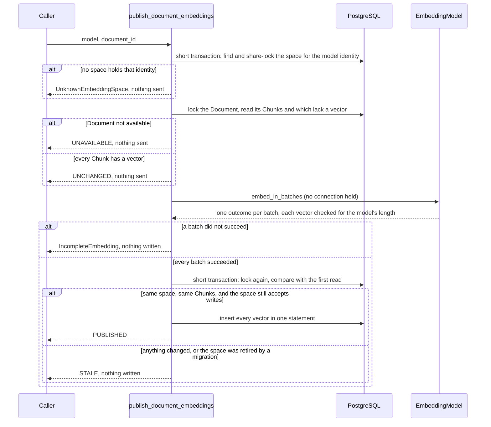

# M04-T12 — Pass the dense-retrieval understanding gate

Source task: [M04-T12](../curriculum/milestones/M04-dense-retrieval/M04-T12-pass-the-dense-retrieval-gate.md)

## What you will do

This is the M04 gate. It mixes writing, diagnosis, and one small feature:

| Requirement | How this lesson meets it |
|---|---|
| Explain embedding and index versioning | Step 2: you answer four questions in the evidence file, from the code. |
| Redraw publication and search | Step 3: you draw both flows from memory, then bring the two diagrams in `docs/architecture.md` up to date with the code. |
| Diagnose a dimension mismatch | Step 4: you predict, then run one script that sends a wrong-length vector through four layers, and trace which layer refused it. |
| Add one filter without a recipe | Steps 5–7: you plan a **Document filter** ("search only inside these Documents") on your own, then compare with the verified version and add it with tests. |
| Filter enforced in storage, ranking preserved | Step 7's tests: the filter is in the same SQL `WHERE` as the permission check, and filtered results keep the exact order and distances of the unfiltered ones. |
| Authorization preserved, no seeded text in telemetry | Naming a Document the reader may not see returns the same empty result as naming one that does not exist; filter values reach PostgreSQL only as one bound parameter. |

This lesson includes coding: Steps 6 and 7 write code. Steps 1, 2, 4, 5, and 8 are writing and running commands, and Step 3 edits Markdown diagrams.

Terms used in this lesson:

- **Embedding model identity:** provider, model name, and number of dimensions together. Vectors are comparable only when all three match.
- **Embedding Space:** the stored home of one identity's vectors. Exactly one space is **current**: the one search reads.
- **Index configuration:** every setting that shapes a stored vector (parsing, chunking, model, scaling, distance), with one fingerprint for all of them.
- **Existence oracle:** a difference in answers that tells a reader whether a hidden thing exists. A filter must not create one.

## Before you begin

- **What already exists.** `search_similar_chunks` (M04-T06 to M04-T10) ranks the Chunks one reader may see. Optional `filters` are typed `MetadataCondition`s from a fixed list: Source, media type, language, and modified-since (M04-T08). `metadata_predicate` turns each one into a fixed SQL clause with bound values, added to the same `WHERE` as eligibility.
- **Why a Document filter.** It is the smallest filter that answers a real need: "search only in the handbook pages I picked" or "ask a follow-up about the Document just cited". It needs no new table, because `documents.document_id` is already in the search's join.
- **The two risks it carries.**
  - It must only narrow. A filter that names a Document the reader may not see must not show it, and must not even reveal that it exists: the answer has to look exactly like the one for a made-up ID.
  - Its values come from the caller. They must reach PostgreSQL as one array parameter, never as SQL text, and anything that is not a real `DocumentId` must be refused before the database is used.
- **What the prototype and its review found.** An independent review attacked the first version against the real database. It confirmed the filter never showed a hidden or tombstoned Document (150 random queries with planted hidden matches), kept the ranking, and gave no existence oracle. It broke the input check three ways, all fixed in the code below with tests that fail without the fix:
  - **The UUID inside an ID could be altered.** The check looked at the ID's `value` but not inside the UUID. A UUID whose number was swapped for text, `-1`, or `None` reached the database and failed there with a raw `DataError`, `OverflowError`, or `TypeError`.
  - **An ID could change after it was checked.** The checked condition still pointed at the caller's own ID objects, and the search waits on the database before it builds the statement, so another task could alter an ID in between.
  - **An ID with its `value` deleted** raised `AttributeError` instead of `UnsupportedFilter`.

  The fix: a condition now keeps **its own copies** of the IDs, rebuilt from checked numbers, so what was checked is exactly what is sent. This also hardens the existing Source filter, which shared the same check.
- **Running the integration tests.** Read the URL inline in each command, so the password is never printed or saved:

  ```bash
  KNOWLEDGE_SERVICE_TEST_DATABASE_URL="$(uv run python scripts/test_database_url.py)" uv run pytest tests/test_retrieval_filters_integration.py -q -m integration
  ```

- **Files you will touch:**
  - new evidence file `docs/evidence/M04-T12-dense-retrieval-gate.md`
  - `docs/architecture.md`
  - `src/knowledge_service/retrieval_filters.py`, `src/knowledge_service/persistence.py`
  - `tests/test_retrieval_filters.py`, `tests/test_vector_search.py`, `tests/test_retrieval_filters_integration.py`

  Leave the task spec and `PROGRESS.md` alone until Step 8.

## Walkthrough

### Step 1 — No coding in this step: write the invariant and your predictions

**Invariant:** search compares a query only with vectors of the same model identity, in the one current Embedding Space, and only among Chunks the reader may see. Every filter is part of the same SQL statement and only narrows it: a filtered result is the unfiltered result with some Chunks removed, in the same order and at the same distances, and it never reveals a Chunk, or the existence of a Document, the reader may not see.

**Action:** create `docs/evidence/M04-T12-dense-retrieval-gate.md`:

```markdown
# M04-T12 — Dense-retrieval gate evidence

Completed: pending

## Invariant

Pending.

## Prediction

Before running anything, say what you expect when the vector length is
wrong at each place: the provider answers 1024 numbers for a 1536-dimension
model; the configured dimensions change from 1536 to 1024 and search runs
with the new setting; search gets a 1024-number query for the 1536 model;
a 1024-number vector is written into the 1536 space. For each, name the
error and the layer that raises it.

For the Document filter: what a search returns when it names a Document
the reader may not see; when it names a Document that does not exist; and
whether the order of the remaining Chunks can change.

## Embedding and index versioning

Pending.

## Publication and search

Pending.

## Dimension mismatch diagnosis

Pending.

## Filter plan

Pending.

## Design

Pending.

## Verification

Pending.

## Reflection

Pending.
```

**Check:** the file holds the invariant in your own words and your predictions.

### Step 2 — No coding in this step: explain embedding and index versioning

Read the code below and answer in `## Embedding and index versioning`, in your own words.

| Read | Look for |
|---|---|
| `src/knowledge_service/embeddings.py` | `EmbeddingModelIdentity`, and `checked_batch`, which every adapter calls on a provider's answer. |
| `src/knowledge_service/persistence.py`, tables `embedding_spaces` and `chunk_embeddings` | Which columns make a space unique, how "at most one current" is enforced, and the two rules that stop a wrong-length vector (`fk_chunk_embeddings_space_dimensions`, `ck_chunk_embeddings_dimensions`). |
| `src/knowledge_service/index_configuration.py` | What `IndexConfiguration` holds and why its `fingerprint` is one hash of everything. |
| `src/knowledge_service/embedding_migration.py` | The three states and what publication and search do in each. |

Answer these questions:

1. Why is the number of dimensions part of a model's identity, and not just a setting next to it?
2. What is the difference between an Embedding Space and an index configuration? Which one does search look at, and which one tells you whether two vectors were made the same way?
3. Name three changes that need a new index configuration even though the model stays the same.
4. You switch from one model to another. Why does the project create a new space and migrate, instead of re-embedding in place?

**Check:** each answer names the type, table, or function it relies on.

### Step 3 — No coding in this step: redraw publication and search

First, on paper, draw from memory what happens when a Document's Chunks are published as vectors, and what happens when a reader searches. Then compare with the code: `publish_document_embeddings` in `embedding_publication.py` and `search_similar_chunks` in `vector_search.py`.

The two diagrams in `docs/architecture.md` were drawn in M04-T05 and M04-T06. M04-T10 changed both flows, and the publication diagram never showed the early exits. Replace them so they match the code.

**Action 1:** in `docs/architecture.md`, under `#### Embedding publication as built in M04`, replace the mermaid block with:

````markdown

````

**Action 2:** under `#### Vector search as built in M04`, change the paragraph's filter list and line wrapping to:

```markdown
distance runs from 0 (same direction) to 2 (opposite). Optional metadata
filters (Source, Document, media type, language, modified since) are typed
conditions from a fixed list; they are added to the same WHERE and only
narrow it.
```

Then, in the same diagram, replace everything from `    alt not current` to the closing fence with:

````markdown
    alt not current
        Search-->>Caller: NoCurrentEmbeddingSpace
    else current
        Search->>DB: one SELECT: space still current AND available AND a matching Access Grant AND every filter AND a real distance, ORDER BY distance, Chunk ID, LIMIT k + 1
        DB-->>Search: eligible Chunks with provenance and distance
        alt no rows and the space is no longer current
            Search-->>Caller: NoCurrentEmbeddingSpace (a migration switched meanwhile)
        else
            Search-->>Caller: VectorSearchResult: up to k ranked Candidates, nearest first, and whether more exist
        end
    end
```
````

Before you paste, trace every arrow to the line of code that does it. Then, in `## Publication and search` of the evidence, write what your paper drawing missed and what the old diagrams missed.

**Check:** `make docs-check` passes.

### Step 4 — No coding in this step: diagnose a dimension mismatch

**The incident.** Someone changes the OpenAI setting `embedding_dimensions` from 1536 to 1024 to save storage. Every search now fails. Where does a wrong vector length get caught, and by whom?

Write your predictions in Step 1 first. Then run the script below from the repository root. It uses the dedicated `knowledge_service_benchmark` database from M04-T11, creates a 1536-dimension space inside a transaction, and rolls everything back: nothing is left behind and no provider is called.

```bash
export KNOWLEDGE_SERVICE_DATABASE_URL="$(uv run python scripts/test_database_url.py | sed 's#/knowledge_service_test$#/knowledge_service_benchmark#')"
uv run python - <<'PY'
import asyncio
import uuid
from datetime import UTC, datetime

import sqlalchemy as sa

from knowledge_service.access import AuthorizationContext
from knowledge_service.database import create_database_runtime
from knowledge_service.embeddings import (
    EmbeddingModelIdentity,
    EmbeddingUsage,
    checked_batch,
)
from knowledge_service.identifiers import ChunkId, EmbeddingSpaceId, UserId
from knowledge_service.persistence import embedding_spaces, insert_chunk_embeddings
from knowledge_service.settings import Settings
from knowledge_service.vector_search import search_similar_chunks

STORED = EmbeddingModelIdentity("openai", "text-embedding-3-small", 1536)
CONFIGURED = EmbeddingModelIdentity("openai", "text-embedding-3-small", 1024)
READER = AuthorizationContext(user_id=UserId(uuid.UUID(int=1)))


def show(case: str, error: BaseException) -> None:
    print(f"{case:34} {type(error).__name__}: {error}".splitlines()[0][:160])


async def main() -> None:
    print("1. provider answers 1024 numbers for a 1536-dimension model")
    try:
        checked_batch(STORED, [[0.1] * 1024], EmbeddingUsage(1, 1), expected=1)
    except Exception as error:
        show("   checked_batch", error)

    runtime = create_database_runtime(Settings())
    async with runtime.engine.connect() as connection:
        transaction = await connection.begin()
        try:
            space_id = EmbeddingSpaceId.new()
            await connection.execute(
                sa.insert(embedding_spaces).values(
                    space_id=space_id.value,
                    provider=STORED.provider,
                    model=STORED.model,
                    dimensions=STORED.dimensions,
                    is_current=True,
                    created_at=datetime.now(UTC),
                )
            )
            print("2. the setting changed to 1024; search with the new identity")
            try:
                await search_similar_chunks(
                    connection,
                    identity=CONFIGURED,
                    query=(0.1,) * 1024,
                    context=READER,
                    limit=5,
                )
            except Exception as error:
                show("   search_similar_chunks", error)
            print("3. the stored identity, but a 1024-number query")
            try:
                await search_similar_chunks(
                    connection,
                    identity=STORED,
                    query=(0.1,) * 1024,
                    context=READER,
                    limit=5,
                )
            except Exception as error:
                show("   search_similar_chunks", error)
            print("4. write a 1024-number vector into the 1536 space")
            try:
                async with connection.begin_nested():
                    await insert_chunk_embeddings(
                        connection,
                        space_id=space_id,
                        dimensions=STORED.dimensions,
                        vectors={ChunkId.new(): (0.1,) * 1024},
                        created_at=datetime.now(UTC),
                    )
            except Exception as error:
                orig = getattr(error, "orig", error)
                name = getattr(getattr(orig, "diag", None), "constraint_name", None)
                case = "   insert_chunk_embeddings"
                print(f"{case:34} {type(orig).__name__}: constraint {name}")
        finally:
            await transaction.rollback()
    await runtime.dispose()


asyncio.run(main())
PY
unset KNOWLEDGE_SERVICE_DATABASE_URL
```

The reference run printed:

```text
1. provider answers 1024 numbers for a 1536-dimension model
   checked_batch                   EmbeddingMalformedResponse: vector 0 has 1024 dimensions, expected 1536
2. the setting changed to 1024; search with the new identity
   search_similar_chunks           NoCurrentEmbeddingSpace: the current embedding space is another model
3. the stored identity, but a 1024-number query
   search_similar_chunks           InvalidVectorQuery: query has 1024 dimensions, expected 1536
4. write a 1024-number vector into the 1536 space
   insert_chunk_embeddings         CheckViolation: constraint ck_chunk_embeddings_dimensions
```

If the benchmark database is gone, recreate and migrate it as in M04-T11 Step 5 first.

Answer in `## Dimension mismatch diagnosis`:

1. For each of the four cases: which layer refused it (provider adapter, search, or the database), and what would have gone wrong if that layer did not exist?
2. Case 2 is the incident. Why does search say "another model" when only the dimensions changed? What would publication raise for the same setting (read `publish_document_embeddings`)?
3. What is the right fix for the incident: change the setting back, edit the stored vectors, or start an embedding migration to a 1024-dimension space? Why?
4. Which of your predictions were wrong?

**Check:** your answers name the error type and the line of code that raised each one.

### Step 5 — No coding in this step: plan the Document filter yourself

The task asks for one filter "without a recipe". Before you read Step 6, write your own plan in `## Filter plan`:

- Which files change, and what each change is.
- What the caller passes, and which values must be refused.
- The SQL condition, and where it sits in the search statement.
- Three tests: one success, the highest-risk edge, and one typed failure.

Use `FilterField.SOURCE` as your model: follow it from `retrieval_filters.py` through `_condition_clause` in `persistence.py`.

**Check:** the plan exists before you open Step 6. Afterwards, write down what your plan missed.

### Step 6 — Coding step: add the Document filter

**In plain words:** a search can now be told "only look inside these Documents". The filter checks that every value really is a Document ID, keeps its own copies of them so nobody can change them later, and adds one condition to the search's database query next to the permission check. A Document the reader may not see stays invisible, even when the filter names it.

What changes:

| File | Change |
|---|---|
| `retrieval_filters.py` | New field `DOCUMENT` with operator `ANY_OF` and `DocumentId` values. Both ID fields (`SOURCE`, `DOCUMENT`) now go through `_copied_ids`, which checks every ID down to the number inside its UUID and stores fresh copies. |
| `persistence.py` | `_condition_clause` maps `DOCUMENT` to `documents.document_id = ANY(:document_ids)`, one array parameter. |

**Edit 1 — `src/knowledge_service/retrieval_filters.py`.** Add the row to the module docstring's table, after the `SOURCE` row:

```markdown
| `DOCUMENT` | `ANY_OF` | a non-empty frozenset of `DocumentId` |
```

Import `DocumentId`:

```python
from knowledge_service.identifiers import DocumentId, SourceId
```

Add the field to `FilterField`, after `SOURCE`:

```python
    DOCUMENT = "document"
```

Add `FilterField.DOCUMENT: FilterOperator.ANY_OF,` to `_ALLOWED_OPERATOR` after the `SOURCE` line, and replace `_ELEMENT_TYPE` and `FilterValue` with:

```python
_ID_FIELDS = frozenset({FilterField.SOURCE, FilterField.DOCUMENT})

_ELEMENT_TYPE: dict[FilterField, type] = {
    FilterField.SOURCE: SourceId,
    FilterField.DOCUMENT: DocumentId,
    FilterField.MEDIA_TYPE: str,
    FilterField.LANGUAGE: Language,
}

type FilterValue = (
    frozenset[SourceId]
    | frozenset[DocumentId]
    | frozenset[str]
    | frozenset[Language]
    | datetime
)
```

In `MetadataCondition.__post_init__`, add the `elif` branch, so the end of the method reads:

```python
            object.__setattr__(self, "value", _utc_moment(self.value))
        elif self.field in _ID_FIELDS:
            object.__setattr__(self, "value", _copied_ids(self.field, self.value))
        else:
            _check_values(self.field, self.value)
```

In `_check_values`, delete the whole `if field is FilterField.SOURCE and any(...)` block with its `raise UnsupportedFilter("every source value must hold a UUID")`. `_copied_ids` replaces it for both ID fields. Then add this function above `_is_media_type`:

```python
def _copied_ids(
    field: FilterField, value: object
) -> frozenset[SourceId] | frozenset[DocumentId]:
    """Return new IDs rebuilt from the checked numbers of the given ones.

    An ID, and even the UUID inside it, can be altered after it was made,
    also while a search waits on the database. The condition keeps these
    copies, which no caller holds, so what was checked is what is sent.
    """
    _check_values(field, value)
    kind = cast(type[SourceId] | type[DocumentId], _ELEMENT_TYPE[field])
    copies: set[SourceId | DocumentId] = set()
    for element in cast(frozenset[object], value):
        uuid = getattr(element, "value", None)
        number = getattr(uuid, "int", None) if type(uuid) is UUID else None
        if type(number) is not int or not 0 <= number < 2**128:
            raise UnsupportedFilter(f"every {field.value} value must hold a UUID")
        copies.add(kind(UUID(int=number)))
    return cast(frozenset[SourceId] | frozenset[DocumentId], frozenset(copies))
```

Why each part is there:

- `_check_values` runs first, so the value is a non-empty frozenset of at most 100 elements, each exactly a `DocumentId` (a `SourceId` is refused, even though it also holds a UUID).
- `getattr(..., None)` turns a deleted `value` or `int` into a refusal instead of an `AttributeError`.
- `UUID(int=number)` builds a new UUID from a checked number, and `kind(...)` a new ID around it. The caller never holds these copies, so nothing can change them after the check.

**Edit 2 — `src/knowledge_service/persistence.py`.** In `metadata_predicate`'s docstring, change the last sentence to:

```python
    condition; a Source or Document condition still matches it.
```

In `_condition_clause`, add this case after the `FilterField.SOURCE` case (`DocumentId` is already imported there):

```python
        case FilterField.DOCUMENT:
            document_ids = cast(frozenset[DocumentId], condition.value)
            return documents.c.document_id == _any_of(
                "document_ids", sorted(d.value for d in document_ids), sa.Uuid()
            )
```

It joins nothing new: `documents` is already in the search's join, and the clause lands in the same `WHERE` as eligibility, so PostgreSQL drops non-matching Chunks before it orders by distance and applies the limit. The `match` ends in `assert_never`, so pyright would have flagged a missing case.

**Check:** `uv run pyright` reports 0 errors, and `uv run pytest tests/test_retrieval_filters.py -q` fails only in `test_a_source_id_altered_to_hold_text_is_refused`. That test alters the caller's ID after the condition was made, and the condition now holds its own copy. Step 7 replaces it.

### Step 7 — Coding step: test the filter

**In plain words:** these tests prove the new filter keeps every promise of search. They check that only real Document IDs are accepted, that the IDs reach the database only as a value and never as SQL text, that filtered results keep exactly the same order and distances, and that naming a hidden Document looks the same as naming one that does not exist.

| Test | Proves |
|---|---|
| allowlist cases in `test_retrieval_filters.py` | `DOCUMENT` accepts only a frozenset of 1 to 100 `DocumentId`s, with `ANY_OF`. |
| `test_an_id_altered_inside_a_condition_is_refused`, `test_a_uuid_altered_inside_an_id_is_refused`, `test_an_id_without_its_value_is_refused` | Tampered IDs raise `UnsupportedFilter`, never a raw error. |
| `test_a_condition_keeps_its_own_copies_of_the_ids` | Altering the caller's ID after the check changes nothing. |
| `test_the_reader_and_the_query_are_bound_parameters` | The Document ID is a bound array value, not SQL text. |
| `test_a_document_filter_keeps_the_ranking_of_the_documents_it_names` | Same Chunks, order, distances, ranks, and `truncated` as the unfiltered result (success). |
| `test_a_document_filter_orders_equal_distances_by_chunk_id` | The tie-break survives the filter. |
| `test_naming_a_document_the_reader_may_not_see_finds_nothing` | No hidden Document and no existence oracle (highest-risk edge). |
| `test_a_document_id_altered_to_hold_text_is_refused_before_the_search` | Typed failure at the search boundary. |

**Edit 1 — `tests/test_retrieval_filters.py`.** Import `DocumentId` and add a constant:

```python
from knowledge_service.identifiers import DocumentId, SourceId, UserId
```

```python
DOCUMENT = DocumentId(UUID(int=2))
```

(put it right after `SOURCE = SourceId(UUID(int=1))`). In `test_each_field_accepts_its_one_operator`'s list, after the `SOURCE` line, add:

```python
        (FilterField.DOCUMENT, ANY_OF, frozenset({DOCUMENT})),
```

In `test_anything_outside_the_allowlist_is_refused`'s list, after the line `(FilterField.SOURCE, ANY_OF, frozenset({UserId(UUID(int=1))})),`, add:

```python
        (FilterField.DOCUMENT, ON_OR_AFTER, frozenset({DOCUMENT})),
        (FilterField.DOCUMENT, ANY_OF, frozenset[DocumentId]()),
        (FilterField.DOCUMENT, ANY_OF, [DOCUMENT]),
        (FilterField.DOCUMENT, ANY_OF, frozenset({DOCUMENT.value})),
        (FilterField.DOCUMENT, ANY_OF, frozenset({str(DOCUMENT.value)})),
        # A Source ID is a UUID too, but names another kind of thing.
        (FilterField.DOCUMENT, ANY_OF, frozenset({SOURCE})),
        (
            FilterField.DOCUMENT,
            ANY_OF,
            frozenset(DocumentId(UUID(int=i)) for i in range(MAX_FILTER_VALUES + 1)),
        ),
```

Replace `test_a_source_id_altered_to_hold_text_is_refused` with these four tests:

```python
@pytest.mark.parametrize(
    ("field", "value"),
    [
        (FilterField.SOURCE, frozenset({SOURCE})),
        (FilterField.DOCUMENT, frozenset({DOCUMENT})),
    ],
)
def test_an_id_altered_inside_a_condition_is_refused(
    field: FilterField, value: FilterValue
) -> None:
    condition = MetadataCondition(field, ANY_OF, value)
    (held,) = cast(frozenset[SourceId | DocumentId], condition.value)
    # Once reached PostgreSQL and failed there with a DataError.
    object.__setattr__(held, "value", "' OR 1=1 --")

    with pytest.raises(UnsupportedFilter):
        checked_conditions([condition])


def test_a_condition_keeps_its_own_copies_of_the_ids() -> None:
    document = DocumentId(UUID(int=2))
    condition = MetadataCondition(FilterField.DOCUMENT, ANY_OF, frozenset({document}))
    # The caller, or another task while the search waits, alters its own ID.
    object.__setattr__(document, "value", "' OR 1=1 --")

    (checked,) = checked_conditions([condition])

    assert checked.value == frozenset({DocumentId(UUID(int=2))})


@pytest.mark.parametrize("number", ["' OR true --", -1, 2**200, None])
def test_a_uuid_altered_inside_an_id_is_refused(number: object) -> None:
    uuid = UUID(int=2)
    object.__setattr__(uuid, "int", number)

    with pytest.raises(UnsupportedFilter):
        MetadataCondition(FilterField.DOCUMENT, ANY_OF, frozenset({DocumentId(uuid)}))


def test_an_id_without_its_value_is_refused() -> None:
    document = DocumentId(UUID(int=2))
    documents = frozenset({document})
    object.__delattr__(document, "value")

    with pytest.raises(UnsupportedFilter):
        MetadataCondition(FilterField.DOCUMENT, ANY_OF, documents)
```

The first test now alters the copy *inside* the condition, which is the only one a search uses, so the check must catch it again.

**Edit 2 — `tests/test_vector_search.py`.** After `GROUP = ...`, add:

```python
DOCUMENT = DocumentId.parse("00000000-0000-0000-0000-0000000000c1")
```

In `test_the_reader_and_the_query_are_bound_parameters`, add a third condition after the `LANGUAGE` one:

```python
                MetadataCondition(
                    FilterField.DOCUMENT,
                    FilterOperator.ANY_OF,
                    frozenset({DOCUMENT}),
                ),
```

and two assertions: `assert str(DOCUMENT.value) not in sql` after `assert "'uk'" not in sql`, and `assert [DOCUMENT.value] in values` after `assert ["uk"] in values`.

**Edit 3 — `tests/test_retrieval_filters_integration.py`.** Add `from uuid import UUID` after `from typing import cast`. Add this helper after `modified_since`:

```python
def in_documents(*document_ids: DocumentId) -> MetadataCondition:
    return MetadataCondition(
        FilterField.DOCUMENT, FilterOperator.ANY_OF, frozenset(document_ids)
    )
```

Append these tests at the end of the file:

```python
@pytest.mark.integration
async def test_a_document_filter_keeps_the_ranking_of_the_documents_it_names(
    runtime: DatabaseRuntime,
) -> None:
    await a_corpus(runtime)
    everything = await search(runtime, ())
    named = {"uk-old.txt", "en-old.txt", "uk-new.md"}
    chosen = [c for c in everything.candidates if c.external_id in named]
    ids = [c.document_id for c in chosen]

    filtered = await search(runtime, (in_documents(*ids),))
    nearest = await search(runtime, (in_documents(*ids),), limit=2)

    # The same Chunks, in the same order, at the same distances.
    assert [(c.chunk_id, c.distance) for c in filtered.candidates] == [
        (c.chunk_id, c.distance) for c in chosen
    ]
    assert [c.rank for c in filtered.candidates] == [1, 2, 3]
    assert filtered.truncated is False
    assert names(nearest) == ["en-old.txt", "uk-new.md"]
    assert nearest.truncated is True


@pytest.mark.integration
async def test_a_document_filter_orders_equal_distances_by_chunk_id(
    runtime: DatabaseRuntime,
) -> None:
    for name in ("twin-a.txt", "twin-b.txt", "twin-c.txt"):
        await a_document(
            runtime,
            a_record(
                name,
                source=HANDBOOK,
                media_type="text/plain",
                text=ENGLISH,
                modified_at=None,
            ),
            vector=[0.0, 0.0, 1.0],
        )
    everything = await search(runtime, ())
    ids = [c.document_id for c in everything.candidates]

    result = await search(runtime, (in_documents(*ids),))

    chunk_ids = [c.chunk_id for c in result.candidates]
    assert len({c.distance for c in result.candidates}) == 1
    assert chunk_ids == sorted(chunk_ids, key=lambda chunk_id: chunk_id.value)


@pytest.mark.integration
async def test_naming_a_document_the_reader_may_not_see_finds_nothing(
    runtime: DatabaseRuntime,
) -> None:
    hidden = await a_document(
        runtime,
        a_record(
            "hidden.md",
            source=WIKI,
            media_type="text/markdown",
            text=ENGLISH,
            modified_at=None,
        ),
        vector=[1.0, 0.0, 0.0],
        readers=[Subject.user(OTHER_USER)],
    )
    visible = await a_document(
        runtime,
        a_record(
            "visible.md",
            source=WIKI,
            media_type="text/markdown",
            text=ENGLISH,
            modified_at=None,
        ),
        vector=[0.0, 1.0, 0.0],
    )

    only_hidden = await search(runtime, (in_documents(hidden),))
    unknown = await search(runtime, (in_documents(DocumentId.new()),))
    both = await search(runtime, (in_documents(hidden, visible),), limit=1)

    # A hidden Document looks exactly like one that does not exist.
    assert only_hidden == unknown
    assert names(only_hidden) == []
    assert only_hidden.truncated is False
    assert names(both) == ["visible.md"]
    assert both.truncated is False


@pytest.mark.integration
async def test_a_document_id_altered_to_hold_text_is_refused_before_the_search(
    runtime: DatabaseRuntime,
) -> None:
    await a_corpus(runtime)
    condition = in_documents(DocumentId(UUID(int=1)))
    (held,) = cast(frozenset[DocumentId], condition.value)
    object.__setattr__(held, "value", "' OR true --")

    with pytest.raises(UnsupportedFilter):
        await search(runtime, (condition,))
```

The hidden Document is the exact nearest match to the query, so it is the first thing a broken filter would show. With `limit=1`, `truncated` is False for `both`: the hidden Chunk is not counted as "more".

**Check:**

```bash
uv run pytest tests/test_retrieval_filters.py tests/test_vector_search.py -q
KNOWLEDGE_SERVICE_TEST_DATABASE_URL="$(uv run python scripts/test_database_url.py)" uv run pytest tests/test_retrieval_filters_integration.py -q -m integration
```

Expected: 95 passed, then 26 passed. To see the tests do their job, temporarily make the `DOCUMENT` case `return sa.true()`: the ranking test, the hidden-Document test, and the bound-parameter test fail. Undo it afterwards.

### Step 8 — No coding in this step: gates, evidence, and progress

Run these in order and keep the outputs:

```bash
uv run pytest tests/test_retrieval_filters.py tests/test_vector_search.py -q
make test-integration
make format-check
make lint
make typecheck
make check
make docs-check
```

Expected: everything passes. On the reference run, `make check` reported 1078 passed and 3 deselected, and `make test-integration` 200 passed.

Then complete the evidence file:

- **Design:** the changed files, the filter's SQL condition, and why the IDs are copied.
- **Verification:** the commands and counts, the diagnosis output, and the deliberate break from Step 7.
- **Reflection:** your answers to the questions below.

`docs/architecture.md` is the only diagram that changed (Step 3). Finally, mark the task completed, add the M04-T12 row to `docs/curriculum/PROGRESS.md`, set the next task to M05-T01 (Index English full-text search), and commit with `m04-t12: pass the dense retrieval gate`.

## Reflection questions

1. What does `MetadataCondition` hide from whoever calls search? List the things a caller never has to think about, such as how a value becomes SQL or what happens if they change an ID later.
2. Suppose someone later switches search to the HNSW index from M04-T11 to make it faster. What would happen to a Document filter that names only two Documents, and how would you notice?
3. Why must a search that names a hidden Document return exactly the same answer as one that names a made-up ID? What could a reader learn if the two answers differed, even slightly?
4. What test or measurement could prove your answers wrong? Think about a filter with 100 Documents, many readers at once, or a Document that is tombstoned while a search runs.

## Completion checklist

- [ ] The evidence file has the invariant and your predictions, written before running anything.
- [ ] You answered the four versioning questions from the code.
- [ ] Both diagrams in `docs/architecture.md` match the code, and you noted what your own drawing missed.
- [ ] You ran the diagnosis script and explained each of the four refusals and the right fix.
- [ ] You wrote your own filter plan before reading Step 6.
- [ ] `FilterField.DOCUMENT` works, and the tests prove: same ranking, no hidden Document and no existence oracle, typed refusal of bad IDs.
- [ ] All gates pass: format, lint, types, unit, integration, docs.
- [ ] The evidence file has the design, verification, and your reflection.
- [ ] The PROGRESS row is added and the commit is made.

When you have written the code, share it or any error output, and I will review it against this checklist.
