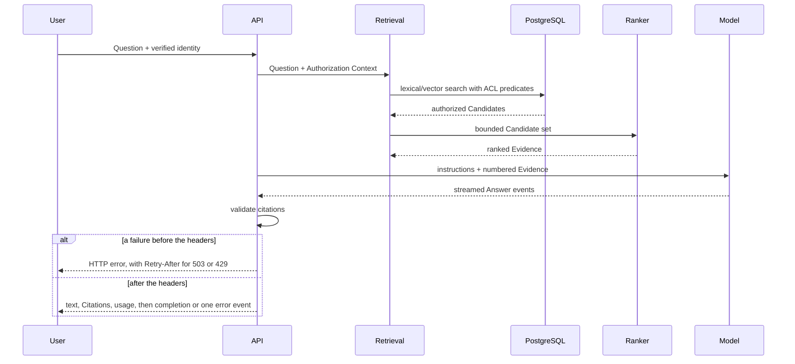
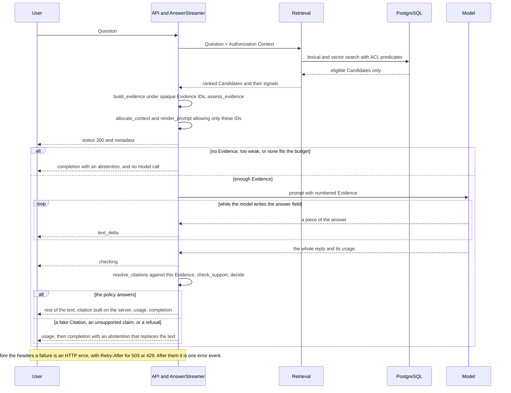

# M06-T14 — Pass the answering understanding gate

Source task: [M06-T14](../curriculum/milestones/M06-answers-and-conversations/M06-T14-pass-the-answering-gate.md)

## What you will do

This gate checks that you understand how an Answer is built from Evidence, end to end, by asking you to explain it, draw it, debug it, and extend it. There are four parts: explain the evidence flow in your own words, redraw the answering sequence diagram so it matches the code, diagnose what happens when a model invents a Citation, and add one new SSE event without a step-by-step recipe.

- The explanation and the diagram show you can follow a Question from retrieval to the last event.
- The diagnosis shows a fake Citation is already stopped, but the stream's record could not say why; the fix records it.
- The new event, `checking`, tells the client the model has finished and the server is checking its reply. It needs a new protocol version, and the reader must still read old streams.

| The task asks for | Where it happens |
|---|---|
| Explain the Answer evidence flow | Step 2: under `## Evidence flow` |
| Update the sequence diagram | Step 2: the answering diagram in `docs/architecture.md` |
| Diagnose a fake Citation | Step 3: a script, the chain under `## Fake Citation`, and Step 5's repair of the record |
| Add one SSE event without a recipe | Steps 4 and 5: design `checking` from a brief, then compare with the reference |
| Validation and client reconstruction stayed compatible | Step 6: the reader reads version `1` and `2`; with or without `checking`, a client rebuilds the same Answer |
| Tests: success, highest-risk edge, typed failure | Step 6: `tests/test_answering_gate.py` |
| No seeded text in telemetry | Step 6: a marker in the answer and in a fake Citation never reaches a record |

This lesson includes coding: Steps 4, 5, and 6 write code. Steps 1, 2, 3, 7, and 8 do not, though Step 2 edits the architecture document and Step 3 runs a script.

Terms used in this lesson:

- **Evidence ID:** the opaque name, `E` and eight random hex digits such as `E50316490`, that a Chunk gets for one request only. The model cites Evidence by this ID, never by a Chunk or Document ID.
- **Fake Citation:** a reference the model writes that is not one of this request's Evidence IDs: invented, copied from another request, malformed, or a real Chunk ID.
- **Protocol version:** the number in the `metadata` event that says which rules the rest of the stream follows. A reader that does not know the number refuses the stream at its first event.
- **Backward compatible:** a new reader still reads every stream an older server wrote, and rebuilds it the same way.

## Before you begin

This section explains the choices behind the code, so each step makes sense when you reach it.

- **What already exists.** M06-T01 to T13 built every piece: Evidence under opaque IDs, the prompt, the context budget, `generate_answer` and its checks, Citations rebuilt on the server, the support check and the abstention policy, the event contract, the streamer, follow-up resolution, and the failure policy. The architecture diagram for answering is older than most of them.
- **A fake Citation is already stopped.** The model's reply is checked by `resolve_citations` against this request's own Evidence. Any reference that is not one of its IDs makes the reply `invalid`, the policy abstains with `answer_failed`, no `citation` event is ever sent, and the client replaces the streamed text with the fixed message. What was missing is the record: it said only `abstained`, so an operator could not tell a fake Citation from an unsupported claim or a refusal. The record now holds the abstention `reason`, how the reply was judged (`reply`), and the rule it broke (`defect`), names only.
- **Why a `checking` event.** After the model's last word, the server still checks the reply: the Citations, every claim against its Evidence, and the policy. With a model as the support judge, that can take seconds of silence. `checking` tells the client the model is done and the answer is being verified, so a screen can say so. It holds no data, so it reveals nothing about the reply; it is sent the same way for a good reply and a fake one.
- **Where it goes.** Once, as soon as the whole reply arrived, before any Citation, usage, or terminal event. Text may still follow it: text the model did not stream as it wrote is sent only after the decision to answer.
- **Version `2`.** A version `1` reader does not know `checking` and would refuse a new stream as malformed, without saying why. So the writer now says version `2`. The reader reads both: version `1` without `checking` and with the M01 retry owners it had then, version `2` with `checking` and the after-headers guidance of M06-T13. A version `1` reader refuses a version `2` stream at its first event, which is the clearest way to tell a client it is too old. This also settles the M06-T13 limit, where the stricter retry check had kept version `1`.
- **Compatible, proved.** A property test builds the same stream with and without `checking` and checks a client rebuilds the same Answer, or refuses both for the same reason. Another rewrites a stream as a version `1` server wrote it and checks it rebuilds the same.
- **What the review found.** An independent adversarial review attacked the new event, the record, and the diagram. `checking` is sent in every path where the model replied and in none where it did not; it reveals nothing, since it is sent alike for good and fake replies; a client leaving right after it is recorded as cancelled with the model's stream closed; every fake Citation it tried, from invented and other-request IDs to a real Chunk ID and an upper-cased ID, was stopped with no `citation` event; and no marker reached a record. It found these problems, each fixed with a test that fails without the fix:
  - A version `1` reader refused every new stream as malformed, while the stream still said version `1`. Now the writer says version `2`, and the reader reads both.
  - The gate's own property test failed for text with nothing visible, because the writer refused that Answer before the test could compare. Now the test compares what the writer or the reader made of each stream.
  - A refused reply and streamed text that differs from the checked Answer were both recorded as `answer_failed` with no defect. Now the record also says how the reply was judged.
  - A stream that failed after a refused decision kept that decision's reason. Now a reason is recorded only with its completion.
  - Documented, not fixed: the reader accepts a few orders the server never writes; they change nothing a client rebuilds.
- **Where the code lives.** `answering/events.py` and `answering/streaming.py`; one sentence in `answering/stream_failures.py`; three existing tests that pin the event order or the version; the new `tests/test_answering_gate.py`; and `docs/architecture.md`.
- **Known limits.** The reader accepts a few orders the server never writes, such as `checking` right before an abstention with no usage; they change nothing a client rebuilds. `confirm_citations` is still not in the streamed path; M07 wires it with the real reader identity. The record says why an Answer failed, but not which Citation was fake, on purpose: its value came from the model.

## Walkthrough

### Step 1 — No coding in this step: write the invariant and your predictions

Before any code exists, write what must be true when the lesson is done. Step 7 checks the predictions.

Create `docs/evidence/M06-T14-answering-gate.md`:

```markdown
# M06-T14 — Answering gate evidence

## Invariant

A streamed Answer uses only Evidence the reader may see, under opaque IDs
of this request; a Citation the model writes is kept only when it is one of
those IDs, and is rebuilt from its Evidence on the server. A reply with a
fake Citation is never shown: the client gets an abstention, no `citation`
event, and the stream's record says `answer_failed`, `invalid`, and
`invalid_citation`. The writer writes protocol version `2`, with at most
one `checking` event once the model's whole reply has arrived and before
any Citation, usage, or terminal event. The reader reads versions `1` and
`2`, and a client rebuilds the same Answer from a stream with or without
`checking`. No record holds Answer text or a Citation value.

## Expected failing check

Before the change, `uv run python -c "from knowledge_service.answering.events import EventName; EventName('checking')"`
fails with `ValueError`.

## Predictions

- What the client sees, event by event, when the model cites an Evidence ID that is not in its prompt: ...
- What the stream's record says about that stream before this change, and what an operator could not tell from it: ...
- What a version `1` reader does with a stream that holds a `checking` event, and why that calls for a new version: ...
- How many gate tests fail if the reader accepts a second `checking`: ...

## Evidence flow

## Diagram

## Fake Citation

## New event

## Design

## Verification

## Decision

## Reflection
```

Check: the file exists, the failing check fails, and every prediction is a full sentence Step 7 can prove wrong.

### Step 2 — No coding in this step: explain the evidence flow and redraw the diagram

This step asks you to explain, from memory first, how a Question becomes an Answer with Citations, and then to make the diagram say the same.

**Action 1:** under `## Evidence flow`, write one short paragraph for each stage, in order, naming the function that does it and what it guarantees: retrieval with the permission check, Evidence under opaque IDs, judging the Evidence before any model call, the context budget and the prompt, the model's stream, checking the reply and its Citations, the support check and the decision, and what the client receives. Write it before you read the code again; then check each claim against the code and correct it.

**Action 2:** redraw the answering diagram so it matches `AnswerStreamer`, and mention `checking` and the new record in the `answering` row.

In `docs/architecture.md`:

**1.** Find:

```markdown
| Package | Module | Main entry points |
|---|---|---|
| `ingestion` | Source synchronization, Document normalization, Indexing | `synchronize_source`, `normalize`, `reconcile_document` |
| `ingestion.parsers` | Document normalization | `parse_text`, `parse_markdown`, `parse_html`, `parse_pdf` |
| `embeddings` | Indexing (vectors) | `EmbeddingModel` (`port`), `OpenAIEmbeddingModel` (managed), `LocalEmbeddingModel` (BGE-M3 over HTTP, pinned revision), `SparseModel` (`sparse`, the port for sparse term weights; M05-T10 prototype only), `publish_document_embeddings`, the migration workflow |
| `retrieval` | Retrieval | `search_similar_chunks`, `search_lexical_chunks` (routes each Question to English, `simple`, or both; `simple` reads a Question's topic words, without Ukrainian stop words, and needs two of them), `search_english_chunks`, `search_ukrainian_chunks`, `Candidate` (the fields every branch returns), `fuse_ranked_candidates` (Reciprocal Rank Fusion of branch Candidates), `retrieve_hybrid` (both branches at once under one deadline, fused, with per-branch diagnostics), `MetadataCondition`, `load_dataset` / `verify_corpus` / `run_dataset` / `compare_branches` (the bilingual seed Evaluation Dataset in `datasets/bilingual-seed/`, run lexical, dense, and fused), `recall_at` / `reciprocal_rank` (Recall@k and MRR), `compare_sparse` with `search_sparse_chunks` (M05-T10 prototype: BGE-M3 sparse weights against PostgreSQL word search; no default uses it), `Reranker` (`reranking`, the port for cross-encoder scores) with `rerank_candidates` (reorders eligible Candidates within the reranker's limits under one deadline) and `LocalReranker` (`local_reranker`, bge-reranker-v2-m3 over HTTP, pinned revision), `compare_reranking` (fused retrieval before and after reranking; no default reranks yet), `RankingModel` (`llm_reranking`, the port for a language model that returns a ranking) with `rerank_with_llm` (orders the top eligible Candidates under opaque IDs within a candidate and token budget, checks the ranking, keeps retrieval's order on any failure, and returns the billed usage) and `OpenAIRankingModel` (`openai_ranking`, a pinned model over the Responses API with Structured Outputs), `compare_llm_reranking` (the same comparison with fallbacks and cost), `compare_reranking_strategies` (no reranker, the cross-encoder, and the language model on the same Candidates of each case, with quality, latency, and cost per case), `classify_question` (`rewrite_classes`, one rewrite class per Question and the words any rewrite must keep; any word with a digit, or with `_`, `@`, `/`, `.`, `:`, or a backslash inside it, is `exact_identifier` and never rewritten) with `load_rewrite_cases` / `score_rewrite_cases` (`rewrite_cases`, the verified labels in `datasets/bilingual-seed/rewrite-classes.json` and how often the rules agree), `rewrite_question` (`query_rewriting`, the `RewriteModel` port: a Question is sent only when its class is switched on in a `RewritePolicy`, and its rewrite is used only when it keeps every word to keep, every typed identifier, and the stated language, and adds no search operator; otherwise the Question is searched as typed) with `OpenAIRewriteModel` (`openai_rewriting`, a pinned model over the Responses API; `QUERY_REWRITE_CLASSES` is the policy flag, empty by default), and `compare_rewriting` with `score_rewriting` / `check_rollout` (`rewrite_evaluation`, the gain per class on `datasets/bilingual-seed/rewrite-retrieval.json`; a class that harms a case, was not fully measured, or does not gain is not rolled out) |
| `answering` | Question answering | `build_evidence` / `EvidenceSet` (`evidence`, the Chunks an Answer may use, each under a fresh opaque `EvidenceId`, with provenance, excerpt, and source link copied from retrieval) and `resolve_citations` / `read_citations` (`citations`, a model's Evidence IDs checked against the request's own set: unknown, malformed, or mismatched references are refused, a repeated one is cited once, and a repeat in stored Citations read back is refused, and a Citation's provenance always comes from the server), `render_prompt` (`prompt`, the fixed policy, the Question and numbered Evidence as one escaped JSON document, and a response schema that allows only this request's Evidence IDs), `allocate_context` (`context_budget`, splits a `ContextBudget` between the fixed policy, the Answer and History reserves, the Question, and Evidence; keeps the longest head of retrieval's order whose counted prompt fits, drops the rest whole, and reports kept and dropped Evidence IDs with token counts), `generate_answer` (`generation`, the `AnswerModel` port: fits the context, sends the counted prompt once, and checks the reply on the server into one outcome, answered with Citations of Evidence in the prompt, abstained with a reason, refused, invalid with a named defect, or no Evidence without a call; provider failures raise the M01 `ChatModelError` family) with `OpenAIAnswerModel` (`openai_answering`, a pinned model over the Responses API with Structured Outputs; `AnswerSettings` gives the budget), `confirm_citations` (`current_citations`, run after generation and before the client: one query rechecks every cited Chunk under the retrieval permission check and its current version; one Chunk that is gone, rewritten, tombstoned, or no longer visible withdraws the whole Answer, keeping its usage, and confirmed Citations are rebuilt from the stored rows), `check_support` (`support`, splits an Answer into claims by position and asks a versioned `SupportJudge`, the deterministic `LexicalSupportJudge` or a `ModelSupportJudge` over any `AnswerModel`, which cited Evidence supports each claim; the server keeps a finding only for a quote found in cited Evidence on word boundaries that holds the claim's numbers, and returns a separate `SupportReport` bound to the judge's version and the answer text's SHA-256, never editing the Answer), `decide` (`abstention`, the answer policy: `assess_evidence` judges retrieval before any model call as empty or weak by a threshold calibrated for one `RerankerIdentity`, `find_conflicts` finds cited Documents that disagree on a claim's numbers, and `decide` answers, or abstains with one reason and a fixed bilingual message, answering only with a support report of this exact text; empty, unauthorized, and withdrawn read the same; `classify`, `score_abstention`, and `calibrate_threshold` measure correct answers, correct abstentions, over-abstentions, and unsupported answers against labelled cases), `AnswerEventWriter` / `AnswerEventReader` (`events`, the SSE event contract of a streamed Answer: `metadata`, then `text_delta`, `citation`, and at most one `usage`, then one terminal `completion` or `error`, with IDs counting up from 0; the writer refuses an event out of order without changing the stream, and the reader refuses invalid order, lost or repeated events, a cut-off stream, any spelling but the writer's, or a stream over its limits, and rebuilds the Answer however the bytes are split; an answer needs visible text, a Citation, and its usage, Citations never precede an abstention, and abstentions and errors carry only their fixed messages), and `AnswerStreamer` (`streaming`, behind `POST /v1/answer/stream`: finds and judges Evidence before any byte, so its failures stay HTTP errors; then pulls the model's stream one event at a time, passes the answer's text on as it arrives, checks the whole reply and lets an `AnswerFinisher` decide, and sends Citations only after an `answer` decision and the usage before the terminal event; one deadline covers it all, and a client that leaves cancels the work and closes the model's stream through `EventStreamResponse`), `stream_failure` (`stream_failures`, one policy per failure kind and phase: before the headers an HTTP error with the M01 status and, for an outage or a limit, a `Retry-After` header; after them one terminal `error` event, the caller's to retry for an outage or a limit, a validation failure reported as internal; a database that is unreachable, overloaded, or too slow is an outage, any other database error a bug; every stream is recorded with its phase, one audit outcome, and what became of its partial text), and `load_history` (`history`, the earlier turns of the reader's own Conversation within `history_tokens`: recent turns whole, older ones as their Questions; an Answer's text only when it was answered and every Chunk it and every earlier Answer cited is current and visible to the reader now, so a revoked, deleted, or rewritten Document never returns through an old Answer; Questions and their replies are stored together by `add_turn`, with the reply's outcome and cited Chunks), and `resolve_question` (`follow_up`, a follow-up Question made standalone for search: only the `follow_up` class is ever sent to the `RewriteModel`, with the earlier Questions of the History and never an Answer; the rewrite must stay in the stated language and keep the Question's words to keep and the identifiers and acronyms of the newest earlier Question, or the Question is searched as typed; a `ResolvedQuestion` records both texts and how the search text was chosen) with `compare_resolution` (`follow_up_evaluation`, the bilingual rewrite cases replayed as stored Conversations and searched with and without resolution) |
| `persistence` | PostgreSQL implementation | `schema` and one module per kind of record |

Domain values, settings, the database runtime, and the HTTP application stay
at the top level.

Model runtimes that need their own Python live outside `src/`, each as its
```

Replace with:

```markdown
| Package | Module | Main entry points |
|---|---|---|
| `ingestion` | Source synchronization, Document normalization, Indexing | `synchronize_source`, `normalize`, `reconcile_document` |
| `ingestion.parsers` | Document normalization | `parse_text`, `parse_markdown`, `parse_html`, `parse_pdf` |
| `embeddings` | Indexing (vectors) | `EmbeddingModel` (`port`), `OpenAIEmbeddingModel` (managed), `LocalEmbeddingModel` (BGE-M3 over HTTP, pinned revision), `SparseModel` (`sparse`, the port for sparse term weights; M05-T10 prototype only), `publish_document_embeddings`, the migration workflow |
| `retrieval` | Retrieval | `search_similar_chunks`, `search_lexical_chunks` (routes each Question to English, `simple`, or both; `simple` reads a Question's topic words, without Ukrainian stop words, and needs two of them), `search_english_chunks`, `search_ukrainian_chunks`, `Candidate` (the fields every branch returns), `fuse_ranked_candidates` (Reciprocal Rank Fusion of branch Candidates), `retrieve_hybrid` (both branches at once under one deadline, fused, with per-branch diagnostics), `MetadataCondition`, `load_dataset` / `verify_corpus` / `run_dataset` / `compare_branches` (the bilingual seed Evaluation Dataset in `datasets/bilingual-seed/`, run lexical, dense, and fused), `recall_at` / `reciprocal_rank` (Recall@k and MRR), `compare_sparse` with `search_sparse_chunks` (M05-T10 prototype: BGE-M3 sparse weights against PostgreSQL word search; no default uses it), `Reranker` (`reranking`, the port for cross-encoder scores) with `rerank_candidates` (reorders eligible Candidates within the reranker's limits under one deadline) and `LocalReranker` (`local_reranker`, bge-reranker-v2-m3 over HTTP, pinned revision), `compare_reranking` (fused retrieval before and after reranking; no default reranks yet), `RankingModel` (`llm_reranking`, the port for a language model that returns a ranking) with `rerank_with_llm` (orders the top eligible Candidates under opaque IDs within a candidate and token budget, checks the ranking, keeps retrieval's order on any failure, and returns the billed usage) and `OpenAIRankingModel` (`openai_ranking`, a pinned model over the Responses API with Structured Outputs), `compare_llm_reranking` (the same comparison with fallbacks and cost), `compare_reranking_strategies` (no reranker, the cross-encoder, and the language model on the same Candidates of each case, with quality, latency, and cost per case), `classify_question` (`rewrite_classes`, one rewrite class per Question and the words any rewrite must keep; any word with a digit, or with `_`, `@`, `/`, `.`, `:`, or a backslash inside it, is `exact_identifier` and never rewritten) with `load_rewrite_cases` / `score_rewrite_cases` (`rewrite_cases`, the verified labels in `datasets/bilingual-seed/rewrite-classes.json` and how often the rules agree), `rewrite_question` (`query_rewriting`, the `RewriteModel` port: a Question is sent only when its class is switched on in a `RewritePolicy`, and its rewrite is used only when it keeps every word to keep, every typed identifier, and the stated language, and adds no search operator; otherwise the Question is searched as typed) with `OpenAIRewriteModel` (`openai_rewriting`, a pinned model over the Responses API; `QUERY_REWRITE_CLASSES` is the policy flag, empty by default), and `compare_rewriting` with `score_rewriting` / `check_rollout` (`rewrite_evaluation`, the gain per class on `datasets/bilingual-seed/rewrite-retrieval.json`; a class that harms a case, was not fully measured, or does not gain is not rolled out) |
| `answering` | Question answering | `build_evidence` / `EvidenceSet` (`evidence`, the Chunks an Answer may use, each under a fresh opaque `EvidenceId`, with provenance, excerpt, and source link copied from retrieval) and `resolve_citations` / `read_citations` (`citations`, a model's Evidence IDs checked against the request's own set: unknown, malformed, or mismatched references are refused, a repeated one is cited once, and a repeat in stored Citations read back is refused, and a Citation's provenance always comes from the server), `render_prompt` (`prompt`, the fixed policy, the Question and numbered Evidence as one escaped JSON document, and a response schema that allows only this request's Evidence IDs), `allocate_context` (`context_budget`, splits a `ContextBudget` between the fixed policy, the Answer and History reserves, the Question, and Evidence; keeps the longest head of retrieval's order whose counted prompt fits, drops the rest whole, and reports kept and dropped Evidence IDs with token counts), `generate_answer` (`generation`, the `AnswerModel` port: fits the context, sends the counted prompt once, and checks the reply on the server into one outcome, answered with Citations of Evidence in the prompt, abstained with a reason, refused, invalid with a named defect, or no Evidence without a call; provider failures raise the M01 `ChatModelError` family) with `OpenAIAnswerModel` (`openai_answering`, a pinned model over the Responses API with Structured Outputs; `AnswerSettings` gives the budget), `confirm_citations` (`current_citations`, run after generation and before the client: one query rechecks every cited Chunk under the retrieval permission check and its current version; one Chunk that is gone, rewritten, tombstoned, or no longer visible withdraws the whole Answer, keeping its usage, and confirmed Citations are rebuilt from the stored rows), `check_support` (`support`, splits an Answer into claims by position and asks a versioned `SupportJudge`, the deterministic `LexicalSupportJudge` or a `ModelSupportJudge` over any `AnswerModel`, which cited Evidence supports each claim; the server keeps a finding only for a quote found in cited Evidence on word boundaries that holds the claim's numbers, and returns a separate `SupportReport` bound to the judge's version and the answer text's SHA-256, never editing the Answer), `decide` (`abstention`, the answer policy: `assess_evidence` judges retrieval before any model call as empty or weak by a threshold calibrated for one `RerankerIdentity`, `find_conflicts` finds cited Documents that disagree on a claim's numbers, and `decide` answers, or abstains with one reason and a fixed bilingual message, answering only with a support report of this exact text; empty, unauthorized, and withdrawn read the same; `classify`, `score_abstention`, and `calibrate_threshold` measure correct answers, correct abstentions, over-abstentions, and unsupported answers against labelled cases), `AnswerEventWriter` / `AnswerEventReader` (`events`, the SSE event contract of a streamed Answer: `metadata`, then `text_delta`, at most one `checking` once the model is done, `citation`, and at most one `usage`, then one terminal `completion` or `error`, with IDs counting up from 0; the writer refuses an event out of order without changing the stream, and the reader refuses invalid order, lost or repeated events, a cut-off stream, any spelling but the writer's, or a stream over its limits, and rebuilds the Answer however the bytes are split; an answer needs visible text, a Citation, and its usage, Citations never precede an abstention, and abstentions and errors carry only their fixed messages), and `AnswerStreamer` (`streaming`, behind `POST /v1/answer/stream`: finds and judges Evidence before any byte, so its failures stay HTTP errors; then pulls the model's stream one event at a time, passes the answer's text on as it arrives, sends `checking`, checks the whole reply and lets an `AnswerFinisher` decide, and sends Citations only after an `answer` decision and the usage before the terminal event; one deadline covers it all, and a client that leaves cancels the work and closes the model's stream through `EventStreamResponse`), `stream_failure` (`stream_failures`, one policy per failure kind and phase: before the headers an HTTP error with the M01 status and, for an outage or a limit, a `Retry-After` header; after them one terminal `error` event, the caller's to retry for an outage or a limit, a validation failure reported as internal; a database that is unreachable, overloaded, or too slow is an outage, any other database error a bug; every stream is recorded with its phase, one audit outcome, what became of its partial text, and for an abstention its reason and any defect of the reply, such as `invalid_citation`), and `load_history` (`history`, the earlier turns of the reader's own Conversation within `history_tokens`: recent turns whole, older ones as their Questions; an Answer's text only when it was answered and every Chunk it and every earlier Answer cited is current and visible to the reader now, so a revoked, deleted, or rewritten Document never returns through an old Answer; Questions and their replies are stored together by `add_turn`, with the reply's outcome and cited Chunks), and `resolve_question` (`follow_up`, a follow-up Question made standalone for search: only the `follow_up` class is ever sent to the `RewriteModel`, with the earlier Questions of the History and never an Answer; the rewrite must stay in the stated language and keep the Question's words to keep and the identifiers and acronyms of the newest earlier Question, or the Question is searched as typed; a `ResolvedQuestion` records both texts and how the search text was chosen) with `compare_resolution` (`follow_up_evaluation`, the bilingual rewrite cases replayed as stored Conversations and searched with and without resolution) |
| `persistence` | PostgreSQL implementation | `schema` and one module per kind of record |

Domain values, settings, the database runtime, and the HTTP application stay
at the top level.

Model runtimes that need their own Python live outside `src/`, each as its
```

**2.** Find:

````markdown
        Hybrid-->>Caller: HybridRetrieval: up to limit fused Candidates and per-branch diagnostics
    end
```

### Answering



## Deliberate exclusions from the default path

- LangGraph and multi-agent orchestration do not replace ordinary question answering.
- MCP is an additional protocol adapter, not the owner of search logic.
````

Replace with:

````markdown
        Hybrid-->>Caller: HybridRetrieval: up to limit fused Candidates and per-branch diagnostics
    end
```

### Answering

The streamed path, `POST /v1/answer/stream`, as `AnswerStreamer` runs it.
The model only ever sees Evidence the reader may see, under opaque IDs, and
nothing it writes about its sources is trusted: a Citation is resolved
against this request's own Evidence and rebuilt from it on the server.



## Deliberate exclusions from the default path

- LangGraph and multi-agent orchestration do not replace ordinary question answering.
- MCP is an additional protocol adapter, not the owner of search logic.
````

Then, under `## Diagram`, write two sentences: what the old diagram got wrong, and which detail you missed in your first attempt.

Check: `make docs-check` passes, and every arrow of the new diagram names a step you can find in `answering/streaming.py` or the modules it calls.

### Step 3 — No coding in this step: diagnose a fake Citation

This step runs a stream whose model cites an Evidence ID that was never in its prompt, and follows what the code does with it.

**Action 1:** run the stream and print what the client and the record saw:

```bash
PYTHONPATH=tests uv run python - <<'PY'
import asyncio
import logging

from knowledge_service.answering.evidence import EvidenceId
from test_streaming import Model, chunks, names, rebuilt, reply_json, streamer


class LastRecord(logging.Handler):
    def emit(self, record: logging.LogRecord) -> None:
        if record.getMessage() == "answer stream ended":
            self.fields = record.answer_stream


async def main() -> None:
    handler = LastRecord()
    logging.getLogger("knowledge_service").addHandler(handler)
    logging.getLogger("knowledge_service").setLevel(logging.INFO)
    fake = EvidenceId.new().value  # a well-formed ID that is not in the prompt
    sent = await chunks(streamer(Model(final=reply_json(citations=[fake]))))
    result = rebuilt(sent)
    print("events: ", names(sent))
    print("client: ", result.outcome, result.reason, repr(result.text))
    keys = ("audit_outcome", "partial_text", "citations", "reason", "reply", "defect")
    print("record: ", {key: handler.fields.get(key, "(missing)") for key in keys})


asyncio.run(main())
PY
```

Expected, before Steps 4 and 5: the events are `metadata`, seven `text_delta`, `usage`, and `completion`; the client gets `abstained answer_failed ''`; the record holds `'audit_outcome': 'abstained'` and `'partial_text': 'replaced'`, and `reason`, `reply`, and `defect` are `(missing)`.

**Action 2:** under `## Fake Citation`, write the chain from evidence, one link per line: where the fake ID was refused (`resolve_citations` inside `checked_answer`, defect `invalid_citation`), how the reply became `invalid`, why the policy abstained with `answer_failed`, why no `citation` event was sent, what the client shows, and why the record could not tell this from an unsupported claim. End with the repair: record the reason, the reply's outcome, and its defect.

### Step 4 — Coding step: design the `checking` event, then compare

This step adds one event to the contract. Try it yourself first, from the brief, and only then compare with the reference.

**In plain words:** The stream gains one signal that says "the model has finished; the answer is being checked". It carries nothing, comes at most once, and never changes what a client rebuilds. Because an older client would not understand it, the stream now says it follows version 2 of the rules, and the reader keeps reading version 1 as before.

The brief, as a gate would give it:

- Name `checking`, data `{}`, at most once per stream.
- Allowed after `metadata` and after text; refused after a Citation, usage, or a terminal event; text may follow it.
- Writer method `checking()`; the reader checks the same rules, with the same `_Rules`.
- Protocol version `2`; the reader reads `1` and `2`, refuses `checking` in a version `1` stream, and checks a version `1` error against the M01 retry owner.
- A client rebuilds the same Answer with or without it.

The reference, once you have tried:

| Part | What changes |
|---|---|
| `EventName.CHECKING`, `CheckingData` | The event and its empty, strict data |
| `_AFTER`, `_Rules.checking` | Where it may come, and only once |
| `EVENT_PROTOCOL_VERSION`, `MetadataData.version`, `_Rules.version` | Version `2` written, `1` and `2` read |
| `_FIRST_ERRORS` | What a version `1` error was allowed to say |

In `src/knowledge_service/answering/events.py`:

**1.** Find:

```python
the events; `AnswerEventReader` reads them back as a client would and
rebuilds the Answer. Both check every event against one set of rules, so
whatever the writer sends, the reader accepts.

The order of one stream:

    metadata  text_delta*  citation*  usage?  (completion | error)

- **`metadata` first.** Exactly once: the protocol version and the
  request ID. A request that fails before it is an HTTP error, not a
  stream.
- **Text, then Citations, then usage.** `text_delta` events hold the
  Answer's text in pieces; joined, they are the text. `citation` events
  follow, each Evidence once; `usage` follows, at most once.
- **One terminal event, last.** `completion` or `error` ends the stream;
  nothing may follow it, and a stream that stops without one is cut off.
- **What the client keeps.** `completion` with `answer` keeps the text and
  the Citations; it needs visible text, a Citation, and the usage.
  `completion` with `abstain` replaces any streamed text with the fixed
  message of its reason, and an `error` replaces it with the fixed message
```

Replace with:

```python
the events; `AnswerEventReader` reads them back as a client would and
rebuilds the Answer. Both check every event against one set of rules, so
whatever the writer sends, the reader accepts.

The order of one stream:

    metadata  text_delta*  (checking  text_delta*)?  citation*  usage?
    (completion | error)

- **`metadata` first.** Exactly once: the protocol version and the
  request ID. A request that fails before it is an HTTP error, not a
  stream.
- **Versions.** The writer writes version `2`: the `checking` event and
  the retry guidance of `stream_failures` came with it. The reader also
  reads version `1`, as servers wrote it before: no `checking`, and the
  retry owner of the M01 error policy. A version `1` reader refuses a
  version `2` stream at its first event, so a client that is too old
  learns it at once instead of misreading the Answer.
- **Text, then Citations, then usage.** `text_delta` events hold the
  Answer's text in pieces; joined, they are the text. `citation` events
  follow, each Evidence once; `usage` follows, at most once.
- **`checking` when the model is done.** Version `2` only. At most once, before any
  Citation, usage, or terminal event: the model has finished and the
  server is checking its reply before it decides, which can take a while.
  It holds no data and changes nothing a client rebuilds; the end of the
  text may still follow it, because text the model did not stream as it
  wrote is sent only once the server has decided to answer.
- **One terminal event, last.** `completion` or `error` ends the stream;
  nothing may follow it, and a stream that stops without one is cut off.
- **What the client keeps.** `completion` with `answer` keeps the text and
  the Citations; it needs visible text, a Citation, and the usage.
  `completion` with `abstain` replaces any streamed text with the fixed
  message of its reason, and an `error` replaces it with the fixed message
```

**2.** Find:

```python
)
from knowledge_service.answering.evidence import MAX_EVIDENCE, EvidenceId
from knowledge_service.answering.generation import MAX_ANSWER_CHARACTERS
from knowledge_service.answering.prompt import has_visible_text
from knowledge_service.answering.stream_failures import StreamPhase, stream_failure
from knowledge_service.contracts import Usage
from knowledge_service.errors import FailureKind, RetryOwner
from knowledge_service.language import Language

EVENT_PROTOCOL_VERSION = "1"
MAX_EVENT_CHARACTERS = 131_072
_ID = re.compile(r"id: (0|[1-9][0-9]{0,8})")
_STRICT = ConfigDict(extra="forbid", strict=True, frozen=True)
_TOKENS = ("input_tokens", "output_tokens", "total_tokens")
MAX_TOKENS = 2**53 - 1

```

Replace with:

```python
)
from knowledge_service.answering.evidence import MAX_EVIDENCE, EvidenceId
from knowledge_service.answering.generation import MAX_ANSWER_CHARACTERS
from knowledge_service.answering.prompt import has_visible_text
from knowledge_service.answering.stream_failures import StreamPhase, stream_failure
from knowledge_service.contracts import Usage
from knowledge_service.errors import FailureKind, RetryOwner, policy_for
from knowledge_service.language import Language

EVENT_PROTOCOL_VERSION = "2"
# The version servers wrote before `checking`; still read, never written.
_FIRST_VERSION = "1"
MAX_EVENT_CHARACTERS = 131_072
_ID = re.compile(r"id: (0|[1-9][0-9]{0,8})")
_STRICT = ConfigDict(extra="forbid", strict=True, frozen=True)
_TOKENS = ("input_tokens", "output_tokens", "total_tokens")
MAX_TOKENS = 2**53 - 1

```

**3.** Find:

```python

class EventName(StrEnum):
    """The `event:` line of each kind of event."""

    METADATA = "metadata"
    TEXT_DELTA = "text_delta"
    CITATION = "citation"
    USAGE = "usage"
    COMPLETION = "completion"
    ERROR = "error"


```

Replace with:

```python

class EventName(StrEnum):
    """The `event:` line of each kind of event."""

    METADATA = "metadata"
    TEXT_DELTA = "text_delta"
    CHECKING = "checking"
    CITATION = "citation"
    USAGE = "usage"
    COMPLETION = "completion"
    ERROR = "error"


```

**4.** Find:

```python

class MetadataData(BaseModel):
    """The first event: which protocol, and which request."""

    model_config = _STRICT

    version: Literal["1"]
    request_id: str


class TextDeltaData(BaseModel):
    """The next piece of the Answer's text."""

    model_config = _STRICT

    text: str = Field(min_length=1, repr=False)


class UsageData(BaseModel):
    """The tokens the provider billed for this Answer."""

    model_config = _STRICT
```

Replace with:

```python

class MetadataData(BaseModel):
    """The first event: which protocol, and which request."""

    model_config = _STRICT

    version: Literal["1", "2"]
    request_id: str


class TextDeltaData(BaseModel):
    """The next piece of the Answer's text."""

    model_config = _STRICT

    text: str = Field(min_length=1, repr=False)


class CheckingData(BaseModel):
    """The model is done; the server is checking its reply. No data."""

    model_config = _STRICT


class UsageData(BaseModel):
    """The tokens the provider billed for this Answer."""

    model_config = _STRICT
```

**5.** Find:

```python
    retry: RetryOwner


type EventData = (
    MetadataData
    | TextDeltaData
    | CitationPayload
    | UsageData
    | CompletionData
    | ErrorData
)

_DATA: dict[EventName, type[BaseModel]] = {
    EventName.METADATA: MetadataData,
    EventName.TEXT_DELTA: TextDeltaData,
    EventName.CITATION: CitationPayload,
    EventName.USAGE: UsageData,
    EventName.COMPLETION: CompletionData,
    EventName.ERROR: ErrorData,
}

```

Replace with:

```python
    retry: RetryOwner


type EventData = (
    MetadataData
    | TextDeltaData
    | CheckingData
    | CitationPayload
    | UsageData
    | CompletionData
    | ErrorData
)

_DATA: dict[EventName, type[BaseModel]] = {
    EventName.METADATA: MetadataData,
    EventName.TEXT_DELTA: TextDeltaData,
    EventName.CHECKING: CheckingData,
    EventName.CITATION: CitationPayload,
    EventName.USAGE: UsageData,
    EventName.COMPLETION: CompletionData,
    EventName.ERROR: ErrorData,
}

```

**6.** Find:

```python
_AFTER: dict[EventName, tuple[frozenset[_Phase], _Phase]] = {
    EventName.METADATA: (frozenset({_Phase.START}), _Phase.METADATA),
    EventName.TEXT_DELTA: (
        frozenset({_Phase.METADATA, _Phase.TEXT}),
        _Phase.TEXT,
    ),
    EventName.CITATION: (
        frozenset({_Phase.METADATA, _Phase.TEXT, _Phase.CITATIONS}),
        _Phase.CITATIONS,
    ),
    EventName.USAGE: (
        frozenset({_Phase.METADATA, _Phase.TEXT, _Phase.CITATIONS}),
```

Replace with:

```python
_AFTER: dict[EventName, tuple[frozenset[_Phase], _Phase]] = {
    EventName.METADATA: (frozenset({_Phase.START}), _Phase.METADATA),
    EventName.TEXT_DELTA: (
        frozenset({_Phase.METADATA, _Phase.TEXT}),
        _Phase.TEXT,
    ),
    # Text may follow `checking`; `_Rules` keeps it to once.
    EventName.CHECKING: (frozenset({_Phase.METADATA, _Phase.TEXT}), _Phase.TEXT),
    EventName.CITATION: (
        frozenset({_Phase.METADATA, _Phase.TEXT, _Phase.CITATIONS}),
        _Phase.CITATIONS,
    ),
    EventName.USAGE: (
        frozenset({_Phase.METADATA, _Phase.TEXT, _Phase.CITATIONS}),
```

**7.** Find:

```python
        self.next_id = 0
        self.request_id: UUID | None = None
        self.text: list[str] = []
        self.characters = 0
        self.citations: list[CitationPayload] = []
        self.usage: UsageData | None = None
        self.result: StreamedAnswer | None = None

    def accept(self, event: AnswerEvent) -> None:
        """Take one event, or raise `InvalidEventStream` and change nothing."""
        if self.phase is _Phase.DONE:
            raise InvalidEventStream(StreamDefect.AFTER_TERMINAL)
```

Replace with:

```python
        self.next_id = 0
        self.request_id: UUID | None = None
        self.text: list[str] = []
        self.characters = 0
        self.citations: list[CitationPayload] = []
        self.usage: UsageData | None = None
        self.version = EVENT_PROTOCOL_VERSION
        self.checking = False
        self.result: StreamedAnswer | None = None

    def accept(self, event: AnswerEvent) -> None:
        """Take one event, or raise `InvalidEventStream` and change nothing."""
        if self.phase is _Phase.DONE:
            raise InvalidEventStream(StreamDefect.AFTER_TERMINAL)
```

**8.** Find:

```python
        self.next_id += 1

    def _take(self, data: EventData) -> None:
        match data:
            case MetadataData():
                self.request_id = _request_id(data.request_id)
            case TextDeltaData():
                if self.characters + len(data.text) > MAX_ANSWER_CHARACTERS:
                    raise InvalidEventStream(StreamDefect.TOO_LARGE)
                self.text.append(data.text)
                self.characters += len(data.text)
            case CitationPayload():
                if not _server_ids(data):
                    raise InvalidEventStream(StreamDefect.MALFORMED)
                if len(self.citations) >= MAX_EVIDENCE:
                    raise InvalidEventStream(StreamDefect.TOO_LARGE)
                if any(c.evidence_id == data.evidence_id for c in self.citations):
```

Replace with:

```python
        self.next_id += 1

    def _take(self, data: EventData) -> None:
        match data:
            case MetadataData():
                self.request_id = _request_id(data.request_id)
                self.version = data.version
            case TextDeltaData():
                if self.characters + len(data.text) > MAX_ANSWER_CHARACTERS:
                    raise InvalidEventStream(StreamDefect.TOO_LARGE)
                self.text.append(data.text)
                self.characters += len(data.text)
            case CheckingData():
                # Version 1 had no such event.
                if self.version == _FIRST_VERSION:
                    raise InvalidEventStream(StreamDefect.MALFORMED)
                if self.checking:
                    raise InvalidEventStream(StreamDefect.OUT_OF_ORDER)
                self.checking = True
            case CitationPayload():
                if not _server_ids(data):
                    raise InvalidEventStream(StreamDefect.MALFORMED)
                if len(self.citations) >= MAX_EVIDENCE:
                    raise InvalidEventStream(StreamDefect.TOO_LARGE)
                if any(c.evidence_id == data.evidence_id for c in self.citations):
```

**9.** Find:

```python
            raise InvalidEventStream(StreamDefect.OUT_OF_ORDER)
        return self._result(
            StreamOutcome.ABSTAINED, reason=data.reason, message=data.message
        )

    def _failed(self, data: ErrorData) -> StreamedAnswer:
        policy = _PUBLIC_ERRORS.get(data.code)
        if policy is None:
            raise InvalidEventStream(StreamDefect.UNKNOWN_ERROR)
        if data.message != policy.client_message or data.retry is not (
            policy.retry_owner
        ):
            raise InvalidEventStream(StreamDefect.MALFORMED)
```

Replace with:

```python
            raise InvalidEventStream(StreamDefect.OUT_OF_ORDER)
        return self._result(
            StreamOutcome.ABSTAINED, reason=data.reason, message=data.message
        )

    def _failed(self, data: ErrorData) -> StreamedAnswer:
        errors = _FIRST_ERRORS if self.version == _FIRST_VERSION else _PUBLIC_ERRORS
        policy = errors.get(data.code)
        if policy is None:
            raise InvalidEventStream(StreamDefect.UNKNOWN_ERROR)
        if data.message != policy.client_message or data.retry is not (
            policy.retry_owner
        ):
            raise InvalidEventStream(StreamDefect.MALFORMED)
```

**10.** Find:

```python
                version=EVENT_PROTOCOL_VERSION, request_id=str(self._request_id)
            ),
        )

    def text_delta(self, text: str) -> bytes:
        return self._write(EventName.TEXT_DELTA, lambda: TextDeltaData(text=text))

    def citation(self, citation: Citation) -> bytes:
        if type(citation) is not Citation:
            raise InvalidEventStream(StreamDefect.MALFORMED)
        return self._write(EventName.CITATION, lambda: citation_payload(citation))

```

Replace with:

```python
                version=EVENT_PROTOCOL_VERSION, request_id=str(self._request_id)
            ),
        )

    def text_delta(self, text: str) -> bytes:
        return self._write(EventName.TEXT_DELTA, lambda: TextDeltaData(text=text))

    def checking(self) -> bytes:
        return self._write(EventName.CHECKING, CheckingData)

    def citation(self, citation: Citation) -> bytes:
        if type(citation) is not Citation:
            raise InvalidEventStream(StreamDefect.MALFORMED)
        return self._write(EventName.CITATION, lambda: citation_payload(citation))

```

**11.** Find:

```python
    failure.public_code: _PublicError(failure.message, failure.retry)
    for kind in FailureKind
    if (failure := stream_failure(kind, StreamPhase.AFTER_HEADERS)).public_code
    is not None
    and failure.message is not None
}


def _messages(reason: AbstentionReason) -> frozenset[str]:
    return frozenset(abstention_message(reason, language) for language in Language)


```

Replace with:

```python
    failure.public_code: _PublicError(failure.message, failure.retry)
    for kind in FailureKind
    if (failure := stream_failure(kind, StreamPhase.AFTER_HEADERS)).public_code
    is not None
    and failure.message is not None
}
# What a version 1 error said: the M01 policy, before `stream_failures`.
_FIRST_ERRORS: dict[str, _PublicError] = {
    policy.public_code: _PublicError(policy.client_message, policy.retry_owner)
    for policy in map(policy_for, FailureKind)
    if policy.public_code is not None and policy.client_message is not None
}


def _messages(reason: AbstentionReason) -> frozenset[str]:
    return frozenset(abstention_message(reason, language) for language in Language)


```

In `src/knowledge_service/answering/stream_failures.py`:

Find:

```python
- **After the headers.** The status `200` and maybe some text are already
  out, so the status cannot change. The stream ends with one `error`
  event holding a public code, its fixed message, and who may retry. The
  service never retries a stream once text is out, because the text could
  differ, so an outage or a limit tells the caller to send the Question
  again. A validation failure here is the server's own, because the
  request was accepted, so it is reported as an internal error. The
  event reader accepts only this guidance; no client of the version `1`
  events had shipped before it changed, so the version stays `1`.

What every failure settles:

- **The partial text.** The client keeps streamed text only when the
  stream completes with an Answer. An abstention or an `error` replaces
  it with a fixed message; a client that leaves keeps an incomplete
```

Replace with:

```python
- **After the headers.** The status `200` and maybe some text are already
  out, so the status cannot change. The stream ends with one `error`
  event holding a public code, its fixed message, and who may retry. The
  service never retries a stream once text is out, because the text could
  differ, so an outage or a limit tells the caller to send the Question
  again. A validation failure here is the server's own, because the
  request was accepted, so it is reported as an internal error. Events
  of protocol version `2` carry this guidance; the reader still reads a
  version `1` error with the M01 retry owner it had then.

What every failure settles:

- **The partial text.** The client keeps streamed text only when the
  stream completes with an Answer. An abstention or an `error` replaces
  it with a fixed message; a client that leaves keeps an incomplete
```

Check:

```bash
uv run python -c "from knowledge_service.answering.events import EventName; EventName('checking')"
uv run pyright src/knowledge_service/answering/events.py
```

Expected: the first command prints nothing now, and pyright reports 0 errors.

### Step 5 — Coding step: send `checking` and record why an Answer failed

This step makes the streamer use the new event and repairs the record the diagnosis found lacking.

**In plain words:** As soon as the model's whole reply is in, the stream sends `checking`, then checks the reply. When the stream ends, its record now also says why the policy abstained, how the reply was judged, and which rule it broke, so a fake Citation shows up as `answer_failed`, `invalid`, `invalid_citation`. A reason is recorded only with the completion it belongs to.

| Part | What changes |
|---|---|
| `_events` | `yield writer.checking()` after the reply, before `_finished`; the reply's outcome and defect go to the record |
| The completion | Records the decision's `reason` before it is handed over |
| `_Span` | `reason`, `reply`, `defect` in "answer stream ended" |

In `src/knowledge_service/answering/streaming.py`:

**1.** Find:

```python
- **One deadline.** `timeout_seconds` covers finding Evidence, the model's
  whole stream, and the policy's checks. Before the first byte, running
  out is `AnswerDeadlineExceeded`; after it, the stream ends with an
  `error` event.
- **Text as it comes, the decision at the end.** The model writes JSON
  whose first field is the answer; its text is passed on piece by piece.
  The whole reply is then checked as `generate_answer` checks it, and the
  `AnswerFinisher` decides. The client keeps the text only if the decision
  is `answer`, and the streamed text is then exactly the checked text: a
  missing end is sent, and any other difference abstains.
- **Citations after the decision.** They are sent only once the decision
  is `answer`, so the title of a Document behind an Answer the policy
  rejects never leaves the server.
```

Replace with:

```python
- **One deadline.** `timeout_seconds` covers finding Evidence, the model's
  whole stream, and the policy's checks. Before the first byte, running
  out is `AnswerDeadlineExceeded`; after it, the stream ends with an
  `error` event.
- **Text as it comes, the decision at the end.** The model writes JSON
  whose first field is the answer; its text is passed on piece by piece.
  When the reply is complete, a `checking` event says so. The whole reply
  is then checked as `generate_answer` checks it, and the
  `AnswerFinisher` decides. The client keeps the text only if the decision
  is `answer`, and the streamed text is then exactly the checked text: a
  missing end is sent, and any other difference abstains.
- **Citations after the decision.** They are sent only once the decision
  is `answer`, so the title of a Document behind an Answer the policy
  rejects never leaves the server.
```

**2.** Find:

```python
  and bounded by `CLOSE_SECONDS`, so a stuck close cannot hold it.
- **One record per stream.** "answer stream started" and "answer stream
  ended" hold the request ID, counts, tokens, timing, and how the stream
  ended: `completed`, `failed`, or `cancelled`, also when it ends before
  its first event. The end also holds the phase it ended in, its audit
  outcome, and what became of the partial text, as `stream_failures`
  defines them. Never text.
"""

import asyncio
import contextlib
import logging
import re
```

Replace with:

```python
  and bounded by `CLOSE_SECONDS`, so a stuck close cannot hold it.
- **One record per stream.** "answer stream started" and "answer stream
  ended" hold the request ID, counts, tokens, timing, and how the stream
  ended: `completed`, `failed`, or `cancelled`, also when it ends before
  its first event. The end also holds the phase it ended in, its audit
  outcome, and what became of the partial text, as `stream_failures`
  defines them; for a completed abstention its reason; and, when the model
  replied, how its reply was judged (`answered`, `abstained`, `refused`,
  `invalid`) and the rule an invalid one broke, such as
  `invalid_citation`. Never text.
"""

import asyncio
import contextlib
import logging
import re
```

**3.** Find:

```python
)
from knowledge_service.answering.events import AnswerEventWriter, InvalidEventStream
from knowledge_service.answering.evidence import EvidenceSet
from knowledge_service.answering.generation import (
    MAX_ANSWER_CHARACTERS,
    MAX_REPLY_CHARACTERS,
    AnswerOutcome,
    AnswerResult,
    InvalidAnswerRequest,
    ModelIdentity,
    ModelReply,
    positive_seconds,
```

Replace with:

```python
)
from knowledge_service.answering.events import AnswerEventWriter, InvalidEventStream
from knowledge_service.answering.evidence import EvidenceSet
from knowledge_service.answering.generation import (
    MAX_ANSWER_CHARACTERS,
    MAX_REPLY_CHARACTERS,
    AnswerDefect,
    AnswerOutcome,
    AnswerResult,
    InvalidAnswerRequest,
    ModelIdentity,
    ModelReply,
    positive_seconds,
```

**4.** Find:

```python
                            if text:
                                span.sent(text)
                                yield writer.text_delta(text)
                    finally:
                        await _close(parts)
                    span.usage = reply.usage
                    finished = await self._finished(plan, context, reply, span)
            except asyncio.CancelledError:
                raise
            except Exception as error:
                failure = classify_failure(error)
                span.failure = type(error).__name__
            decision = None if failure is not None else self._decision(plan, finished)
```

Replace with:

```python
                            if text:
                                span.sent(text)
                                yield writer.text_delta(text)
                    finally:
                        await _close(parts)
                    span.usage = reply.usage
                    # The model is done; checking its reply can take a while.
                    yield writer.checking()
                    finished = await self._finished(plan, context, reply, span)
                    span.reply = finished.result.outcome
                    span.defect = finished.result.defect
            except asyncio.CancelledError:
                raise
            except Exception as error:
                failure = classify_failure(error)
                span.failure = type(error).__name__
            decision = None if failure is not None else self._decision(plan, finished)
```

**5.** Find:

```python
                    yield writer.usage(span.usage)
                if decision is not None:
                    completion = writer.completion(decision, plan.language)
                    # Recorded before it is handed over: a client that leaves
                    # after reading it got the whole stream.
                    span.outcome = "completed"
                    span.audit_outcome = finished_outcome(decision.decision)
                    span.partial_text = (
                        PartialText.KEPT
                        if decision.decision is Decision.ANSWER
                        else PartialText.REPLACED
                    )
```

Replace with:

```python
                    yield writer.usage(span.usage)
                if decision is not None:
                    completion = writer.completion(decision, plan.language)
                    # Recorded before it is handed over: a client that leaves
                    # after reading it got the whole stream.
                    span.outcome = "completed"
                    span.reason = decision.reason
                    span.audit_outcome = finished_outcome(decision.decision)
                    span.partial_text = (
                        PartialText.KEPT
                        if decision.decision is Decision.ANSWER
                        else PartialText.REPLACED
                    )
```

**6.** Find:

```python
    text: list[str] = field(default_factory=list[str], repr=False)
    characters: int = 0
    deltas: int = 0
    citations: int = 0
    usage: Usage | None = None
    failure: str | None = None
    outcome: str = "cancelled"
    phase: StreamPhase = StreamPhase.BEFORE_HEADERS
    audit_outcome: AuditOutcome = AuditOutcome.CANCELLED
    # What a client that left holds; a decision or an error sets it.
    partial_text: PartialText = PartialText.ABANDONED
    ended: bool = False
```

Replace with:

```python
    text: list[str] = field(default_factory=list[str], repr=False)
    characters: int = 0
    deltas: int = 0
    citations: int = 0
    usage: Usage | None = None
    failure: str | None = None
    # Why the policy abstained, and which rule a reply broke: names only.
    reason: AbstentionReason | None = None
    reply: AnswerOutcome | None = None
    defect: AnswerDefect | None = None
    outcome: str = "cancelled"
    phase: StreamPhase = StreamPhase.BEFORE_HEADERS
    audit_outcome: AuditOutcome = AuditOutcome.CANCELLED
    # What a client that left holds; a decision or an error sets it.
    partial_text: PartialText = PartialText.ABANDONED
    ended: bool = False
```

**7.** Find:

```python
            "citations": self.citations,
            "phase": str(self.phase),
            "audit_outcome": str(self.audit_outcome),
            "partial_text": str(
                self.partial_text if self.characters else PartialText.NONE
            ),
        }
        if self.usage is not None:
            fields["input_tokens"] = self.usage.input_tokens
            fields["output_tokens"] = self.usage.output_tokens
        level = logging.INFO if self.outcome == "completed" else logging.WARNING
        logger.log(level, "answer stream ended", extra={"answer_stream": fields})
```

Replace with:

```python
            "citations": self.citations,
            "phase": str(self.phase),
            "audit_outcome": str(self.audit_outcome),
            "partial_text": str(
                self.partial_text if self.characters else PartialText.NONE
            ),
            "reason": None if self.reason is None else str(self.reason),
            "reply": None if self.reply is None else str(self.reply),
            "defect": None if self.defect is None else str(self.defect),
        }
        if self.usage is not None:
            fields["input_tokens"] = self.usage.input_tokens
            fields["output_tokens"] = self.usage.output_tokens
        level = logging.INFO if self.outcome == "completed" else logging.WARNING
        logger.log(level, "answer stream ended", extra={"answer_stream": fields})
```

Check: run the Step 3 script again. Expected: `checking` appears between the last `text_delta` and `usage`, and the record now holds `'reason': 'answer_failed'`, `'reply': 'invalid'`, `'defect': 'invalid_citation'`.

### Step 6 — Coding step: tests for the gate

This step updates the three tests that pinned the old order or version, and proves the gate's claims.

**In plain words:** Two existing tests list the exact events of a stream, and one checks the exact bytes of the first event; they now expect `checking` and version `2`. The new tests send fake Citations of every kind and check what the client and the record get; check where `checking` comes and when it does not; prove a client rebuilds the same Answer with or without it; refuse it out of place; and read a version `1` stream.

| Test | What it proves |
|---|---|
| `test_a_fake_citation_withdraws_the_streamed_answer_and_is_recorded` | The diagnosis, for invented, other-request, malformed, and planted IDs: the highest-risk edge |
| `test_checking_comes_once_after_the_live_text_and_before_the_decision` | Success: where the server sends it |
| `test_no_checking_is_sent_when_no_reply_arrived` | No model call, or a model that failed |
| `test_checking_changes_nothing_a_client_rebuilds` | Compatibility, as a property test |
| `test_checking_out_of_place_is_refused` | Typed failure: `InvalidEventStream` with its defect |
| `test_the_writer_says_version_2_and_the_reader_still_reads_version_1` | Old streams still rebuild the same |
| `test_the_record_tells_apart_why_the_answer_failed` | A fake Citation, a refusal, and changed text are told apart |

In `tests/test_answer_events.py`:

**1.** Find:

```python

def test_the_stream_is_the_documented_text_format() -> None:
    first = answer_stream()[0].decode()

    assert first == (
        "id: 0\nevent: metadata\n"
        'data: {"version":"1","request_id":"00000000-0000-0000-0000-000000000049"}'
        "\n\n"
    )


def test_bytes_split_anywhere_rebuild_the_same_answer() -> None:
    whole = b"".join(answer_stream())
```

Replace with:

```python

def test_the_stream_is_the_documented_text_format() -> None:
    first = answer_stream()[0].decode()

    assert first == (
        "id: 0\nevent: metadata\n"
        'data: {"version":"2","request_id":"00000000-0000-0000-0000-000000000049"}'
        "\n\n"
    )


def test_bytes_split_anywhere_rebuild_the_same_answer() -> None:
    whole = b"".join(answer_stream())
```

**2.** Find:

```python
        b"id: 0\nevent: metadata\n\n",
        b"id: 0\nevent: shout\ndata: {}\n\n",
        b"id: 00\nevent: metadata\ndata: {}\n\n",
        b"event: metadata\nid: 0\ndata: {}\n\n",
        b"id: 0\nevent: metadata\ndata: []\n\n",
        b"id: 0\nevent: metadata\ndata: {}\nretry: 5\n\n",
        b'id: 0\nevent: metadata\ndata: {"version":"2",'
        b'"request_id":"00000000-0000-0000-0000-000000000049"}\n\n',
        b'id: 0\nevent: metadata\ndata: {"version":"1","request_id":"x"}\n\n',
        b'id: 0\nevent: metadata\ndata: {"version":"1",'
        b'"request_id":"{00000000-0000-0000-0000-000000000049}"}\n\n',
        b'id: 0\nevent: metadata\ndata: {"version":"1","version":"1",'
        b'"request_id":"00000000-0000-0000-0000-000000000049"}\n\n',
```

Replace with:

```python
        b"id: 0\nevent: metadata\n\n",
        b"id: 0\nevent: shout\ndata: {}\n\n",
        b"id: 00\nevent: metadata\ndata: {}\n\n",
        b"event: metadata\nid: 0\ndata: {}\n\n",
        b"id: 0\nevent: metadata\ndata: []\n\n",
        b"id: 0\nevent: metadata\ndata: {}\nretry: 5\n\n",
        b'id: 0\nevent: metadata\ndata: {"version":"3",'
        b'"request_id":"00000000-0000-0000-0000-000000000049"}\n\n',
        b'id: 0\nevent: metadata\ndata: {"version":"1","request_id":"x"}\n\n',
        b'id: 0\nevent: metadata\ndata: {"version":"1",'
        b'"request_id":"{00000000-0000-0000-0000-000000000049}"}\n\n',
        b'id: 0\nevent: metadata\ndata: {"version":"1","version":"1",'
        b'"request_id":"00000000-0000-0000-0000-000000000049"}\n\n',
```

In `tests/test_streaming.py`:

Find:

```python
    )

    sent = await chunks(streamer(Model(final=final)))

    assert names(sent) == [
        "metadata",
        "text_delta",
        "citation",
        "usage",
        "completion",
    ]
    assert rebuilt(sent).text == ANSWER
```

Replace with:

```python
    )

    sent = await chunks(streamer(Model(final=final)))

    assert names(sent) == [
        "metadata",
        "checking",
        "text_delta",
        "citation",
        "usage",
        "completion",
    ]
    assert rebuilt(sent).text == ANSWER
```

In `tests/test_stream_failures.py`:

Find:

```python
    caplog.set_level(logging.INFO)
    # In this key order nothing streams live; the whole text goes at the end.
    final = json.dumps(
        {"citations": [CITED], "abstained": False, "reason": None, "answer": ANSWER}
    )
    events = await streamer(Model(final=final)).open(QUESTION, request_id=REQUEST_ID)
    sent = [await anext(events), await anext(events)]

    await events.aclose()

    assert names(sent) == ["metadata", "text_delta"]
    record = ended(caplog)
    assert record["characters"] == len(ANSWER)
    assert (record["audit_outcome"], record["partial_text"]) == (
        "cancelled",
        "abandoned",
    )
```

Replace with:

```python
    caplog.set_level(logging.INFO)
    # In this key order nothing streams live; the whole text goes at the end.
    final = json.dumps(
        {"citations": [CITED], "abstained": False, "reason": None, "answer": ANSWER}
    )
    events = await streamer(Model(final=final)).open(QUESTION, request_id=REQUEST_ID)
    sent = [await anext(events), await anext(events), await anext(events)]

    await events.aclose()

    assert names(sent) == ["metadata", "checking", "text_delta"]
    record = ended(caplog)
    assert record["characters"] == len(ANSWER)
    assert (record["audit_outcome"], record["partial_text"]) == (
        "cancelled",
        "abandoned",
    )
```

Create `tests/test_answering_gate.py`:

```python
"""The M06 gate: a fake Citation is stopped and recorded; the `checking` event."""

import logging
from collections.abc import AsyncGenerator, Callable
from typing import Any
from uuid import UUID

import pytest
from hypothesis import example, given, settings
from hypothesis import strategies as st

from evidence_fakes import MARKER, candidate
from knowledge_service.answering.abstention import (
    POLICY_VERSION,
    AbstentionDecision,
    AbstentionReason,
    Decision,
)
from knowledge_service.answering.events import (
    EVENT_PROTOCOL_VERSION,
    AnswerEventWriter,
    InvalidEventStream,
    StreamDefect,
    StreamedAnswer,
    StreamOutcome,
)
from knowledge_service.answering.evidence import EvidenceId, build_evidence
from knowledge_service.answering.generation import ModelReply
from knowledge_service.answering.prompt import EvidencePrompt
from knowledge_service.answering.streaming import FoundEvidence
from knowledge_service.errors import FailureKind
from knowledge_service.language import Language
from knowledge_service.model import ChatModelUnavailable
from test_answer_events import (
    ANSWER,
    CITATIONS,
    REQUEST_ID,
    USAGE,
    blocks,
    read,
    refused,
    renumbered,
)
from test_streaming import (
    CITED,
    SIGNALS,
    Deciding,
    Model,
    Source,
    chunks,
    names,
    pieces,
    rebuilt,
    reply_json,
    streamer,
)

UNSUPPORTED = AbstentionDecision(
    Decision.ABSTAIN, AbstentionReason.UNSUPPORTED, POLICY_VERSION
)


def ended(caplog: pytest.LogCaptureFixture) -> dict[str, Any]:
    (record,) = [r for r in caplog.records if r.getMessage() == "answer stream ended"]
    return record.answer_stream  # type: ignore[attr-defined, no-any-return]


# --- Diagnose a fake Citation ---------------------------------------------------------


def another_requests_id() -> str:
    """A well-formed Evidence ID that belongs to another request's Evidence."""
    return build_evidence([candidate(1)]).items[0].evidence_id.value


@pytest.mark.parametrize(
    "fake",
    [
        lambda: EvidenceId.new().value,
        another_requests_id,
        lambda: "ev_000000000000",
        lambda: MARKER,
    ],
    ids=["invented", "other-request", "malformed", "planted"],
)
async def test_a_fake_citation_withdraws_the_streamed_answer_and_is_recorded(
    fake: Any, caplog: pytest.LogCaptureFixture
) -> None:
    caplog.set_level(logging.DEBUG)
    answer = f"Every employee receives 24 days of leave. {MARKER}"
    model = Model(final=reply_json(answer, citations=[fake()]))

    sent = await chunks(streamer(model))

    # The text went out as it arrived; no Citation ever did.
    assert "text_delta" in names(sent)
    assert "citation" not in names(sent)
    result = rebuilt(sent)
    assert result.outcome is StreamOutcome.ABSTAINED
    assert result.reason is AbstentionReason.ANSWER_FAILED
    assert result.text == ""
    record = ended(caplog)
    assert (record["audit_outcome"], record["partial_text"]) == (
        "abstained",
        "replaced",
    )
    assert (record["reason"], record["defect"]) == ("answer_failed", "invalid_citation")
    assert all(MARKER not in repr(r.__dict__) for r in caplog.records)


async def test_a_real_citation_is_recorded_without_a_reason_or_defect(
    caplog: pytest.LogCaptureFixture,
) -> None:
    caplog.set_level(logging.INFO)

    sent = await chunks(streamer(Model(final=reply_json(citations=[CITED]))))

    assert rebuilt(sent).outcome is StreamOutcome.ANSWERED
    record = ended(caplog)
    assert (record["reason"], record["reply"], record["defect"]) == (
        None,
        "answered",
        None,
    )


# --- The `checking` event from the server ---------------------------------------------


async def test_checking_comes_once_after_the_live_text_and_before_the_decision() -> (
    None
):
    sent = await chunks(streamer(Model()))

    order = names(sent)
    assert order.count("checking") == 1
    at = order.index("checking")
    assert set(order[1:at]) == {"text_delta"}
    assert order[at + 1 :] == ["citation", "usage", "completion"]


@pytest.mark.parametrize(
    "answering",
    ["no-evidence", "model-failed"],
)
async def test_no_checking_is_sent_when_no_reply_arrived(answering: str) -> None:
    if answering == "no-evidence":
        empty = Source(found=FoundEvidence(build_evidence([]), SIGNALS))
        sent = await chunks(streamer(Model(), source=empty))
    else:
        sent = await chunks(streamer(Model(error=ChatModelUnavailable())))

    assert "checking" not in names(sent)


# --- The `checking` event in the contract ---------------------------------------------


def with_checking(
    at: int, *deltas: str, decision: AbstentionDecision = ANSWER
) -> list[bytes]:
    """A stream with `checking` after the first `at` deltas, if `at` is not -1."""
    writer = AnswerEventWriter(REQUEST_ID)
    events = [writer.metadata()]
    for index, delta in enumerate(deltas):
        if index == at:
            events.append(writer.checking())
        events.append(writer.text_delta(delta))
    if at >= len(deltas):
        events.append(writer.checking())
    if decision.decision is Decision.ANSWER:
        events += [writer.citation(citation) for citation in CITATIONS]
    events += [writer.usage(USAGE), writer.completion(decision, Language.ENGLISH)]
    return events


def outcome(write: Callable[[], list[bytes]]) -> StreamedAnswer | StreamDefect:
    """The Answer a client rebuilds, or why the writer or the reader refused it."""
    try:
        return read(*write())
    except InvalidEventStream as error:
        return error.defect


@settings(max_examples=200, deadline=None)
@given(
    st.lists(st.text(min_size=1, max_size=20), min_size=1, max_size=6),
    st.integers(min_value=0, max_value=6),
    st.booleans(),
)
# Text with nothing visible: the writer refuses that Answer either way.
@example(deltas=[" "], at=0, answers=True)
def test_checking_changes_nothing_a_client_rebuilds(
    deltas: list[str], at: int, answers: bool
) -> None:
    decision = ANSWER if answers else UNSUPPORTED

    with_it = outcome(lambda: with_checking(at, *deltas, decision=decision))
    without = outcome(lambda: with_checking(-1, *deltas, decision=decision))

    assert with_it == without


def forged(names_: list[str]) -> list[bytes]:
    """A stream whose events come in the order `names_`, from a valid one."""
    parts = dict(blocks(with_checking(1, "Every employee ", "gets 24 days.")))
    # An abstention ends a stream whatever came before it but a Citation.
    parts["completion"] = blocks(with_checking(0, "x", decision=UNSUPPORTED))[-1][1]
    return renumbered([(name, parts[name]) for name in names_])


@pytest.mark.parametrize(
    ("order", "defect"),
    [
        (["checking"], StreamDefect.OUT_OF_ORDER),
        (["metadata", "checking", "checking"], StreamDefect.OUT_OF_ORDER),
        (["metadata", "checking", "text_delta", "checking"], StreamDefect.OUT_OF_ORDER),
        (["metadata", "citation", "checking"], StreamDefect.OUT_OF_ORDER),
        (["metadata", "usage", "checking"], StreamDefect.OUT_OF_ORDER),
        (["metadata", "completion", "checking"], StreamDefect.AFTER_TERMINAL),
    ],
    ids=[
        "before-metadata",
        "twice",
        "twice-around-text",
        "after-citation",
        "after-usage",
        "after-terminal",
    ],
)
def test_checking_out_of_place_is_refused(
    order: list[str], defect: StreamDefect
) -> None:
    assert refused(*forged(order)) is defect


def test_checking_with_data_is_refused() -> None:
    stream = renumbered(
        [
            ("metadata", blocks(with_checking(0, "x"))[0][1]),
            ("checking", {"stage": MARKER}),
        ]
    )

    assert refused(*stream) is StreamDefect.MALFORMED


# --- Review regressions ---------------------------------------------------------------


def first_version(stream: list[bytes]) -> list[bytes]:
    """The same events as a version 1 server wrote them."""
    parts = blocks(stream)
    parts[0][1]["version"] = "1"
    return renumbered(parts)


def test_the_writer_says_version_2_and_the_reader_still_reads_version_1() -> None:
    stream = with_checking(-1, "Every employee ", "gets 24 days.")

    assert EVENT_PROTOCOL_VERSION == "2"
    assert blocks(stream)[0][1]["version"] == "2"
    assert read(*first_version(stream)) == read(*stream)


def test_a_version_1_error_keeps_the_retry_owner_it_had_then() -> None:
    writer = AnswerEventWriter(REQUEST_ID)
    parts = blocks([writer.metadata(), writer.error(FailureKind.DEPENDENCY)])
    assert parts[1][1]["retry"] == "caller"
    parts[1][1]["retry"] = "service"

    assert read(*first_version(renumbered(parts))).error_code == (
        "dependency_unavailable"
    )
    assert refused(*renumbered(parts)) is StreamDefect.MALFORMED


def test_a_version_1_stream_with_checking_is_refused() -> None:
    stream = with_checking(1, "Every employee ", "gets 24 days.")

    assert refused(*first_version(stream)) is StreamDefect.MALFORMED


class Refusing(Model):
    """A model that declines to answer, billed."""

    async def stream(
        self, prompt: EvidencePrompt, *, request_id: UUID, timeout_seconds: float
    ) -> AsyncGenerator[str | ModelReply]:
        yield ModelReply(text="", refused=True, usage=USAGE)


@pytest.mark.parametrize(
    ("model", "reply", "defect"),
    [
        (
            lambda: Model(final=reply_json(citations=["ev_bad"])),
            "invalid",
            "invalid_citation",
        ),
        (lambda: Refusing(), "refused", None),
        (
            lambda: Model(
                parts=pieces(reply_json("You get 99 days.")), final=reply_json()
            ),
            "answered",
            None,
        ),
    ],
    ids=["fake-citation", "refused", "streamed-text-differs"],
)
async def test_the_record_tells_apart_why_the_answer_failed(
    model: Any, reply: str, defect: str | None, caplog: pytest.LogCaptureFixture
) -> None:
    caplog.set_level(logging.INFO)

    sent = await chunks(streamer(model()))

    assert rebuilt(sent).reason is AbstentionReason.ANSWER_FAILED
    record = ended(caplog)
    assert (record["reply"], record["defect"]) == (reply, defect)


async def test_a_stream_that_fails_keeps_no_reason_of_a_refused_decision(
    caplog: pytest.LogCaptureFixture,
) -> None:
    caplog.set_level(logging.INFO)
    wrong = AbstentionDecision(
        Decision.ANSWER, AbstentionReason.ANSWER_FAILED, POLICY_VERSION
    )

    sent = await chunks(streamer(Model(), finisher=Deciding(wrong)))

    assert names(sent)[-1] == "error"
    record = ended(caplog)
    assert (record["outcome"], record["reason"]) == ("failed", None)
```

Check:

```bash
uv run pytest tests/test_answering_gate.py tests/test_answer_events.py tests/test_streaming.py tests/test_stream_failures.py -q
```

Expected: all pass; `tests/test_answering_gate.py` alone gives 23 passed.

### Step 7 — No coding in this step: break it and decide

This step shows what the "only once" rule protects, and records what you learned.

**Action 1:** break the reader on purpose. In `src/knowledge_service/answering/events.py`, in `_Rules._take`, delete these two lines under `case CheckingData():`:

```python
                if self.checking:
                    raise InvalidEventStream(StreamDefect.OUT_OF_ORDER)
```

Run:

```bash
uv run pytest tests/test_answering_gate.py -q
```

Expected: 2 failed, 21 passed: `test_checking_out_of_place_is_refused[twice]` and `[twice-around-text]`. Without the rule, a stream could say "checking" again after the answer was already being checked, and the writer, which uses the same rules, would write it. Put the lines back and run again until all pass.

**Action 2:** under `## New event`, write your design before you saw the reference, and how it differed. Under `## Decision`, write:

- why a fake Citation can never reach the client, and why the record names the defect but never the value;
- why `checking` carries no data;
- why it may come before the end of the text but never after a Citation;
- why adding it called for version `2`, and what the reader keeps for version `1`;
- what is left for later: `confirm_citations` in the streamed path (M07);
- at least one **falsified assumption** in the shape "I assumed X. The run or review shows Y. So Z is wrong."

### Step 8 — No coding in this step: gates, evidence, and progress

This step proves everything still works and records the result.

**Action 1:** run the gates in order:

```bash
uv run pytest tests/test_answering_gate.py -q
make format-check
make lint
make typecheck
make test-unit
KNOWLEDGE_SERVICE_TEST_DATABASE_URL="$(uv run python scripts/test_database_url.py)" make test-integration
make docs-check
```

Expected: all pass. The reference run gave 2320 passed for `make test-unit`, 23 more than M06-T13, and 378 passed for `make test-integration`, the same as M06-T13. If it says there is no test database, start it with `docker start knowledge-service-postgres`.

**Action 2:** complete the evidence file:

- **Design:** the event and its rules, version `2` and what the reader keeps for version `1`, where the streamer sends it, and the record's new fields.
- **Verification:** the commands and counts, the Step 3 output before and after, the deliberate break, and the known limits from "Before you begin".
- **Review:** an independent adversarial review found `checking` sent exactly when a reply arrived, revealing nothing, and every fake Citation stopped with no marker in a record. It found four problems, all fixed with tests that failed before the fix: a version `1` reader refused new streams while they still said version `1`; the gate's property test failed on invisible text; a refused reply and changed text looked the same in the record; a failed stream kept a stale reason. One limit is documented: the reader accepts a few orders the server never writes.
- **Reflection:** your answers to the questions below.

Then mark the task completed, add the M06-T14 row to `docs/curriculum/PROGRESS.md`, set the next task to the first task of M07, and commit with `m06-t14: pass the answering gate`.

## Reflection questions

1. Name every place between the model's reply and the client where a fake Citation could slip through if one check were missing. Which single check, if removed, would let it reach the client?
2. The record tells you an Answer failed because of `invalid_citation`. What would you look at next to find out why the model invented a source, without logging the model's text?
3. A colleague wants to put the number of claims being checked into the `checking` event, so the screen can show a progress bar. What would that reveal, and to whom?
4. Which later optimization could break "a client rebuilds the same Answer with or without `checking`", and which test would catch it?
5. If you had to add a third event tomorrow, which version would it need, and what would the reader have to keep reading?

## Completion checklist

- [ ] The evidence file has the invariant and your predictions, written before the code.
- [ ] `## Evidence flow` explains each stage in your own words, checked against the code.
- [ ] The answering diagram matches `AnswerStreamer`, including `checking` and both failure phases.
- [ ] `## Fake Citation` holds the chain from the Step 3 run, and the record now names the reason, the reply's outcome, and the defect.
- [ ] `checking` is sent once after the whole reply and before any Citation, usage, or terminal event, and never when no reply arrived.
- [ ] The writer writes version `2`; the reader reads `1` and `2`, and a client rebuilds the same Answer with or without `checking`.
- [ ] No record holds Answer text or a Citation value.
- [ ] You ran the deliberate break, saw the tests fail, and undid it.
- [ ] All gates pass: format, lint, types, unit, integration, docs.
- [ ] The evidence, task status, PROGRESS row, and commit are done.

When you have written the files, share them or any error output, and I will review them against this checklist.
