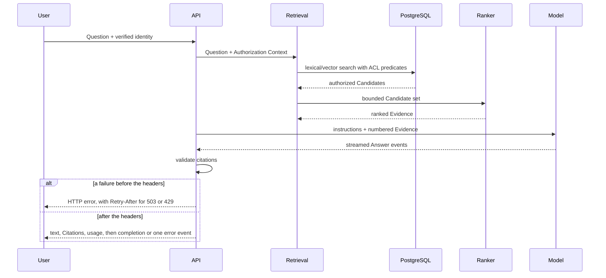
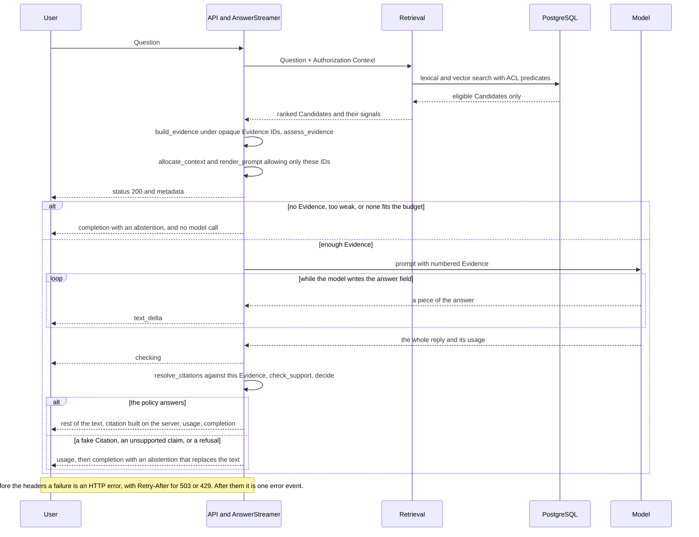

# M06-T14 — Пройдіть ворота розуміння відповідей

Англійська версія: [M06-T14-pass-the-answering-gate.md](M06-T14-pass-the-answering-gate.md)

Вихідне завдання: [M06-T14](../curriculum/milestones/M06-answers-and-conversations/M06-T14-pass-the-answering-gate.md)

## Що ви зробите

Ці ворота (gate) перевіряють, що ви розумієте, як відповідь будується з доказів від початку до кінця: треба пояснити, намалювати, налагодити й розширити. Частин чотири: пояснити потік доказів своїми словами, перемалювати діаграму послідовності відповіді так, щоб вона відповідала коду, діагностувати, що стається, коли модель вигадує цитату, і додати одну нову SSE-подію без покрокового рецепта.

- Пояснення і діаграма показують, що ви можете простежити запитання від пошуку до останньої події.
- Діагностика показує, що фальшива цитата вже зупиняється, але запис потоку не міг сказати чому; виправлення це записує.
- Нова подія `checking` каже клієнту, що модель закінчила, а сервер перевіряє її відповідь. Вона потребує нової версії протоколу, а читач має й далі читати старі потоки.

| Завдання вимагає | Де це відбувається |
|---|---|
| Пояснити потік доказів відповіді | Крок 2: під `## Evidence flow` |
| Оновити діаграму послідовності | Крок 2: діаграма відповіді в `docs/architecture.md` |
| Діагностувати фальшиву цитату | Крок 3: скрипт, ланцюжок під `## Fake Citation` і виправлення запису в кроці 5 |
| Додати одну SSE-подію без рецепта | Кроки 4 і 5: спроєктувати `checking` за брифом, потім порівняти з еталоном |
| Валідація і відновлення на клієнті лишилися сумісними | Крок 6: читач читає версії `1` і `2`; з `checking` чи без нього клієнт відновлює ту саму відповідь |
| Тести: успіх, найризикованіший край, типізована відмова | Крок 6: `tests/test_answering_gate.py` |
| Жодного підкладеного тексту в телеметрії | Крок 6: маркер у відповіді та у фальшивій цитаті ніколи не потрапляє в запис |

Цей урок містить код: кроки 4, 5 і 6 пишуть код. Кроки 1, 2, 3, 7 і 8 — без коду, хоча крок 2 редагує документ архітектури, а крок 3 запускає скрипт.

Терміни цього уроку:

- **ID доказу (Evidence ID):** непрозора назва, `E` і вісім випадкових шістнадцяткових цифр, як-от `E50316490`, яку Chunk отримує лише на один запит. Модель цитує докази за цим ID, ніколи — за ID Chunk чи документа.
- **Фальшива цитата (fake Citation):** посилання від моделі, яке не є одним з ID доказів цього запиту: вигадане, скопійоване з іншого запиту, зіпсоване або справжній ID Chunk.
- **Версія протоколу (protocol version):** число в події `metadata`, що каже, яких правил дотримується решта потоку. Читач, що не знає цього числа, відкидає потік на першій же події.
- **Зворотна сумісність (backward compatible):** новий читач і далі читає кожен потік, який написав старіший сервер, і відновлює його так само.

## Перед початком

Цей розділ пояснює рішення, на яких стоїть код, щоб кожен крок був зрозумілий, коли ви до нього дійдете.

- **Що вже є.** M06-T01–T13 побудували кожну частину: докази під непрозорими ID, промпт, бюджет контексту, `generate_answer` і його перевірки, цитати, відбудовані на сервері, перевірку підтримки й політику утримання, контракт подій, стрімер, розв'язання уточнень і політику збоїв. Архітектурна діаграма відповіді старша за більшість із них.
- **Фальшива цитата вже зупиняється.** Відповідь моделі перевіряє `resolve_citations` проти власних доказів цього запиту. Будь-яке посилання, що не є одним із їхніх ID, робить відповідь `invalid`, політика утримується з `answer_failed`, жодна подія `citation` не надсилається, а клієнт замінює надісланий текст фіксованим повідомленням. Бракувало запису: він казав лише `abstained`, тож оператор не міг відрізнити фальшиву цитату від непідтвердженого твердження чи відмови моделі. Тепер запис містить причину утримання (`reason`), як оцінено відповідь (`reply`) і яке правило вона порушила (`defect`) — лише назви.
- **Навіщо подія `checking`.** Після останнього слова моделі сервер ще перевіряє відповідь: цитати, кожне твердження проти його доказів і політику. Коли суддею підтримки є модель, це може тривати секунди тиші. `checking` каже клієнту, що модель закінчила, а відповідь перевіряється, тож екран може це показати. Подія не містить даних, тож нічого не розкриває про відповідь; вона надсилається однаково для доброї відповіді й для фальшивої.
- **Де вона йде.** Один раз, щойно надійшла вся відповідь, до будь-якої цитати, використання чи термінальної події. Текст іще може йти після неї: текст, який модель не транслювала по ходу, надсилається лише після рішення відповідати.
- **Версія `2`.** Читач версії `1` не знає `checking` і відкинув би новий потік як зіпсований, не сказавши чому. Тому записувач тепер каже версію `2`. Читач читає обидві: версію `1` без `checking` і з власниками повтору M01, як тоді, і версію `2` з `checking` і порадами «після заголовків» з M06-T13. Читач версії `1` відкидає потік версії `2` на першій події, і це найясніший спосіб сказати клієнту, що він застарів. Це також закриває обмеження M06-T13, де суворіша перевірка повтору лишила версію `1`.
- **Сумісність, доведена тестом.** Тест властивостей будує той самий потік із `checking` і без нього й перевіряє, що клієнт відновлює ту саму відповідь або відкидає обидва потоки з тієї самої причини. Інший тест переписує потік так, як його написав би сервер версії `1`, і перевіряє, що він відновлюється так само.
- **Що знайшло рев'ю.** Незалежне агресивне рев'ю атакувало нову подію, запис і діаграму:
  - `checking` надсилається на кожному шляху, де модель відповіла, і на жодному, де не відповіла.
  - Подія нічого не розкриває, бо однакова для доброї та фальшивої відповіді.
  - Клієнта, що пішов одразу після неї, записано як скасування, а потік моделі закрито.
  - Кожну фальшиву цитату зупинено без події `citation`: від вигаданого й чужого ID до справжнього ID Chunk і ID у верхньому регістрі.
  - Жоден маркер не потрапив у запис.

  Воно знайшло такі проблеми; кожну виправлено з тестом, що падає без виправлення:
  - Читач версії `1` відкидав кожен новий потік як зіпсований, хоча потік і далі казав версію `1`. Тепер записувач каже версію `2`, а читач читає обидві.
  - Власний тест властивостей воріт падав на тексті без видимих символів, бо записувач відкидав таку відповідь раніше, ніж тест міг порівняти. Тепер тест порівнює, що з кожним потоком зробили записувач або читач.
  - Відмову моделі і надісланий текст, що відрізняється від перевіреної відповіді, обидва записувало як `answer_failed` без дефекту. Тепер запис ще й каже, як оцінено відповідь.
  - Потік, що зламався після відкинутого рішення, зберігав причину цього рішення. Тепер причина записується лише разом зі своїм completion.
  - Задокументовано, не виправлено: читач приймає кілька порядків, яких сервер ніколи не пише; на відновлене клієнтом вони не впливають.
- **Де живе код.** `answering/events.py` і `answering/streaming.py`; одне речення в `answering/stream_failures.py`; три наявні тести, що фіксували порядок подій чи версію; новий `tests/test_answering_gate.py`; і `docs/architecture.md`.
- **Відомі обмеження.** Читач приймає кілька порядків, яких сервер ніколи не пише, як-от `checking` просто перед утриманням без використання; на відновлене клієнтом вони не впливають. `confirm_citations` досі немає в потоковому шляху; M07 підключить його зі справжньою особою читача. Запис каже, чому відповідь не вдалася, але не каже, яка цитата була фальшивою, — навмисно: її значення прийшло від моделі.

## Покроково

### Крок 1 — Без коду: запишіть інваріант і свої передбачення

Поки коду ще немає, запишіть, що має бути правдою наприкінці уроку. Крок 7 перевіряє передбачення.

Створіть `docs/evidence/M06-T14-answering-gate.md`:

```markdown
# M06-T14 — Answering gate evidence

## Invariant

A streamed Answer uses only Evidence the reader may see, under opaque IDs
of this request; a Citation the model writes is kept only when it is one of
those IDs, and is rebuilt from its Evidence on the server. A reply with a
fake Citation is never shown: the client gets an abstention, no `citation`
event, and the stream's record says `answer_failed`, `invalid`, and
`invalid_citation`. The writer writes protocol version `2`, with at most
one `checking` event once the model's whole reply has arrived and before
any Citation, usage, or terminal event. The reader reads versions `1` and
`2`, and a client rebuilds the same Answer from a stream with or without
`checking`. No record holds Answer text or a Citation value.

## Expected failing check

Before the change, `uv run python -c "from knowledge_service.answering.events import EventName; EventName('checking')"`
fails with `ValueError`.

## Predictions

- What the client sees, event by event, when the model cites an Evidence ID that is not in its prompt: ...
- What the stream's record says about that stream before this change, and what an operator could not tell from it: ...
- What a version `1` reader does with a stream that holds a `checking` event, and why that calls for a new version: ...
- How many gate tests fail if the reader accepts a second `checking`: ...

## Evidence flow

## Diagram

## Fake Citation

## New event

## Design

## Verification

## Decision

## Reflection
```

Перевірка: файл існує, перевірка, що має впасти, падає, а кожне передбачення — повне речення, яке крок 7 може спростувати.

### Крок 2 — Без коду: поясніть потік доказів і перемалюйте діаграму

Цей крок просить пояснити, спершу з пам'яті, як запитання стає відповіддю з цитатами, а потім змусити діаграму казати те саме.

**Дія 1:** під `## Evidence flow` напишіть по короткому абзацу на кожен етап, по черзі, назвавши функцію, що його виконує, і те, що вона гарантує: пошук із перевіркою доступу, докази під непрозорими ID, оцінка доказів до будь-якого виклику моделі, бюджет контексту і промпт, потік моделі, перевірка відповіді та її цитат, перевірка підтримки і рішення, і що отримує клієнт. Напишіть це, перш ніж знову читати код; потім звірте кожне твердження з кодом і виправте.

**Дія 2:** перемалюйте діаграму відповіді так, щоб вона відповідала `AnswerStreamer`, і згадайте `checking` і новий запис у рядку `answering`.

У `docs/architecture.md`:

**1.** Знайдіть:

```markdown
| Package | Module | Main entry points |
|---|---|---|
| `ingestion` | Source synchronization, Document normalization, Indexing | `synchronize_source`, `normalize`, `reconcile_document` |
| `ingestion.parsers` | Document normalization | `parse_text`, `parse_markdown`, `parse_html`, `parse_pdf` |
| `embeddings` | Indexing (vectors) | `EmbeddingModel` (`port`), `OpenAIEmbeddingModel` (managed), `LocalEmbeddingModel` (BGE-M3 over HTTP, pinned revision), `SparseModel` (`sparse`, the port for sparse term weights; M05-T10 prototype only), `publish_document_embeddings`, the migration workflow |
| `retrieval` | Retrieval | `search_similar_chunks`, `search_lexical_chunks` (routes each Question to English, `simple`, or both; `simple` reads a Question's topic words, without Ukrainian stop words, and needs two of them), `search_english_chunks`, `search_ukrainian_chunks`, `Candidate` (the fields every branch returns), `fuse_ranked_candidates` (Reciprocal Rank Fusion of branch Candidates), `retrieve_hybrid` (both branches at once under one deadline, fused, with per-branch diagnostics), `MetadataCondition`, `load_dataset` / `verify_corpus` / `run_dataset` / `compare_branches` (the bilingual seed Evaluation Dataset in `datasets/bilingual-seed/`, run lexical, dense, and fused), `recall_at` / `reciprocal_rank` (Recall@k and MRR), `compare_sparse` with `search_sparse_chunks` (M05-T10 prototype: BGE-M3 sparse weights against PostgreSQL word search; no default uses it), `Reranker` (`reranking`, the port for cross-encoder scores) with `rerank_candidates` (reorders eligible Candidates within the reranker's limits under one deadline) and `LocalReranker` (`local_reranker`, bge-reranker-v2-m3 over HTTP, pinned revision), `compare_reranking` (fused retrieval before and after reranking; no default reranks yet), `RankingModel` (`llm_reranking`, the port for a language model that returns a ranking) with `rerank_with_llm` (orders the top eligible Candidates under opaque IDs within a candidate and token budget, checks the ranking, keeps retrieval's order on any failure, and returns the billed usage) and `OpenAIRankingModel` (`openai_ranking`, a pinned model over the Responses API with Structured Outputs), `compare_llm_reranking` (the same comparison with fallbacks and cost), `compare_reranking_strategies` (no reranker, the cross-encoder, and the language model on the same Candidates of each case, with quality, latency, and cost per case), `classify_question` (`rewrite_classes`, one rewrite class per Question and the words any rewrite must keep; any word with a digit, or with `_`, `@`, `/`, `.`, `:`, or a backslash inside it, is `exact_identifier` and never rewritten) with `load_rewrite_cases` / `score_rewrite_cases` (`rewrite_cases`, the verified labels in `datasets/bilingual-seed/rewrite-classes.json` and how often the rules agree), `rewrite_question` (`query_rewriting`, the `RewriteModel` port: a Question is sent only when its class is switched on in a `RewritePolicy`, and its rewrite is used only when it keeps every word to keep, every typed identifier, and the stated language, and adds no search operator; otherwise the Question is searched as typed) with `OpenAIRewriteModel` (`openai_rewriting`, a pinned model over the Responses API; `QUERY_REWRITE_CLASSES` is the policy flag, empty by default), and `compare_rewriting` with `score_rewriting` / `check_rollout` (`rewrite_evaluation`, the gain per class on `datasets/bilingual-seed/rewrite-retrieval.json`; a class that harms a case, was not fully measured, or does not gain is not rolled out) |
| `answering` | Question answering | `build_evidence` / `EvidenceSet` (`evidence`, the Chunks an Answer may use, each under a fresh opaque `EvidenceId`, with provenance, excerpt, and source link copied from retrieval) and `resolve_citations` / `read_citations` (`citations`, a model's Evidence IDs checked against the request's own set: unknown, malformed, or mismatched references are refused, a repeated one is cited once, and a repeat in stored Citations read back is refused, and a Citation's provenance always comes from the server), `render_prompt` (`prompt`, the fixed policy, the Question and numbered Evidence as one escaped JSON document, and a response schema that allows only this request's Evidence IDs), `allocate_context` (`context_budget`, splits a `ContextBudget` between the fixed policy, the Answer and History reserves, the Question, and Evidence; keeps the longest head of retrieval's order whose counted prompt fits, drops the rest whole, and reports kept and dropped Evidence IDs with token counts), `generate_answer` (`generation`, the `AnswerModel` port: fits the context, sends the counted prompt once, and checks the reply on the server into one outcome, answered with Citations of Evidence in the prompt, abstained with a reason, refused, invalid with a named defect, or no Evidence without a call; provider failures raise the M01 `ChatModelError` family) with `OpenAIAnswerModel` (`openai_answering`, a pinned model over the Responses API with Structured Outputs; `AnswerSettings` gives the budget), `confirm_citations` (`current_citations`, run after generation and before the client: one query rechecks every cited Chunk under the retrieval permission check and its current version; one Chunk that is gone, rewritten, tombstoned, or no longer visible withdraws the whole Answer, keeping its usage, and confirmed Citations are rebuilt from the stored rows), `check_support` (`support`, splits an Answer into claims by position and asks a versioned `SupportJudge`, the deterministic `LexicalSupportJudge` or a `ModelSupportJudge` over any `AnswerModel`, which cited Evidence supports each claim; the server keeps a finding only for a quote found in cited Evidence on word boundaries that holds the claim's numbers, and returns a separate `SupportReport` bound to the judge's version and the answer text's SHA-256, never editing the Answer), `decide` (`abstention`, the answer policy: `assess_evidence` judges retrieval before any model call as empty or weak by a threshold calibrated for one `RerankerIdentity`, `find_conflicts` finds cited Documents that disagree on a claim's numbers, and `decide` answers, or abstains with one reason and a fixed bilingual message, answering only with a support report of this exact text; empty, unauthorized, and withdrawn read the same; `classify`, `score_abstention`, and `calibrate_threshold` measure correct answers, correct abstentions, over-abstentions, and unsupported answers against labelled cases), `AnswerEventWriter` / `AnswerEventReader` (`events`, the SSE event contract of a streamed Answer: `metadata`, then `text_delta`, `citation`, and at most one `usage`, then one terminal `completion` or `error`, with IDs counting up from 0; the writer refuses an event out of order without changing the stream, and the reader refuses invalid order, lost or repeated events, a cut-off stream, any spelling but the writer's, or a stream over its limits, and rebuilds the Answer however the bytes are split; an answer needs visible text, a Citation, and its usage, Citations never precede an abstention, and abstentions and errors carry only their fixed messages), and `AnswerStreamer` (`streaming`, behind `POST /v1/answer/stream`: finds and judges Evidence before any byte, so its failures stay HTTP errors; then pulls the model's stream one event at a time, passes the answer's text on as it arrives, checks the whole reply and lets an `AnswerFinisher` decide, and sends Citations only after an `answer` decision and the usage before the terminal event; one deadline covers it all, and a client that leaves cancels the work and closes the model's stream through `EventStreamResponse`), `stream_failure` (`stream_failures`, one policy per failure kind and phase: before the headers an HTTP error with the M01 status and, for an outage or a limit, a `Retry-After` header; after them one terminal `error` event, the caller's to retry for an outage or a limit, a validation failure reported as internal; a database that is unreachable, overloaded, or too slow is an outage, any other database error a bug; every stream is recorded with its phase, one audit outcome, and what became of its partial text), and `load_history` (`history`, the earlier turns of the reader's own Conversation within `history_tokens`: recent turns whole, older ones as their Questions; an Answer's text only when it was answered and every Chunk it and every earlier Answer cited is current and visible to the reader now, so a revoked, deleted, or rewritten Document never returns through an old Answer; Questions and their replies are stored together by `add_turn`, with the reply's outcome and cited Chunks), and `resolve_question` (`follow_up`, a follow-up Question made standalone for search: only the `follow_up` class is ever sent to the `RewriteModel`, with the earlier Questions of the History and never an Answer; the rewrite must stay in the stated language and keep the Question's words to keep and the identifiers and acronyms of the newest earlier Question, or the Question is searched as typed; a `ResolvedQuestion` records both texts and how the search text was chosen) with `compare_resolution` (`follow_up_evaluation`, the bilingual rewrite cases replayed as stored Conversations and searched with and without resolution) |
| `persistence` | PostgreSQL implementation | `schema` and one module per kind of record |

Domain values, settings, the database runtime, and the HTTP application stay
at the top level.

Model runtimes that need their own Python live outside `src/`, each as its
```

Замініть на:

```markdown
| Package | Module | Main entry points |
|---|---|---|
| `ingestion` | Source synchronization, Document normalization, Indexing | `synchronize_source`, `normalize`, `reconcile_document` |
| `ingestion.parsers` | Document normalization | `parse_text`, `parse_markdown`, `parse_html`, `parse_pdf` |
| `embeddings` | Indexing (vectors) | `EmbeddingModel` (`port`), `OpenAIEmbeddingModel` (managed), `LocalEmbeddingModel` (BGE-M3 over HTTP, pinned revision), `SparseModel` (`sparse`, the port for sparse term weights; M05-T10 prototype only), `publish_document_embeddings`, the migration workflow |
| `retrieval` | Retrieval | `search_similar_chunks`, `search_lexical_chunks` (routes each Question to English, `simple`, or both; `simple` reads a Question's topic words, without Ukrainian stop words, and needs two of them), `search_english_chunks`, `search_ukrainian_chunks`, `Candidate` (the fields every branch returns), `fuse_ranked_candidates` (Reciprocal Rank Fusion of branch Candidates), `retrieve_hybrid` (both branches at once under one deadline, fused, with per-branch diagnostics), `MetadataCondition`, `load_dataset` / `verify_corpus` / `run_dataset` / `compare_branches` (the bilingual seed Evaluation Dataset in `datasets/bilingual-seed/`, run lexical, dense, and fused), `recall_at` / `reciprocal_rank` (Recall@k and MRR), `compare_sparse` with `search_sparse_chunks` (M05-T10 prototype: BGE-M3 sparse weights against PostgreSQL word search; no default uses it), `Reranker` (`reranking`, the port for cross-encoder scores) with `rerank_candidates` (reorders eligible Candidates within the reranker's limits under one deadline) and `LocalReranker` (`local_reranker`, bge-reranker-v2-m3 over HTTP, pinned revision), `compare_reranking` (fused retrieval before and after reranking; no default reranks yet), `RankingModel` (`llm_reranking`, the port for a language model that returns a ranking) with `rerank_with_llm` (orders the top eligible Candidates under opaque IDs within a candidate and token budget, checks the ranking, keeps retrieval's order on any failure, and returns the billed usage) and `OpenAIRankingModel` (`openai_ranking`, a pinned model over the Responses API with Structured Outputs), `compare_llm_reranking` (the same comparison with fallbacks and cost), `compare_reranking_strategies` (no reranker, the cross-encoder, and the language model on the same Candidates of each case, with quality, latency, and cost per case), `classify_question` (`rewrite_classes`, one rewrite class per Question and the words any rewrite must keep; any word with a digit, or with `_`, `@`, `/`, `.`, `:`, or a backslash inside it, is `exact_identifier` and never rewritten) with `load_rewrite_cases` / `score_rewrite_cases` (`rewrite_cases`, the verified labels in `datasets/bilingual-seed/rewrite-classes.json` and how often the rules agree), `rewrite_question` (`query_rewriting`, the `RewriteModel` port: a Question is sent only when its class is switched on in a `RewritePolicy`, and its rewrite is used only when it keeps every word to keep, every typed identifier, and the stated language, and adds no search operator; otherwise the Question is searched as typed) with `OpenAIRewriteModel` (`openai_rewriting`, a pinned model over the Responses API; `QUERY_REWRITE_CLASSES` is the policy flag, empty by default), and `compare_rewriting` with `score_rewriting` / `check_rollout` (`rewrite_evaluation`, the gain per class on `datasets/bilingual-seed/rewrite-retrieval.json`; a class that harms a case, was not fully measured, or does not gain is not rolled out) |
| `answering` | Question answering | `build_evidence` / `EvidenceSet` (`evidence`, the Chunks an Answer may use, each under a fresh opaque `EvidenceId`, with provenance, excerpt, and source link copied from retrieval) and `resolve_citations` / `read_citations` (`citations`, a model's Evidence IDs checked against the request's own set: unknown, malformed, or mismatched references are refused, a repeated one is cited once, and a repeat in stored Citations read back is refused, and a Citation's provenance always comes from the server), `render_prompt` (`prompt`, the fixed policy, the Question and numbered Evidence as one escaped JSON document, and a response schema that allows only this request's Evidence IDs), `allocate_context` (`context_budget`, splits a `ContextBudget` between the fixed policy, the Answer and History reserves, the Question, and Evidence; keeps the longest head of retrieval's order whose counted prompt fits, drops the rest whole, and reports kept and dropped Evidence IDs with token counts), `generate_answer` (`generation`, the `AnswerModel` port: fits the context, sends the counted prompt once, and checks the reply on the server into one outcome, answered with Citations of Evidence in the prompt, abstained with a reason, refused, invalid with a named defect, or no Evidence without a call; provider failures raise the M01 `ChatModelError` family) with `OpenAIAnswerModel` (`openai_answering`, a pinned model over the Responses API with Structured Outputs; `AnswerSettings` gives the budget), `confirm_citations` (`current_citations`, run after generation and before the client: one query rechecks every cited Chunk under the retrieval permission check and its current version; one Chunk that is gone, rewritten, tombstoned, or no longer visible withdraws the whole Answer, keeping its usage, and confirmed Citations are rebuilt from the stored rows), `check_support` (`support`, splits an Answer into claims by position and asks a versioned `SupportJudge`, the deterministic `LexicalSupportJudge` or a `ModelSupportJudge` over any `AnswerModel`, which cited Evidence supports each claim; the server keeps a finding only for a quote found in cited Evidence on word boundaries that holds the claim's numbers, and returns a separate `SupportReport` bound to the judge's version and the answer text's SHA-256, never editing the Answer), `decide` (`abstention`, the answer policy: `assess_evidence` judges retrieval before any model call as empty or weak by a threshold calibrated for one `RerankerIdentity`, `find_conflicts` finds cited Documents that disagree on a claim's numbers, and `decide` answers, or abstains with one reason and a fixed bilingual message, answering only with a support report of this exact text; empty, unauthorized, and withdrawn read the same; `classify`, `score_abstention`, and `calibrate_threshold` measure correct answers, correct abstentions, over-abstentions, and unsupported answers against labelled cases), `AnswerEventWriter` / `AnswerEventReader` (`events`, the SSE event contract of a streamed Answer: `metadata`, then `text_delta`, at most one `checking` once the model is done, `citation`, and at most one `usage`, then one terminal `completion` or `error`, with IDs counting up from 0; the writer refuses an event out of order without changing the stream, and the reader refuses invalid order, lost or repeated events, a cut-off stream, any spelling but the writer's, or a stream over its limits, and rebuilds the Answer however the bytes are split; an answer needs visible text, a Citation, and its usage, Citations never precede an abstention, and abstentions and errors carry only their fixed messages), and `AnswerStreamer` (`streaming`, behind `POST /v1/answer/stream`: finds and judges Evidence before any byte, so its failures stay HTTP errors; then pulls the model's stream one event at a time, passes the answer's text on as it arrives, sends `checking`, checks the whole reply and lets an `AnswerFinisher` decide, and sends Citations only after an `answer` decision and the usage before the terminal event; one deadline covers it all, and a client that leaves cancels the work and closes the model's stream through `EventStreamResponse`), `stream_failure` (`stream_failures`, one policy per failure kind and phase: before the headers an HTTP error with the M01 status and, for an outage or a limit, a `Retry-After` header; after them one terminal `error` event, the caller's to retry for an outage or a limit, a validation failure reported as internal; a database that is unreachable, overloaded, or too slow is an outage, any other database error a bug; every stream is recorded with its phase, one audit outcome, what became of its partial text, and for an abstention its reason and any defect of the reply, such as `invalid_citation`), and `load_history` (`history`, the earlier turns of the reader's own Conversation within `history_tokens`: recent turns whole, older ones as their Questions; an Answer's text only when it was answered and every Chunk it and every earlier Answer cited is current and visible to the reader now, so a revoked, deleted, or rewritten Document never returns through an old Answer; Questions and their replies are stored together by `add_turn`, with the reply's outcome and cited Chunks), and `resolve_question` (`follow_up`, a follow-up Question made standalone for search: only the `follow_up` class is ever sent to the `RewriteModel`, with the earlier Questions of the History and never an Answer; the rewrite must stay in the stated language and keep the Question's words to keep and the identifiers and acronyms of the newest earlier Question, or the Question is searched as typed; a `ResolvedQuestion` records both texts and how the search text was chosen) with `compare_resolution` (`follow_up_evaluation`, the bilingual rewrite cases replayed as stored Conversations and searched with and without resolution) |
| `persistence` | PostgreSQL implementation | `schema` and one module per kind of record |

Domain values, settings, the database runtime, and the HTTP application stay
at the top level.

Model runtimes that need their own Python live outside `src/`, each as its
```

**2.** Знайдіть:

````markdown
        Hybrid-->>Caller: HybridRetrieval: up to limit fused Candidates and per-branch diagnostics
    end
```

### Answering



## Deliberate exclusions from the default path

- LangGraph and multi-agent orchestration do not replace ordinary question answering.
- MCP is an additional protocol adapter, not the owner of search logic.
````

Замініть на:

````markdown
        Hybrid-->>Caller: HybridRetrieval: up to limit fused Candidates and per-branch diagnostics
    end
```

### Answering

The streamed path, `POST /v1/answer/stream`, as `AnswerStreamer` runs it.
The model only ever sees Evidence the reader may see, under opaque IDs, and
nothing it writes about its sources is trusted: a Citation is resolved
against this request's own Evidence and rebuilt from it on the server.



## Deliberate exclusions from the default path

- LangGraph and multi-agent orchestration do not replace ordinary question answering.
- MCP is an additional protocol adapter, not the owner of search logic.
````

Потім під `## Diagram` напишіть два речення: у чому помилялася стара діаграма і яку деталь ви пропустили в першій спробі.

Перевірка: `make docs-check` проходить, і кожна стрілка нової діаграми називає крок, який можна знайти в `answering/streaming.py` або в модулях, які він викликає.

### Крок 3 — Без коду: діагностуйте фальшиву цитату

Цей крок запускає потік, у якому модель цитує ID доказу, якого ніколи не було в її промпті, і простежує, що з ним робить код.

**Дія 1:** запустіть потік і надрукуйте, що побачили клієнт і запис:

```bash
PYTHONPATH=tests uv run python - <<'PY'
import asyncio
import logging

from knowledge_service.answering.evidence import EvidenceId
from test_streaming import Model, chunks, names, rebuilt, reply_json, streamer


class LastRecord(logging.Handler):
    def emit(self, record: logging.LogRecord) -> None:
        if record.getMessage() == "answer stream ended":
            self.fields = record.answer_stream


async def main() -> None:
    handler = LastRecord()
    logging.getLogger("knowledge_service").addHandler(handler)
    logging.getLogger("knowledge_service").setLevel(logging.INFO)
    fake = EvidenceId.new().value  # a well-formed ID that is not in the prompt
    sent = await chunks(streamer(Model(final=reply_json(citations=[fake]))))
    result = rebuilt(sent)
    print("events: ", names(sent))
    print("client: ", result.outcome, result.reason, repr(result.text))
    keys = ("audit_outcome", "partial_text", "citations", "reason", "reply", "defect")
    print("record: ", {key: handler.fields.get(key, "(missing)") for key in keys})


asyncio.run(main())
PY
```

Очікувано до кроків 4 і 5: події — `metadata`, сім `text_delta`, `usage` і `completion`; клієнт отримує `abstained answer_failed ''`; запис містить `'audit_outcome': 'abstained'` і `'partial_text': 'replaced'`, а `reason`, `reply` і `defect` — `(missing)`.

**Дія 2:** під `## Fake Citation` запишіть ланцюжок із доказами, по одній ланці на рядок: де відкинуто фальшивий ID (`resolve_citations` усередині `checked_answer`, дефект `invalid_citation`), як відповідь стала `invalid`, чому політика утрималася з `answer_failed`, чому не надіслано жодної події `citation`, що показує клієнт і чому запис не міг відрізнити це від непідтвердженого твердження. Завершіть виправленням: записувати причину, оцінку відповіді і її дефект.

### Крок 4 — Крок із кодом: спроєктуйте подію `checking`, потім порівняйте

Цей крок додає одну подію до контракту. Спершу спробуйте самі за брифом, і лише потім порівняйте з еталоном.

**Простими словами:** потік отримує один сигнал, що каже «модель закінчила, відповідь перевіряється». Він нічого не несе, приходить щонайбільше раз і ніколи не змінює того, що відновлює клієнт. Оскільки старіший клієнт його не зрозуміє, потік тепер каже, що дотримується версії 2 правил, а читач і далі читає версію 1, як раніше.

Бриф, як його дали б на воротах:

- Назва `checking`, дані `{}`, щонайбільше раз на потік.
- Дозволена після `metadata` і після тексту; відкидається після цитати, використання чи термінальної події; текст може йти після неї.
- Метод записувача `checking()`; читач перевіряє ті самі правила, тими самими `_Rules`.
- Версія протоколу `2`; читач читає `1` і `2`, відкидає `checking` у потоці версії `1` і перевіряє помилку версії `1` за власником повтору M01.
- З нею чи без неї клієнт відновлює ту саму відповідь.

Еталон, коли спробуєте:

| Частина | Що змінюється |
|---|---|
| `EventName.CHECKING`, `CheckingData` | Подія та її порожні суворі дані |
| `_AFTER`, `_Rules.checking` | Де вона може йти і що лише раз |
| `EVENT_PROTOCOL_VERSION`, `MetadataData.version`, `_Rules.version` | Пишеться версія `2`, читаються `1` і `2` |
| `_FIRST_ERRORS` | Що могла казати помилка версії `1` |

У `src/knowledge_service/answering/events.py`:

**1.** Знайдіть:

```python
the events; `AnswerEventReader` reads them back as a client would and
rebuilds the Answer. Both check every event against one set of rules, so
whatever the writer sends, the reader accepts.

The order of one stream:

    metadata  text_delta*  citation*  usage?  (completion | error)

- **`metadata` first.** Exactly once: the protocol version and the
  request ID. A request that fails before it is an HTTP error, not a
  stream.
- **Text, then Citations, then usage.** `text_delta` events hold the
  Answer's text in pieces; joined, they are the text. `citation` events
  follow, each Evidence once; `usage` follows, at most once.
- **One terminal event, last.** `completion` or `error` ends the stream;
  nothing may follow it, and a stream that stops without one is cut off.
- **What the client keeps.** `completion` with `answer` keeps the text and
  the Citations; it needs visible text, a Citation, and the usage.
  `completion` with `abstain` replaces any streamed text with the fixed
  message of its reason, and an `error` replaces it with the fixed message
```

Замініть на:

```python
the events; `AnswerEventReader` reads them back as a client would and
rebuilds the Answer. Both check every event against one set of rules, so
whatever the writer sends, the reader accepts.

The order of one stream:

    metadata  text_delta*  (checking  text_delta*)?  citation*  usage?
    (completion | error)

- **`metadata` first.** Exactly once: the protocol version and the
  request ID. A request that fails before it is an HTTP error, not a
  stream.
- **Versions.** The writer writes version `2`: the `checking` event and
  the retry guidance of `stream_failures` came with it. The reader also
  reads version `1`, as servers wrote it before: no `checking`, and the
  retry owner of the M01 error policy. A version `1` reader refuses a
  version `2` stream at its first event, so a client that is too old
  learns it at once instead of misreading the Answer.
- **Text, then Citations, then usage.** `text_delta` events hold the
  Answer's text in pieces; joined, they are the text. `citation` events
  follow, each Evidence once; `usage` follows, at most once.
- **`checking` when the model is done.** Version `2` only. At most once, before any
  Citation, usage, or terminal event: the model has finished and the
  server is checking its reply before it decides, which can take a while.
  It holds no data and changes nothing a client rebuilds; the end of the
  text may still follow it, because text the model did not stream as it
  wrote is sent only once the server has decided to answer.
- **One terminal event, last.** `completion` or `error` ends the stream;
  nothing may follow it, and a stream that stops without one is cut off.
- **What the client keeps.** `completion` with `answer` keeps the text and
  the Citations; it needs visible text, a Citation, and the usage.
  `completion` with `abstain` replaces any streamed text with the fixed
  message of its reason, and an `error` replaces it with the fixed message
```

**2.** Знайдіть:

```python
)
from knowledge_service.answering.evidence import MAX_EVIDENCE, EvidenceId
from knowledge_service.answering.generation import MAX_ANSWER_CHARACTERS
from knowledge_service.answering.prompt import has_visible_text
from knowledge_service.answering.stream_failures import StreamPhase, stream_failure
from knowledge_service.contracts import Usage
from knowledge_service.errors import FailureKind, RetryOwner
from knowledge_service.language import Language

EVENT_PROTOCOL_VERSION = "1"
MAX_EVENT_CHARACTERS = 131_072
_ID = re.compile(r"id: (0|[1-9][0-9]{0,8})")
_STRICT = ConfigDict(extra="forbid", strict=True, frozen=True)
_TOKENS = ("input_tokens", "output_tokens", "total_tokens")
MAX_TOKENS = 2**53 - 1

```

Замініть на:

```python
)
from knowledge_service.answering.evidence import MAX_EVIDENCE, EvidenceId
from knowledge_service.answering.generation import MAX_ANSWER_CHARACTERS
from knowledge_service.answering.prompt import has_visible_text
from knowledge_service.answering.stream_failures import StreamPhase, stream_failure
from knowledge_service.contracts import Usage
from knowledge_service.errors import FailureKind, RetryOwner, policy_for
from knowledge_service.language import Language

EVENT_PROTOCOL_VERSION = "2"
# The version servers wrote before `checking`; still read, never written.
_FIRST_VERSION = "1"
MAX_EVENT_CHARACTERS = 131_072
_ID = re.compile(r"id: (0|[1-9][0-9]{0,8})")
_STRICT = ConfigDict(extra="forbid", strict=True, frozen=True)
_TOKENS = ("input_tokens", "output_tokens", "total_tokens")
MAX_TOKENS = 2**53 - 1

```

**3.** Знайдіть:

```python

class EventName(StrEnum):
    """The `event:` line of each kind of event."""

    METADATA = "metadata"
    TEXT_DELTA = "text_delta"
    CITATION = "citation"
    USAGE = "usage"
    COMPLETION = "completion"
    ERROR = "error"


```

Замініть на:

```python

class EventName(StrEnum):
    """The `event:` line of each kind of event."""

    METADATA = "metadata"
    TEXT_DELTA = "text_delta"
    CHECKING = "checking"
    CITATION = "citation"
    USAGE = "usage"
    COMPLETION = "completion"
    ERROR = "error"


```

**4.** Знайдіть:

```python

class MetadataData(BaseModel):
    """The first event: which protocol, and which request."""

    model_config = _STRICT

    version: Literal["1"]
    request_id: str


class TextDeltaData(BaseModel):
    """The next piece of the Answer's text."""

    model_config = _STRICT

    text: str = Field(min_length=1, repr=False)


class UsageData(BaseModel):
    """The tokens the provider billed for this Answer."""

    model_config = _STRICT
```

Замініть на:

```python

class MetadataData(BaseModel):
    """The first event: which protocol, and which request."""

    model_config = _STRICT

    version: Literal["1", "2"]
    request_id: str


class TextDeltaData(BaseModel):
    """The next piece of the Answer's text."""

    model_config = _STRICT

    text: str = Field(min_length=1, repr=False)


class CheckingData(BaseModel):
    """The model is done; the server is checking its reply. No data."""

    model_config = _STRICT


class UsageData(BaseModel):
    """The tokens the provider billed for this Answer."""

    model_config = _STRICT
```

**5.** Знайдіть:

```python
    retry: RetryOwner


type EventData = (
    MetadataData
    | TextDeltaData
    | CitationPayload
    | UsageData
    | CompletionData
    | ErrorData
)

_DATA: dict[EventName, type[BaseModel]] = {
    EventName.METADATA: MetadataData,
    EventName.TEXT_DELTA: TextDeltaData,
    EventName.CITATION: CitationPayload,
    EventName.USAGE: UsageData,
    EventName.COMPLETION: CompletionData,
    EventName.ERROR: ErrorData,
}

```

Замініть на:

```python
    retry: RetryOwner


type EventData = (
    MetadataData
    | TextDeltaData
    | CheckingData
    | CitationPayload
    | UsageData
    | CompletionData
    | ErrorData
)

_DATA: dict[EventName, type[BaseModel]] = {
    EventName.METADATA: MetadataData,
    EventName.TEXT_DELTA: TextDeltaData,
    EventName.CHECKING: CheckingData,
    EventName.CITATION: CitationPayload,
    EventName.USAGE: UsageData,
    EventName.COMPLETION: CompletionData,
    EventName.ERROR: ErrorData,
}

```

**6.** Знайдіть:

```python
_AFTER: dict[EventName, tuple[frozenset[_Phase], _Phase]] = {
    EventName.METADATA: (frozenset({_Phase.START}), _Phase.METADATA),
    EventName.TEXT_DELTA: (
        frozenset({_Phase.METADATA, _Phase.TEXT}),
        _Phase.TEXT,
    ),
    EventName.CITATION: (
        frozenset({_Phase.METADATA, _Phase.TEXT, _Phase.CITATIONS}),
        _Phase.CITATIONS,
    ),
    EventName.USAGE: (
        frozenset({_Phase.METADATA, _Phase.TEXT, _Phase.CITATIONS}),
```

Замініть на:

```python
_AFTER: dict[EventName, tuple[frozenset[_Phase], _Phase]] = {
    EventName.METADATA: (frozenset({_Phase.START}), _Phase.METADATA),
    EventName.TEXT_DELTA: (
        frozenset({_Phase.METADATA, _Phase.TEXT}),
        _Phase.TEXT,
    ),
    # Text may follow `checking`; `_Rules` keeps it to once.
    EventName.CHECKING: (frozenset({_Phase.METADATA, _Phase.TEXT}), _Phase.TEXT),
    EventName.CITATION: (
        frozenset({_Phase.METADATA, _Phase.TEXT, _Phase.CITATIONS}),
        _Phase.CITATIONS,
    ),
    EventName.USAGE: (
        frozenset({_Phase.METADATA, _Phase.TEXT, _Phase.CITATIONS}),
```

**7.** Знайдіть:

```python
        self.next_id = 0
        self.request_id: UUID | None = None
        self.text: list[str] = []
        self.characters = 0
        self.citations: list[CitationPayload] = []
        self.usage: UsageData | None = None
        self.result: StreamedAnswer | None = None

    def accept(self, event: AnswerEvent) -> None:
        """Take one event, or raise `InvalidEventStream` and change nothing."""
        if self.phase is _Phase.DONE:
            raise InvalidEventStream(StreamDefect.AFTER_TERMINAL)
```

Замініть на:

```python
        self.next_id = 0
        self.request_id: UUID | None = None
        self.text: list[str] = []
        self.characters = 0
        self.citations: list[CitationPayload] = []
        self.usage: UsageData | None = None
        self.version = EVENT_PROTOCOL_VERSION
        self.checking = False
        self.result: StreamedAnswer | None = None

    def accept(self, event: AnswerEvent) -> None:
        """Take one event, or raise `InvalidEventStream` and change nothing."""
        if self.phase is _Phase.DONE:
            raise InvalidEventStream(StreamDefect.AFTER_TERMINAL)
```

**8.** Знайдіть:

```python
        self.next_id += 1

    def _take(self, data: EventData) -> None:
        match data:
            case MetadataData():
                self.request_id = _request_id(data.request_id)
            case TextDeltaData():
                if self.characters + len(data.text) > MAX_ANSWER_CHARACTERS:
                    raise InvalidEventStream(StreamDefect.TOO_LARGE)
                self.text.append(data.text)
                self.characters += len(data.text)
            case CitationPayload():
                if not _server_ids(data):
                    raise InvalidEventStream(StreamDefect.MALFORMED)
                if len(self.citations) >= MAX_EVIDENCE:
                    raise InvalidEventStream(StreamDefect.TOO_LARGE)
                if any(c.evidence_id == data.evidence_id for c in self.citations):
```

Замініть на:

```python
        self.next_id += 1

    def _take(self, data: EventData) -> None:
        match data:
            case MetadataData():
                self.request_id = _request_id(data.request_id)
                self.version = data.version
            case TextDeltaData():
                if self.characters + len(data.text) > MAX_ANSWER_CHARACTERS:
                    raise InvalidEventStream(StreamDefect.TOO_LARGE)
                self.text.append(data.text)
                self.characters += len(data.text)
            case CheckingData():
                # Version 1 had no such event.
                if self.version == _FIRST_VERSION:
                    raise InvalidEventStream(StreamDefect.MALFORMED)
                if self.checking:
                    raise InvalidEventStream(StreamDefect.OUT_OF_ORDER)
                self.checking = True
            case CitationPayload():
                if not _server_ids(data):
                    raise InvalidEventStream(StreamDefect.MALFORMED)
                if len(self.citations) >= MAX_EVIDENCE:
                    raise InvalidEventStream(StreamDefect.TOO_LARGE)
                if any(c.evidence_id == data.evidence_id for c in self.citations):
```

**9.** Знайдіть:

```python
            raise InvalidEventStream(StreamDefect.OUT_OF_ORDER)
        return self._result(
            StreamOutcome.ABSTAINED, reason=data.reason, message=data.message
        )

    def _failed(self, data: ErrorData) -> StreamedAnswer:
        policy = _PUBLIC_ERRORS.get(data.code)
        if policy is None:
            raise InvalidEventStream(StreamDefect.UNKNOWN_ERROR)
        if data.message != policy.client_message or data.retry is not (
            policy.retry_owner
        ):
            raise InvalidEventStream(StreamDefect.MALFORMED)
```

Замініть на:

```python
            raise InvalidEventStream(StreamDefect.OUT_OF_ORDER)
        return self._result(
            StreamOutcome.ABSTAINED, reason=data.reason, message=data.message
        )

    def _failed(self, data: ErrorData) -> StreamedAnswer:
        errors = _FIRST_ERRORS if self.version == _FIRST_VERSION else _PUBLIC_ERRORS
        policy = errors.get(data.code)
        if policy is None:
            raise InvalidEventStream(StreamDefect.UNKNOWN_ERROR)
        if data.message != policy.client_message or data.retry is not (
            policy.retry_owner
        ):
            raise InvalidEventStream(StreamDefect.MALFORMED)
```

**10.** Знайдіть:

```python
                version=EVENT_PROTOCOL_VERSION, request_id=str(self._request_id)
            ),
        )

    def text_delta(self, text: str) -> bytes:
        return self._write(EventName.TEXT_DELTA, lambda: TextDeltaData(text=text))

    def citation(self, citation: Citation) -> bytes:
        if type(citation) is not Citation:
            raise InvalidEventStream(StreamDefect.MALFORMED)
        return self._write(EventName.CITATION, lambda: citation_payload(citation))

```

Замініть на:

```python
                version=EVENT_PROTOCOL_VERSION, request_id=str(self._request_id)
            ),
        )

    def text_delta(self, text: str) -> bytes:
        return self._write(EventName.TEXT_DELTA, lambda: TextDeltaData(text=text))

    def checking(self) -> bytes:
        return self._write(EventName.CHECKING, CheckingData)

    def citation(self, citation: Citation) -> bytes:
        if type(citation) is not Citation:
            raise InvalidEventStream(StreamDefect.MALFORMED)
        return self._write(EventName.CITATION, lambda: citation_payload(citation))

```

**11.** Знайдіть:

```python
    failure.public_code: _PublicError(failure.message, failure.retry)
    for kind in FailureKind
    if (failure := stream_failure(kind, StreamPhase.AFTER_HEADERS)).public_code
    is not None
    and failure.message is not None
}


def _messages(reason: AbstentionReason) -> frozenset[str]:
    return frozenset(abstention_message(reason, language) for language in Language)


```

Замініть на:

```python
    failure.public_code: _PublicError(failure.message, failure.retry)
    for kind in FailureKind
    if (failure := stream_failure(kind, StreamPhase.AFTER_HEADERS)).public_code
    is not None
    and failure.message is not None
}
# What a version 1 error said: the M01 policy, before `stream_failures`.
_FIRST_ERRORS: dict[str, _PublicError] = {
    policy.public_code: _PublicError(policy.client_message, policy.retry_owner)
    for policy in map(policy_for, FailureKind)
    if policy.public_code is not None and policy.client_message is not None
}


def _messages(reason: AbstentionReason) -> frozenset[str]:
    return frozenset(abstention_message(reason, language) for language in Language)


```

У `src/knowledge_service/answering/stream_failures.py`:

Знайдіть:

```python
- **After the headers.** The status `200` and maybe some text are already
  out, so the status cannot change. The stream ends with one `error`
  event holding a public code, its fixed message, and who may retry. The
  service never retries a stream once text is out, because the text could
  differ, so an outage or a limit tells the caller to send the Question
  again. A validation failure here is the server's own, because the
  request was accepted, so it is reported as an internal error. The
  event reader accepts only this guidance; no client of the version `1`
  events had shipped before it changed, so the version stays `1`.

What every failure settles:

- **The partial text.** The client keeps streamed text only when the
  stream completes with an Answer. An abstention or an `error` replaces
  it with a fixed message; a client that leaves keeps an incomplete
```

Замініть на:

```python
- **After the headers.** The status `200` and maybe some text are already
  out, so the status cannot change. The stream ends with one `error`
  event holding a public code, its fixed message, and who may retry. The
  service never retries a stream once text is out, because the text could
  differ, so an outage or a limit tells the caller to send the Question
  again. A validation failure here is the server's own, because the
  request was accepted, so it is reported as an internal error. Events
  of protocol version `2` carry this guidance; the reader still reads a
  version `1` error with the M01 retry owner it had then.

What every failure settles:

- **The partial text.** The client keeps streamed text only when the
  stream completes with an Answer. An abstention or an `error` replaces
  it with a fixed message; a client that leaves keeps an incomplete
```

Перевірка:

```bash
uv run python -c "from knowledge_service.answering.events import EventName; EventName('checking')"
uv run pyright src/knowledge_service/answering/events.py
```

Очікувано: перша команда тепер нічого не друкує, а pyright показує 0 помилок.

### Крок 5 — Крок із кодом: надсилайте `checking` і записуйте, чому відповідь не вдалася

Цей крок змушує стрімер використовувати нову подію і виправляє запис, якого бракувало за діагностикою.

**Простими словами:** щойно вся відповідь моделі надійшла, потік надсилає `checking`, а потім перевіряє відповідь. Коли потік завершується, його запис тепер ще й каже, чому політика утрималася, як оцінено відповідь і яке правило вона порушила, тож фальшива цитата видна як `answer_failed`, `invalid`, `invalid_citation`. Причина записується лише разом із completion, до якого належить.

| Частина | Що змінюється |
|---|---|
| `_events` | `yield writer.checking()` після відповіді, до `_finished`; оцінка відповіді та дефект ідуть у запис |
| completion | Записує `reason` рішення до того, як його передано |
| `_Span` | `reason`, `reply`, `defect` в «answer stream ended» |

У `src/knowledge_service/answering/streaming.py`:

**1.** Знайдіть:

```python
- **One deadline.** `timeout_seconds` covers finding Evidence, the model's
  whole stream, and the policy's checks. Before the first byte, running
  out is `AnswerDeadlineExceeded`; after it, the stream ends with an
  `error` event.
- **Text as it comes, the decision at the end.** The model writes JSON
  whose first field is the answer; its text is passed on piece by piece.
  The whole reply is then checked as `generate_answer` checks it, and the
  `AnswerFinisher` decides. The client keeps the text only if the decision
  is `answer`, and the streamed text is then exactly the checked text: a
  missing end is sent, and any other difference abstains.
- **Citations after the decision.** They are sent only once the decision
  is `answer`, so the title of a Document behind an Answer the policy
  rejects never leaves the server.
```

Замініть на:

```python
- **One deadline.** `timeout_seconds` covers finding Evidence, the model's
  whole stream, and the policy's checks. Before the first byte, running
  out is `AnswerDeadlineExceeded`; after it, the stream ends with an
  `error` event.
- **Text as it comes, the decision at the end.** The model writes JSON
  whose first field is the answer; its text is passed on piece by piece.
  When the reply is complete, a `checking` event says so. The whole reply
  is then checked as `generate_answer` checks it, and the
  `AnswerFinisher` decides. The client keeps the text only if the decision
  is `answer`, and the streamed text is then exactly the checked text: a
  missing end is sent, and any other difference abstains.
- **Citations after the decision.** They are sent only once the decision
  is `answer`, so the title of a Document behind an Answer the policy
  rejects never leaves the server.
```

**2.** Знайдіть:

```python
  and bounded by `CLOSE_SECONDS`, so a stuck close cannot hold it.
- **One record per stream.** "answer stream started" and "answer stream
  ended" hold the request ID, counts, tokens, timing, and how the stream
  ended: `completed`, `failed`, or `cancelled`, also when it ends before
  its first event. The end also holds the phase it ended in, its audit
  outcome, and what became of the partial text, as `stream_failures`
  defines them. Never text.
"""

import asyncio
import contextlib
import logging
import re
```

Замініть на:

```python
  and bounded by `CLOSE_SECONDS`, so a stuck close cannot hold it.
- **One record per stream.** "answer stream started" and "answer stream
  ended" hold the request ID, counts, tokens, timing, and how the stream
  ended: `completed`, `failed`, or `cancelled`, also when it ends before
  its first event. The end also holds the phase it ended in, its audit
  outcome, and what became of the partial text, as `stream_failures`
  defines them; for a completed abstention its reason; and, when the model
  replied, how its reply was judged (`answered`, `abstained`, `refused`,
  `invalid`) and the rule an invalid one broke, such as
  `invalid_citation`. Never text.
"""

import asyncio
import contextlib
import logging
import re
```

**3.** Знайдіть:

```python
)
from knowledge_service.answering.events import AnswerEventWriter, InvalidEventStream
from knowledge_service.answering.evidence import EvidenceSet
from knowledge_service.answering.generation import (
    MAX_ANSWER_CHARACTERS,
    MAX_REPLY_CHARACTERS,
    AnswerOutcome,
    AnswerResult,
    InvalidAnswerRequest,
    ModelIdentity,
    ModelReply,
    positive_seconds,
```

Замініть на:

```python
)
from knowledge_service.answering.events import AnswerEventWriter, InvalidEventStream
from knowledge_service.answering.evidence import EvidenceSet
from knowledge_service.answering.generation import (
    MAX_ANSWER_CHARACTERS,
    MAX_REPLY_CHARACTERS,
    AnswerDefect,
    AnswerOutcome,
    AnswerResult,
    InvalidAnswerRequest,
    ModelIdentity,
    ModelReply,
    positive_seconds,
```

**4.** Знайдіть:

```python
                            if text:
                                span.sent(text)
                                yield writer.text_delta(text)
                    finally:
                        await _close(parts)
                    span.usage = reply.usage
                    finished = await self._finished(plan, context, reply, span)
            except asyncio.CancelledError:
                raise
            except Exception as error:
                failure = classify_failure(error)
                span.failure = type(error).__name__
            decision = None if failure is not None else self._decision(plan, finished)
```

Замініть на:

```python
                            if text:
                                span.sent(text)
                                yield writer.text_delta(text)
                    finally:
                        await _close(parts)
                    span.usage = reply.usage
                    # The model is done; checking its reply can take a while.
                    yield writer.checking()
                    finished = await self._finished(plan, context, reply, span)
                    span.reply = finished.result.outcome
                    span.defect = finished.result.defect
            except asyncio.CancelledError:
                raise
            except Exception as error:
                failure = classify_failure(error)
                span.failure = type(error).__name__
            decision = None if failure is not None else self._decision(plan, finished)
```

**5.** Знайдіть:

```python
                    yield writer.usage(span.usage)
                if decision is not None:
                    completion = writer.completion(decision, plan.language)
                    # Recorded before it is handed over: a client that leaves
                    # after reading it got the whole stream.
                    span.outcome = "completed"
                    span.audit_outcome = finished_outcome(decision.decision)
                    span.partial_text = (
                        PartialText.KEPT
                        if decision.decision is Decision.ANSWER
                        else PartialText.REPLACED
                    )
```

Замініть на:

```python
                    yield writer.usage(span.usage)
                if decision is not None:
                    completion = writer.completion(decision, plan.language)
                    # Recorded before it is handed over: a client that leaves
                    # after reading it got the whole stream.
                    span.outcome = "completed"
                    span.reason = decision.reason
                    span.audit_outcome = finished_outcome(decision.decision)
                    span.partial_text = (
                        PartialText.KEPT
                        if decision.decision is Decision.ANSWER
                        else PartialText.REPLACED
                    )
```

**6.** Знайдіть:

```python
    text: list[str] = field(default_factory=list[str], repr=False)
    characters: int = 0
    deltas: int = 0
    citations: int = 0
    usage: Usage | None = None
    failure: str | None = None
    outcome: str = "cancelled"
    phase: StreamPhase = StreamPhase.BEFORE_HEADERS
    audit_outcome: AuditOutcome = AuditOutcome.CANCELLED
    # What a client that left holds; a decision or an error sets it.
    partial_text: PartialText = PartialText.ABANDONED
    ended: bool = False
```

Замініть на:

```python
    text: list[str] = field(default_factory=list[str], repr=False)
    characters: int = 0
    deltas: int = 0
    citations: int = 0
    usage: Usage | None = None
    failure: str | None = None
    # Why the policy abstained, and which rule a reply broke: names only.
    reason: AbstentionReason | None = None
    reply: AnswerOutcome | None = None
    defect: AnswerDefect | None = None
    outcome: str = "cancelled"
    phase: StreamPhase = StreamPhase.BEFORE_HEADERS
    audit_outcome: AuditOutcome = AuditOutcome.CANCELLED
    # What a client that left holds; a decision or an error sets it.
    partial_text: PartialText = PartialText.ABANDONED
    ended: bool = False
```

**7.** Знайдіть:

```python
            "citations": self.citations,
            "phase": str(self.phase),
            "audit_outcome": str(self.audit_outcome),
            "partial_text": str(
                self.partial_text if self.characters else PartialText.NONE
            ),
        }
        if self.usage is not None:
            fields["input_tokens"] = self.usage.input_tokens
            fields["output_tokens"] = self.usage.output_tokens
        level = logging.INFO if self.outcome == "completed" else logging.WARNING
        logger.log(level, "answer stream ended", extra={"answer_stream": fields})
```

Замініть на:

```python
            "citations": self.citations,
            "phase": str(self.phase),
            "audit_outcome": str(self.audit_outcome),
            "partial_text": str(
                self.partial_text if self.characters else PartialText.NONE
            ),
            "reason": None if self.reason is None else str(self.reason),
            "reply": None if self.reply is None else str(self.reply),
            "defect": None if self.defect is None else str(self.defect),
        }
        if self.usage is not None:
            fields["input_tokens"] = self.usage.input_tokens
            fields["output_tokens"] = self.usage.output_tokens
        level = logging.INFO if self.outcome == "completed" else logging.WARNING
        logger.log(level, "answer stream ended", extra={"answer_stream": fields})
```

Перевірка: запустіть скрипт із кроку 3 ще раз. Очікувано: `checking` з'являється між останнім `text_delta` і `usage`, а запис тепер містить `'reason': 'answer_failed'`, `'reply': 'invalid'`, `'defect': 'invalid_citation'`.

### Крок 6 — Крок із кодом: тести воріт

Цей крок оновлює три тести, що фіксували старий порядок чи версію, і доводить твердження воріт.

**Простими словами:** два наявні тести перелічують точні події потоку, а один перевіряє точні байти першої події; тепер вони чекають `checking` і версію `2`. Нові тести:
- надсилають фальшиві цитати всіх видів і перевіряють, що отримують клієнт і запис;
- перевіряють, де йде `checking` і коли її немає;
- доводять, що клієнт відновлює ту саму відповідь з нею і без неї;
- відкидають її не на своєму місці;
- читають потік версії `1`.

| Тест | Що доводить |
|---|---|
| `test_a_fake_citation_withdraws_the_streamed_answer_and_is_recorded` | Діагностику для вигаданого, чужого, зіпсованого і підкладеного ID: найризикованіший край |
| `test_checking_comes_once_after_the_live_text_and_before_the_decision` | Успіх: де її надсилає сервер |
| `test_no_checking_is_sent_when_no_reply_arrived` | Немає виклику моделі або модель зламалася |
| `test_checking_changes_nothing_a_client_rebuilds` | Сумісність, як тест властивостей |
| `test_checking_out_of_place_is_refused` | Типізована відмова: `InvalidEventStream` з дефектом |
| `test_the_writer_says_version_2_and_the_reader_still_reads_version_1` | Старі потоки відновлюються так само |
| `test_the_record_tells_apart_why_the_answer_failed` | Фальшиву цитату, відмову і змінений текст розрізнено |

У `tests/test_answer_events.py`:

**1.** Знайдіть:

```python

def test_the_stream_is_the_documented_text_format() -> None:
    first = answer_stream()[0].decode()

    assert first == (
        "id: 0\nevent: metadata\n"
        'data: {"version":"1","request_id":"00000000-0000-0000-0000-000000000049"}'
        "\n\n"
    )


def test_bytes_split_anywhere_rebuild_the_same_answer() -> None:
    whole = b"".join(answer_stream())
```

Замініть на:

```python

def test_the_stream_is_the_documented_text_format() -> None:
    first = answer_stream()[0].decode()

    assert first == (
        "id: 0\nevent: metadata\n"
        'data: {"version":"2","request_id":"00000000-0000-0000-0000-000000000049"}'
        "\n\n"
    )


def test_bytes_split_anywhere_rebuild_the_same_answer() -> None:
    whole = b"".join(answer_stream())
```

**2.** Знайдіть:

```python
        b"id: 0\nevent: metadata\n\n",
        b"id: 0\nevent: shout\ndata: {}\n\n",
        b"id: 00\nevent: metadata\ndata: {}\n\n",
        b"event: metadata\nid: 0\ndata: {}\n\n",
        b"id: 0\nevent: metadata\ndata: []\n\n",
        b"id: 0\nevent: metadata\ndata: {}\nretry: 5\n\n",
        b'id: 0\nevent: metadata\ndata: {"version":"2",'
        b'"request_id":"00000000-0000-0000-0000-000000000049"}\n\n',
        b'id: 0\nevent: metadata\ndata: {"version":"1","request_id":"x"}\n\n',
        b'id: 0\nevent: metadata\ndata: {"version":"1",'
        b'"request_id":"{00000000-0000-0000-0000-000000000049}"}\n\n',
        b'id: 0\nevent: metadata\ndata: {"version":"1","version":"1",'
        b'"request_id":"00000000-0000-0000-0000-000000000049"}\n\n',
```

Замініть на:

```python
        b"id: 0\nevent: metadata\n\n",
        b"id: 0\nevent: shout\ndata: {}\n\n",
        b"id: 00\nevent: metadata\ndata: {}\n\n",
        b"event: metadata\nid: 0\ndata: {}\n\n",
        b"id: 0\nevent: metadata\ndata: []\n\n",
        b"id: 0\nevent: metadata\ndata: {}\nretry: 5\n\n",
        b'id: 0\nevent: metadata\ndata: {"version":"3",'
        b'"request_id":"00000000-0000-0000-0000-000000000049"}\n\n',
        b'id: 0\nevent: metadata\ndata: {"version":"1","request_id":"x"}\n\n',
        b'id: 0\nevent: metadata\ndata: {"version":"1",'
        b'"request_id":"{00000000-0000-0000-0000-000000000049}"}\n\n',
        b'id: 0\nevent: metadata\ndata: {"version":"1","version":"1",'
        b'"request_id":"00000000-0000-0000-0000-000000000049"}\n\n',
```

У `tests/test_streaming.py`:

Знайдіть:

```python
    )

    sent = await chunks(streamer(Model(final=final)))

    assert names(sent) == [
        "metadata",
        "text_delta",
        "citation",
        "usage",
        "completion",
    ]
    assert rebuilt(sent).text == ANSWER
```

Замініть на:

```python
    )

    sent = await chunks(streamer(Model(final=final)))

    assert names(sent) == [
        "metadata",
        "checking",
        "text_delta",
        "citation",
        "usage",
        "completion",
    ]
    assert rebuilt(sent).text == ANSWER
```

У `tests/test_stream_failures.py`:

Знайдіть:

```python
    caplog.set_level(logging.INFO)
    # In this key order nothing streams live; the whole text goes at the end.
    final = json.dumps(
        {"citations": [CITED], "abstained": False, "reason": None, "answer": ANSWER}
    )
    events = await streamer(Model(final=final)).open(QUESTION, request_id=REQUEST_ID)
    sent = [await anext(events), await anext(events)]

    await events.aclose()

    assert names(sent) == ["metadata", "text_delta"]
    record = ended(caplog)
    assert record["characters"] == len(ANSWER)
    assert (record["audit_outcome"], record["partial_text"]) == (
        "cancelled",
        "abandoned",
    )
```

Замініть на:

```python
    caplog.set_level(logging.INFO)
    # In this key order nothing streams live; the whole text goes at the end.
    final = json.dumps(
        {"citations": [CITED], "abstained": False, "reason": None, "answer": ANSWER}
    )
    events = await streamer(Model(final=final)).open(QUESTION, request_id=REQUEST_ID)
    sent = [await anext(events), await anext(events), await anext(events)]

    await events.aclose()

    assert names(sent) == ["metadata", "checking", "text_delta"]
    record = ended(caplog)
    assert record["characters"] == len(ANSWER)
    assert (record["audit_outcome"], record["partial_text"]) == (
        "cancelled",
        "abandoned",
    )
```

Створіть `tests/test_answering_gate.py`:

```python
"""The M06 gate: a fake Citation is stopped and recorded; the `checking` event."""

import logging
from collections.abc import AsyncGenerator, Callable
from typing import Any
from uuid import UUID

import pytest
from hypothesis import example, given, settings
from hypothesis import strategies as st

from evidence_fakes import MARKER, candidate
from knowledge_service.answering.abstention import (
    POLICY_VERSION,
    AbstentionDecision,
    AbstentionReason,
    Decision,
)
from knowledge_service.answering.events import (
    EVENT_PROTOCOL_VERSION,
    AnswerEventWriter,
    InvalidEventStream,
    StreamDefect,
    StreamedAnswer,
    StreamOutcome,
)
from knowledge_service.answering.evidence import EvidenceId, build_evidence
from knowledge_service.answering.generation import ModelReply
from knowledge_service.answering.prompt import EvidencePrompt
from knowledge_service.answering.streaming import FoundEvidence
from knowledge_service.errors import FailureKind
from knowledge_service.language import Language
from knowledge_service.model import ChatModelUnavailable
from test_answer_events import (
    ANSWER,
    CITATIONS,
    REQUEST_ID,
    USAGE,
    blocks,
    read,
    refused,
    renumbered,
)
from test_streaming import (
    CITED,
    SIGNALS,
    Deciding,
    Model,
    Source,
    chunks,
    names,
    pieces,
    rebuilt,
    reply_json,
    streamer,
)

UNSUPPORTED = AbstentionDecision(
    Decision.ABSTAIN, AbstentionReason.UNSUPPORTED, POLICY_VERSION
)


def ended(caplog: pytest.LogCaptureFixture) -> dict[str, Any]:
    (record,) = [r for r in caplog.records if r.getMessage() == "answer stream ended"]
    return record.answer_stream  # type: ignore[attr-defined, no-any-return]


# --- Diagnose a fake Citation ---------------------------------------------------------


def another_requests_id() -> str:
    """A well-formed Evidence ID that belongs to another request's Evidence."""
    return build_evidence([candidate(1)]).items[0].evidence_id.value


@pytest.mark.parametrize(
    "fake",
    [
        lambda: EvidenceId.new().value,
        another_requests_id,
        lambda: "ev_000000000000",
        lambda: MARKER,
    ],
    ids=["invented", "other-request", "malformed", "planted"],
)
async def test_a_fake_citation_withdraws_the_streamed_answer_and_is_recorded(
    fake: Any, caplog: pytest.LogCaptureFixture
) -> None:
    caplog.set_level(logging.DEBUG)
    answer = f"Every employee receives 24 days of leave. {MARKER}"
    model = Model(final=reply_json(answer, citations=[fake()]))

    sent = await chunks(streamer(model))

    # The text went out as it arrived; no Citation ever did.
    assert "text_delta" in names(sent)
    assert "citation" not in names(sent)
    result = rebuilt(sent)
    assert result.outcome is StreamOutcome.ABSTAINED
    assert result.reason is AbstentionReason.ANSWER_FAILED
    assert result.text == ""
    record = ended(caplog)
    assert (record["audit_outcome"], record["partial_text"]) == (
        "abstained",
        "replaced",
    )
    assert (record["reason"], record["defect"]) == ("answer_failed", "invalid_citation")
    assert all(MARKER not in repr(r.__dict__) for r in caplog.records)


async def test_a_real_citation_is_recorded_without_a_reason_or_defect(
    caplog: pytest.LogCaptureFixture,
) -> None:
    caplog.set_level(logging.INFO)

    sent = await chunks(streamer(Model(final=reply_json(citations=[CITED]))))

    assert rebuilt(sent).outcome is StreamOutcome.ANSWERED
    record = ended(caplog)
    assert (record["reason"], record["reply"], record["defect"]) == (
        None,
        "answered",
        None,
    )


# --- The `checking` event from the server ---------------------------------------------


async def test_checking_comes_once_after_the_live_text_and_before_the_decision() -> (
    None
):
    sent = await chunks(streamer(Model()))

    order = names(sent)
    assert order.count("checking") == 1
    at = order.index("checking")
    assert set(order[1:at]) == {"text_delta"}
    assert order[at + 1 :] == ["citation", "usage", "completion"]


@pytest.mark.parametrize(
    "answering",
    ["no-evidence", "model-failed"],
)
async def test_no_checking_is_sent_when_no_reply_arrived(answering: str) -> None:
    if answering == "no-evidence":
        empty = Source(found=FoundEvidence(build_evidence([]), SIGNALS))
        sent = await chunks(streamer(Model(), source=empty))
    else:
        sent = await chunks(streamer(Model(error=ChatModelUnavailable())))

    assert "checking" not in names(sent)


# --- The `checking` event in the contract ---------------------------------------------


def with_checking(
    at: int, *deltas: str, decision: AbstentionDecision = ANSWER
) -> list[bytes]:
    """A stream with `checking` after the first `at` deltas, if `at` is not -1."""
    writer = AnswerEventWriter(REQUEST_ID)
    events = [writer.metadata()]
    for index, delta in enumerate(deltas):
        if index == at:
            events.append(writer.checking())
        events.append(writer.text_delta(delta))
    if at >= len(deltas):
        events.append(writer.checking())
    if decision.decision is Decision.ANSWER:
        events += [writer.citation(citation) for citation in CITATIONS]
    events += [writer.usage(USAGE), writer.completion(decision, Language.ENGLISH)]
    return events


def outcome(write: Callable[[], list[bytes]]) -> StreamedAnswer | StreamDefect:
    """The Answer a client rebuilds, or why the writer or the reader refused it."""
    try:
        return read(*write())
    except InvalidEventStream as error:
        return error.defect


@settings(max_examples=200, deadline=None)
@given(
    st.lists(st.text(min_size=1, max_size=20), min_size=1, max_size=6),
    st.integers(min_value=0, max_value=6),
    st.booleans(),
)
# Text with nothing visible: the writer refuses that Answer either way.
@example(deltas=[" "], at=0, answers=True)
def test_checking_changes_nothing_a_client_rebuilds(
    deltas: list[str], at: int, answers: bool
) -> None:
    decision = ANSWER if answers else UNSUPPORTED

    with_it = outcome(lambda: with_checking(at, *deltas, decision=decision))
    without = outcome(lambda: with_checking(-1, *deltas, decision=decision))

    assert with_it == without


def forged(names_: list[str]) -> list[bytes]:
    """A stream whose events come in the order `names_`, from a valid one."""
    parts = dict(blocks(with_checking(1, "Every employee ", "gets 24 days.")))
    # An abstention ends a stream whatever came before it but a Citation.
    parts["completion"] = blocks(with_checking(0, "x", decision=UNSUPPORTED))[-1][1]
    return renumbered([(name, parts[name]) for name in names_])


@pytest.mark.parametrize(
    ("order", "defect"),
    [
        (["checking"], StreamDefect.OUT_OF_ORDER),
        (["metadata", "checking", "checking"], StreamDefect.OUT_OF_ORDER),
        (["metadata", "checking", "text_delta", "checking"], StreamDefect.OUT_OF_ORDER),
        (["metadata", "citation", "checking"], StreamDefect.OUT_OF_ORDER),
        (["metadata", "usage", "checking"], StreamDefect.OUT_OF_ORDER),
        (["metadata", "completion", "checking"], StreamDefect.AFTER_TERMINAL),
    ],
    ids=[
        "before-metadata",
        "twice",
        "twice-around-text",
        "after-citation",
        "after-usage",
        "after-terminal",
    ],
)
def test_checking_out_of_place_is_refused(
    order: list[str], defect: StreamDefect
) -> None:
    assert refused(*forged(order)) is defect


def test_checking_with_data_is_refused() -> None:
    stream = renumbered(
        [
            ("metadata", blocks(with_checking(0, "x"))[0][1]),
            ("checking", {"stage": MARKER}),
        ]
    )

    assert refused(*stream) is StreamDefect.MALFORMED


# --- Review regressions ---------------------------------------------------------------


def first_version(stream: list[bytes]) -> list[bytes]:
    """The same events as a version 1 server wrote them."""
    parts = blocks(stream)
    parts[0][1]["version"] = "1"
    return renumbered(parts)


def test_the_writer_says_version_2_and_the_reader_still_reads_version_1() -> None:
    stream = with_checking(-1, "Every employee ", "gets 24 days.")

    assert EVENT_PROTOCOL_VERSION == "2"
    assert blocks(stream)[0][1]["version"] == "2"
    assert read(*first_version(stream)) == read(*stream)


def test_a_version_1_error_keeps_the_retry_owner_it_had_then() -> None:
    writer = AnswerEventWriter(REQUEST_ID)
    parts = blocks([writer.metadata(), writer.error(FailureKind.DEPENDENCY)])
    assert parts[1][1]["retry"] == "caller"
    parts[1][1]["retry"] = "service"

    assert read(*first_version(renumbered(parts))).error_code == (
        "dependency_unavailable"
    )
    assert refused(*renumbered(parts)) is StreamDefect.MALFORMED


def test_a_version_1_stream_with_checking_is_refused() -> None:
    stream = with_checking(1, "Every employee ", "gets 24 days.")

    assert refused(*first_version(stream)) is StreamDefect.MALFORMED


class Refusing(Model):
    """A model that declines to answer, billed."""

    async def stream(
        self, prompt: EvidencePrompt, *, request_id: UUID, timeout_seconds: float
    ) -> AsyncGenerator[str | ModelReply]:
        yield ModelReply(text="", refused=True, usage=USAGE)


@pytest.mark.parametrize(
    ("model", "reply", "defect"),
    [
        (
            lambda: Model(final=reply_json(citations=["ev_bad"])),
            "invalid",
            "invalid_citation",
        ),
        (lambda: Refusing(), "refused", None),
        (
            lambda: Model(
                parts=pieces(reply_json("You get 99 days.")), final=reply_json()
            ),
            "answered",
            None,
        ),
    ],
    ids=["fake-citation", "refused", "streamed-text-differs"],
)
async def test_the_record_tells_apart_why_the_answer_failed(
    model: Any, reply: str, defect: str | None, caplog: pytest.LogCaptureFixture
) -> None:
    caplog.set_level(logging.INFO)

    sent = await chunks(streamer(model()))

    assert rebuilt(sent).reason is AbstentionReason.ANSWER_FAILED
    record = ended(caplog)
    assert (record["reply"], record["defect"]) == (reply, defect)


async def test_a_stream_that_fails_keeps_no_reason_of_a_refused_decision(
    caplog: pytest.LogCaptureFixture,
) -> None:
    caplog.set_level(logging.INFO)
    wrong = AbstentionDecision(
        Decision.ANSWER, AbstentionReason.ANSWER_FAILED, POLICY_VERSION
    )

    sent = await chunks(streamer(Model(), finisher=Deciding(wrong)))

    assert names(sent)[-1] == "error"
    record = ended(caplog)
    assert (record["outcome"], record["reason"]) == ("failed", None)
```

Перевірка:

```bash
uv run pytest tests/test_answering_gate.py tests/test_answer_events.py tests/test_streaming.py tests/test_stream_failures.py -q
```

Очікувано: усе проходить; `tests/test_answering_gate.py` окремо дає 23 passed.

### Крок 7 — Без коду: зламайте і вирішіть

Цей крок показує, що захищає правило «лише раз», і фіксує, чого ви навчилися.

**Дія 1:** навмисно зламайте читача. У `src/knowledge_service/answering/events.py`, у `_Rules._take`, видаліть ці два рядки під `case CheckingData():`:

```python
                if self.checking:
                    raise InvalidEventStream(StreamDefect.OUT_OF_ORDER)
```

Запустіть:

```bash
uv run pytest tests/test_answering_gate.py -q
```

Очікувано: 2 failed, 21 passed: `test_checking_out_of_place_is_refused[twice]` і `[twice-around-text]`. Без цього правила потік міг би знову сказати «checking», коли відповідь уже перевіряється, а записувач, що користується тими самими правилами, написав би це. Поверніть рядки і запускайте знову, доки все не пройде.

**Дія 2:** під `## New event` напишіть свій дизайн до того, як побачили еталон, і чим він відрізнявся. Під `## Decision` напишіть:

- чому фальшива цитата ніколи не дійде до клієнта і чому запис називає дефект, але ніколи не значення;
- чому `checking` не несе даних;
- чому вона може йти до кінця тексту, але ніколи після цитати;
- чому її додавання вимагало версії `2` і що читач зберігає для версії `1`;
- що лишається на потім: `confirm_citations` у потоковому шляху (M07);
- щонайменше одне **спростоване припущення** у формі «Я припускав X. Прогін чи рев'ю показує Y. Отже, Z хибне».

### Крок 8 — Без коду: перевірки, evidence і прогрес

Цей крок доводить, що все досі працює, і фіксує результат.

**Дія 1:** запустіть перевірки по черзі:

```bash
uv run pytest tests/test_answering_gate.py -q
make format-check
make lint
make typecheck
make test-unit
KNOWLEDGE_SERVICE_TEST_DATABASE_URL="$(uv run python scripts/test_database_url.py)" make test-integration
make docs-check
```

Очікувано: усе проходить. Еталонний прогін дав 2320 passed для `make test-unit`, на 23 більше, ніж після M06-T13, і 378 passed для `make test-integration`, як і після M06-T13. Якщо пише, що тестової бази немає, запустіть її командою `docker start knowledge-service-postgres`.

**Дія 2:** заповніть evidence-файл:

- **Design:** подія та її правила, версія `2` і що читач зберігає для версії `1`, де стрімер її надсилає, і нові поля запису.
- **Verification:** команди й лічильники, вивід кроку 3 до і після, навмисна поломка і відомі обмеження з «Перед початком».
- **Review:** незалежне агресивне рев'ю з'ясувало, що `checking` надсилається рівно тоді, коли відповідь надійшла, нічого не розкриваючи, а кожну фальшиву цитату зупинено без маркера в записі. Воно знайшло чотири проблеми, усі виправлено з тестами, що падали до виправлення: читач версії `1` відкидав нові потоки, хоча вони казали версію `1`; тест властивостей воріт падав на невидимому тексті; відмова і змінений текст у записі виглядали однаково; зламаний потік зберігав застарілу причину. Одне обмеження задокументовано: читач приймає кілька порядків, яких сервер ніколи не пише.
- **Reflection:** ваші відповіді на запитання нижче.

Потім позначте задачу виконаною, додайте рядок M06-T14 у `docs/curriculum/PROGRESS.md`, встановіть наступною задачею першу задачу M07 і закомітьте з `m06-t14: pass the answering gate`.

## Запитання для рефлексії

1. Назвіть кожне місце між відповіддю моделі та клієнтом, де фальшива цитата могла б прослизнути, якби бракувало однієї перевірки. Яка одна перевірка, якщо її прибрати, пропустила б її до клієнта?
2. Запис каже, що відповідь не вдалася через `invalid_citation`. На що б ви подивилися далі, щоб з'ясувати, чому модель вигадала джерело, не логуючи текст моделі?
3. Колега хоче додати в подію `checking` кількість тверджень, що перевіряються, щоб екран показував індикатор прогресу. Що б це розкрило і кому?
4. Яка пізніша оптимізація могла б зламати правило «клієнт відновлює ту саму відповідь з `checking` і без неї», і який тест це помітить?
5. Якби завтра треба було додати третю подію, якої версії вона потребувала б і що читач мав би й далі читати?

## Чек-лист завершення

- [ ] Evidence-файл містить інваріант і ваші передбачення, записані до коду.
- [ ] `## Evidence flow` пояснює кожен етап вашими словами, звіреними з кодом.
- [ ] Діаграма відповіді відповідає `AnswerStreamer`, разом із `checking` і обома фазами збоїв.
- [ ] `## Fake Citation` містить ланцюжок із прогону кроку 3, а запис тепер називає причину, оцінку відповіді й дефект.
- [ ] `checking` надсилається один раз після всієї відповіді й до будь-якої цитати, використання чи термінальної події і ніколи, коли відповіді не було.
- [ ] Записувач пише версію `2`; читач читає `1` і `2`, і клієнт відновлює ту саму відповідь з `checking` і без неї.
- [ ] Жоден запис не містить тексту відповіді чи значення цитати.
- [ ] Ви виконали навмисну поломку, побачили, що тести падають, і скасували її.
- [ ] Усі перевірки проходять: формат, lint, типи, unit, integration, docs.
- [ ] Evidence, статус задачі, рядок у PROGRESS і коміт готові.

Коли напишете файли, поділіться ними або виводом помилок, і я перевірю їх за цим чек-листом.
