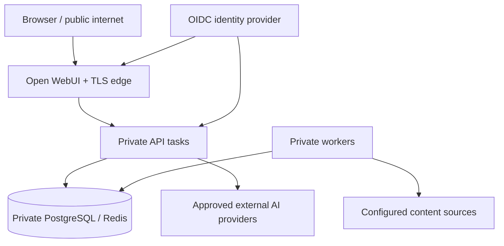
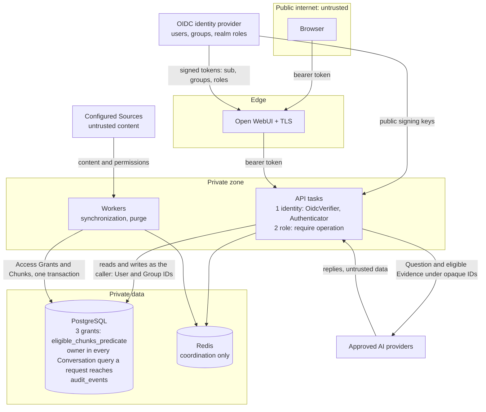

# M07-T16 — Pass the authorization understanding gate

Source task: [M07-T16](../curriculum/milestones/M07-identity-and-authorization/M07-T16-pass-the-authorization-gate.md)

## What you will do

This gate checks that you understand how the service decides who may do what. It asks you to explain it, draw it, debug it, and extend it. There are four parts:

- **Explain** identity, roles, and grants in your own words: three different questions that the service answers at three different places.
- **Redraw** the trust-zone diagram so it shows where each of those checks happens and what may cross each boundary.
- **Diagnose** a leak that a small, plausible-looking change plants in the identity code, using the M07-T15 suite to find who sees what they should not.
- **Add a new protected operation** on your own: `DELETE /v1/conversations/{conversation_id}`, which lets a User delete their own Conversation. It must fail closed at the HTTP boundary and in the database.

| The task asks for | Where it happens |
|---|---|
| Explain identity versus roles versus grants | Step 2: under `## Identity, roles, and grants` |
| Update trust-zone diagrams | Step 3: the diagram under "Trust zones" in `docs/security.md` |
| Diagnose an injected leak | Step 4: inject, run the suite, trace, write it under `## Injected leak`, undo |
| Add a new protected operation independently | Step 5: design it from a brief, then compare with the reference |
| Tests: success, highest-risk edge, typed failure or denial | Step 6: `tests/test_authorization_gate.py` and `tests/test_authorization_gate_integration.py` |
| Fail-closed at storage and transport seams | Step 6: no role, a stranger, a malformed ID, and an audit that cannot be written all change nothing |
| Telemetry holds no seeded text | Step 6: a marker in a Conversation and in a store error never reaches a log or an audit row |
| Update only what the change made inaccurate | Steps 3 and 8: `docs/security.md`, `docs/threat-model.md`, `docs/architecture.md` |

This lesson includes coding: Steps 5 and 6 write code. Steps 1, 2, 3, 4, 7, and 8 do not, though Steps 3 and 8 edit documents and Step 4 runs commands.

Terms used in this lesson:

- **Identity:** who is asking. Here it is the User and their Groups, taken from a token the identity provider signed. Example: alice, in the group `/engineering`.
- **Application Role:** what kind of work a caller may do with the service, such as asking questions or configuring Sources. Example: a content manager may start a Synchronization Run.
- **Access Grant:** which Documents a reader may see. It comes from the Source's own permissions. Example: the payroll handbook is granted to `/finance/payroll`.
- **Protected operation:** an action the service performs only for a caller whose role permits it. Each one is a value of `Operation` in `roles.py`.
- **Fail closed:** when something is wrong or missing, the answer is "no", never "yes". Example: if the audit row cannot be written, the deletion does not happen.
- **Existence leak:** an answer that differs depending on whether something the caller may not see exists. Example: "404" for a missing Conversation but "403" for someone else's tells a stranger which IDs are real.

## Before you begin

This section explains the choices behind the code, so each step makes sense when you reach it.

- **What already exists.** M07 built every piece: `OidcVerifier` checks the token's signature, issuer, audience, and time; `Authenticator` turns its claims into a `Caller`, which holds the reader (User and Group IDs) and, apart from it, the Application Roles; `require` refuses an operation no role of the caller permits; `eligible_chunks_predicate` checks Access Grants inside every search; and M07-T15 built one adversarial suite that walks seeded people through every door.
- **Three questions, three places.** Identity is decided once, at the API, from the token alone. Roles are checked next, at the API, before any input is read. Grants are checked last, in PostgreSQL, inside the query that reads the records. Mixing them up is the classic mistake: an administrator role that reads every Document, or a group that unlocks an operation.
- **Why deleting a Conversation.** `manage_own_conversations` is listed in `PERMISSIONS` for the `user` role, but no endpoint checks it yet. The store function `delete_conversation` already exists and already puts the owner in its SQL. So the new operation is small, and it touches all three questions: identity says whose Conversation, the role says whether the caller may delete at all, and no grant is needed, because a Conversation belongs to its User, not to a Source.
- **The same answer for every ID.** The endpoint answers 204, with no body, whether it deleted the Conversation, found it missing, found it already deleted, or found it belongs to someone else. Answering 404 for "not yours" would let anyone test which IDs exist. The store's `delete` returns nothing, so the HTTP code cannot even see the difference.
- **Order: who, then whether, then which.** The token is checked first, then the role, and only then is the ID parsed. A caller without the role gets 403 whatever ID they send, so a malformed ID tells them nothing.
- **Audited with the change.** `delete_conversation` now records one `conversation.deleted` audit event in the same transaction: `allowed` when it deleted, `denied` when nothing of the caller's was there. If the event cannot be written, the whole transaction rolls back and nothing is deleted. The response stays the same; only operators see the difference, in the audit trail.
- **The injected leak.** Step 4 runs a short command that changes one line of the identity code. It is encoded, so you diagnose from what the tests show, not from reading the patch. The answer is in a collapsed block at the end of the step.
- **Where the code lives.** `persistence/conversations.py` (the audit event); a new `answering/conversation_store.py`, beside the History it shares Conversations with; `app.py` (the route and the `ConversationStore` port); `tests/test_app_authentication.py` (the route list); the two new gate test files; and the three documents.
- **What the review found.** An independent adversarial review attacked the prototype with hostile IDs, headers, bodies, and fifteen mutants. Every guarantee held: no request could name another owner, the checks always ran in order, alice's and bob's responses were byte-identical, and every mutant failed at least one test. It found these smaller problems, now fixed, each with a test that fails without the fix:
  - `UUID()` also reads braces, `urn:uuid:`, a missing dash, a `+` sign, and Arabic-Indic digits as the same ID. The route now accepts only the canonical spelling.
  - A store that reported whether it deleted, with the app answering 404 on "no", passed every unit test; only the database tests caught it, and CI runs unit tests only. A unit test now gives the app a store that says "found" and one that says "not found", and requires identical responses.
  - A failed deletion left no log line at all. It now logs the error's type, never its message.
  - Three diagram and threat-model labels overstated or understated what crosses a boundary; they now say exactly what does.
- **Known limits.** Only deleting has a route: reading a Conversation or its History still has none. A 403 for a missing role writes no audit event, as before. A stranger's delete and a real one take slightly different time, since only a real one queues a purge Job. Any User can write one `denied` audit row per request until rate limits arrive (M09-T10), and the request ID in a row is the one the client sent. The purge itself runs in M08.

## Walkthrough

Before the integration checks, start PostgreSQL and set the test database URL in your terminal:

```bash
export KNOWLEDGE_SERVICE_TEST_DATABASE_URL="$(uv run python scripts/test_database_url.py)"
```

### Step 1 — No coding in this step: write the invariant and your predictions

Before any code exists, write what must be true when the lesson is done. Step 7 checks the predictions.

Create `docs/evidence/M07-T16-authorization-gate.md`:

```markdown
# M07-T16 — Authorization gate evidence

## Invariant

Every `/v1` operation decides who the caller is from a verified token
alone, checks that one of the caller's Application Roles permits the
operation before reading any input, and touches only the records the
caller may: Chunks through Access Grants checked inside PostgreSQL, and
Conversations through the owner in the SQL. A request that fails any of
these checks changes nothing, and its answer, logs, and audit rows never
reveal whether another User's record exists.

## Expected failing check

Before the change, `uv run pytest tests/test_authorization_gate.py -q`
fails with `ERROR: file or directory not found: tests/test_authorization_gate.py`.

## Predictions

- What bob gets when he deletes alice's Conversation by its real ID, and what changes in the database:
- What a content manager gets when deleting with a malformed ID:
- Which person reads a Document they may not after the injected change, and why only some seeds fail:
- How many tests in `tests/test_authorization_gate_integration.py` fail if `delete_conversation` forgets the owner:

## Identity, roles, and grants

## Trust zones

## Injected leak

## New operation

## Design

## Verification

## Review

## Decision

## Reflection
```

**Check:** the file exists, and each prediction has your answer after the colon.

### Step 2 — No coding in this step: explain identity, roles, and grants

This step asks you to explain, in your own words, the three questions the service answers for every request. Write it under `## Identity, roles, and grants` in the evidence file, checking each claim against the code.

For each of the three, answer:

- **What question does it answer?**
- **Where does its answer come from?** The token claim, the Source, or the code.
- **Where in the code is it checked, and when?** Name the function and say what has already happened before it.
- **What does a request that fails it get?** The status code, and what still runs.

Then work through one example that keeps them apart: a Keycloak user with the `administrator` and `user` roles, in no group, asks about a Document granted to `/engineering`. Say what each check decides, and why the administrator role does not help. `test_an_administrator_reads_exactly_what_the_same_user_reads` in `tests/test_app_authentication.py` shows the answer.

| Where to look | What it shows |
|---|---|
| `src/knowledge_service/identity/context.py` | `build_authorization_context`, `application_roles`, `Authenticator`, `Caller` |
| `src/knowledge_service/roles.py` | `PERMISSIONS`, `permits`, `require` |
| `src/knowledge_service/app.py` | `admit`: who, then whether, then the body |
| `src/knowledge_service/persistence/access.py` | `eligible_chunks_predicate` |
| `src/knowledge_service/persistence/conversations.py` | `_live`: the owner in every Conversation query |

**Check:** each answer names a function that exists, and the example ends with the user reading nothing from `/engineering`.

### Step 3 — No coding in this step: redraw the trust zones

The diagram under "Trust zones" in `docs/security.md` shows boxes and arrows but not where any check happens or what may cross. This step redraws it so a reader sees the three checks in order, and what each boundary lets through.

Draw your own version first, on paper or in Markdown. Then compare it with the reference and write under `## Trust zones` what you drew differently and why.

**Action:** replace the diagram.

In `docs/security.md`:

**1.** Find:

````markdown

## Trust zones



## Threat-driven controls

````

Replace with:

````markdown

## Trust zones

Each arrow that enters a zone crosses a boundary, and the label says what
may cross it. The numbers mark the three checks every request meets, in
order: who the caller is, whether their role permits the operation, and
which records they may touch.



- **Identity** says who is asking: the User and Groups in a verified token,
  turned into an Authorization Context. Nothing else in a request names
  them.
- **Roles** say which operations the caller may run, such as asking or
  deleting their own Conversation. A role never lets anyone read a
  Document.
- **Grants** say which Documents a reader may see. They come from each
  Source's permissions and are checked inside PostgreSQL, in the same
  query that finds the Chunks.

## Threat-driven controls

````

The numbers 1, 2, and 3 follow one request: identity at the API, the role at the API, grants inside PostgreSQL. Workers have no number: they write Access Grants, but they never answer a User.

**Check:** `make docs-check` passes, and the diagram renders when you preview the file in your editor or on GitHub.

### Step 4 — No coding in this step: diagnose an injected leak

This step plants a leak in the identity code and asks you to find it from the outside, as you would in production: from failing tests, not from a diff. The M07-T15 suite is your detector.

**Action 1:** run the injection. It changes one line of `src/knowledge_service/identity/context.py`. The line is base64-encoded so that you diagnose the leak rather than read it:

```bash
uv run python - <<'EOF'
from base64 import b64decode
from pathlib import Path
path = Path("src/knowledge_service/identity/context.py")
old, new = (
    b64decode(s).decode()
    for s in ("ICAgICAgICBuYW1lZC5hZGQocGF0aCkK", "ICAgICAgICBuYW1lZC5hZGQocGF0aC5jYXNlZm9sZCgpKQo=")
)
text = path.read_text()
assert text.count(old) == 1
path.write_text(text.replace(old, new))
EOF
```

**Action 2:** run the identity tests, the generator tests, and the suite:

```bash
uv run pytest tests/test_authorization_context.py -q
uv run pytest tests/test_authorization_scenarios.py -q
uv run pytest -m integration tests/test_authorization_suite_integration.py -q
```

Expected: `2 failed, 87 passed`, then `54 passed`, then `6 failed, 30 passed`. The generator's own tests miss it, because only carol ever has an upper-case group path.

**Action 3:** diagnose. Answer these under `## Injected leak`:

- **Symptom.** Which tests fail, for which seeds? Read one failure message: each names the door, the language, the person, and the seed, then the set they got against the set they may read.
- **Who and what.** Which person reads a Document they may not, and which Document do they lose? Print that person's groups for each seed with `uv run python -c "import sys; sys.path.insert(0, 'tests'); from authorization_scenarios import scenario; [print(s, scenario(s).person('carol').groups) for s in range(6)]"`.
- **Cause.** Which part of the token's journey to an Authorization Context changed? The two failing tests in `tests/test_authorization_context.py` point at it; confirm with `git diff` only after you have a guess.
- **Chain.** From the token's claim, through the Group ID, to the SQL that returned the Chunk: one line per hop.
- **Why only some seeds.** What must a person's groups contain for the leak to show?

**Action 4:** undo it, and check the suite is green again:

```bash
git checkout -- src/knowledge_service/identity/context.py
uv run pytest -m integration tests/test_authorization_suite_integration.py -q
```

Expected: `36 passed`.

<details>
<summary>The answer, after you have written yours</summary>

The change lower-cases every group path in the token before it becomes a Group ID (`named.add(path.casefold())` in `_group_paths`). Access Grants are still written with the path as the Source wrote it. So a token that says `/Engineering` now gets the Group ID of `/engineering`: carol, in seeds 4 and 5, reads the `/engineering` Documents and loses her own `/Engineering` ones. Seeds 0 to 3 pass because there carol has no upper-case path, and alice and bob are always lower-case. The chain: `groups` claim `/Engineering` → `_group_paths` gives `/engineering` → `group_id_for` gives `/engineering`'s ID → `eligible_chunks_predicate` matches the `/engineering` grant → the Chunk is returned. The lesson: a normalization applied on only one side of a comparison widens access. Group paths are compared exactly, as Keycloak names them.

</details>

**Check:** `git diff src/` is empty, and `## Injected leak` holds the symptom, the person, the cause, the chain, and why only some seeds fail.

### Step 5 — Coding step: add the protected operation

**In plain words:** this step lets a User delete their own Conversation over HTTP. The service checks who is asking, that their role allows managing their own Conversations, and only then reads which Conversation they mean. The database deletes it only if it belongs to the caller, and records the attempt in the audit trail in the same step. Whatever happened, the caller gets the same short answer, so nobody can use it to find out which Conversations exist.

Try it yourself first. The brief:

| Must | Detail |
|---|---|
| Route | `DELETE /v1/conversations/{conversation_id}` |
| Operation | `Operation.MANAGE_OWN_CONVERSATIONS`, through `require`, after authentication and before the ID is parsed |
| Owner | `caller.reader.user_id`, never anything from the request |
| Answer | 204 with no body, the same for deleted, missing, already deleted, and another User's |
| Malformed ID | 422 `validation_error`, only for a caller with the role; only the canonical `8-4-4-4-12` hex spelling is an ID |
| No store | 503 `conversations_unavailable` |
| Store fails | the failure policy: 503 with `Retry-After` for an unreachable database, 500 otherwise, with no error text; the log names only the error's type |
| Audit | `conversation.deleted` in the same transaction: `allowed` and `succeeded`, or `denied` and `failed` |

Then compare with the reference below, and write under `## New operation` where yours differed and which is better.

**Action 1:** record each deletion attempt in the audit trail.

In `src/knowledge_service/persistence/conversations.py`:

**1.** Find:

```python
  past these functions can make its Conversation unreadable.
- **Feedback is audited.** `rate_message` records who rated which Message,
  up or down, in the same transaction as the rating.

The other functions read and write without an owner, for system work such
as retention and purge Jobs; they are never given a User's request.
```

Replace with:

```python
  past these functions can make its Conversation unreadable.
- **Feedback is audited.** `rate_message` records who rated which Message,
  up or down, in the same transaction as the rating.
- **Deletion is audited.** `delete_conversation` records one
  `conversation.deleted` event in the same transaction: `allowed` when it
  deleted the owner's Conversation, `denied` when there was nothing of
  theirs to delete, whoever's ID it was.

The other functions read and write without an owner, for system work such
as retention and purge Jobs; they are never given a User's request.
```

**2.** Find:

```python
    owner_id: UserId,
    conversation_id: ConversationId,
    now: datetime,
) -> bool:
    """Delete the owner's Conversation now, and queue its purge.

    Returns True when this call deleted it, also past its deadline, and
    False when there was nothing of this owner's to delete. A caller must
    answer the same either way, so the result never tells a User whether
    another User's Conversation exists.
    """
    now = _utc(now)
    deleted = await connection.scalar(
        sa.update(conversations)
        .where(
```

Replace with:

```python
    owner_id: UserId,
    conversation_id: ConversationId,
    now: datetime,
    request_id: UUID | None = None,
) -> bool:
    """Delete the owner's Conversation now, and queue its purge.

    Returns True when this call deleted it, also past its deadline, and
    False when there was nothing of this owner's to delete. A caller must
    answer the same either way, so the result never tells a User whether
    another User's Conversation exists. Either way one audit event records
    the attempt, with `request_id` when a request made it.
    """
    now = _utc(now)
    if request_id is not None and type(request_id) is not UUID:
        raise TypeError("request_id must be a UUID")
    deleted = await connection.scalar(
        sa.update(conversations)
        .where(
```

**3.** Find:

```python
        .values(deleted_at=sa.func.greatest(now, conversations.c.last_message_at))
        .returning(conversations.c.conversation_id)
    )
    if deleted is None:
        return False
    await enqueue_job(
        connection,
        Job.request(
            job_id=JobId.new(),
            kind=JobKind.PURGE_CONVERSATION,
            target_id=conversation_id.value,
            queued_at=now,
        ),
    )
    return True


def _live(
```

Replace with:

```python
        .values(deleted_at=sa.func.greatest(now, conversations.c.last_message_at))
        .returning(conversations.c.conversation_id)
    )
    if deleted is not None:
        await enqueue_job(
            connection,
            Job.request(
                job_id=JobId.new(),
                kind=JobKind.PURGE_CONVERSATION,
                target_id=conversation_id.value,
                queued_at=now,
            ),
        )
    await record_audit_event(
        connection,
        AuditEvent(
            event_id=AuditEventId.new(),
            occurred_at=now,
            actor_id=owner_id,
            action=AuditAction.CONVERSATION_DELETED,
            target_kind=AuditTargetKind.CONVERSATION,
            target_id=conversation_id.value,
            decision=AuditDecision.DENIED if deleted is None else AuditDecision.ALLOWED,
            outcome=AuditOutcome.FAILED if deleted is None else AuditOutcome.SUCCEEDED,
            request_id=request_id,
            run_id=None,
            metadata={},
        ),
    )
    return deleted is not None


def _live(
```

The purge Job is queued only for a real deletion, but the audit event is written either way. `request_id` is optional, so the existing callers keep working.

**Action 2:** the store the app is given.

Create `src/knowledge_service/answering/conversation_store.py`:

```python
"""The caller's own Conversations, as an HTTP request reaches them.

`DatabaseConversationStore` is the `ConversationStore` an entry point gives
the app. It runs each operation in one transaction of its own, with the
owner from the caller's verified token, and keeps the store's promise at the
boundary:

- **Owner in the SQL.** The owner is the caller's `UserId`, never a value
  from the request, and `delete_conversation` puts it in the statement.
- **Nothing to tell apart.** `delete` returns nothing, whether it deleted
  the caller's Conversation or found nothing of theirs: missing, another
  User's, and already deleted all end the same way, so the response cannot
  reveal which.
- **Audited with the change.** The deletion, its purge Job, and its audit
  event commit together, or none of them does.
"""

from collections.abc import Callable
from datetime import UTC, datetime
from uuid import UUID

from knowledge_service.database import DatabaseRuntime
from knowledge_service.identifiers import ConversationId, UserId
from knowledge_service.persistence.conversations import delete_conversation


def _utc_now() -> datetime:
    return datetime.now(UTC)


class DatabaseConversationStore:
    """The caller's own Conversations in PostgreSQL."""

    def __init__(
        self, runtime: DatabaseRuntime, clock: Callable[[], datetime] = _utc_now
    ) -> None:
        self._runtime = runtime
        self._clock = clock

    async def delete(
        self, *, owner_id: UserId, conversation_id: ConversationId, request_id: UUID
    ) -> None:
        """Delete the owner's Conversation, if it is theirs and live."""
        async with self._runtime.transaction() as connection:
            await delete_conversation(
                connection,
                owner_id=owner_id,
                conversation_id=conversation_id,
                now=self._clock(),
                request_id=request_id,
            )
```

`delete` returns `None` on purpose: the HTTP layer cannot leak a difference it never receives.

**Action 3:** the route.

In `src/knowledge_service/app.py`:

**1.** Find:

```python
import asyncio
import contextlib
import logging
from collections.abc import Awaitable, Callable, Coroutine
from typing import Protocol
from uuid import UUID, uuid4
```

Replace with:

```python
import asyncio
import contextlib
import logging
import re
from collections.abc import Awaitable, Callable, Coroutine
from typing import Protocol
from uuid import UUID, uuid4
```

**2.** Find:

```python
    classify_failure,
    policy_for,
)
from knowledge_service.identity.context import (
    AuthenticationError,
    Caller,
```

Replace with:

```python
    classify_failure,
    policy_for,
)
from knowledge_service.identifiers import ConversationId, UserId
from knowledge_service.identity.context import (
    AuthenticationError,
    Caller,
```

**3.** Find:

```python
ReadinessCheck = Callable[[], Awaitable[bool]]
# A Question is at most 4,000 characters; even escaped as JSON it fits.
MAX_BODY_BYTES = 65_536


class RequestAuthenticator(Protocol):
```

Replace with:

```python
ReadinessCheck = Callable[[], Awaitable[bool]]
# A Question is at most 4,000 characters; even escaped as JSON it fits.
MAX_BODY_BYTES = 65_536
# The one spelling of an ID the API accepts: `UUID()` alone also reads braces,
# `urn:uuid:`, a missing dash, a sign, or non-ASCII digits.
CANONICAL_ID = re.compile(
    r"[0-9a-f]{8}-[0-9a-f]{4}-[0-9a-f]{4}-[0-9a-f]{4}-[0-9a-f]{12}", re.IGNORECASE
)


class RequestAuthenticator(Protocol):
```

**4.** Find:

```python
    """

    async def authenticate(self, headers: list[str]) -> Caller: ...


class _NotAuthenticated(Exception):
```

Replace with:

```python
    """

    async def authenticate(self, headers: list[str]) -> Caller: ...


class ConversationStore(Protocol):
    """The caller's own Conversations.

    `DatabaseConversationStore` is the implementation. `delete` returns
    nothing whether or not there was a Conversation of the owner's to delete.
    """

    async def delete(
        self, *, owner_id: UserId, conversation_id: ConversationId, request_id: UUID
    ) -> None: ...


class _NotAuthenticated(Exception):
```

**5.** Find:

```python
    workflow: AnswerWorkflow | None = None,
    streamer: AnswerStreamer | None = None,
    authenticator: RequestAuthenticator | None = None,
) -> FastAPI:
    """The HTTP application.

    Both answer endpoints need a bearer token and the role that permits
    asking: without an `authenticator` they answer 503, and the reader is
    only ever the context it returns.
    """
    app = FastAPI(title="knowledge-service")

```

Replace with:

```python
    workflow: AnswerWorkflow | None = None,
    streamer: AnswerStreamer | None = None,
    authenticator: RequestAuthenticator | None = None,
    conversations: ConversationStore | None = None,
) -> FastAPI:
    """The HTTP application.

    Every `/v1` endpoint needs a bearer token and the role that permits its
    operation: without an `authenticator` they answer 503, and the reader or
    owner is only ever the one in the context it returns.
    """
    app = FastAPI(title="knowledge-service")

```

**6.** Find:

```python
            },
        )

    return app


```

Replace with:

```python
            },
        )

    @app.delete("/v1/conversations/{conversation_id}", status_code=204)
    async def delete_own_conversation(
        request: Request, conversation_id: str
    ) -> Response:
        # Who, then whether they may, then which Conversation: the ID is not
        # even parsed for a caller who may not delete Conversations.
        caller = await authenticate(request)
        require(caller.roles, Operation.MANAGE_OWN_CONVERSATIONS)
        request_id = request_id_from(request)
        if not CANONICAL_ID.fullmatch(conversation_id):
            return failure_response(kind=FailureKind.VALIDATION, request_id=request_id)
        target = ConversationId.parse(conversation_id)
        if conversations is None:
            return error_response(
                status_code=503,
                code="conversations_unavailable",
                message="Conversations are unavailable",
                request_id=request_id,
            )
        try:
            # The owner is the caller; nothing in the request can name another.
            await conversations.delete(
                owner_id=caller.reader.user_id,
                conversation_id=target,
                request_id=request_id,
            )
        except asyncio.CancelledError:
            raise
        except Exception as error:
            # Only the type: the message may name the Conversation or its text.
            logger.error("conversation delete failed: %s", type(error).__name__)
            return failure_response(kind=classify_failure(error), request_id=request_id)
        # The same whether it was deleted, missing, or another User's.
        return Response(status_code=204)

    return app


```

The ID arrives as a plain string and is parsed by hand, after the role check. If it were typed as a `UUID` in the route, FastAPI would validate it before the handler runs, so a caller with no token or no role would learn that the ID was malformed.

**Check:** `uv run pyright src` reports 0 errors.

### Step 6 — Coding step: tests for the gate

**In plain words:** these tests send real HTTP requests to the app. The first file uses a fake store, so it can check exactly who the store was asked to delete for, and that it was never asked at all when the caller had no token or no role. The second file uses the real database, and shows that a stranger's delete changes nothing and is recorded as denied, and that a deletion whose audit row cannot be written does not happen.

| Test | Shows |
|---|---|
| `test_a_user_deletes_their_conversation_as_the_token_says` | Success: 204, and the store is asked for the token's User |
| `test_nothing_in_the_request_can_name_another_owner` | Query, headers, and body naming bob change nothing |
| `test_two_users_deleting_the_same_id_each_act_only_as_themselves` | Same answer for both, each as themselves |
| `test_the_answer_cannot_tell_a_deletion_from_nothing_to_delete` | Even a store that reports "found" or "not found" cannot change the response |
| `test_a_caller_without_the_role_is_refused_before_the_id_is_read` | A content manager gets 403 for a valid and a malformed ID alike |
| `test_a_request_without_a_valid_token_deletes_nothing` | 401 and the store untouched |
| `test_a_malformed_id_from_a_permitted_caller_is_a_422` | Typed refusal, store untouched, including spellings `UUID()` would accept |
| `test_the_store_refuses_a_request_id_that_is_not_a_uuid` | The store's own typed refusal, before any SQL |
| `test_an_unreachable_database_is_a_503_with_retry_after`, `test_an_app_without_a_store_deletes_nothing_and_says_so`, `test_a_store_error_names_nothing_to_the_client_or_the_log` | Failures refuse, and name nothing |
| `test_the_owner_deletes_and_the_deletion_is_audited_with_it` | In PostgreSQL: deleted, one purge Job, one `allowed` row with the request ID |
| `test_a_second_delete_reads_the_same_and_queues_nothing_more` | Repeating is harmless and recorded as `denied` |
| `test_a_strangers_delete_reads_like_a_missing_one_and_changes_nothing` | The highest-risk edge: identical responses, alice's Conversation intact, two `denied` rows, no marker anywhere |
| `test_a_caller_without_the_role_changes_nothing` | 403, nothing changed, nothing recorded |
| `test_a_deletion_that_cannot_be_audited_does_not_happen` | Storage fails closed: a trigger refuses the audit row, and the Conversation stays |

**Action 1:** list the new route with its operation. A test in this file fails for any route that is not listed, which is how you find out a new route needs a decision.

In `tests/test_app_authentication.py`:

**1.** Find:

```python

import logging
from typing import Any, cast

import httpx
import pytest
```

Replace with:

```python

import logging
from typing import Any, cast
from uuid import uuid4

import httpx
import pytest
```

**2.** Find:

```python
    ("GET", "/redoc"): None,
    ("POST", "/v1/answer"): Operation.ASK_QUESTIONS,
    ("POST", "/v1/answer/stream"): Operation.ASK_QUESTIONS,
}
PROTECTED = [(route, operation) for route, operation in ROUTES.items() if operation]


class Counting:
```

Replace with:

```python
    ("GET", "/redoc"): None,
    ("POST", "/v1/answer"): Operation.ASK_QUESTIONS,
    ("POST", "/v1/answer/stream"): Operation.ASK_QUESTIONS,
    ("DELETE", "/v1/conversations/{conversation_id}"): (
        Operation.MANAGE_OWN_CONVERSATIONS
    ),
}
PROTECTED = [(route, operation) for route, operation in ROUTES.items() if operation]
# The routes that read a body, to check none is read before the role.
WITH_BODY = [path for (method, path), _ in PROTECTED if method == "POST"]


class Counting:
```

**3.** Find:

```python
        raise RuntimeError("reached")


def full_app(
    source: Source, workflow: Any = None, tokens: dict[str, Any] | None = None
) -> Any:
    """The app with both answer endpoints wired, so every route is real."""
    return create_app(
        workflow=cast(AnswerWorkflow, workflow or Counting()),
        streamer=streamer(Model(), source=source),
        authenticator=Authenticator(Verifier(tokens or TOKENS), POLICY),
    )


```

Replace with:

```python
        raise RuntimeError("reached")


class Deleting:
    """A Conversation store that records each deletion it is asked for."""

    def __init__(self) -> None:
        self.calls: list[dict[str, Any]] = []

    async def delete(self, **request: Any) -> None:
        self.calls.append(request)


def full_app(
    source: Source,
    workflow: Any = None,
    tokens: dict[str, Any] | None = None,
    conversations: Deleting | None = None,
) -> Any:
    """The app with every endpoint wired, so every route is real."""
    return create_app(
        workflow=cast(AnswerWorkflow, workflow or Counting()),
        streamer=streamer(Model(), source=source),
        authenticator=Authenticator(Verifier(tokens or TOKENS), POLICY),
        conversations=conversations or Deleting(),
    )


```

**4.** Find:

```python
    operation: Operation,
    roles: frozenset[ApplicationRole],
) -> None:
    source, workflow = Source(), Counting()
    token = verified(realm_access={"roles": sorted(roles)})
    app = full_app(source, workflow, {"token": token})
    method, path = route

    async with client(app) as http:
        response = await http.request(
            method,
            path,
            json={"text": QUESTION.text},
            headers={"Authorization": "Bearer token"},
        )

    allowed = bool(roles & MATRIX[operation])
    assert (response.status_code == 403) is not allowed
    assert bool(source.readers or workflow.calls) is allowed


@pytest.mark.parametrize("path", [path for (_, path), _ in PROTECTED])
async def test_the_role_is_checked_before_the_body_is_read(path: str) -> None:
    read: list[int] = []
    sent: list[dict[str, Any]] = []
```

Replace with:

```python
    operation: Operation,
    roles: frozenset[ApplicationRole],
) -> None:
    source, workflow, conversations = Source(), Counting(), Deleting()
    token = verified(realm_access={"roles": sorted(roles)})
    app = full_app(source, workflow, {"token": token}, conversations)
    method, path = route

    async with client(app) as http:
        response = await http.request(
            method,
            path.replace("{conversation_id}", str(uuid4())),
            json={"text": QUESTION.text},
            headers={"Authorization": "Bearer token"},
        )

    allowed = bool(roles & MATRIX[operation])
    assert (response.status_code == 403) is not allowed
    assert bool(source.readers or workflow.calls or conversations.calls) is allowed


@pytest.mark.parametrize("path", WITH_BODY)
async def test_the_role_is_checked_before_the_body_is_read(path: str) -> None:
    read: list[int] = []
    sent: list[dict[str, Any]] = []
```

**Action 2:** the HTTP tests over a fake store.

Create `tests/test_authorization_gate.py`:

```python
"""The M07 gate's new protected operation: a User deletes their Conversation.

`DELETE /v1/conversations/{conversation_id}` brings the three checks of the
milestone together. Identity: the owner is the User the verified token
names, and nothing in the request can name another. Role: the caller needs
`manage_own_conversations`, checked before the ID is even parsed. Grants: none
are needed, because a Conversation is the User's own, not a Document. These
tests run the real app and `Authenticator` over a fake store; the store's
own rules run in `test_authorization_gate_integration.py`.
"""

import logging
from datetime import UTC, datetime
from typing import Any, cast
from uuid import UUID

import httpx
import pytest
from sqlalchemy.exc import OperationalError

from knowledge_service.app import create_app
from knowledge_service.identifiers import ConversationId
from knowledge_service.identity.context import Authenticator, user_id_for
from knowledge_service.persistence.conversations import delete_conversation
from test_app_authentication import Deleting
from test_authorization_context import ALICE, ISSUER, POLICY, Verifier, verified

CONVERSATION = "0190a3a0-0000-7000-8000-000000000016"
REQUEST_ID = "0190a3a0-0000-7000-8000-0000000000aa"
MARKER = "GATE-MARKER-5531"
TOKENS = {
    "alice-token": verified(),
    "bob-token": verified(sub="bob"),
    "manager-token": verified(realm_access={"roles": ["content-manager"]}),
}


class Answering:
    """A store that deletes, and returns `found`, as a careless one might."""

    def __init__(self, found: bool) -> None:
        self.found = found

    async def delete(self, **request: Any) -> bool:
        return self.found


class Failing:
    """A Conversation store that raises `error` on every call."""

    def __init__(self, error: Exception) -> None:
        self.error = error

    async def delete(self, **request: Any) -> None:
        raise self.error


def app_with(conversations: Any) -> Any:
    return create_app(
        authenticator=Authenticator(Verifier(TOKENS), POLICY),
        conversations=conversations,
    )


async def delete(
    app: Any,
    bearer: str | None = "alice-token",
    conversation_id: str = CONVERSATION,
    **extra: Any,
) -> httpx.Response:
    headers = {"X-Request-ID": REQUEST_ID, **extra.pop("headers", {})}
    if bearer is not None:
        headers["Authorization"] = f"Bearer {bearer}"
    async with httpx.AsyncClient(
        transport=httpx.ASGITransport(app=app), base_url="http://t"
    ) as http:
        return await http.request(
            "DELETE",
            f"/v1/conversations/{conversation_id}",
            headers=headers,
            **extra,
        )


# --- Success: the owner is whoever the token names ------------------------------


async def test_a_user_deletes_their_conversation_as_the_token_says() -> None:
    store = Deleting()

    response = await delete(app_with(store))

    assert response.status_code == 204
    assert response.content == b""
    assert store.calls == [
        {
            "owner_id": user_id_for(ISSUER, ALICE),
            "conversation_id": ConversationId.parse(CONVERSATION),
            "request_id": UUID(REQUEST_ID),
        }
    ]


async def test_nothing_in_the_request_can_name_another_owner() -> None:
    store = Deleting()
    bob = str(user_id_for(ISSUER, "bob").value)

    response = await delete(
        app_with(store),
        params={"owner_id": bob, "user_id": bob},
        headers={"X-User-ID": bob, "X-Forwarded-User": "bob"},
        json={"owner_id": bob},
    )

    assert response.status_code == 204
    assert [call["owner_id"] for call in store.calls] == [user_id_for(ISSUER, ALICE)]


async def test_two_users_deleting_the_same_id_each_act_only_as_themselves() -> None:
    store = Deleting()
    app = app_with(store)

    first = await delete(app, "alice-token")
    second = await delete(app, "bob-token")

    # Same answer, so bob cannot tell whether alice's Conversation existed.
    assert (first.status_code, first.content) == (second.status_code, second.content)
    assert [call["owner_id"] for call in store.calls] == [
        user_id_for(ISSUER, ALICE),
        user_id_for(ISSUER, "bob"),
    ]


async def test_the_answer_cannot_tell_a_deletion_from_nothing_to_delete() -> None:
    deleted = await delete(app_with(Answering(found=True)))
    nothing = await delete(app_with(Answering(found=False)))

    # Even a store that said which happened could not change the response.
    assert deleted.status_code == nothing.status_code == 204
    assert deleted.content == nothing.content == b""
    assert sorted(deleted.headers.items()) == sorted(nothing.headers.items())


# --- Highest-risk edge: who and whether, before which -----------------------------


async def test_a_caller_without_the_role_is_refused_before_the_id_is_read() -> None:
    store = Deleting()

    known = await delete(app_with(store), "manager-token")
    malformed = await delete(app_with(store), "manager-token", "not-an-id")

    # A content manager gets 403 whatever the ID, and the store is never asked.
    assert (known.status_code, malformed.status_code) == (403, 403)
    assert known.json()["code"] == "forbidden"
    assert store.calls == []


@pytest.mark.parametrize("token", [None, "unknown-token"])
async def test_a_request_without_a_valid_token_deletes_nothing(
    token: str | None,
) -> None:
    store = Deleting()

    response = await delete(app_with(store), token, "not-an-id")

    assert response.status_code == 401
    assert response.headers["www-authenticate"].startswith("Bearer")
    assert store.calls == []


@pytest.mark.parametrize(
    "conversation_id",
    [
        "not-an-id",
        "0190a3a0",
        "%00",
        "0190a3a0-0000-7000-8000-00000000001g",
        # `UUID()` reads all of these as the same ID; the API does not.
        "{0190a3a0-0000-7000-8000-000000000016}",
        "urn:uuid:0190a3a0-0000-7000-8000-000000000016",
        "0190a3a0000070008000000000000016",
        "+190a3a0000070008000000000000016",
        "\u0660190a3a0-0000-7000-8000-000000000016",
    ],
)
async def test_a_malformed_id_from_a_permitted_caller_is_a_422(
    conversation_id: str,
) -> None:
    store = Deleting()

    response = await delete(app_with(store), conversation_id=conversation_id)

    assert response.status_code == 422
    assert response.json()["code"] == "validation_error"
    assert store.calls == []


# --- Typed failures: an unusable store refuses, never guesses -----------------------


async def test_an_unreachable_database_is_a_503_with_retry_after() -> None:
    down = OperationalError("connect", {}, ConnectionRefusedError(MARKER))

    response = await delete(app_with(Failing(down)))

    assert response.status_code == 503
    assert response.json()["code"] == "dependency_unavailable"
    assert response.headers["retry-after"] == "5"


async def test_an_app_without_a_store_deletes_nothing_and_says_so() -> None:
    response = await delete(app_with(None))

    assert response.status_code == 503
    assert response.json()["code"] == "conversations_unavailable"


async def test_a_store_error_names_nothing_to_the_client_or_the_log(
    caplog: pytest.LogCaptureFixture,
) -> None:
    caplog.set_level(logging.DEBUG)

    response = await delete(app_with(Failing(RuntimeError(MARKER))))

    assert response.status_code == 500
    assert MARKER not in response.text
    assert all(MARKER not in str(vars(record)) for record in caplog.records)
    # Operators still see that it failed, and of what kind.
    assert "conversation delete failed: RuntimeError" in caplog.messages


async def test_the_store_refuses_a_request_id_that_is_not_a_uuid() -> None:
    # Checked before any SQL, so no connection is needed.
    with pytest.raises(TypeError):
        await delete_conversation(
            cast(Any, None),
            owner_id=user_id_for(ISSUER, ALICE),
            conversation_id=ConversationId.parse(CONVERSATION),
            now=datetime(2026, 11, 20, tzinfo=UTC),
            request_id=cast(Any, REQUEST_ID),
        )
```

**Action 3:** the same operation over real PostgreSQL.

Create `tests/test_authorization_gate_integration.py`:

```python
"""The gate's protected operation over HTTP and real PostgreSQL.

`DELETE /v1/conversations/{conversation_id}` runs as the token's User, with
the real `DatabaseConversationStore`. It must fail closed at both seams:

- **Transport.** A caller without the role changes nothing; a stranger's
  delete answers exactly as a delete of a missing ID does.
- **Storage.** The owner is in the SQL, so another User's Conversation is
  never touched; the deletion, its purge Job, and its audit event commit
  together, so a deletion that cannot be audited does not happen.

People come from token claims through `authorization_scenarios`, as in the
M07-T15 suite.
"""

import json
import logging
from collections.abc import AsyncIterator
from datetime import UTC, datetime, timedelta
from typing import Any
from uuid import UUID

import httpx
import pytest
import sqlalchemy as sa
from pydantic import SecretStr

from authorization_scenarios import Person
from knowledge_service.answering.conversation_store import DatabaseConversationStore
from knowledge_service.app import create_app
from knowledge_service.conversations import (
    ConversationLimits,
    MessageOutcome,
    Transcript,
)
from knowledge_service.database import DatabaseRuntime, create_database_runtime
from knowledge_service.identifiers import ConversationId
from knowledge_service.identity.context import (
    AuthenticationError,
    Caller,
    Unauthenticated,
)
from knowledge_service.persistence.conversations import (
    add_turn,
    read_conversation,
    start_conversation,
)
from knowledge_service.persistence.schema import audit_events, jobs
from knowledge_service.roles import ApplicationRole
from knowledge_service.settings import Settings

pytestmark = pytest.mark.integration

NOW = datetime(2026, 11, 20, 9, 0, tzinfo=UTC)
LATER = NOW + timedelta(minutes=5)
LIMITS = ConversationLimits(retention=timedelta(days=30), max_messages=10)
REQUEST_ID = UUID("0190a3a0-0000-7000-8000-0000000000bb")
MARKER = "GATE-MARKER-8817"
ALICE = Person("alice", ("/engineering",))
BOB = Person("bob", ("/engineering",))
MANAGER = Person("morgan", ("/engineering",))
CALLERS = {
    "Bearer alice": Caller(
        reader=ALICE.context(), roles=frozenset({ApplicationRole.USER})
    ),
    "Bearer bob": Caller(reader=BOB.context(), roles=frozenset({ApplicationRole.USER})),
    "Bearer morgan": Caller(
        reader=MANAGER.context(), roles=frozenset({ApplicationRole.CONTENT_MANAGER})
    ),
}


class Tokens:
    """Gives each test token the caller its claims would give."""

    async def authenticate(self, headers: list[str]) -> Caller:
        if len(headers) == 1 and headers[0] in CALLERS:
            return CALLERS[headers[0]]
        raise Unauthenticated("test", error=AuthenticationError.INVALID_TOKEN)


@pytest.fixture
async def runtime(migrated_database: str) -> AsyncIterator[DatabaseRuntime]:
    runtime = create_database_runtime(
        Settings(database_url=SecretStr(migrated_database))
    )
    try:
        yield runtime
    finally:
        await runtime.dispose()


async def alices_conversation(runtime: DatabaseRuntime) -> ConversationId:
    """A Conversation of alice's, with one answered turn holding `MARKER`."""
    owner = ALICE.context().user_id
    async with runtime.transaction() as connection:
        conversation = await start_conversation(
            connection, owner_id=owner, now=NOW, limits=LIMITS
        )
        await add_turn(
            connection,
            owner_id=owner,
            conversation_id=conversation.conversation_id,
            question=f"What does {MARKER} say?",
            reply=f"It says {MARKER}.",
            outcome=MessageOutcome.ABSTAINED,
            now=NOW,
            limits=LIMITS,
        )
    return conversation.conversation_id


async def delete(
    runtime: DatabaseRuntime, person: Person, conversation_id: ConversationId
) -> httpx.Response:
    app = create_app(
        authenticator=Tokens(),
        conversations=DatabaseConversationStore(runtime, clock=lambda: LATER),
    )
    async with httpx.AsyncClient(
        transport=httpx.ASGITransport(app=app), base_url="http://t"
    ) as http:
        return await http.delete(
            f"/v1/conversations/{conversation_id.serialize()}",
            headers={
                "Authorization": f"Bearer {person.name}",
                "X-Request-ID": str(REQUEST_ID),
            },
        )


async def alices_view(
    runtime: DatabaseRuntime, conversation_id: ConversationId
) -> Transcript | None:
    async with runtime.transaction() as connection:
        return await read_conversation(
            connection,
            owner_id=ALICE.context().user_id,
            conversation_id=conversation_id,
            now=LATER,
        )


async def purge_jobs(runtime: DatabaseRuntime) -> int:
    async with runtime.transaction() as connection:
        count = await connection.scalar(
            sa.select(sa.func.count())
            .select_from(jobs)
            .where(jobs.c.kind == "purge_conversation")
        )
    return int(count or 0)


async def audit_rows(runtime: DatabaseRuntime) -> list[dict[str, Any]]:
    async with runtime.transaction() as connection:
        records = (
            (await connection.execute(sa.select(audit_events).order_by("occurred_at")))
            .mappings()
            .all()
        )
    return [dict(record) for record in records]


def logged(caplog: pytest.LogCaptureFixture) -> str:
    return "\n".join(
        json.dumps(vars(record), default=str, ensure_ascii=False)
        for record in caplog.records
    )


def same_response(first: httpx.Response, second: httpx.Response) -> bool:
    """Status, body, and headers, apart from the ones that vary by time."""

    def shown(response: httpx.Response) -> tuple[Any, ...]:
        headers = sorted(
            (name, value) for name, value in response.headers.items() if name != "date"
        )
        return response.status_code, response.content, headers

    return shown(first) == shown(second)


# --- Success: the owner deletes, and it is audited with the change -----------------


async def test_the_owner_deletes_and_the_deletion_is_audited_with_it(
    runtime: DatabaseRuntime,
) -> None:
    conversation_id = await alices_conversation(runtime)

    response = await delete(runtime, ALICE, conversation_id)

    assert response.status_code == 204
    assert await alices_view(runtime, conversation_id) is None
    assert await purge_jobs(runtime) == 1
    [event] = await audit_rows(runtime)
    assert event["action"] == "conversation.deleted"
    assert event["target_id"] == conversation_id.value
    assert event["actor_id"] == ALICE.context().user_id.value
    assert (event["decision"], event["outcome"]) == ("allowed", "succeeded")
    assert event["request_id"] == REQUEST_ID


async def test_a_second_delete_reads_the_same_and_queues_nothing_more(
    runtime: DatabaseRuntime,
) -> None:
    conversation_id = await alices_conversation(runtime)

    first = await delete(runtime, ALICE, conversation_id)
    second = await delete(runtime, ALICE, conversation_id)

    assert same_response(first, second)
    assert await purge_jobs(runtime) == 1
    decisions = [row["decision"] for row in await audit_rows(runtime)]
    assert decisions == ["allowed", "denied"]


# --- Highest-risk edge: a stranger's delete ------------------------------------------


async def test_a_strangers_delete_reads_like_a_missing_one_and_changes_nothing(
    runtime: DatabaseRuntime, caplog: pytest.LogCaptureFixture
) -> None:
    caplog.set_level(logging.DEBUG)
    conversation_id = await alices_conversation(runtime)

    strangers = await delete(runtime, BOB, conversation_id)
    missing = await delete(runtime, BOB, ConversationId.new())

    assert strangers.status_code == 204
    assert same_response(strangers, missing)
    kept = await alices_view(runtime, conversation_id)
    assert kept is not None
    assert len(kept.messages) == 2
    assert await purge_jobs(runtime) == 0
    rows = await audit_rows(runtime)
    assert [(row["decision"], row["outcome"]) for row in rows] == [
        ("denied", "failed"),
        ("denied", "failed"),
    ]
    assert {row["actor_id"] for row in rows} == {BOB.context().user_id.value}
    # The attempt is recorded, never what the Conversation holds.
    assert MARKER not in json.dumps(rows, default=str)
    assert MARKER not in logged(caplog)


# --- Typed denial: no role, no change, no record ------------------------------------


async def test_a_caller_without_the_role_changes_nothing(
    runtime: DatabaseRuntime,
) -> None:
    conversation_id = await alices_conversation(runtime)

    response = await delete(runtime, MANAGER, conversation_id)

    assert response.status_code == 403
    assert response.json()["code"] == "forbidden"
    assert await alices_view(runtime, conversation_id) is not None
    assert await purge_jobs(runtime) == 0
    assert await audit_rows(runtime) == []


# --- Storage fails closed: no audit, no deletion -------------------------------------


async def test_a_deletion_that_cannot_be_audited_does_not_happen(
    runtime: DatabaseRuntime,
) -> None:
    conversation_id = await alices_conversation(runtime)
    # A real trigger, so it is PostgreSQL that rolls the deletion back.
    async with runtime.transaction() as connection:
        await connection.execute(
            sa.text(
                "CREATE FUNCTION refuse_audit() RETURNS trigger LANGUAGE plpgsql AS"
                " $$ BEGIN RAISE EXCEPTION 'audit refused'; END $$"
            )
        )
        await connection.execute(
            sa.text(
                "CREATE TRIGGER refuse_audit BEFORE INSERT ON audit_events"
                " FOR EACH ROW EXECUTE FUNCTION refuse_audit()"
            )
        )
    try:
        response = await delete(runtime, ALICE, conversation_id)
    finally:
        # The schema outlives this test: later tests reuse the database.
        async with runtime.transaction() as connection:
            await connection.execute(
                sa.text("DROP TRIGGER IF EXISTS refuse_audit ON audit_events")
            )
            await connection.execute(sa.text("DROP FUNCTION IF EXISTS refuse_audit()"))

    assert response.status_code == 500
    assert response.json()["code"] == "internal_error"
    assert await alices_view(runtime, conversation_id) is not None
    assert await purge_jobs(runtime) == 0
```

The last test adds a trigger that refuses every audit row, and drops it again in `finally`, because the test database is reused by the next test.

**Check:** `uv run pytest tests/test_authorization_gate.py tests/test_app_authentication.py -q` gives `110 passed`, and `uv run pytest -m integration tests/test_authorization_gate_integration.py -q` gives `5 passed`.

### Step 7 — No coding in this step: break it on purpose

This step removes the owner from the deletion's SQL, the mistake the whole design guards against, and shows that the tests catch it.

**Action 1:** in `delete_conversation` in `src/knowledge_service/persistence/conversations.py`, delete this line:

```python
            conversations.c.owner_id == _owner(owner_id).value,
```

**Action 2:** run `uv run pytest -m integration tests/test_authorization_gate_integration.py -q`. Expected: `1 failed, 4 passed`. Only `test_a_strangers_delete_reads_like_a_missing_one_and_changes_nothing` fails: bob's delete now deletes alice's Conversation, queues its purge, and records `allowed`. The response is still 204, so only the database shows the damage. That is why this test reads the database, not just the response.

**Action 3:** put the line back and run the same command: `5 passed`. Compare with your last prediction.

**Action 4:** write under `## Decision` why the endpoint answers 204 for every ID, why the ID is parsed after the role check, and why the audit event shares the deletion's transaction. Add at least one **falsified assumption**, in the shape "I assumed X. The run or review shows Y. So Z is wrong."

### Step 8 — No coding in this step: documents, gates, evidence, and progress

This step updates what the change made inaccurate, proves everything still works, and records the result.

**Action 1:** update two documents.

In `docs/threat-model.md`:

**1.** Find:

```markdown

The zones are the ones drawn under "Trust zones" in `docs/security.md`. The boundaries that matter here:

- **Public to edge.** Everything from the browser is untrusted until the edge and the API have verified a token. Both answer endpoints accept only a request whose bearer token `OidcVerifier` verifies, and `Authenticator` builds its Authorization Context from that token's claims alone.
- **API to data.** PostgreSQL decides eligibility inside every search; a Chunk the reader may not see never leaves it.
- **API to model providers.** Evidence and the Question leave the private zone here; only eligible Evidence under opaque IDs may cross, and replies come back as untrusted data.
- **Workers to Sources.** Source content enters here and stays untrusted data for its whole life.
```

Replace with:

```markdown

The zones are the ones drawn under "Trust zones" in `docs/security.md`. The boundaries that matter here:

- **Public to edge.** Everything from the browser is untrusted until the edge and the API have verified a token. Every `/v1` endpoint accepts only a request whose bearer token `OidcVerifier` verifies, and `Authenticator` builds its Authorization Context from that token's claims alone.
- **API to data.** PostgreSQL decides eligibility inside every search; a Chunk the reader may not see never leaves it.
- **API to model providers.** Evidence and the Question leave the private zone here; only eligible Evidence under opaque IDs may cross, and replies come back as untrusted data.
- **Workers to Sources.** Source content enters here and stays untrusted data for its whole life.
```

**2.** Find:

```markdown
|---|---|---|
| `POST /v1/answer/stream` | Any client that reaches the API | The grounded path: Evidence, checked Citations, and the abstention policy. Needs a bearer token and the `user` role, both checked before the body is read; the Evidence source searches as the token's User and Groups |
| `POST /v1/answer` | Any client that reaches the API | The M01 walking skeleton: needs a bearer token and the `user` role, then sends the Question straight to the model, with no retrieval, Evidence, Citations, or output limit, and without asking the provider not to keep it. The versioned Question route replaces it (M09-T01) |
| `GET /health/live`, `GET /health/ready` | Load balancers | Return status only |
| Local Keycloak, `http://localhost:8180` | Developers and, later, Open WebUI | Bound to 127.0.0.1. One application client, `open-webui`: the code flow with S256 PKCE, one exact redirect URI, no optional scopes, and only the four application roles in its tokens. No client in the realm gives a token for a password alone. The master realm's admin console shares the port, behind the generated bootstrap admin. Non-production demo users with fixed IDs |
| Source adapters | Workers | The local directory Source; Confluence in M08 |
```

Replace with:

```markdown
|---|---|---|
| `POST /v1/answer/stream` | Any client that reaches the API | The grounded path: Evidence, checked Citations, and the abstention policy. Needs a bearer token and the `user` role, both checked before the body is read; the Evidence source searches as the token's User and Groups |
| `POST /v1/answer` | Any client that reaches the API | The M01 walking skeleton: needs a bearer token and the `user` role, then sends the Question straight to the model, with no retrieval, Evidence, Citations, or output limit, and without asking the provider not to keep it. The versioned Question route replaces it (M09-T01) |
| `DELETE /v1/conversations/{conversation_id}` | Any client that reaches the API | Deletes the caller's own Conversation. Needs a bearer token and the `manage_own_conversations` operation (the `user` role), both checked before the ID is parsed; the owner is the token's User, and only the canonical spelling of an ID is accepted; the answer is 204 whether the Conversation was deleted, missing, or another User's |
| `GET /health/live`, `GET /health/ready` | Load balancers | Return status only |
| Local Keycloak, `http://localhost:8180` | Developers and, later, Open WebUI | Bound to 127.0.0.1. One application client, `open-webui`: the code flow with S256 PKCE, one exact redirect URI, no optional scopes, and only the four application roles in its tokens. No client in the realm gives a token for a password alone. The master realm's admin console shares the port, behind the generated bootstrap admin. Non-production demo users with fixed IDs |
| Source adapters | Workers | The local directory Source; Confluence in M08 |
```

**3.** Find:

```markdown

| Abuse case | Mitigation now | Still to come |
|---|---|---|
| A client with no identity reads or spends | Both answer endpoints need a bearer token before the body is read; no other header, cookie, or body field names the reader; bodies over 64 KiB are refused; without an authenticator the endpoints answer 503 | Identity-aware rate limits (M09-T10) |
| A forged, expired, or other-audience token is accepted | `OidcVerifier`: RS256 only, a key from the issuer's JWKS, the exact issuer, the API audience, and the times within 30 seconds of skew; `Authenticator` calls it on every answer request | None |
| A token widens what its User reads: issued to another client, or with crafted group names | `azp` must be a trusted client; `groups` must be a list of at most 64 names, and a path with `~`, a hidden character, or no leading `/` is left out; Keycloak escapes `/` inside group names, so a group named `a/b` never becomes group `b` inside `a` | None |
| A role widens what its holder reads, or a caller without the role asks | `Caller` keeps the reader and the roles apart: the reader comes only from `sub` and `groups`, the roles only from realm roles, and no role permits reading a Document; both answer endpoints need the `user` role before the body is read, roles do not inherit, and an operation no role lists is denied; a test lists every route with its operation, so a new route fails until it has one; the realm maps roles to users only, never to groups or through composite roles | Role checks on the Source, synchronization, evaluation, and policy entry points when they exist |
| Random key IDs make the API flood the identity provider, or an outage opens the API | An unknown key ID refreshes the keys at most once per 30 seconds; cached keys outlive failed refreshes for at most an hour, then every token is refused as unavailable | None |
| Logs or traces hold Question, Evidence, or Answer text | Log records hold counts, names, and outcomes; the telemetry handler exports only allowlisted fields (`TELEMETRY_FIELDS`) with plain values, only this service's own messages, and only an exception's type; raw text appears only under development diagnostics, which production refuses; tests scan the exported JSON for seeded sentences | Span attributes pass the same rules when traces arrive (M10-T14) |
| A credential appears in a repr or a log | Settings redact the database URL and API keys | Configuration separate from secrets (M12-T05) |
| An evaluation artifact leaks private content | `artifacts/private` and `artifacts/raw` are ignored; reports name no text | An audit event per evaluation run when runs get an entry point |
| An action on content or access leaves no trace, or its trace holds content | Six actions write one `audit_events` row each: a grant change, a rating, and an embedding migration step in the same transaction as the change; a pass of `synchronize_source` when it ends; each cited Document (`document.read`, `allowed` or `denied`) in the Citation check's transaction; and each answer stream (`question.asked`) before its decision is sent, or the stream ends with an error. Rows hold identifiers, fixed labels, and one-word metadata, checked in Python and by the database; tests plant words in Questions, titles, and errors and search every row | Database roles that forbid updating or deleting audit rows; retention and review of the trail |
| A hostile dependency or image ships | Locked dependencies | Image scanning and SBOM (M12-T09) |

## Invariant trace
```

Replace with:

```markdown

| Abuse case | Mitigation now | Still to come |
|---|---|---|
| A client with no identity reads or spends | Every `/v1` endpoint needs a bearer token before it reads a body or an ID; no other header, cookie, or body field names the reader; bodies over 64 KiB are refused; without an authenticator the endpoints answer 503 | Identity-aware rate limits (M09-T10) |
| A forged, expired, or other-audience token is accepted | `OidcVerifier`: RS256 only, a key from the issuer's JWKS, the exact issuer, the API audience, and the times within 30 seconds of skew; `Authenticator` calls it on every answer request | None |
| A token widens what its User reads: issued to another client, or with crafted group names | `azp` must be a trusted client; `groups` must be a list of at most 64 names, and a path with `~`, a hidden character, or no leading `/` is left out; Keycloak escapes `/` inside group names, so a group named `a/b` never becomes group `b` inside `a` | None |
| A role widens what its holder reads, or a caller without the role asks | `Caller` keeps the reader and the roles apart: the reader comes only from `sub` and `groups`, the roles only from realm roles, and no role permits reading a Document; both answer endpoints need the `user` role before the body is read, deleting a Conversation needs `manage_own_conversations` before its ID is parsed, roles do not inherit, and an operation no role lists is denied; a test lists every route with its operation, so a new route fails until it has one; the realm maps roles to users only, never to groups or through composite roles | Role checks on the Source, synchronization, evaluation, and policy entry points when they exist |
| A User deletes, or learns of, another User's Conversation by its ID | The owner is the token's User, put in the SQL by `delete_conversation`; nothing in the request can name another; a Conversation that is missing, another User's, or already deleted answers the same 204 with the same headers and changes nothing; each attempt that reaches the store records `conversation.deleted`, `allowed` or `denied`, in the same transaction, so a deletion that cannot be recorded does not happen | None |
| Random key IDs make the API flood the identity provider, or an outage opens the API | An unknown key ID refreshes the keys at most once per 30 seconds; cached keys outlive failed refreshes for at most an hour, then every token is refused as unavailable | None |
| Logs or traces hold Question, Evidence, or Answer text | Log records hold counts, names, and outcomes; the telemetry handler exports only allowlisted fields (`TELEMETRY_FIELDS`) with plain values, only this service's own messages, and only an exception's type; raw text appears only under development diagnostics, which production refuses; tests scan the exported JSON for seeded sentences | Span attributes pass the same rules when traces arrive (M10-T14) |
| A credential appears in a repr or a log | Settings redact the database URL and API keys | Configuration separate from secrets (M12-T05) |
| An evaluation artifact leaks private content | `artifacts/private` and `artifacts/raw` are ignored; reports name no text | An audit event per evaluation run when runs get an entry point |
| An action on content or access leaves no trace, or its trace holds content | Seven actions write one `audit_events` row each: a grant change, a rating, a Conversation deletion (`allowed`, or `denied` when nothing of the caller's was deleted), and an embedding migration step in the same transaction as the change; a pass of `synchronize_source` when it ends; each cited Document (`document.read`, `allowed` or `denied`) in the Citation check's transaction; and each answer stream (`question.asked`) before its decision is sent, or the stream ends with an error. Rows hold identifiers, fixed labels, and one-word metadata, checked in Python and by the database; tests plant words in Questions, titles, and errors and search every row | Database roles that forbid updating or deleting audit rows; retention and review of the trail |
| A hostile dependency or image ships | Locked dependencies | Image scanning and SBOM (M12-T09) |

## Invariant trace
```

**4.** Find:

```markdown
| 4 | Fixed policy; Question and Evidence as escaped JSON; Citations only from this request's Evidence IDs | `tests/test_prompt.py::test_the_input_reads_back_as_exactly_the_question_and_evidence`, `tests/test_prompt.py::test_no_hidden_or_control_character_reaches_the_prompt_unescaped`, `tests/test_citations.py::test_a_passage_cannot_choose_its_own_citation`, `tests/test_llm_reranking.py::test_an_obeyed_injection_can_only_reorder_eligible_candidates`, `tests/test_retrieved_instructions.py::test_an_obeyed_injection_never_reaches_the_client`, `tests/test_retrieved_instructions.py::test_the_model_is_offered_no_tool_and_a_tool_call_is_no_answer` |
| 5 | Log records hold counts, names, and outcomes only; the telemetry handler exports only allowlisted plain fields, and raw text only under development diagnostics, never in production; audit events hold identifiers, fixed labels, and one-word metadata only | `tests/test_streaming.py::test_the_stream_record_holds_no_text`, `tests/test_query_audit.py::test_the_record_holds_no_question_or_answer_text`, `tests/test_audit_events_integration.py::test_a_question_and_the_documents_it_cites_are_recorded`, `tests/test_generation.py::test_no_question_document_or_answer_text_reaches_logs_or_reprs`, `tests/test_telemetry.py::test_an_answer_exports_its_counts_and_none_of_its_text`, `tests/test_telemetry.py::test_text_in_fields_and_arguments_is_dropped_or_redacted`, `tests/test_telemetry.py::test_production_refuses_development_diagnostics`, `M10-T14` |
| 6 | No agent or tool exists yet; the default path answers without one | `M11-T01`, `M11-T06`, `M11-T14` |
| 7 | Citations only from this request's eligible Evidence; one message for empty, unauthorized, and withdrawn; History withholds what the reader may no longer see | `tests/test_citations.py::test_an_id_from_another_request_is_unknown_here`, `tests/test_abstention.py::test_empty_unauthorized_and_withdrawn_tell_the_user_the_same_thing`, `tests/test_history_integration.py::test_another_users_conversation_has_no_history_for_the_reader`, `tests/test_citation_confirmation_integration.py::test_another_users_chunk_is_never_cited_to_the_reader`, `tests/test_citation_confirmation_integration.py::test_a_grant_revoked_while_the_model_writes_withdraws_the_answer`, `tests/test_existence_leaks_integration.py::test_a_forbidden_best_match_changes_nothing_the_reader_or_logs_see`, `tests/test_existence_leaks_integration.py::test_citing_a_forbidden_chunk_reads_like_citing_a_missing_one`, `tests/test_authorization_suite_integration.py::test_the_answer_stream_shows_each_person_only_what_they_may_read`, `tests/test_authorization_suite_integration.py::test_a_documents_real_ids_never_let_another_person_read_it`, `tests/test_authorization_suite_integration.py::test_a_conversation_is_only_its_owners_and_forgets_what_they_lose` |

## Known gaps

- No production entry point assembles the app yet: whoever does must pass an `Authenticator`, or both answer endpoints answer 503. `VectorEvidenceSource` searches the database as the reader, by meaning only: lexical and hybrid retrieval are not wired into the answer stream yet, and nothing reranks its Evidence yet, so the abstention policy sees only whether anything was found.
- Groups from the identity provider become Group IDs by their path; a Source's groups and users become the same IDs only through its `PrincipalDirectory`, which is passed to `synchronize_source` by hand, since no stored Source configuration holds one yet. The count of unresolved principals is logged only when a pass completes. A Keycloak group whose path holds `~` or a hidden character gives its members nothing.
- `/docs`, `/redoc`, and `/openapi.json` answer anyone and list the API's routes; whoever builds the production entry point decides whether to serve them.
- A malformed or oversized realm roles claim refuses the whole token, as a malformed `groups` claim does, so its User cannot read either.
- Sparse search (the BGE-M3 prototype) applies the same predicate but is outside the shared security contract, and `load_searchable_chunks` in `persistence.chunks` reads Chunks with no permission check; nothing in `src` calls it.
- `rate_message` and `load_message_feedback` take a Message ID with no owner check, and rating a missing Message fails differently from rating another User's; no route exposes them yet, and an owner-scoped wrapper must come first. Sparse search (the prototype) scores hidden Chunks in Python, so its time depends on them.
- Only `ask_questions` has an entry point that checks it. Configuring Sources, starting Synchronization Runs, and running evaluations are scripts a developer runs with no identity; each operation gets its role check with its entry point.
- `OidcVerifier` sets no maximum token lifetime and does not check a token's type: Keycloak's ID tokens are refused only because their audience is the client, not the API.
- `POST /v1/answer` is the ungrounded M01 path, kept until M09-T01 replaces it.
- No endpoint reads a whole Document, an excerpt, or an export by ID yet; each must read through `eligible_chunks_predicate` with the request's reader when it is built, as the agent tools must (M11-T01).
- Telemetry is log records only; there are no traces until M10-T14. Audit events are rows in `audit_events` that nothing reads yet but tests; the service's own database user can still update or delete them, and an answer stream whose cancellation or failure cannot be recorded says so only in telemetry (`audited: false`). Administration is recorded only for starting and switching an embedding migration, whose callers pass the administrator's ID by hand until an entry point checks the role. A caller refused by role before the stream opens gets a 403 that no audit event records. A `document.read` event records the Citation check's decision, not delivery: an Answer abstained after it still leaves `allowed` reads. If the event writer refused an event after the decision was recorded, which only a bug can cause, the event keeps the decision while the client gets an error. A cancelled synchronization pass records nothing, and a pass whose success cannot be recorded raises although its work is committed. Ratings and migration steps carry no request ID until an HTTP entry point passes one, and no production entry point builds the answer stream with `DatabaseAuditTrail` yet: whoever writes it must. No production entry point calls `configure_telemetry` yet: whoever builds it must, and must send loggers that do not propagate, such as uvicorn's, to the root logger. A single plain word, such as a model name or a group path, passes the value rule, so an allowlisted field must never hold Document text.
- There are no rate limits until M09-T10.
- The local Keycloak names itself `http://localhost:8180`, which a container cannot reach; Open WebUI and the API in containers need a back-channel address (M09-T08, M12-T03).
- CI runs the unit tests only, so the integration test owners and `make docs-check` run locally; the trace itself is also checked by a unit test.
```

Replace with:

```markdown
| 4 | Fixed policy; Question and Evidence as escaped JSON; Citations only from this request's Evidence IDs | `tests/test_prompt.py::test_the_input_reads_back_as_exactly_the_question_and_evidence`, `tests/test_prompt.py::test_no_hidden_or_control_character_reaches_the_prompt_unescaped`, `tests/test_citations.py::test_a_passage_cannot_choose_its_own_citation`, `tests/test_llm_reranking.py::test_an_obeyed_injection_can_only_reorder_eligible_candidates`, `tests/test_retrieved_instructions.py::test_an_obeyed_injection_never_reaches_the_client`, `tests/test_retrieved_instructions.py::test_the_model_is_offered_no_tool_and_a_tool_call_is_no_answer` |
| 5 | Log records hold counts, names, and outcomes only; the telemetry handler exports only allowlisted plain fields, and raw text only under development diagnostics, never in production; audit events hold identifiers, fixed labels, and one-word metadata only | `tests/test_streaming.py::test_the_stream_record_holds_no_text`, `tests/test_query_audit.py::test_the_record_holds_no_question_or_answer_text`, `tests/test_audit_events_integration.py::test_a_question_and_the_documents_it_cites_are_recorded`, `tests/test_generation.py::test_no_question_document_or_answer_text_reaches_logs_or_reprs`, `tests/test_telemetry.py::test_an_answer_exports_its_counts_and_none_of_its_text`, `tests/test_telemetry.py::test_text_in_fields_and_arguments_is_dropped_or_redacted`, `tests/test_telemetry.py::test_production_refuses_development_diagnostics`, `M10-T14` |
| 6 | No agent or tool exists yet; the default path answers without one | `M11-T01`, `M11-T06`, `M11-T14` |
| 7 | Citations only from this request's eligible Evidence; one message for empty, unauthorized, and withdrawn; History withholds what the reader may no longer see | `tests/test_citations.py::test_an_id_from_another_request_is_unknown_here`, `tests/test_abstention.py::test_empty_unauthorized_and_withdrawn_tell_the_user_the_same_thing`, `tests/test_history_integration.py::test_another_users_conversation_has_no_history_for_the_reader`, `tests/test_citation_confirmation_integration.py::test_another_users_chunk_is_never_cited_to_the_reader`, `tests/test_citation_confirmation_integration.py::test_a_grant_revoked_while_the_model_writes_withdraws_the_answer`, `tests/test_existence_leaks_integration.py::test_a_forbidden_best_match_changes_nothing_the_reader_or_logs_see`, `tests/test_existence_leaks_integration.py::test_citing_a_forbidden_chunk_reads_like_citing_a_missing_one`, `tests/test_authorization_gate_integration.py::test_a_strangers_delete_reads_like_a_missing_one_and_changes_nothing`, `tests/test_authorization_suite_integration.py::test_the_answer_stream_shows_each_person_only_what_they_may_read`, `tests/test_authorization_suite_integration.py::test_a_documents_real_ids_never_let_another_person_read_it`, `tests/test_authorization_suite_integration.py::test_a_conversation_is_only_its_owners_and_forgets_what_they_lose` |

## Known gaps

- No production entry point assembles the app yet: whoever does must pass an `Authenticator`, or every `/v1` endpoint answers 503, and a `DatabaseConversationStore`, or deleting a Conversation answers 503. `VectorEvidenceSource` searches the database as the reader, by meaning only: lexical and hybrid retrieval are not wired into the answer stream yet, and nothing reranks its Evidence yet, so the abstention policy sees only whether anything was found.
- Groups from the identity provider become Group IDs by their path; a Source's groups and users become the same IDs only through its `PrincipalDirectory`, which is passed to `synchronize_source` by hand, since no stored Source configuration holds one yet. The count of unresolved principals is logged only when a pass completes. A Keycloak group whose path holds `~` or a hidden character gives its members nothing.
- `/docs`, `/redoc`, and `/openapi.json` answer anyone and list the API's routes; whoever builds the production entry point decides whether to serve them.
- A malformed or oversized realm roles claim refuses the whole token, as a malformed `groups` claim does, so its User cannot read either.
- Sparse search (the BGE-M3 prototype) applies the same predicate but is outside the shared security contract, and `load_searchable_chunks` in `persistence.chunks` reads Chunks with no permission check; nothing in `src` calls it.
- `rate_message` and `load_message_feedback` take a Message ID with no owner check, and rating a missing Message fails differently from rating another User's; no route exposes them yet, and an owner-scoped wrapper must come first. Sparse search (the prototype) scores hidden Chunks in Python, so its time depends on them.
- Only `ask_questions` and `manage_own_conversations` have entry points that check them, and the second only for deleting; reading a Conversation or its History has no route yet. Configuring Sources, starting Synchronization Runs, and running evaluations are scripts a developer runs with no identity; each operation gets its role check with its entry point.
- `OidcVerifier` sets no maximum token lifetime and does not check a token's type: Keycloak's ID tokens are refused only because their audience is the client, not the API.
- `POST /v1/answer` is the ungrounded M01 path, kept until M09-T01 replaces it.
- No endpoint reads a whole Document, an excerpt, or an export by ID yet; each must read through `eligible_chunks_predicate` with the request's reader when it is built, as the agent tools must (M11-T01).
- Telemetry is log records only; there are no traces until M10-T14. Audit events are rows in `audit_events` that nothing reads yet but tests; the service's own database user can still update or delete them, and an answer stream whose cancellation or failure cannot be recorded says so only in telemetry (`audited: false`). Administration is recorded only for starting and switching an embedding migration, whose callers pass the administrator's ID by hand until an entry point checks the role. A caller refused by role gets a 403 that no audit event records. A `document.read` event records the Citation check's decision, not delivery: an Answer abstained after it still leaves `allowed` reads. If the event writer refused an event after the decision was recorded, which only a bug can cause, the event keeps the decision while the client gets an error. A cancelled synchronization pass records nothing, and a pass whose success cannot be recorded raises although its work is committed. Ratings and migration steps carry no request ID until an HTTP entry point passes one, and no production entry point builds the answer stream with `DatabaseAuditTrail` yet: whoever writes it must. No production entry point calls `configure_telemetry` yet: whoever builds it must, and must send loggers that do not propagate, such as uvicorn's, to the root logger. A single plain word, such as a model name or a group path, passes the value rule, so an allowlisted field must never hold Document text.
- There are no rate limits until M09-T10.
- The local Keycloak names itself `http://localhost:8180`, which a container cannot reach; Open WebUI and the API in containers need a back-channel address (M09-T08, M12-T03).
- CI runs the unit tests only, so the integration test owners and `make docs-check` run locally; the trace itself is also checked by a unit test.
```

In `docs/architecture.md`:

**1.** Find:

```markdown
an operation no role lists is denied, and no role permits reading a
Document. Both answer endpoints `require` the `ask_questions` operation
before they read the body, and refuse with 403 otherwise.

`telemetry` decides what leaves the process as logs. `configure_telemetry`
installs one root handler that writes JSON lines, and its `TelemetryFilter`
```

Replace with:

```markdown
an operation no role lists is denied, and no role permits reading a
Document. Both answer endpoints `require` the `ask_questions` operation
before they read the body, and refuse with 403 otherwise.
`DELETE /v1/conversations/{conversation_id}` requires
`manage_own_conversations` before it parses the ID, and deletes through
`DatabaseConversationStore` (`answering.conversation_store`), which passes
the token's User as the owner and returns nothing, so the response is the same whether the
Conversation was deleted, missing, or another User's.

`telemetry` decides what leaves the process as logs. `configure_telemetry`
installs one root handler that writes JSON lines, and its `TelemetryFilter`
```

**Action 2:** run the gates in order, with PostgreSQL and Keycloak running (`make keycloak-up`):

```bash
uv run pytest tests/test_authorization_gate.py -q
make format-check
make lint
make typecheck
make test-unit
KNOWLEDGE_SERVICE_TEST_DATABASE_URL="$(uv run python scripts/test_database_url.py)" make test-integration
make docs-check
```

Expected: all pass. The reference run gave 2986 passed for `make test-unit`, 36 more than M07-T15, and 695 passed for `make test-integration`, 5 more.

**Action 3:** complete the evidence file:

- **New operation:** where your design differed from the reference.
- **Design:** the route, its order of checks, the store port, and the audit event.
- **Verification:** the commands and counts, the injected leak's failures before and after, the deliberate break, and the known limits from "Before you begin".
- **Review:** the review findings from "Before you begin".
- **Reflection:** your answers to the questions below.

Then mark the task completed, add the M07-T16 row to `docs/curriculum/PROGRESS.md`, set the next task to M08-T01, and commit with `m07-t16: pass the authorization gate`.

## Reflection questions

1. A colleague proposes giving the `administrator` role a bypass in `eligible_chunks_predicate`, "for support cases". Which of the three questions would that mix up, and what would an administrator then see that no grant gave them?
2. The injected change made group paths case-insensitive in one place only. If both the token side and the grant side were lower-cased, would there still be a leak? What would you have to know about the identity provider to decide?
3. The delete endpoint answers 204 even for an ID that was never a Conversation. What would a client lose by not being told "not found", and why is that worth it here?
4. The audit row of a stranger's delete holds alice's Conversation ID with bob as the actor. Who may read that row, and what does it let them learn that the HTTP response does not?
5. When a route for reading a Conversation is added, which of today's tests and checks would you copy, and which new risk does reading bring that deleting did not?

## Completion checklist

- [ ] The evidence file has the invariant and your predictions, written before the code.
- [ ] `## Identity, roles, and grants` answers the four questions for each, with the administrator example.
- [ ] The trust-zone diagram shows the three checks in order and what crosses each boundary.
- [ ] `## Injected leak` names the symptom, the person, the cause, the chain, and why only some seeds fail; `git diff src/` was empty afterwards.
- [ ] `DELETE /v1/conversations/{conversation_id}` checks the token, then the role, then the ID, and answers 204 for every ID.
- [ ] Each attempt writes one `conversation.deleted` audit row in the deletion's transaction; without it, nothing is deleted.
- [ ] No log record or audit row holds Conversation text.
- [ ] You ran the deliberate break, saw the tests fail, and undid it.
- [ ] `docs/security.md`, `docs/threat-model.md`, and `docs/architecture.md` describe the new route.
- [ ] All gates pass: format, lint, types, unit, integration, docs.
- [ ] The evidence, task status, PROGRESS row, and commit are done.

When you have written the files, share them or any error output, and I will review them against this checklist.
