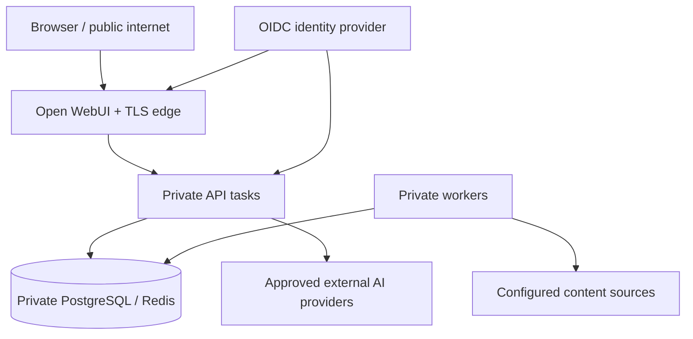
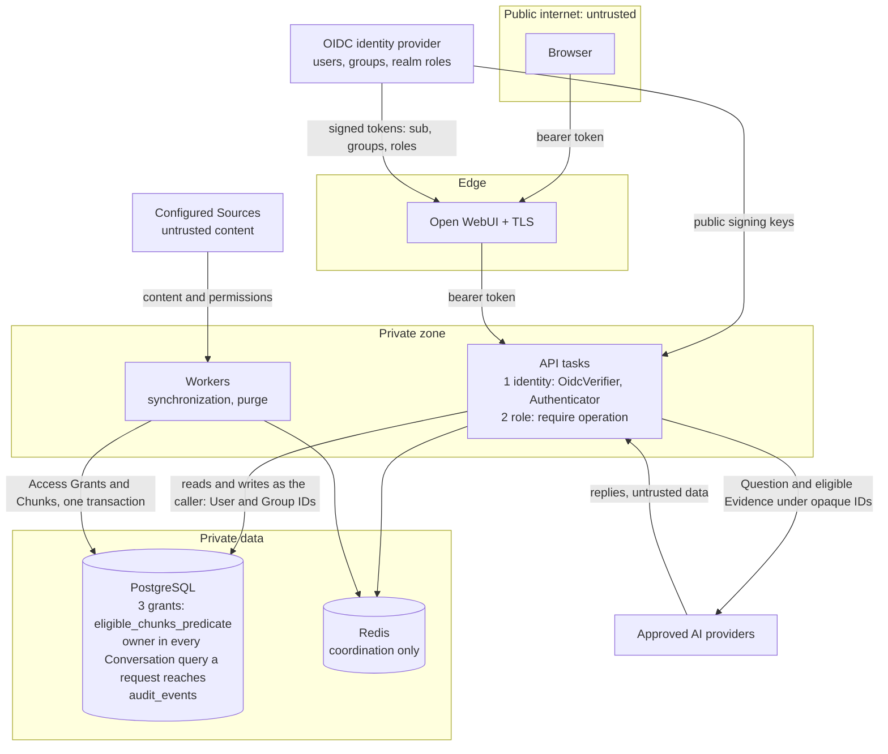

# M07-T16 — Пройти контрольну точку з авторизації

Англійська версія: [M07-T16-pass-the-authorization-gate.md](M07-T16-pass-the-authorization-gate.md)

Задача: [M07-T16](../curriculum/milestones/M07-identity-and-authorization/M07-T16-pass-the-authorization-gate.md)

## Що ви зробите

Ця контрольна точка (gate) перевіряє, що ви розумієте, як сервіс вирішує, хто що може робити. Вас попросять це пояснити, намалювати, налагодити й розширити. Частин чотири:

- **Пояснити** своїми словами ідентичність, ролі та доступи: це три різні питання, на які сервіс відповідає у трьох різних місцях.
- **Перемалювати** діаграму зон довіри, щоб на ній було видно, де відбувається кожна з цих перевірок і що може перетинати кожну межу.
- **Діагностувати** витік, який невелика й на вигляд розумна зміна закладає в код ідентичності. Шукати його будете набором тестів з M07-T15: хто бачить те, чого не мав би.
- **Самостійно додати нову захищену операцію**: `DELETE /v1/conversations/{conversation_id}`, яка дає Користувачеві видалити власну Розмову. Вона має відмовляти безпечно і на межі HTTP, і в базі даних.

| Задача вимагає | Де це відбувається |
|---|---|
| Пояснити ідентичність, ролі та доступи | Крок 2: під `## Identity, roles, and grants` |
| Оновити діаграми зон довіри | Крок 3: діаграма під "Trust zones" у `docs/security.md` |
| Діагностувати внесений витік | Крок 4: внести, запустити набір, простежити, записати під `## Injected leak`, скасувати |
| Самостійно додати нову захищену операцію | Крок 5: спроєктувати за коротким описом, потім порівняти з еталоном |
| Тести: успіх, найризикованіший край, типізована відмова | Крок 6: `tests/test_authorization_gate.py` і `tests/test_authorization_gate_integration.py` |
| Безпечна відмова на межах сховища й транспорту | Крок 6: без ролі, чужа людина, некоректний ID і аудит, який не вдалося записати, — нічого не змінюють |
| Телеметрія не містить підкинутого тексту | Крок 6: маркер у Розмові й у помилці сховища ніколи не потрапляє ні в лог, ні в рядок аудиту |
| Оновити лише те, що зміна зробила неточним | Кроки 3 і 8: `docs/security.md`, `docs/threat-model.md`, `docs/architecture.md` |

Цей урок містить код: кроки 5 і 6 пишуть код. Кроки 1, 2, 3, 4, 7 і 8 — ні, хоча кроки 3 і 8 редагують документи, а крок 4 запускає команди.

Терміни цього уроку:

- **Ідентичність (identity):** хто питає. Тут це Користувач і його Групи, взяті з токена, який підписав провайдер ідентичності. Приклад: alice у групі `/engineering`.
- **Роль застосунку (Application Role):** яку роботу із сервісом може виконувати той, хто викликає, наприклад ставити питання чи налаштовувати Джерела. Приклад: менеджер контенту може запустити Синхронізацію.
- **Доступ (Access Grant):** які Документи може бачити читач. Він береться з власних дозволів Джерела. Приклад: довідник із зарплат відкритий для `/finance/payroll`.
- **Захищена операція (protected operation):** дія, яку сервіс виконує лише для того, чия роль її дозволяє. Кожна така дія — значення `Operation` у `roles.py`.
- **Безпечна відмова (fail closed):** коли щось не так або чогось бракує, відповідь — «ні», а не «так». Приклад: якщо рядок аудиту не вдалося записати, видалення не відбувається.
- **Витік існування (existence leak):** відповідь, яка відрізняється залежно від того, чи існує щось, чого той, хто питає, бачити не може. Приклад: «404» для відсутньої Розмови, але «403» для чужої — і стороння людина дізнається, які ID справжні.

## Перед початком

Цей розділ пояснює рішення, на яких стоїть код, щоб кожен крок був зрозумілим, коли до нього дійдете.

- **Що вже є.** M07 збудував усі частини. `OidcVerifier` перевіряє підпис токена, видавця, аудиторію та час. `Authenticator` перетворює його поля на `Caller`, де окремо лежать читач (ID Користувача й Груп) і Ролі застосунку. `require` відмовляє в операції, яку не дозволяє жодна роль. `eligible_chunks_predicate` перевіряє Доступи всередині кожного пошуку. А M07-T15 збудував один набір атакувальних тестів, який проводить згенерованих людей крізь усі двері.
- **Три питання, три місця.** Ідентичність визначається один раз, в API, лише з токена. Роль перевіряється наступною, теж в API, ще до читання будь-яких вхідних даних. Доступи перевіряються останніми, у PostgreSQL, усередині запиту, який читає записи. Сплутати їх — класична помилка: роль адміністратора, що читає всі Документи, або група, що відмикає операцію.
- **Чому саме видалення Розмови.** `manage_own_conversations` записана в `PERMISSIONS` для ролі `user`, але жоден ендпоінт її ще не перевіряє. Функція сховища `delete_conversation` уже існує і вже ставить власника в SQL. Тож нова операція невелика, але торкається всіх трьох питань: ідентичність каже, чия це Розмова; роль — чи можна взагалі видаляти; а доступ не потрібен, бо Розмова належить своєму Користувачеві, а не Джерелу.
- **Однакова відповідь для будь-якого ID.** Ендпоінт відповідає 204 без тіла, хоч він видалив Розмову, хоч її не було, хоч вона вже видалена, хоч вона чужа. Відповідь 404 на «не ваша» дала б будь-кому перевіряти, які ID існують. `delete` у сховища нічого не повертає, тож код HTTP навіть не бачить різниці.
- **Порядок: хто, потім чи можна, потім що.** Спочатку перевіряється токен, потім роль, і лише тоді розбирається ID. Хто не має ролі, отримує 403 для будь-якого ID, тож некоректний ID йому нічого не каже.
- **Аудит разом зі зміною.** `delete_conversation` тепер записує одну подію аудиту `conversation.deleted` у тій самій транзакції: `allowed`, коли видалила, і `denied`, коли нічого свого в того, хто питав, не знайшлося. Якщо подію не вдалося записати, уся транзакція відкочується і нічого не видаляється. Відповідь при цьому та сама; різницю бачать лише оператори, у журналі аудиту.
- **Внесений витік.** Крок 4 запускає коротку команду, що змінює один рядок коду ідентичності. Вона закодована, тож ви діагностуєте за тим, що показують тести, а не читаючи патч. Відповідь — у згорнутому блоці наприкінці кроку.
- **Де живе код.** `persistence/conversations.py` (подія аудиту); новий `answering/conversation_store.py`, поруч з Історією, з якою він ділить Розмови; `app.py` (маршрут і порт `ConversationStore`); `tests/test_app_authentication.py` (список маршрутів); два нові файли тестів контрольної точки; і три документи.
- **Що знайшло рев'ю.** Незалежне атакувальне рев'ю штурмувало прототип ворожими ID, заголовками, тілами запитів і п'ятнадцятьма мутантами. Усі гарантії встояли: жоден запит не зміг назвати іншого власника, перевірки завжди йшли в правильному порядку, відповіді alice і bob збігалися байт-у-байт, і кожен мутант провалив хоча б один тест. Воно знайшло дрібніші проблеми, тепер виправлені, і для кожної є тест, що без виправлення падає:
  - `UUID()` читає як той самий ID ще й фігурні дужки, `urn:uuid:`, пропущений дефіс, знак `+` і арабсько-індійські цифри. Тепер маршрут приймає лише канонічний запис.
  - Сховище, що повідомляло, чи видалило, разом із застосунком, що на «ні» відповідав 404, проходило всі unit-тести; ловили його лише тести з базою, а CI запускає тільки unit-тести. Тепер unit-тест дає застосунку сховище, яке каже «знайдено», і сховище, яке каже «не знайдено», і вимагає однакових відповідей.
  - Невдале видалення не лишало в лозі жодного рядка. Тепер у лог потрапляє тип помилки, але ніколи не її текст.
  - Три підписи на діаграмі та в моделі загроз перебільшували або применшували, що перетинає межу; тепер вони кажуть рівно те, що перетинає.
- **Відомі обмеження.** Маршрут є лише для видалення: читати Розмову чи її Історію досі нема як. Відмова 403 через відсутню роль, як і раніше, не пише подію аудиту. Видалення чужої Розмови та справжнє займають трохи різний час, бо лише справжнє ставить у чергу Завдання очищення. Поки не з'являться обмеження частоти (M09-T10), будь-який Користувач може записати один рядок аудиту `denied` на запит, а ID запиту в рядку — той, що надіслав клієнт. Саме очищення запрацює в M08.

## Покрокове проходження

Перед інтеграційними перевірками запустіть PostgreSQL і задайте URL тестової бази в терміналі:

```bash
export KNOWLEDGE_SERVICE_TEST_DATABASE_URL="$(uv run python scripts/test_database_url.py)"
```

### Крок 1 — У цьому кроці без коду: запишіть інваріант і свої передбачення

Поки коду ще немає, запишіть, що має бути правдою, коли урок завершено. Крок 7 перевіряє передбачення.

Створіть `docs/evidence/M07-T16-authorization-gate.md`:

```markdown
# M07-T16 — Authorization gate evidence

## Invariant

Every `/v1` operation decides who the caller is from a verified token
alone, checks that one of the caller's Application Roles permits the
operation before reading any input, and touches only the records the
caller may: Chunks through Access Grants checked inside PostgreSQL, and
Conversations through the owner in the SQL. A request that fails any of
these checks changes nothing, and its answer, logs, and audit rows never
reveal whether another User's record exists.

## Expected failing check

Before the change, `uv run pytest tests/test_authorization_gate.py -q`
fails with `ERROR: file or directory not found: tests/test_authorization_gate.py`.

## Predictions

- What bob gets when he deletes alice's Conversation by its real ID, and what changes in the database:
- What a content manager gets when deleting with a malformed ID:
- Which person reads a Document they may not after the injected change, and why only some seeds fail:
- How many tests in `tests/test_authorization_gate_integration.py` fail if `delete_conversation` forgets the owner:

## Identity, roles, and grants

## Trust zones

## Injected leak

## New operation

## Design

## Verification

## Review

## Decision

## Reflection
```

**Перевірка:** файл існує, і в кожному передбаченні після двокрапки стоїть ваша відповідь.

### Крок 2 — У цьому кроці без коду: поясніть ідентичність, ролі та доступи

Цей крок просить своїми словами пояснити три питання, на які сервіс відповідає для кожного запиту. Запишіть це під `## Identity, roles, and grants` у файлі доказів, звіряючи кожне твердження з кодом.

Для кожного з трьох дайте відповідь:

- **На яке питання воно відповідає?**
- **Звідки береться відповідь?** З поля токена, з Джерела чи з коду.
- **Де в коді це перевіряється і коли?** Назвіть функцію і скажіть, що вже відбулося до неї.
- **Що отримує запит, який цю перевірку не пройшов?** Код статусу і що все ж виконується.

Потім розберіть один приклад, де їх легко розрізнити: користувач Keycloak з ролями `administrator` і `user`, без жодної групи, питає про Документ, відкритий для `/engineering`. Скажіть, що вирішує кожна перевірка і чому роль адміністратора не допомагає. Відповідь показує `test_an_administrator_reads_exactly_what_the_same_user_reads` у `tests/test_app_authentication.py`.

| Де дивитися | Що там видно |
|---|---|
| `src/knowledge_service/identity/context.py` | `build_authorization_context`, `application_roles`, `Authenticator`, `Caller` |
| `src/knowledge_service/roles.py` | `PERMISSIONS`, `permits`, `require` |
| `src/knowledge_service/app.py` | `admit`: хто, потім чи можна, потім тіло запиту |
| `src/knowledge_service/persistence/access.py` | `eligible_chunks_predicate` |
| `src/knowledge_service/persistence/conversations.py` | `_live`: власник у кожному запиті до Розмов |

**Перевірка:** кожна відповідь називає функцію, яка існує, а приклад закінчується тим, що користувач нічого з `/engineering` не читає.

### Крок 3 — У цьому кроці без коду: перемалюйте зони довіри

Діаграма під "Trust zones" у `docs/security.md` показує блоки й стрілки, але не показує, де відбувається хоч одна перевірка і що може перетинати межі. Цей крок перемальовує її так, щоб читач бачив три перевірки по порядку і що пропускає кожна межа.

Спершу намалюйте свою версію, на папері чи в Markdown. Потім порівняйте з еталоном і запишіть під `## Trust zones`, що ви намалювали інакше і чому.

**Дія:** замініть діаграму.

У `docs/security.md`:

**1.** Знайдіть:

````markdown

## Trust zones



## Threat-driven controls

````

Замініть на:

````markdown

## Trust zones

Each arrow that enters a zone crosses a boundary, and the label says what
may cross it. The numbers mark the three checks every request meets, in
order: who the caller is, whether their role permits the operation, and
which records they may touch.



- **Identity** says who is asking: the User and Groups in a verified token,
  turned into an Authorization Context. Nothing else in a request names
  them.
- **Roles** say which operations the caller may run, such as asking or
  deleting their own Conversation. A role never lets anyone read a
  Document.
- **Grants** say which Documents a reader may see. They come from each
  Source's permissions and are checked inside PostgreSQL, in the same
  query that finds the Chunks.

## Threat-driven controls

````

Числа 1, 2 і 3 ідуть за одним запитом: ідентичність в API, роль в API, доступи всередині PostgreSQL. Воркери номера не мають: вони записують Доступи, але ніколи не відповідають Користувачеві.

**Перевірка:** `make docs-check` проходить, і діаграма відображається, коли ви відкриваєте попередній перегляд файлу в редакторі чи на GitHub.

### Крок 4 — У цьому кроці без коду: діагностуйте внесений витік

Цей крок закладає витік у код ідентичності і просить знайти його ззовні, як ви робили б у продакшені: за тестами, що падають, а не за diff. Ваш детектор — набір тестів з M07-T15.

**Дія 1:** запустіть внесення витоку. Команда змінює один рядок `src/knowledge_service/identity/context.py`. Рядок закодовано в base64, щоб ви діагностували витік, а не прочитали його:

```bash
uv run python - <<'EOF'
from base64 import b64decode
from pathlib import Path
path = Path("src/knowledge_service/identity/context.py")
old, new = (
    b64decode(s).decode()
    for s in ("ICAgICAgICBuYW1lZC5hZGQocGF0aCkK", "ICAgICAgICBuYW1lZC5hZGQocGF0aC5jYXNlZm9sZCgpKQo=")
)
text = path.read_text()
assert text.count(old) == 1
path.write_text(text.replace(old, new))
EOF
```

**Дія 2:** запустіть тести ідентичності, тести генератора і набір:

```bash
uv run pytest tests/test_authorization_context.py -q
uv run pytest tests/test_authorization_scenarios.py -q
uv run pytest -m integration tests/test_authorization_suite_integration.py -q
```

Очікувано: `2 failed, 87 passed`, потім `54 passed`, потім `6 failed, 30 passed`. Власні тести генератора витоку не помічають, бо шлях групи з великої літери буває лише в carol.

**Дія 3:** діагностуйте. Відповіді запишіть під `## Injected leak`:

- **Симптом.** Які тести падають і на яких seed? Прочитайте одне повідомлення про помилку: у кожному названо двері, мову, людину й seed, а далі — що людина отримала і що їй можна читати.
- **Хто і що.** Хто читає Документ, якого не мав би, і який свій Документ втрачає? Виведіть групи цієї людини для кожного seed командою `uv run python -c "import sys; sys.path.insert(0, 'tests'); from authorization_scenarios import scenario; [print(s, scenario(s).person('carol').groups) for s in range(6)]"`.
- **Причина.** Яка ділянка шляху від токена до Контексту авторизації змінилася? На неї вказують два тести, що падають у `tests/test_authorization_context.py`; підтвердіть `git diff` лише тоді, коли маєте здогад.
- **Ланцюжок.** Від поля токена через ID Групи до SQL, що повернув Фрагмент: один рядок на кожен крок.
- **Чому лише деякі seed.** Що мають містити групи людини, щоб витік проявився?

**Дія 4:** скасуйте зміну і перевірте, що набір знову зелений:

```bash
git checkout -- src/knowledge_service/identity/context.py
uv run pytest -m integration tests/test_authorization_suite_integration.py -q
```

Очікувано: `36 passed`.

<details>
<summary>Відповідь — після того, як запишете свою</summary>

Зміна переводить кожен шлях групи з токена в нижній регістр, перш ніж він стає ID Групи (`named.add(path.casefold())` у `_group_paths`). Доступи досі записуються зі шляхом так, як його написало Джерело. Тому токен із `/Engineering` тепер отримує ID Групи `/engineering`: carol у seed 4 і 5 читає Документи `/engineering` і втрачає свої Документи `/Engineering`. Seed 0–3 проходять, бо там у carol немає шляху з великої літери, а в alice і bob шляхи завжди з малої. Ланцюжок: поле `groups` зі значенням `/Engineering` → `_group_paths` дає `/engineering` → `group_id_for` дає ID `/engineering` → `eligible_chunks_predicate` збігається з доступом для `/engineering` → Фрагмент повертається. Урок: нормалізація лише з одного боку порівняння розширює доступ. Шляхи груп порівнюються точно, так, як їх називає Keycloak.

</details>

**Перевірка:** `git diff src/` порожній, а під `## Injected leak` є симптом, людина, причина, ланцюжок і пояснення, чому падають лише деякі seed.

### Крок 5 — Крок із кодом: додайте захищену операцію

**Простими словами:** цей крок дає Користувачеві видалити власну Розмову через HTTP. Сервіс перевіряє, хто питає і чи дозволяє його роль керувати власними Розмовами, і лише тоді читає, яку Розмову мають на увазі. База видаляє її, лише якщо вона належить тому, хто питає, і тим самим кроком записує спробу в журнал аудиту. Хоч би що сталося, відповідь та сама й коротка, тож з її допомогою не дізнатися, які Розмови існують.

Спершу спробуйте самі. Короткий опис:

| Має бути | Деталі |
|---|---|
| Маршрут | `DELETE /v1/conversations/{conversation_id}` |
| Операція | `Operation.MANAGE_OWN_CONVERSATIONS` через `require`, після автентифікації і до розбору ID |
| Власник | `caller.reader.user_id`, ніколи не щось із запиту |
| Відповідь | 204 без тіла, однаково для видаленої, відсутньої, уже видаленої і чужої |
| Некоректний ID | 422 `validation_error`, лише для того, хто має роль; ID — це лише канонічний шістнадцятковий запис `8-4-4-4-12` |
| Немає сховища | 503 `conversations_unavailable` |
| Сховище падає | політика збоїв: 503 з `Retry-After` для недоступної бази, інакше 500, без тексту помилки; у лозі лише тип помилки |
| Аудит | `conversation.deleted` у тій самій транзакції: `allowed` і `succeeded` або `denied` і `failed` |

Потім порівняйте з еталоном нижче і запишіть під `## New operation`, чим ваш варіант відрізнявся і який кращий.

**Дія 1:** записуйте кожну спробу видалення в журнал аудиту.

У `src/knowledge_service/persistence/conversations.py`:

**1.** Знайдіть:

```python
  past these functions can make its Conversation unreadable.
- **Feedback is audited.** `rate_message` records who rated which Message,
  up or down, in the same transaction as the rating.

The other functions read and write without an owner, for system work such
as retention and purge Jobs; they are never given a User's request.
```

Замініть на:

```python
  past these functions can make its Conversation unreadable.
- **Feedback is audited.** `rate_message` records who rated which Message,
  up or down, in the same transaction as the rating.
- **Deletion is audited.** `delete_conversation` records one
  `conversation.deleted` event in the same transaction: `allowed` when it
  deleted the owner's Conversation, `denied` when there was nothing of
  theirs to delete, whoever's ID it was.

The other functions read and write without an owner, for system work such
as retention and purge Jobs; they are never given a User's request.
```

**2.** Знайдіть:

```python
    owner_id: UserId,
    conversation_id: ConversationId,
    now: datetime,
) -> bool:
    """Delete the owner's Conversation now, and queue its purge.

    Returns True when this call deleted it, also past its deadline, and
    False when there was nothing of this owner's to delete. A caller must
    answer the same either way, so the result never tells a User whether
    another User's Conversation exists.
    """
    now = _utc(now)
    deleted = await connection.scalar(
        sa.update(conversations)
        .where(
```

Замініть на:

```python
    owner_id: UserId,
    conversation_id: ConversationId,
    now: datetime,
    request_id: UUID | None = None,
) -> bool:
    """Delete the owner's Conversation now, and queue its purge.

    Returns True when this call deleted it, also past its deadline, and
    False when there was nothing of this owner's to delete. A caller must
    answer the same either way, so the result never tells a User whether
    another User's Conversation exists. Either way one audit event records
    the attempt, with `request_id` when a request made it.
    """
    now = _utc(now)
    if request_id is not None and type(request_id) is not UUID:
        raise TypeError("request_id must be a UUID")
    deleted = await connection.scalar(
        sa.update(conversations)
        .where(
```

**3.** Знайдіть:

```python
        .values(deleted_at=sa.func.greatest(now, conversations.c.last_message_at))
        .returning(conversations.c.conversation_id)
    )
    if deleted is None:
        return False
    await enqueue_job(
        connection,
        Job.request(
            job_id=JobId.new(),
            kind=JobKind.PURGE_CONVERSATION,
            target_id=conversation_id.value,
            queued_at=now,
        ),
    )
    return True


def _live(
```

Замініть на:

```python
        .values(deleted_at=sa.func.greatest(now, conversations.c.last_message_at))
        .returning(conversations.c.conversation_id)
    )
    if deleted is not None:
        await enqueue_job(
            connection,
            Job.request(
                job_id=JobId.new(),
                kind=JobKind.PURGE_CONVERSATION,
                target_id=conversation_id.value,
                queued_at=now,
            ),
        )
    await record_audit_event(
        connection,
        AuditEvent(
            event_id=AuditEventId.new(),
            occurred_at=now,
            actor_id=owner_id,
            action=AuditAction.CONVERSATION_DELETED,
            target_kind=AuditTargetKind.CONVERSATION,
            target_id=conversation_id.value,
            decision=AuditDecision.DENIED if deleted is None else AuditDecision.ALLOWED,
            outcome=AuditOutcome.FAILED if deleted is None else AuditOutcome.SUCCEEDED,
            request_id=request_id,
            run_id=None,
            metadata={},
        ),
    )
    return deleted is not None


def _live(
```

Завдання очищення ставиться в чергу лише для справжнього видалення, а подія аудиту пишеться в будь-якому разі. `request_id` необов'язковий, тож наявні виклики працюють далі.

**Дія 2:** сховище, яке отримує застосунок.

Створіть `src/knowledge_service/answering/conversation_store.py`:

```python
"""The caller's own Conversations, as an HTTP request reaches them.

`DatabaseConversationStore` is the `ConversationStore` an entry point gives
the app. It runs each operation in one transaction of its own, with the
owner from the caller's verified token, and keeps the store's promise at the
boundary:

- **Owner in the SQL.** The owner is the caller's `UserId`, never a value
  from the request, and `delete_conversation` puts it in the statement.
- **Nothing to tell apart.** `delete` returns nothing, whether it deleted
  the caller's Conversation or found nothing of theirs: missing, another
  User's, and already deleted all end the same way, so the response cannot
  reveal which.
- **Audited with the change.** The deletion, its purge Job, and its audit
  event commit together, or none of them does.
"""

from collections.abc import Callable
from datetime import UTC, datetime
from uuid import UUID

from knowledge_service.database import DatabaseRuntime
from knowledge_service.identifiers import ConversationId, UserId
from knowledge_service.persistence.conversations import delete_conversation


def _utc_now() -> datetime:
    return datetime.now(UTC)


class DatabaseConversationStore:
    """The caller's own Conversations in PostgreSQL."""

    def __init__(
        self, runtime: DatabaseRuntime, clock: Callable[[], datetime] = _utc_now
    ) -> None:
        self._runtime = runtime
        self._clock = clock

    async def delete(
        self, *, owner_id: UserId, conversation_id: ConversationId, request_id: UUID
    ) -> None:
        """Delete the owner's Conversation, if it is theirs and live."""
        async with self._runtime.transaction() as connection:
            await delete_conversation(
                connection,
                owner_id=owner_id,
                conversation_id=conversation_id,
                now=self._clock(),
                request_id=request_id,
            )
```

`delete` навмисно повертає `None`: шар HTTP не може видати різницю, якої ніколи не отримує.

**Дія 3:** маршрут.

У `src/knowledge_service/app.py`:

**1.** Знайдіть:

```python
import asyncio
import contextlib
import logging
from collections.abc import Awaitable, Callable, Coroutine
from typing import Protocol
from uuid import UUID, uuid4
```

Замініть на:

```python
import asyncio
import contextlib
import logging
import re
from collections.abc import Awaitable, Callable, Coroutine
from typing import Protocol
from uuid import UUID, uuid4
```

**2.** Знайдіть:

```python
    classify_failure,
    policy_for,
)
from knowledge_service.identity.context import (
    AuthenticationError,
    Caller,
```

Замініть на:

```python
    classify_failure,
    policy_for,
)
from knowledge_service.identifiers import ConversationId, UserId
from knowledge_service.identity.context import (
    AuthenticationError,
    Caller,
```

**3.** Знайдіть:

```python
ReadinessCheck = Callable[[], Awaitable[bool]]
# A Question is at most 4,000 characters; even escaped as JSON it fits.
MAX_BODY_BYTES = 65_536


class RequestAuthenticator(Protocol):
```

Замініть на:

```python
ReadinessCheck = Callable[[], Awaitable[bool]]
# A Question is at most 4,000 characters; even escaped as JSON it fits.
MAX_BODY_BYTES = 65_536
# The one spelling of an ID the API accepts: `UUID()` alone also reads braces,
# `urn:uuid:`, a missing dash, a sign, or non-ASCII digits.
CANONICAL_ID = re.compile(
    r"[0-9a-f]{8}-[0-9a-f]{4}-[0-9a-f]{4}-[0-9a-f]{4}-[0-9a-f]{12}", re.IGNORECASE
)


class RequestAuthenticator(Protocol):
```

**4.** Знайдіть:

```python
    """

    async def authenticate(self, headers: list[str]) -> Caller: ...


class _NotAuthenticated(Exception):
```

Замініть на:

```python
    """

    async def authenticate(self, headers: list[str]) -> Caller: ...


class ConversationStore(Protocol):
    """The caller's own Conversations.

    `DatabaseConversationStore` is the implementation. `delete` returns
    nothing whether or not there was a Conversation of the owner's to delete.
    """

    async def delete(
        self, *, owner_id: UserId, conversation_id: ConversationId, request_id: UUID
    ) -> None: ...


class _NotAuthenticated(Exception):
```

**5.** Знайдіть:

```python
    workflow: AnswerWorkflow | None = None,
    streamer: AnswerStreamer | None = None,
    authenticator: RequestAuthenticator | None = None,
) -> FastAPI:
    """The HTTP application.

    Both answer endpoints need a bearer token and the role that permits
    asking: without an `authenticator` they answer 503, and the reader is
    only ever the context it returns.
    """
    app = FastAPI(title="knowledge-service")

```

Замініть на:

```python
    workflow: AnswerWorkflow | None = None,
    streamer: AnswerStreamer | None = None,
    authenticator: RequestAuthenticator | None = None,
    conversations: ConversationStore | None = None,
) -> FastAPI:
    """The HTTP application.

    Every `/v1` endpoint needs a bearer token and the role that permits its
    operation: without an `authenticator` they answer 503, and the reader or
    owner is only ever the one in the context it returns.
    """
    app = FastAPI(title="knowledge-service")

```

**6.** Знайдіть:

```python
            },
        )

    return app


```

Замініть на:

```python
            },
        )

    @app.delete("/v1/conversations/{conversation_id}", status_code=204)
    async def delete_own_conversation(
        request: Request, conversation_id: str
    ) -> Response:
        # Who, then whether they may, then which Conversation: the ID is not
        # even parsed for a caller who may not delete Conversations.
        caller = await authenticate(request)
        require(caller.roles, Operation.MANAGE_OWN_CONVERSATIONS)
        request_id = request_id_from(request)
        if not CANONICAL_ID.fullmatch(conversation_id):
            return failure_response(kind=FailureKind.VALIDATION, request_id=request_id)
        target = ConversationId.parse(conversation_id)
        if conversations is None:
            return error_response(
                status_code=503,
                code="conversations_unavailable",
                message="Conversations are unavailable",
                request_id=request_id,
            )
        try:
            # The owner is the caller; nothing in the request can name another.
            await conversations.delete(
                owner_id=caller.reader.user_id,
                conversation_id=target,
                request_id=request_id,
            )
        except asyncio.CancelledError:
            raise
        except Exception as error:
            # Only the type: the message may name the Conversation or its text.
            logger.error("conversation delete failed: %s", type(error).__name__)
            return failure_response(kind=classify_failure(error), request_id=request_id)
        # The same whether it was deleted, missing, or another User's.
        return Response(status_code=204)

    return app


```

ID приходить звичайним рядком і розбирається вручну, після перевірки ролі. Якби в маршруті він мав тип `UUID`, FastAPI перевірив би його ще до обробника, і той, хто без токена чи без ролі, дізнався б, що ID некоректний.

**Перевірка:** `uv run pyright src` показує 0 помилок.

### Крок 6 — Крок із кодом: тести контрольної точки

**Простими словами:** ці тести надсилають застосунку справжні HTTP-запити. Перший файл використовує підробне сховище, тож може точно перевірити, для кого сховище попросили видалити, і що його взагалі не питали, коли в того, хто викликав, не було токена чи ролі. Другий файл працює зі справжньою базою і показує, що видалення від чужої людини нічого не змінює і записується як відмова, а видалення, рядок аудиту якого не вдалося записати, не відбувається.

| Тест | Показує |
|---|---|
| `test_a_user_deletes_their_conversation_as_the_token_says` | Успіх: 204, і сховище просять видалити для Користувача з токена |
| `test_nothing_in_the_request_can_name_another_owner` | Параметри, заголовки й тіло з іменем bob нічого не змінюють |
| `test_two_users_deleting_the_same_id_each_act_only_as_themselves` | Однакова відповідь обом, кожен діє лише від свого імені |
| `test_the_answer_cannot_tell_a_deletion_from_nothing_to_delete` | Навіть сховище, яке каже «знайдено» чи «не знайдено», не може змінити відповідь |
| `test_a_caller_without_the_role_is_refused_before_the_id_is_read` | Менеджер контенту отримує 403 і для коректного, і для некоректного ID |
| `test_a_request_without_a_valid_token_deletes_nothing` | 401, і сховище не чіпали |
| `test_a_malformed_id_from_a_permitted_caller_is_a_422` | Типізована відмова, сховище не чіпали, зокрема для записів, які `UUID()` прийняв би |
| `test_the_store_refuses_a_request_id_that_is_not_a_uuid` | Власна типізована відмова сховища, ще до SQL |
| `test_an_unreachable_database_is_a_503_with_retry_after`, `test_an_app_without_a_store_deletes_nothing_and_says_so`, `test_a_store_error_names_nothing_to_the_client_or_the_log` | Збої закінчуються відмовою і нічого не розкривають |
| `test_the_owner_deletes_and_the_deletion_is_audited_with_it` | У PostgreSQL: видалено, одне Завдання очищення, один рядок `allowed` з ID запиту |
| `test_a_second_delete_reads_the_same_and_queues_nothing_more` | Повтор нешкідливий і записується як `denied` |
| `test_a_strangers_delete_reads_like_a_missing_one_and_changes_nothing` | Найризикованіший край: однакові відповіді, Розмова alice ціла, два рядки `denied`, маркера ніде немає |
| `test_a_caller_without_the_role_changes_nothing` | 403, нічого не змінено, нічого не записано |
| `test_a_deletion_that_cannot_be_audited_does_not_happen` | Сховище відмовляє безпечно: тригер не пускає рядок аудиту, і Розмова лишається |

**Дія 1:** додайте новий маршрут зі своєю операцією до списку. Тест у цьому файлі падає для будь-якого маршруту, якого немає в списку, — так ви й дізнаєтеся, що новий маршрут потребує рішення.

У `tests/test_app_authentication.py`:

**1.** Знайдіть:

```python

import logging
from typing import Any, cast

import httpx
import pytest
```

Замініть на:

```python

import logging
from typing import Any, cast
from uuid import uuid4

import httpx
import pytest
```

**2.** Знайдіть:

```python
    ("GET", "/redoc"): None,
    ("POST", "/v1/answer"): Operation.ASK_QUESTIONS,
    ("POST", "/v1/answer/stream"): Operation.ASK_QUESTIONS,
}
PROTECTED = [(route, operation) for route, operation in ROUTES.items() if operation]


class Counting:
```

Замініть на:

```python
    ("GET", "/redoc"): None,
    ("POST", "/v1/answer"): Operation.ASK_QUESTIONS,
    ("POST", "/v1/answer/stream"): Operation.ASK_QUESTIONS,
    ("DELETE", "/v1/conversations/{conversation_id}"): (
        Operation.MANAGE_OWN_CONVERSATIONS
    ),
}
PROTECTED = [(route, operation) for route, operation in ROUTES.items() if operation]
# The routes that read a body, to check none is read before the role.
WITH_BODY = [path for (method, path), _ in PROTECTED if method == "POST"]


class Counting:
```

**3.** Знайдіть:

```python
        raise RuntimeError("reached")


def full_app(
    source: Source, workflow: Any = None, tokens: dict[str, Any] | None = None
) -> Any:
    """The app with both answer endpoints wired, so every route is real."""
    return create_app(
        workflow=cast(AnswerWorkflow, workflow or Counting()),
        streamer=streamer(Model(), source=source),
        authenticator=Authenticator(Verifier(tokens or TOKENS), POLICY),
    )


```

Замініть на:

```python
        raise RuntimeError("reached")


class Deleting:
    """A Conversation store that records each deletion it is asked for."""

    def __init__(self) -> None:
        self.calls: list[dict[str, Any]] = []

    async def delete(self, **request: Any) -> None:
        self.calls.append(request)


def full_app(
    source: Source,
    workflow: Any = None,
    tokens: dict[str, Any] | None = None,
    conversations: Deleting | None = None,
) -> Any:
    """The app with every endpoint wired, so every route is real."""
    return create_app(
        workflow=cast(AnswerWorkflow, workflow or Counting()),
        streamer=streamer(Model(), source=source),
        authenticator=Authenticator(Verifier(tokens or TOKENS), POLICY),
        conversations=conversations or Deleting(),
    )


```

**4.** Знайдіть:

```python
    operation: Operation,
    roles: frozenset[ApplicationRole],
) -> None:
    source, workflow = Source(), Counting()
    token = verified(realm_access={"roles": sorted(roles)})
    app = full_app(source, workflow, {"token": token})
    method, path = route

    async with client(app) as http:
        response = await http.request(
            method,
            path,
            json={"text": QUESTION.text},
            headers={"Authorization": "Bearer token"},
        )

    allowed = bool(roles & MATRIX[operation])
    assert (response.status_code == 403) is not allowed
    assert bool(source.readers or workflow.calls) is allowed


@pytest.mark.parametrize("path", [path for (_, path), _ in PROTECTED])
async def test_the_role_is_checked_before_the_body_is_read(path: str) -> None:
    read: list[int] = []
    sent: list[dict[str, Any]] = []
```

Замініть на:

```python
    operation: Operation,
    roles: frozenset[ApplicationRole],
) -> None:
    source, workflow, conversations = Source(), Counting(), Deleting()
    token = verified(realm_access={"roles": sorted(roles)})
    app = full_app(source, workflow, {"token": token}, conversations)
    method, path = route

    async with client(app) as http:
        response = await http.request(
            method,
            path.replace("{conversation_id}", str(uuid4())),
            json={"text": QUESTION.text},
            headers={"Authorization": "Bearer token"},
        )

    allowed = bool(roles & MATRIX[operation])
    assert (response.status_code == 403) is not allowed
    assert bool(source.readers or workflow.calls or conversations.calls) is allowed


@pytest.mark.parametrize("path", WITH_BODY)
async def test_the_role_is_checked_before_the_body_is_read(path: str) -> None:
    read: list[int] = []
    sent: list[dict[str, Any]] = []
```

**Дія 2:** HTTP-тести над підробним сховищем.

Створіть `tests/test_authorization_gate.py`:

```python
"""The M07 gate's new protected operation: a User deletes their Conversation.

`DELETE /v1/conversations/{conversation_id}` brings the three checks of the
milestone together. Identity: the owner is the User the verified token
names, and nothing in the request can name another. Role: the caller needs
`manage_own_conversations`, checked before the ID is even parsed. Grants: none
are needed, because a Conversation is the User's own, not a Document. These
tests run the real app and `Authenticator` over a fake store; the store's
own rules run in `test_authorization_gate_integration.py`.
"""

import logging
from datetime import UTC, datetime
from typing import Any, cast
from uuid import UUID

import httpx
import pytest
from sqlalchemy.exc import OperationalError

from knowledge_service.app import create_app
from knowledge_service.identifiers import ConversationId
from knowledge_service.identity.context import Authenticator, user_id_for
from knowledge_service.persistence.conversations import delete_conversation
from test_app_authentication import Deleting
from test_authorization_context import ALICE, ISSUER, POLICY, Verifier, verified

CONVERSATION = "0190a3a0-0000-7000-8000-000000000016"
REQUEST_ID = "0190a3a0-0000-7000-8000-0000000000aa"
MARKER = "GATE-MARKER-5531"
TOKENS = {
    "alice-token": verified(),
    "bob-token": verified(sub="bob"),
    "manager-token": verified(realm_access={"roles": ["content-manager"]}),
}


class Answering:
    """A store that deletes, and returns `found`, as a careless one might."""

    def __init__(self, found: bool) -> None:
        self.found = found

    async def delete(self, **request: Any) -> bool:
        return self.found


class Failing:
    """A Conversation store that raises `error` on every call."""

    def __init__(self, error: Exception) -> None:
        self.error = error

    async def delete(self, **request: Any) -> None:
        raise self.error


def app_with(conversations: Any) -> Any:
    return create_app(
        authenticator=Authenticator(Verifier(TOKENS), POLICY),
        conversations=conversations,
    )


async def delete(
    app: Any,
    bearer: str | None = "alice-token",
    conversation_id: str = CONVERSATION,
    **extra: Any,
) -> httpx.Response:
    headers = {"X-Request-ID": REQUEST_ID, **extra.pop("headers", {})}
    if bearer is not None:
        headers["Authorization"] = f"Bearer {bearer}"
    async with httpx.AsyncClient(
        transport=httpx.ASGITransport(app=app), base_url="http://t"
    ) as http:
        return await http.request(
            "DELETE",
            f"/v1/conversations/{conversation_id}",
            headers=headers,
            **extra,
        )


# --- Success: the owner is whoever the token names ------------------------------


async def test_a_user_deletes_their_conversation_as_the_token_says() -> None:
    store = Deleting()

    response = await delete(app_with(store))

    assert response.status_code == 204
    assert response.content == b""
    assert store.calls == [
        {
            "owner_id": user_id_for(ISSUER, ALICE),
            "conversation_id": ConversationId.parse(CONVERSATION),
            "request_id": UUID(REQUEST_ID),
        }
    ]


async def test_nothing_in_the_request_can_name_another_owner() -> None:
    store = Deleting()
    bob = str(user_id_for(ISSUER, "bob").value)

    response = await delete(
        app_with(store),
        params={"owner_id": bob, "user_id": bob},
        headers={"X-User-ID": bob, "X-Forwarded-User": "bob"},
        json={"owner_id": bob},
    )

    assert response.status_code == 204
    assert [call["owner_id"] for call in store.calls] == [user_id_for(ISSUER, ALICE)]


async def test_two_users_deleting_the_same_id_each_act_only_as_themselves() -> None:
    store = Deleting()
    app = app_with(store)

    first = await delete(app, "alice-token")
    second = await delete(app, "bob-token")

    # Same answer, so bob cannot tell whether alice's Conversation existed.
    assert (first.status_code, first.content) == (second.status_code, second.content)
    assert [call["owner_id"] for call in store.calls] == [
        user_id_for(ISSUER, ALICE),
        user_id_for(ISSUER, "bob"),
    ]


async def test_the_answer_cannot_tell_a_deletion_from_nothing_to_delete() -> None:
    deleted = await delete(app_with(Answering(found=True)))
    nothing = await delete(app_with(Answering(found=False)))

    # Even a store that said which happened could not change the response.
    assert deleted.status_code == nothing.status_code == 204
    assert deleted.content == nothing.content == b""
    assert sorted(deleted.headers.items()) == sorted(nothing.headers.items())


# --- Highest-risk edge: who and whether, before which -----------------------------


async def test_a_caller_without_the_role_is_refused_before_the_id_is_read() -> None:
    store = Deleting()

    known = await delete(app_with(store), "manager-token")
    malformed = await delete(app_with(store), "manager-token", "not-an-id")

    # A content manager gets 403 whatever the ID, and the store is never asked.
    assert (known.status_code, malformed.status_code) == (403, 403)
    assert known.json()["code"] == "forbidden"
    assert store.calls == []


@pytest.mark.parametrize("token", [None, "unknown-token"])
async def test_a_request_without_a_valid_token_deletes_nothing(
    token: str | None,
) -> None:
    store = Deleting()

    response = await delete(app_with(store), token, "not-an-id")

    assert response.status_code == 401
    assert response.headers["www-authenticate"].startswith("Bearer")
    assert store.calls == []


@pytest.mark.parametrize(
    "conversation_id",
    [
        "not-an-id",
        "0190a3a0",
        "%00",
        "0190a3a0-0000-7000-8000-00000000001g",
        # `UUID()` reads all of these as the same ID; the API does not.
        "{0190a3a0-0000-7000-8000-000000000016}",
        "urn:uuid:0190a3a0-0000-7000-8000-000000000016",
        "0190a3a0000070008000000000000016",
        "+190a3a0000070008000000000000016",
        "\u0660190a3a0-0000-7000-8000-000000000016",
    ],
)
async def test_a_malformed_id_from_a_permitted_caller_is_a_422(
    conversation_id: str,
) -> None:
    store = Deleting()

    response = await delete(app_with(store), conversation_id=conversation_id)

    assert response.status_code == 422
    assert response.json()["code"] == "validation_error"
    assert store.calls == []


# --- Typed failures: an unusable store refuses, never guesses -----------------------


async def test_an_unreachable_database_is_a_503_with_retry_after() -> None:
    down = OperationalError("connect", {}, ConnectionRefusedError(MARKER))

    response = await delete(app_with(Failing(down)))

    assert response.status_code == 503
    assert response.json()["code"] == "dependency_unavailable"
    assert response.headers["retry-after"] == "5"


async def test_an_app_without_a_store_deletes_nothing_and_says_so() -> None:
    response = await delete(app_with(None))

    assert response.status_code == 503
    assert response.json()["code"] == "conversations_unavailable"


async def test_a_store_error_names_nothing_to_the_client_or_the_log(
    caplog: pytest.LogCaptureFixture,
) -> None:
    caplog.set_level(logging.DEBUG)

    response = await delete(app_with(Failing(RuntimeError(MARKER))))

    assert response.status_code == 500
    assert MARKER not in response.text
    assert all(MARKER not in str(vars(record)) for record in caplog.records)
    # Operators still see that it failed, and of what kind.
    assert "conversation delete failed: RuntimeError" in caplog.messages


async def test_the_store_refuses_a_request_id_that_is_not_a_uuid() -> None:
    # Checked before any SQL, so no connection is needed.
    with pytest.raises(TypeError):
        await delete_conversation(
            cast(Any, None),
            owner_id=user_id_for(ISSUER, ALICE),
            conversation_id=ConversationId.parse(CONVERSATION),
            now=datetime(2026, 11, 20, tzinfo=UTC),
            request_id=cast(Any, REQUEST_ID),
        )
```

**Дія 3:** та сама операція над справжнім PostgreSQL.

Створіть `tests/test_authorization_gate_integration.py`:

```python
"""The gate's protected operation over HTTP and real PostgreSQL.

`DELETE /v1/conversations/{conversation_id}` runs as the token's User, with
the real `DatabaseConversationStore`. It must fail closed at both seams:

- **Transport.** A caller without the role changes nothing; a stranger's
  delete answers exactly as a delete of a missing ID does.
- **Storage.** The owner is in the SQL, so another User's Conversation is
  never touched; the deletion, its purge Job, and its audit event commit
  together, so a deletion that cannot be audited does not happen.

People come from token claims through `authorization_scenarios`, as in the
M07-T15 suite.
"""

import json
import logging
from collections.abc import AsyncIterator
from datetime import UTC, datetime, timedelta
from typing import Any
from uuid import UUID

import httpx
import pytest
import sqlalchemy as sa
from pydantic import SecretStr

from authorization_scenarios import Person
from knowledge_service.answering.conversation_store import DatabaseConversationStore
from knowledge_service.app import create_app
from knowledge_service.conversations import (
    ConversationLimits,
    MessageOutcome,
    Transcript,
)
from knowledge_service.database import DatabaseRuntime, create_database_runtime
from knowledge_service.identifiers import ConversationId
from knowledge_service.identity.context import (
    AuthenticationError,
    Caller,
    Unauthenticated,
)
from knowledge_service.persistence.conversations import (
    add_turn,
    read_conversation,
    start_conversation,
)
from knowledge_service.persistence.schema import audit_events, jobs
from knowledge_service.roles import ApplicationRole
from knowledge_service.settings import Settings

pytestmark = pytest.mark.integration

NOW = datetime(2026, 11, 20, 9, 0, tzinfo=UTC)
LATER = NOW + timedelta(minutes=5)
LIMITS = ConversationLimits(retention=timedelta(days=30), max_messages=10)
REQUEST_ID = UUID("0190a3a0-0000-7000-8000-0000000000bb")
MARKER = "GATE-MARKER-8817"
ALICE = Person("alice", ("/engineering",))
BOB = Person("bob", ("/engineering",))
MANAGER = Person("morgan", ("/engineering",))
CALLERS = {
    "Bearer alice": Caller(
        reader=ALICE.context(), roles=frozenset({ApplicationRole.USER})
    ),
    "Bearer bob": Caller(reader=BOB.context(), roles=frozenset({ApplicationRole.USER})),
    "Bearer morgan": Caller(
        reader=MANAGER.context(), roles=frozenset({ApplicationRole.CONTENT_MANAGER})
    ),
}


class Tokens:
    """Gives each test token the caller its claims would give."""

    async def authenticate(self, headers: list[str]) -> Caller:
        if len(headers) == 1 and headers[0] in CALLERS:
            return CALLERS[headers[0]]
        raise Unauthenticated("test", error=AuthenticationError.INVALID_TOKEN)


@pytest.fixture
async def runtime(migrated_database: str) -> AsyncIterator[DatabaseRuntime]:
    runtime = create_database_runtime(
        Settings(database_url=SecretStr(migrated_database))
    )
    try:
        yield runtime
    finally:
        await runtime.dispose()


async def alices_conversation(runtime: DatabaseRuntime) -> ConversationId:
    """A Conversation of alice's, with one answered turn holding `MARKER`."""
    owner = ALICE.context().user_id
    async with runtime.transaction() as connection:
        conversation = await start_conversation(
            connection, owner_id=owner, now=NOW, limits=LIMITS
        )
        await add_turn(
            connection,
            owner_id=owner,
            conversation_id=conversation.conversation_id,
            question=f"What does {MARKER} say?",
            reply=f"It says {MARKER}.",
            outcome=MessageOutcome.ABSTAINED,
            now=NOW,
            limits=LIMITS,
        )
    return conversation.conversation_id


async def delete(
    runtime: DatabaseRuntime, person: Person, conversation_id: ConversationId
) -> httpx.Response:
    app = create_app(
        authenticator=Tokens(),
        conversations=DatabaseConversationStore(runtime, clock=lambda: LATER),
    )
    async with httpx.AsyncClient(
        transport=httpx.ASGITransport(app=app), base_url="http://t"
    ) as http:
        return await http.delete(
            f"/v1/conversations/{conversation_id.serialize()}",
            headers={
                "Authorization": f"Bearer {person.name}",
                "X-Request-ID": str(REQUEST_ID),
            },
        )


async def alices_view(
    runtime: DatabaseRuntime, conversation_id: ConversationId
) -> Transcript | None:
    async with runtime.transaction() as connection:
        return await read_conversation(
            connection,
            owner_id=ALICE.context().user_id,
            conversation_id=conversation_id,
            now=LATER,
        )


async def purge_jobs(runtime: DatabaseRuntime) -> int:
    async with runtime.transaction() as connection:
        count = await connection.scalar(
            sa.select(sa.func.count())
            .select_from(jobs)
            .where(jobs.c.kind == "purge_conversation")
        )
    return int(count or 0)


async def audit_rows(runtime: DatabaseRuntime) -> list[dict[str, Any]]:
    async with runtime.transaction() as connection:
        records = (
            (await connection.execute(sa.select(audit_events).order_by("occurred_at")))
            .mappings()
            .all()
        )
    return [dict(record) for record in records]


def logged(caplog: pytest.LogCaptureFixture) -> str:
    return "\n".join(
        json.dumps(vars(record), default=str, ensure_ascii=False)
        for record in caplog.records
    )


def same_response(first: httpx.Response, second: httpx.Response) -> bool:
    """Status, body, and headers, apart from the ones that vary by time."""

    def shown(response: httpx.Response) -> tuple[Any, ...]:
        headers = sorted(
            (name, value) for name, value in response.headers.items() if name != "date"
        )
        return response.status_code, response.content, headers

    return shown(first) == shown(second)


# --- Success: the owner deletes, and it is audited with the change -----------------


async def test_the_owner_deletes_and_the_deletion_is_audited_with_it(
    runtime: DatabaseRuntime,
) -> None:
    conversation_id = await alices_conversation(runtime)

    response = await delete(runtime, ALICE, conversation_id)

    assert response.status_code == 204
    assert await alices_view(runtime, conversation_id) is None
    assert await purge_jobs(runtime) == 1
    [event] = await audit_rows(runtime)
    assert event["action"] == "conversation.deleted"
    assert event["target_id"] == conversation_id.value
    assert event["actor_id"] == ALICE.context().user_id.value
    assert (event["decision"], event["outcome"]) == ("allowed", "succeeded")
    assert event["request_id"] == REQUEST_ID


async def test_a_second_delete_reads_the_same_and_queues_nothing_more(
    runtime: DatabaseRuntime,
) -> None:
    conversation_id = await alices_conversation(runtime)

    first = await delete(runtime, ALICE, conversation_id)
    second = await delete(runtime, ALICE, conversation_id)

    assert same_response(first, second)
    assert await purge_jobs(runtime) == 1
    decisions = [row["decision"] for row in await audit_rows(runtime)]
    assert decisions == ["allowed", "denied"]


# --- Highest-risk edge: a stranger's delete ------------------------------------------


async def test_a_strangers_delete_reads_like_a_missing_one_and_changes_nothing(
    runtime: DatabaseRuntime, caplog: pytest.LogCaptureFixture
) -> None:
    caplog.set_level(logging.DEBUG)
    conversation_id = await alices_conversation(runtime)

    strangers = await delete(runtime, BOB, conversation_id)
    missing = await delete(runtime, BOB, ConversationId.new())

    assert strangers.status_code == 204
    assert same_response(strangers, missing)
    kept = await alices_view(runtime, conversation_id)
    assert kept is not None
    assert len(kept.messages) == 2
    assert await purge_jobs(runtime) == 0
    rows = await audit_rows(runtime)
    assert [(row["decision"], row["outcome"]) for row in rows] == [
        ("denied", "failed"),
        ("denied", "failed"),
    ]
    assert {row["actor_id"] for row in rows} == {BOB.context().user_id.value}
    # The attempt is recorded, never what the Conversation holds.
    assert MARKER not in json.dumps(rows, default=str)
    assert MARKER not in logged(caplog)


# --- Typed denial: no role, no change, no record ------------------------------------


async def test_a_caller_without_the_role_changes_nothing(
    runtime: DatabaseRuntime,
) -> None:
    conversation_id = await alices_conversation(runtime)

    response = await delete(runtime, MANAGER, conversation_id)

    assert response.status_code == 403
    assert response.json()["code"] == "forbidden"
    assert await alices_view(runtime, conversation_id) is not None
    assert await purge_jobs(runtime) == 0
    assert await audit_rows(runtime) == []


# --- Storage fails closed: no audit, no deletion -------------------------------------


async def test_a_deletion_that_cannot_be_audited_does_not_happen(
    runtime: DatabaseRuntime,
) -> None:
    conversation_id = await alices_conversation(runtime)
    # A real trigger, so it is PostgreSQL that rolls the deletion back.
    async with runtime.transaction() as connection:
        await connection.execute(
            sa.text(
                "CREATE FUNCTION refuse_audit() RETURNS trigger LANGUAGE plpgsql AS"
                " $$ BEGIN RAISE EXCEPTION 'audit refused'; END $$"
            )
        )
        await connection.execute(
            sa.text(
                "CREATE TRIGGER refuse_audit BEFORE INSERT ON audit_events"
                " FOR EACH ROW EXECUTE FUNCTION refuse_audit()"
            )
        )
    try:
        response = await delete(runtime, ALICE, conversation_id)
    finally:
        # The schema outlives this test: later tests reuse the database.
        async with runtime.transaction() as connection:
            await connection.execute(
                sa.text("DROP TRIGGER IF EXISTS refuse_audit ON audit_events")
            )
            await connection.execute(sa.text("DROP FUNCTION IF EXISTS refuse_audit()"))

    assert response.status_code == 500
    assert response.json()["code"] == "internal_error"
    assert await alices_view(runtime, conversation_id) is not None
    assert await purge_jobs(runtime) == 0
```

Останній тест додає тригер, який відхиляє кожен рядок аудиту, і прибирає його у `finally`, бо наступний тест використовує ту саму тестову базу.

**Перевірка:** `uv run pytest tests/test_authorization_gate.py tests/test_app_authentication.py -q` дає `110 passed`, а `uv run pytest -m integration tests/test_authorization_gate_integration.py -q` дає `5 passed`.

### Крок 7 — У цьому кроці без коду: зламайте навмисно

Цей крок прибирає власника з SQL видалення — саме ту помилку, від якої захищає весь дизайн, — і показує, що тести її ловлять.

**Дія 1:** у `delete_conversation` у `src/knowledge_service/persistence/conversations.py` видаліть цей рядок:

```python
            conversations.c.owner_id == _owner(owner_id).value,
```

**Дія 2:** запустіть `uv run pytest -m integration tests/test_authorization_gate_integration.py -q`. Очікувано: `1 failed, 4 passed`. Падає лише `test_a_strangers_delete_reads_like_a_missing_one_and_changes_nothing`: видалення від bob тепер видаляє Розмову alice, ставить у чергу її очищення і записує `allowed`. Відповідь досі 204, тож шкоду видно лише в базі. Саме тому цей тест читає базу, а не лише відповідь.

**Дія 3:** поверніть рядок і запустіть ту саму команду: `5 passed`. Порівняйте зі своїм останнім передбаченням.

**Дія 4:** запишіть під `## Decision`, чому ендпоінт відповідає 204 для будь-якого ID, чому ID розбирається після перевірки ролі і чому подія аудиту ділить транзакцію з видаленням. Додайте щонайменше одне **спростоване припущення** у формі «Я вважав X. Запуск чи рев'ю показує Y. Отже, Z хибне».

### Крок 8 — У цьому кроці без коду: документи, перевірки, докази й прогрес

Цей крок оновлює те, що зміна зробила неточним, доводить, що все досі працює, і фіксує результат.

**Дія 1:** оновіть два документи.

У `docs/threat-model.md`:

**1.** Знайдіть:

```markdown

The zones are the ones drawn under "Trust zones" in `docs/security.md`. The boundaries that matter here:

- **Public to edge.** Everything from the browser is untrusted until the edge and the API have verified a token. Both answer endpoints accept only a request whose bearer token `OidcVerifier` verifies, and `Authenticator` builds its Authorization Context from that token's claims alone.
- **API to data.** PostgreSQL decides eligibility inside every search; a Chunk the reader may not see never leaves it.
- **API to model providers.** Evidence and the Question leave the private zone here; only eligible Evidence under opaque IDs may cross, and replies come back as untrusted data.
- **Workers to Sources.** Source content enters here and stays untrusted data for its whole life.
```

Замініть на:

```markdown

The zones are the ones drawn under "Trust zones" in `docs/security.md`. The boundaries that matter here:

- **Public to edge.** Everything from the browser is untrusted until the edge and the API have verified a token. Every `/v1` endpoint accepts only a request whose bearer token `OidcVerifier` verifies, and `Authenticator` builds its Authorization Context from that token's claims alone.
- **API to data.** PostgreSQL decides eligibility inside every search; a Chunk the reader may not see never leaves it.
- **API to model providers.** Evidence and the Question leave the private zone here; only eligible Evidence under opaque IDs may cross, and replies come back as untrusted data.
- **Workers to Sources.** Source content enters here and stays untrusted data for its whole life.
```

**2.** Знайдіть:

```markdown
|---|---|---|
| `POST /v1/answer/stream` | Any client that reaches the API | The grounded path: Evidence, checked Citations, and the abstention policy. Needs a bearer token and the `user` role, both checked before the body is read; the Evidence source searches as the token's User and Groups |
| `POST /v1/answer` | Any client that reaches the API | The M01 walking skeleton: needs a bearer token and the `user` role, then sends the Question straight to the model, with no retrieval, Evidence, Citations, or output limit, and without asking the provider not to keep it. The versioned Question route replaces it (M09-T01) |
| `GET /health/live`, `GET /health/ready` | Load balancers | Return status only |
| Local Keycloak, `http://localhost:8180` | Developers and, later, Open WebUI | Bound to 127.0.0.1. One application client, `open-webui`: the code flow with S256 PKCE, one exact redirect URI, no optional scopes, and only the four application roles in its tokens. No client in the realm gives a token for a password alone. The master realm's admin console shares the port, behind the generated bootstrap admin. Non-production demo users with fixed IDs |
| Source adapters | Workers | The local directory Source; Confluence in M08 |
```

Замініть на:

```markdown
|---|---|---|
| `POST /v1/answer/stream` | Any client that reaches the API | The grounded path: Evidence, checked Citations, and the abstention policy. Needs a bearer token and the `user` role, both checked before the body is read; the Evidence source searches as the token's User and Groups |
| `POST /v1/answer` | Any client that reaches the API | The M01 walking skeleton: needs a bearer token and the `user` role, then sends the Question straight to the model, with no retrieval, Evidence, Citations, or output limit, and without asking the provider not to keep it. The versioned Question route replaces it (M09-T01) |
| `DELETE /v1/conversations/{conversation_id}` | Any client that reaches the API | Deletes the caller's own Conversation. Needs a bearer token and the `manage_own_conversations` operation (the `user` role), both checked before the ID is parsed; the owner is the token's User, and only the canonical spelling of an ID is accepted; the answer is 204 whether the Conversation was deleted, missing, or another User's |
| `GET /health/live`, `GET /health/ready` | Load balancers | Return status only |
| Local Keycloak, `http://localhost:8180` | Developers and, later, Open WebUI | Bound to 127.0.0.1. One application client, `open-webui`: the code flow with S256 PKCE, one exact redirect URI, no optional scopes, and only the four application roles in its tokens. No client in the realm gives a token for a password alone. The master realm's admin console shares the port, behind the generated bootstrap admin. Non-production demo users with fixed IDs |
| Source adapters | Workers | The local directory Source; Confluence in M08 |
```

**3.** Знайдіть:

```markdown

| Abuse case | Mitigation now | Still to come |
|---|---|---|
| A client with no identity reads or spends | Both answer endpoints need a bearer token before the body is read; no other header, cookie, or body field names the reader; bodies over 64 KiB are refused; without an authenticator the endpoints answer 503 | Identity-aware rate limits (M09-T10) |
| A forged, expired, or other-audience token is accepted | `OidcVerifier`: RS256 only, a key from the issuer's JWKS, the exact issuer, the API audience, and the times within 30 seconds of skew; `Authenticator` calls it on every answer request | None |
| A token widens what its User reads: issued to another client, or with crafted group names | `azp` must be a trusted client; `groups` must be a list of at most 64 names, and a path with `~`, a hidden character, or no leading `/` is left out; Keycloak escapes `/` inside group names, so a group named `a/b` never becomes group `b` inside `a` | None |
| A role widens what its holder reads, or a caller without the role asks | `Caller` keeps the reader and the roles apart: the reader comes only from `sub` and `groups`, the roles only from realm roles, and no role permits reading a Document; both answer endpoints need the `user` role before the body is read, roles do not inherit, and an operation no role lists is denied; a test lists every route with its operation, so a new route fails until it has one; the realm maps roles to users only, never to groups or through composite roles | Role checks on the Source, synchronization, evaluation, and policy entry points when they exist |
| Random key IDs make the API flood the identity provider, or an outage opens the API | An unknown key ID refreshes the keys at most once per 30 seconds; cached keys outlive failed refreshes for at most an hour, then every token is refused as unavailable | None |
| Logs or traces hold Question, Evidence, or Answer text | Log records hold counts, names, and outcomes; the telemetry handler exports only allowlisted fields (`TELEMETRY_FIELDS`) with plain values, only this service's own messages, and only an exception's type; raw text appears only under development diagnostics, which production refuses; tests scan the exported JSON for seeded sentences | Span attributes pass the same rules when traces arrive (M10-T14) |
| A credential appears in a repr or a log | Settings redact the database URL and API keys | Configuration separate from secrets (M12-T05) |
| An evaluation artifact leaks private content | `artifacts/private` and `artifacts/raw` are ignored; reports name no text | An audit event per evaluation run when runs get an entry point |
| An action on content or access leaves no trace, or its trace holds content | Six actions write one `audit_events` row each: a grant change, a rating, and an embedding migration step in the same transaction as the change; a pass of `synchronize_source` when it ends; each cited Document (`document.read`, `allowed` or `denied`) in the Citation check's transaction; and each answer stream (`question.asked`) before its decision is sent, or the stream ends with an error. Rows hold identifiers, fixed labels, and one-word metadata, checked in Python and by the database; tests plant words in Questions, titles, and errors and search every row | Database roles that forbid updating or deleting audit rows; retention and review of the trail |
| A hostile dependency or image ships | Locked dependencies | Image scanning and SBOM (M12-T09) |

## Invariant trace
```

Замініть на:

```markdown

| Abuse case | Mitigation now | Still to come |
|---|---|---|
| A client with no identity reads or spends | Every `/v1` endpoint needs a bearer token before it reads a body or an ID; no other header, cookie, or body field names the reader; bodies over 64 KiB are refused; without an authenticator the endpoints answer 503 | Identity-aware rate limits (M09-T10) |
| A forged, expired, or other-audience token is accepted | `OidcVerifier`: RS256 only, a key from the issuer's JWKS, the exact issuer, the API audience, and the times within 30 seconds of skew; `Authenticator` calls it on every answer request | None |
| A token widens what its User reads: issued to another client, or with crafted group names | `azp` must be a trusted client; `groups` must be a list of at most 64 names, and a path with `~`, a hidden character, or no leading `/` is left out; Keycloak escapes `/` inside group names, so a group named `a/b` never becomes group `b` inside `a` | None |
| A role widens what its holder reads, or a caller without the role asks | `Caller` keeps the reader and the roles apart: the reader comes only from `sub` and `groups`, the roles only from realm roles, and no role permits reading a Document; both answer endpoints need the `user` role before the body is read, deleting a Conversation needs `manage_own_conversations` before its ID is parsed, roles do not inherit, and an operation no role lists is denied; a test lists every route with its operation, so a new route fails until it has one; the realm maps roles to users only, never to groups or through composite roles | Role checks on the Source, synchronization, evaluation, and policy entry points when they exist |
| A User deletes, or learns of, another User's Conversation by its ID | The owner is the token's User, put in the SQL by `delete_conversation`; nothing in the request can name another; a Conversation that is missing, another User's, or already deleted answers the same 204 with the same headers and changes nothing; each attempt that reaches the store records `conversation.deleted`, `allowed` or `denied`, in the same transaction, so a deletion that cannot be recorded does not happen | None |
| Random key IDs make the API flood the identity provider, or an outage opens the API | An unknown key ID refreshes the keys at most once per 30 seconds; cached keys outlive failed refreshes for at most an hour, then every token is refused as unavailable | None |
| Logs or traces hold Question, Evidence, or Answer text | Log records hold counts, names, and outcomes; the telemetry handler exports only allowlisted fields (`TELEMETRY_FIELDS`) with plain values, only this service's own messages, and only an exception's type; raw text appears only under development diagnostics, which production refuses; tests scan the exported JSON for seeded sentences | Span attributes pass the same rules when traces arrive (M10-T14) |
| A credential appears in a repr or a log | Settings redact the database URL and API keys | Configuration separate from secrets (M12-T05) |
| An evaluation artifact leaks private content | `artifacts/private` and `artifacts/raw` are ignored; reports name no text | An audit event per evaluation run when runs get an entry point |
| An action on content or access leaves no trace, or its trace holds content | Seven actions write one `audit_events` row each: a grant change, a rating, a Conversation deletion (`allowed`, or `denied` when nothing of the caller's was deleted), and an embedding migration step in the same transaction as the change; a pass of `synchronize_source` when it ends; each cited Document (`document.read`, `allowed` or `denied`) in the Citation check's transaction; and each answer stream (`question.asked`) before its decision is sent, or the stream ends with an error. Rows hold identifiers, fixed labels, and one-word metadata, checked in Python and by the database; tests plant words in Questions, titles, and errors and search every row | Database roles that forbid updating or deleting audit rows; retention and review of the trail |
| A hostile dependency or image ships | Locked dependencies | Image scanning and SBOM (M12-T09) |

## Invariant trace
```

**4.** Знайдіть:

```markdown
| 4 | Fixed policy; Question and Evidence as escaped JSON; Citations only from this request's Evidence IDs | `tests/test_prompt.py::test_the_input_reads_back_as_exactly_the_question_and_evidence`, `tests/test_prompt.py::test_no_hidden_or_control_character_reaches_the_prompt_unescaped`, `tests/test_citations.py::test_a_passage_cannot_choose_its_own_citation`, `tests/test_llm_reranking.py::test_an_obeyed_injection_can_only_reorder_eligible_candidates`, `tests/test_retrieved_instructions.py::test_an_obeyed_injection_never_reaches_the_client`, `tests/test_retrieved_instructions.py::test_the_model_is_offered_no_tool_and_a_tool_call_is_no_answer` |
| 5 | Log records hold counts, names, and outcomes only; the telemetry handler exports only allowlisted plain fields, and raw text only under development diagnostics, never in production; audit events hold identifiers, fixed labels, and one-word metadata only | `tests/test_streaming.py::test_the_stream_record_holds_no_text`, `tests/test_query_audit.py::test_the_record_holds_no_question_or_answer_text`, `tests/test_audit_events_integration.py::test_a_question_and_the_documents_it_cites_are_recorded`, `tests/test_generation.py::test_no_question_document_or_answer_text_reaches_logs_or_reprs`, `tests/test_telemetry.py::test_an_answer_exports_its_counts_and_none_of_its_text`, `tests/test_telemetry.py::test_text_in_fields_and_arguments_is_dropped_or_redacted`, `tests/test_telemetry.py::test_production_refuses_development_diagnostics`, `M10-T14` |
| 6 | No agent or tool exists yet; the default path answers without one | `M11-T01`, `M11-T06`, `M11-T14` |
| 7 | Citations only from this request's eligible Evidence; one message for empty, unauthorized, and withdrawn; History withholds what the reader may no longer see | `tests/test_citations.py::test_an_id_from_another_request_is_unknown_here`, `tests/test_abstention.py::test_empty_unauthorized_and_withdrawn_tell_the_user_the_same_thing`, `tests/test_history_integration.py::test_another_users_conversation_has_no_history_for_the_reader`, `tests/test_citation_confirmation_integration.py::test_another_users_chunk_is_never_cited_to_the_reader`, `tests/test_citation_confirmation_integration.py::test_a_grant_revoked_while_the_model_writes_withdraws_the_answer`, `tests/test_existence_leaks_integration.py::test_a_forbidden_best_match_changes_nothing_the_reader_or_logs_see`, `tests/test_existence_leaks_integration.py::test_citing_a_forbidden_chunk_reads_like_citing_a_missing_one`, `tests/test_authorization_suite_integration.py::test_the_answer_stream_shows_each_person_only_what_they_may_read`, `tests/test_authorization_suite_integration.py::test_a_documents_real_ids_never_let_another_person_read_it`, `tests/test_authorization_suite_integration.py::test_a_conversation_is_only_its_owners_and_forgets_what_they_lose` |

## Known gaps

- No production entry point assembles the app yet: whoever does must pass an `Authenticator`, or both answer endpoints answer 503. `VectorEvidenceSource` searches the database as the reader, by meaning only: lexical and hybrid retrieval are not wired into the answer stream yet, and nothing reranks its Evidence yet, so the abstention policy sees only whether anything was found.
- Groups from the identity provider become Group IDs by their path; a Source's groups and users become the same IDs only through its `PrincipalDirectory`, which is passed to `synchronize_source` by hand, since no stored Source configuration holds one yet. The count of unresolved principals is logged only when a pass completes. A Keycloak group whose path holds `~` or a hidden character gives its members nothing.
- `/docs`, `/redoc`, and `/openapi.json` answer anyone and list the API's routes; whoever builds the production entry point decides whether to serve them.
- A malformed or oversized realm roles claim refuses the whole token, as a malformed `groups` claim does, so its User cannot read either.
- Sparse search (the BGE-M3 prototype) applies the same predicate but is outside the shared security contract, and `load_searchable_chunks` in `persistence.chunks` reads Chunks with no permission check; nothing in `src` calls it.
- `rate_message` and `load_message_feedback` take a Message ID with no owner check, and rating a missing Message fails differently from rating another User's; no route exposes them yet, and an owner-scoped wrapper must come first. Sparse search (the prototype) scores hidden Chunks in Python, so its time depends on them.
- Only `ask_questions` has an entry point that checks it. Configuring Sources, starting Synchronization Runs, and running evaluations are scripts a developer runs with no identity; each operation gets its role check with its entry point.
- `OidcVerifier` sets no maximum token lifetime and does not check a token's type: Keycloak's ID tokens are refused only because their audience is the client, not the API.
- `POST /v1/answer` is the ungrounded M01 path, kept until M09-T01 replaces it.
- No endpoint reads a whole Document, an excerpt, or an export by ID yet; each must read through `eligible_chunks_predicate` with the request's reader when it is built, as the agent tools must (M11-T01).
- Telemetry is log records only; there are no traces until M10-T14. Audit events are rows in `audit_events` that nothing reads yet but tests; the service's own database user can still update or delete them, and an answer stream whose cancellation or failure cannot be recorded says so only in telemetry (`audited: false`). Administration is recorded only for starting and switching an embedding migration, whose callers pass the administrator's ID by hand until an entry point checks the role. A caller refused by role before the stream opens gets a 403 that no audit event records. A `document.read` event records the Citation check's decision, not delivery: an Answer abstained after it still leaves `allowed` reads. If the event writer refused an event after the decision was recorded, which only a bug can cause, the event keeps the decision while the client gets an error. A cancelled synchronization pass records nothing, and a pass whose success cannot be recorded raises although its work is committed. Ratings and migration steps carry no request ID until an HTTP entry point passes one, and no production entry point builds the answer stream with `DatabaseAuditTrail` yet: whoever writes it must. No production entry point calls `configure_telemetry` yet: whoever builds it must, and must send loggers that do not propagate, such as uvicorn's, to the root logger. A single plain word, such as a model name or a group path, passes the value rule, so an allowlisted field must never hold Document text.
- There are no rate limits until M09-T10.
- The local Keycloak names itself `http://localhost:8180`, which a container cannot reach; Open WebUI and the API in containers need a back-channel address (M09-T08, M12-T03).
- CI runs the unit tests only, so the integration test owners and `make docs-check` run locally; the trace itself is also checked by a unit test.
```

Замініть на:

```markdown
| 4 | Fixed policy; Question and Evidence as escaped JSON; Citations only from this request's Evidence IDs | `tests/test_prompt.py::test_the_input_reads_back_as_exactly_the_question_and_evidence`, `tests/test_prompt.py::test_no_hidden_or_control_character_reaches_the_prompt_unescaped`, `tests/test_citations.py::test_a_passage_cannot_choose_its_own_citation`, `tests/test_llm_reranking.py::test_an_obeyed_injection_can_only_reorder_eligible_candidates`, `tests/test_retrieved_instructions.py::test_an_obeyed_injection_never_reaches_the_client`, `tests/test_retrieved_instructions.py::test_the_model_is_offered_no_tool_and_a_tool_call_is_no_answer` |
| 5 | Log records hold counts, names, and outcomes only; the telemetry handler exports only allowlisted plain fields, and raw text only under development diagnostics, never in production; audit events hold identifiers, fixed labels, and one-word metadata only | `tests/test_streaming.py::test_the_stream_record_holds_no_text`, `tests/test_query_audit.py::test_the_record_holds_no_question_or_answer_text`, `tests/test_audit_events_integration.py::test_a_question_and_the_documents_it_cites_are_recorded`, `tests/test_generation.py::test_no_question_document_or_answer_text_reaches_logs_or_reprs`, `tests/test_telemetry.py::test_an_answer_exports_its_counts_and_none_of_its_text`, `tests/test_telemetry.py::test_text_in_fields_and_arguments_is_dropped_or_redacted`, `tests/test_telemetry.py::test_production_refuses_development_diagnostics`, `M10-T14` |
| 6 | No agent or tool exists yet; the default path answers without one | `M11-T01`, `M11-T06`, `M11-T14` |
| 7 | Citations only from this request's eligible Evidence; one message for empty, unauthorized, and withdrawn; History withholds what the reader may no longer see | `tests/test_citations.py::test_an_id_from_another_request_is_unknown_here`, `tests/test_abstention.py::test_empty_unauthorized_and_withdrawn_tell_the_user_the_same_thing`, `tests/test_history_integration.py::test_another_users_conversation_has_no_history_for_the_reader`, `tests/test_citation_confirmation_integration.py::test_another_users_chunk_is_never_cited_to_the_reader`, `tests/test_citation_confirmation_integration.py::test_a_grant_revoked_while_the_model_writes_withdraws_the_answer`, `tests/test_existence_leaks_integration.py::test_a_forbidden_best_match_changes_nothing_the_reader_or_logs_see`, `tests/test_existence_leaks_integration.py::test_citing_a_forbidden_chunk_reads_like_citing_a_missing_one`, `tests/test_authorization_gate_integration.py::test_a_strangers_delete_reads_like_a_missing_one_and_changes_nothing`, `tests/test_authorization_suite_integration.py::test_the_answer_stream_shows_each_person_only_what_they_may_read`, `tests/test_authorization_suite_integration.py::test_a_documents_real_ids_never_let_another_person_read_it`, `tests/test_authorization_suite_integration.py::test_a_conversation_is_only_its_owners_and_forgets_what_they_lose` |

## Known gaps

- No production entry point assembles the app yet: whoever does must pass an `Authenticator`, or every `/v1` endpoint answers 503, and a `DatabaseConversationStore`, or deleting a Conversation answers 503. `VectorEvidenceSource` searches the database as the reader, by meaning only: lexical and hybrid retrieval are not wired into the answer stream yet, and nothing reranks its Evidence yet, so the abstention policy sees only whether anything was found.
- Groups from the identity provider become Group IDs by their path; a Source's groups and users become the same IDs only through its `PrincipalDirectory`, which is passed to `synchronize_source` by hand, since no stored Source configuration holds one yet. The count of unresolved principals is logged only when a pass completes. A Keycloak group whose path holds `~` or a hidden character gives its members nothing.
- `/docs`, `/redoc`, and `/openapi.json` answer anyone and list the API's routes; whoever builds the production entry point decides whether to serve them.
- A malformed or oversized realm roles claim refuses the whole token, as a malformed `groups` claim does, so its User cannot read either.
- Sparse search (the BGE-M3 prototype) applies the same predicate but is outside the shared security contract, and `load_searchable_chunks` in `persistence.chunks` reads Chunks with no permission check; nothing in `src` calls it.
- `rate_message` and `load_message_feedback` take a Message ID with no owner check, and rating a missing Message fails differently from rating another User's; no route exposes them yet, and an owner-scoped wrapper must come first. Sparse search (the prototype) scores hidden Chunks in Python, so its time depends on them.
- Only `ask_questions` and `manage_own_conversations` have entry points that check them, and the second only for deleting; reading a Conversation or its History has no route yet. Configuring Sources, starting Synchronization Runs, and running evaluations are scripts a developer runs with no identity; each operation gets its role check with its entry point.
- `OidcVerifier` sets no maximum token lifetime and does not check a token's type: Keycloak's ID tokens are refused only because their audience is the client, not the API.
- `POST /v1/answer` is the ungrounded M01 path, kept until M09-T01 replaces it.
- No endpoint reads a whole Document, an excerpt, or an export by ID yet; each must read through `eligible_chunks_predicate` with the request's reader when it is built, as the agent tools must (M11-T01).
- Telemetry is log records only; there are no traces until M10-T14. Audit events are rows in `audit_events` that nothing reads yet but tests; the service's own database user can still update or delete them, and an answer stream whose cancellation or failure cannot be recorded says so only in telemetry (`audited: false`). Administration is recorded only for starting and switching an embedding migration, whose callers pass the administrator's ID by hand until an entry point checks the role. A caller refused by role gets a 403 that no audit event records. A `document.read` event records the Citation check's decision, not delivery: an Answer abstained after it still leaves `allowed` reads. If the event writer refused an event after the decision was recorded, which only a bug can cause, the event keeps the decision while the client gets an error. A cancelled synchronization pass records nothing, and a pass whose success cannot be recorded raises although its work is committed. Ratings and migration steps carry no request ID until an HTTP entry point passes one, and no production entry point builds the answer stream with `DatabaseAuditTrail` yet: whoever writes it must. No production entry point calls `configure_telemetry` yet: whoever builds it must, and must send loggers that do not propagate, such as uvicorn's, to the root logger. A single plain word, such as a model name or a group path, passes the value rule, so an allowlisted field must never hold Document text.
- There are no rate limits until M09-T10.
- The local Keycloak names itself `http://localhost:8180`, which a container cannot reach; Open WebUI and the API in containers need a back-channel address (M09-T08, M12-T03).
- CI runs the unit tests only, so the integration test owners and `make docs-check` run locally; the trace itself is also checked by a unit test.
```

У `docs/architecture.md`:

**1.** Знайдіть:

```markdown
an operation no role lists is denied, and no role permits reading a
Document. Both answer endpoints `require` the `ask_questions` operation
before they read the body, and refuse with 403 otherwise.

`telemetry` decides what leaves the process as logs. `configure_telemetry`
installs one root handler that writes JSON lines, and its `TelemetryFilter`
```

Замініть на:

```markdown
an operation no role lists is denied, and no role permits reading a
Document. Both answer endpoints `require` the `ask_questions` operation
before they read the body, and refuse with 403 otherwise.
`DELETE /v1/conversations/{conversation_id}` requires
`manage_own_conversations` before it parses the ID, and deletes through
`DatabaseConversationStore` (`answering.conversation_store`), which passes
the token's User as the owner and returns nothing, so the response is the same whether the
Conversation was deleted, missing, or another User's.

`telemetry` decides what leaves the process as logs. `configure_telemetry`
installs one root handler that writes JSON lines, and its `TelemetryFilter`
```

**Дія 2:** запустіть перевірки по порядку, коли PostgreSQL і Keycloak працюють (`make keycloak-up`):

```bash
uv run pytest tests/test_authorization_gate.py -q
make format-check
make lint
make typecheck
make test-unit
KNOWLEDGE_SERVICE_TEST_DATABASE_URL="$(uv run python scripts/test_database_url.py)" make test-integration
make docs-check
```

Очікувано: усе проходить. Еталонний запуск дав 2986 passed для `make test-unit`, на 36 більше, ніж у M07-T15, і 695 passed для `make test-integration`, на 5 більше.

**Дія 3:** заповніть файл доказів:

- **New operation:** чим ваш дизайн відрізнявся від еталона.
- **Design:** маршрут, порядок його перевірок, порт сховища і подія аудиту.
- **Verification:** команди й числа, збої від внесеного витоку до і після, навмисна поломка і відомі обмеження з «Перед початком».
- **Review:** знахідки рев'ю з «Перед початком».
- **Reflection:** ваші відповіді на запитання нижче.

Потім позначте задачу завершеною, додайте рядок M07-T16 у `docs/curriculum/PROGRESS.md`, вкажіть наступною задачею M08-T01 і зробіть коміт із повідомленням `m07-t16: pass the authorization gate`.

## Запитання для роздумів

1. Колега пропонує дати ролі `administrator` обхід в `eligible_chunks_predicate` «для звернень у підтримку». Які з трьох питань це змішало б, і що адміністратор тоді бачив би без жодного доступу?
2. Внесена зміна зробила шляхи груп нечутливими до регістру лише в одному місці. Якби в нижній регістр переводили і бік токена, і бік доступів, чи був би витік? Що треба знати про провайдера ідентичності, щоб вирішити?
3. Ендпоінт видалення відповідає 204 навіть для ID, який ніколи не був Розмовою. Що втрачає клієнт, не почувши «не знайдено», і чому тут це варте того?
4. Рядок аудиту від чужого видалення містить ID Розмови alice і bob як виконавця. Хто може читати цей рядок і що він дає дізнатися такого, чого не дає відповідь HTTP?
5. Коли з'явиться маршрут для читання Розмови, які з сьогоднішніх тестів і перевірок ви скопіюєте і який новий ризик приносить читання, якого не було у видаленні?

## Контрольний список завершення

- [ ] У файлі доказів є інваріант і ваші передбачення, записані до коду.
- [ ] `## Identity, roles, and grants` відповідає на чотири запитання для кожного з трьох, з прикладом про адміністратора.
- [ ] Діаграма зон довіри показує три перевірки по порядку і що перетинає кожну межу.
- [ ] `## Injected leak` називає симптом, людину, причину, ланцюжок і чому падають лише деякі seed; після цього `git diff src/` був порожній.
- [ ] `DELETE /v1/conversations/{conversation_id}` перевіряє токен, потім роль, потім ID і відповідає 204 для будь-якого ID.
- [ ] Кожна спроба пише один рядок аудиту `conversation.deleted` у транзакції видалення; без нього нічого не видаляється.
- [ ] Жоден запис логу чи рядок аудиту не містить тексту Розмови.
- [ ] Ви запустили навмисну поломку, побачили, що тести падають, і скасували її.
- [ ] `docs/security.md`, `docs/threat-model.md` і `docs/architecture.md` описують новий маршрут.
- [ ] Усі перевірки проходять: формат, лінтер, типи, unit, integration, документація.
- [ ] Докази, статус задачі, рядок у PROGRESS і коміт зроблено.

Коли напишете файли, поділіться ними або виводом помилок, і я перевірю їх за цим списком.
