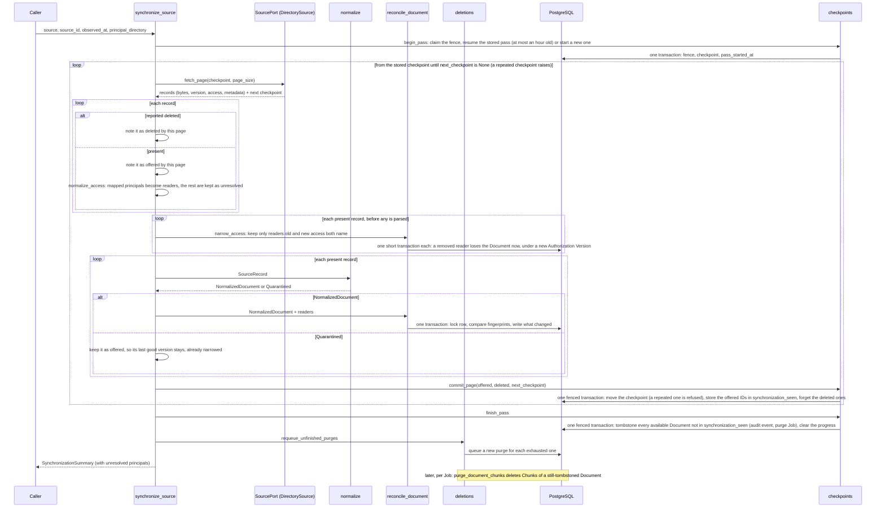

# M08-T09 — Commit Source checkpoints safely

Task: [M08-T09 — Commit Source checkpoints safely](../curriculum/milestones/M08-jobs-and-confluence/M08-T09-commit-source-checkpoints-safely.md)

## What you will do

This lesson lets a synchronization pass keep its place. Today a pass remembers how far it got only in memory. If the worker dies on page 7 of 10, the retry from M08-T08 starts again at page 1. After this lesson, the pass writes its place to PostgreSQL after every finished page, and a retry continues from there. Nothing is lost, and nothing is hidden by mistake.

A concrete example. The Source "Handbook" offers three pages: `a.txt`, then `b.txt`, then `c.txt`. An earlier pass also stored `old.txt`, which the Source no longer lists. The worker dies while it fetches page three.

| Time | Attempt 1 (worker A) | Attempt 2 (worker B) | What PostgreSQL holds afterwards |
|---|---|---|---|
| 10:00:00 | starts the pass, reads page 1, stores `a.txt` | | place: start of pass; seen: none |
| 10:00:01 | commits page 1 | | place: after page 1; seen: `a.txt` |
| 10:00:02 | reads page 2, stores `b.txt`, commits it | | place: after page 2; seen: `a.txt`, `b.txt` |
| 10:00:03 | dies while fetching page 3 | | unchanged |
| 10:05:00 | | resumes: reads only page 3, stores `c.txt`, commits it | seen: `a.txt`, `b.txt`, `c.txt` |
| 10:05:01 | | finishes: hides every Document not in "seen" | `old.txt` is tombstoned; the place is cleared |

Attempt 2 never read pages 1 and 2, yet it did not hide `a.txt` or `b.txt`. PostgreSQL remembered that the pass had already seen them.

| What the task asks | Where it is done |
|---|---|
| Advance the checkpoint only after the page's records and deletions are durably reconciled | Blocks 1 and 4; Step 5: `commit_page` |
| Worker-crash tests at each boundary resume without loss | Blocks 2 and 3; Step 7: the crash tests |
| ... and tolerate replay | Block 2; Step 7: `test_a_page_reconciled_but_not_committed_is_replayed_harmlessly` |
| Success, boundary, and typed failure or denial cases on real infrastructure | Step 7: 20 tests on real PostgreSQL |
| Replay and cancellation behaviour explicit | Blocks 2, 5, and 7 |
| Explain what would falsify the design | Step 8 and the reflection questions |
| Update only affected documentation | Step 9: architecture, operations, security |

This lesson includes coding: Steps 2 to 7 write a migration, code, and tests. Steps 1, 8, 9, and 10 need no code, although Step 9 edits three documents.

Terms used in this lesson:

- **Checkpoint:** the Source's own bookmark, such as `"2"` or a page token. Handing it back to the Source returns the next page. It is a plain string that only the Source understands.
- **Pass:** one run over every page of a Source, ending with hiding the Documents it did not see. One pass may take several attempts.
- **Attempt:** one try of a pass by one worker. A crash ends an attempt; the next attempt of the same pass resumes.
- **Page commit:** the one transaction that runs after a page is fully processed. It saves the page's results and moves the checkpoint past it.
- **Seen list:** the external IDs the pass has met so far, stored in the new table `synchronization_seen`.
- **Tombstone:** the mark that hides a Document from search. It is not a delete: the row stays, and the Chunks are purged later.
- **Replay:** doing the same work a second time after a crash. It is harmless when the work is **idempotent**: running it twice has the same effect as once, like pressing a lift button twice.
- **Fence:** from M08-T05. The Source row stores the observation time of the newest pass. Only that pass may write.

## Before you begin

This section explains every design choice the code depends on. Read it first; the steps assume it.

### 1. Move the bookmark only after the page is done

The checkpoint must move past a page only after every record on that page is stored. In the wrong order, a crash skips records forever.

Take the three-page Source above. Suppose the code saved the checkpoint as soon as it read a page, before processing it:

| Time | Worker A | PostgreSQL afterwards |
|---|---|---|
| 10:00:02 | reads page 2 and saves "after page 2" | place: after page 2; `b.txt` not stored yet |
| 10:00:03 | starts storing `b.txt` and dies half-way | the half-finished transaction rolls back; `b.txt` is still missing |
| 10:05:00 | worker B resumes "after page 2" and reads page 3 | `b.txt` is never read in this pass |

The hidden fact is simple. A commit is permanent the moment it returns, and nothing after it is promised. If the bookmark commits first, it says "page 2 is done" while page 2 is not.

How bad is it here? With today's folder Source, `b.txt` waits until the next full pass, about an hour later. In M08-T10 an incremental pass reads only changes since the checkpoint, so a skipped change would never come back.

The fix is the order. Before:

```python
page = await source.fetch_page(checkpoint=checkpoint, page_size=page_size)
# nothing was stored; the checkpoint lived only in this variable
checkpoint = page.next_checkpoint
```

After:

```python
page = await source.fetch_page(checkpoint=checkpoint, page_size=page_size)
# ... narrow and reconcile every record of the page, each in its own commit ...
await commit_page(..., next_checkpoint=page.next_checkpoint)  # only now
```

It is like a bookmark in a book: you move it after you finish reading the page, not when you turn to it.

### 2. Replaying a page is harmless

The safe order has its own crash window. The records are stored, but the page commit has not happened yet.

| Time | Worker A | PostgreSQL afterwards |
|---|---|---|
| 10:00:00 | stores `a.txt` (its own transaction commits) | `a.txt` stored; place: start of pass |
| 10:00:01 | dies before the page commit | unchanged |
| 10:05:00 | worker B starts from the stored place, which is still the start, and reads page 1 again | |
| 10:05:00 | stores `a.txt` again | nothing written: same text, same readers |

The hidden fact: reconciliation (M03) compares fingerprints before it writes. A fingerprint is a short hash of the text and another of the readers. When both match the stored row, it writes nothing and reports `UNCHANGED`. So the second store of `a.txt` changes nothing. Its narrowing step (M07) is the same: a reader already removed is not removed twice.

So we accept this window instead of closing it. The rule is "a page may be done twice, never skipped". That is the at-least-once promise from ADR 0005.

### 3. Remember what the pass saw, not only where it is

The checkpoint alone is not enough. At the end, a pass hides every Document it did not see. A resumed attempt did not see the early pages.

Here is the pass from "What you will do", saving only the checkpoint and keeping the seen list in memory, as the code does today:

| Time | Worker | In-memory seen list | Result |
|---|---|---|---|
| 10:00:02 | A, after page 2 | `a.txt`, `b.txt` | |
| 10:00:03 | A dies | lost with the process | |
| 10:05:00 | B resumes after page 2 and reads page 3 | `c.txt` | |
| 10:05:01 | B finishes and hides what it did not see | `c.txt` | `a.txt`, `b.txt`, and `old.txt` are tombstoned |

Two live Documents disappear from search, and their Chunks are queued for purging. The hidden fact: the end-of-pass step decides by absence. "Not in the list" means "deleted" only when the list covers every page. A list from half a pass makes a wrong deletion look like a correct one.

The fix: each page commit writes the page's IDs into a new table, `synchronization_seen`. The final step reads that table instead of a Python set. In SQL, the final question is:

```sql
SELECT document_id FROM documents
WHERE source_id = :source AND availability = 'available'
  AND NOT EXISTS (
    SELECT 1 FROM synchronization_seen s
    WHERE s.source_id = documents.source_id
      AND s.external_id = documents.external_id)
ORDER BY external_id;
```

It is like a guest list kept on paper at the door instead of in the doorman's head: a new doorman can take over mid-evening.

### 4. One page commit is all or nothing

A page commit does several things: it moves the checkpoint, notes the checkpoint as used, adds the offered IDs to the seen list, and removes the IDs the page reported deleted. They must land together.

Suppose they were separate commits and the worker died between them. The checkpoint moves to "after page 2", then the worker dies before `b.txt` is added to the seen list. The next attempt skips page 2 and, at the end, hides `b.txt`. That is Block 3's wrong deletion again.

So they share one transaction. These are the statements one page commit sends:

```sql
BEGIN;
UPDATE sources SET checkpoint = '2'
  WHERE source_id = :source AND synchronization_fence = :observed_at
    AND pass_started_at IS NOT NULL
  RETURNING source_id;                          -- no row: a newer pass owns it
INSERT INTO synchronization_checkpoints (source_id, checkpoint)
  VALUES (:source, '2') ON CONFLICT DO NOTHING
  RETURNING checkpoint;                         -- no row: the Source repeated it
DELETE FROM synchronization_seen
  WHERE source_id = :source AND external_id IN (...);   -- reported deleted
INSERT INTO synchronization_seen (source_id, external_id)
  VALUES (...) ON CONFLICT DO NOTHING;                   -- offered
COMMIT;
```

| If the worker dies... | What stays | What is undone |
|---|---|---|
| before `COMMIT` | every earlier page commit; every record already reconciled | all four writes of this page commit |
| after `COMMIT` | all four writes | nothing |

The records themselves are not inside this transaction. Each record keeps its own short commit, as in M07. That keeps a removed reader's loss of access fast, and Block 2 makes a replay of them harmless.

### 5. The fence check comes first, and it takes a write lock

Only the newest pass may write progress. The page commit checks this in its first statement. That statement also locks the Source row against writers until the commit ends.

The existing guard from M08-T05 takes a **share lock**: many transactions may hold one at once, and it blocks writers. The page commit needs to change the Source row, so a share lock is not enough. Taking a share lock first and then updating the same row can deadlock. Two transactions each hold a share lock, and each waits for the other to let go before it can write. So the commit starts with the fenced `UPDATE` itself. That one statement checks the fence and takes the write lock at once.

Two passes can still meet:

| Time | Pass P1 (observed 10:00) | Pass P2 (observed 10:10) | The Source row afterwards |
|---|---|---|---|
| 10:10:00 | is in the middle of page 3 | claims the fence and finds P1's progress, 10 minutes old | fence: 10:10; place: after page 2 |
| 10:10:00 | | resumes it: reads page 3 onward | |
| 10:10:01 | tries to commit page 3: the `UPDATE` matches no row | | P1 gets `SynchronizationSuperseded`; it wrote nothing |

P2 inherits P1's seen list. That is safe, because an inherited list can only grow. A bigger list means fewer Documents hidden, never a wrong one. The fence claim and the progress read happen in one transaction, so no P1 commit can land between them.

A cancelled attempt behaves like a crash: its open transaction rolls back, and the next attempt resumes from the last page commit. It records no `synchronization.finished` event, as before this lesson.

### 6. Review findings

An independent reviewer attacked a first version with random crash points, concurrent passes, and hostile Sources. Three attacks broke it. Each fix has a test in Step 7 that fails without it.

**Deleted, then offered again but unreadable.** In the first version a page commit also tombstoned what the page reported deleted. Then this happened in one pass: page 1 says "`x.txt` deleted", and the commit hides it. Page 2 offers `x.txt` again, but the file cannot be parsed, so nothing restores it. The pass ended with `x.txt` hidden. The rule since M03 says the last report wins, and "a file that fails to parse is not a deleted one". Now a page commit only removes deleted IDs from the seen list. The hiding waits for the end of the pass, where the last report has the final say. Test: `test_an_item_deleted_then_offered_unparseable_stays_available`.

**A repeated checkpoint got stored by the next attempt.** The Source pages `start → A → B`, and then `B` points back to `A`. Attempt 1 stored A and B and then refused the repeated A, keeping only an in-memory list of used checkpoints. Attempt 2 resumed from B with an empty list. It accepted A, stored it, and refused at B. Each later attempt flipped the stored place between A and B, re-reading pages for an hour. Now the used checkpoints live in a table, `synchronization_checkpoints`. Its primary key refuses a repeat across attempts too. Tests: `test_a_repeated_checkpoint_is_never_stored` and `test_a_repeated_checkpoint_is_refused_by_a_resumed_attempt_too`.

**A very large page could not commit.** One insert with 33,000 IDs needs 66,000 parameters. PostgreSQL allows at most 65,535 in one statement, so the commit failed every time and the pass could never get past that page. Now the IDs go in batches of 1,000. Test: `test_a_page_larger_than_one_statement_can_hold_commits`.

The reviewer's other attacks held. Hundreds of random page layouts with random crash points converged to the expected state. 40 rounds of three overlapping passes, with a scheduler share-locking the same row, ended without a deadlock.

### 7. Known limits

**A resumed pass does not re-read earlier pages.** If the Source changes page 1 between attempt 1 and attempt 2, the change waits for the next pass. That includes a removed reader. To bound the wait, progress older than an hour (`MAX_RESUME_AGE`) is dropped, and the pass starts again from page 1. The hour counts from the pass's first attempt, so a pass that keeps failing for longer starts over on every retry. The worst wait is therefore about an hour plus the synchronization interval. `docs/security.md` says so in Step 9.

**The checkpoint must stay meaningful for an hour.** The folder Source pages by file name, so its checkpoint stays valid. A Source that pages by position ("skip 200") can shift when items are added. The Source contract does not forbid that yet; M08-T12 should use stable, key-based tokens for Confluence.

**Counts cover one attempt.** `SynchronizationSummary` counts only the pages this attempt read. The new `resumed` field says when that is a partial view.

**The seen list costs one row per Document per pass.** The rows are written page by page and deleted when the pass ends. For a large Source that is real write work, but each row is tiny.

**The checkpoint is cleared after a finished pass.** The next pass starts from page 1. Keeping the last checkpoint as a "changes since" cursor is M08-T10's incremental sync.

## Step-by-step instructions

Start PostgreSQL before you begin. Run every command from the repository root. For integration checks, set the test database URL in your terminal:

```bash
export KNOWLEDGE_SERVICE_TEST_DATABASE_URL="$(uv run python scripts/test_database_url.py)"
```

Run only one integration command against this database at a time.

### Step 1 — No coding in this step: write the invariant and your predictions

Before changing anything, write down what must be true at the end and what you expect to see. You check the predictions in Step 8 and Step 10.

Create `docs/evidence/M08-T09-commit-source-checkpoints-safely.md`:

```markdown
# M08-T09 — Commit Source checkpoints safely evidence

## Invariant

A Source's checkpoint moves past a page only in the transaction that also
stores the page's offered external IDs, forgets the ones it reported
deleted, and records the checkpoint as used, and that transaction commits
only after every record of the page is reconciled. A pass that dies at any
point resumes on its next attempt from its last committed page, if the pass
started at most `MAX_RESUME_AGE` ago; its end-of-pass tombstones count every
page any attempt committed. Only the pass that holds the Source's fence can
write progress, and a checkpoint the pass stored before is never stored
again.

## Owners

- Durable progress: PostgreSQL (`sources.checkpoint`,
  `sources.pass_started_at`, `synchronization_seen`,
  `synchronization_checkpoints`).
- Page commit and resume: `ingestion.checkpoints`.
- Retries of a failed attempt: the stored Job (M08-T04) and recovery
  (M08-T08); a retry is a new attempt of the same pass.
- Write authority: the Source's fence (M08-T05).

## Expected failing check

Before the change,
`uv run pytest tests/test_checkpoints_integration.py -q -m integration`
reports `no tests ran`, because the file does not exist.

## Predictions

- A pass dies while fetching page 3 of 3. Which page does the retry read first:
- The same pass, but the seen list is kept in memory only. Which Documents does the retry tombstone:
- How many tests fail if the page commit runs before the page's records are reconciled:
- A Source reports `x.txt` deleted on page 1 and offers it, unreadable, on page 2. Is `x.txt` available after the pass:

## Design

## Verification

## Review

## Decision

## Reflection
```

**Check:** run the expected failing check above and see `no tests ran`. Each prediction has your answer after the colon.

### Step 2 — Coding step: the migration and the table shapes

This step adds the columns and tables where a pass keeps its progress.

**In plain words:** the database learns to remember an unfinished pass. The Source row gets the time the pass started, next to the checkpoint column that already exists. Two small new tables hold the IDs the pass has seen and the checkpoints it has used. Nothing uses them yet; the next steps do.

| What | Holds | Why |
|---|---|---|
| `sources.pass_started_at` | when the pass in progress started; NULL when none | to resume only recent progress (Block 7) |
| `sources.checkpoint` | already exists, never written until now | the place to resume from |
| `ck_sources_checkpoint_pass` | a checkpoint needs a start time | a bookmark without its pass cannot be trusted |
| `synchronization_seen` | one row per external ID the pass has seen | Block 3 |
| `synchronization_checkpoints` | one row per checkpoint the pass has stored | Block 6, the repeated checkpoint |

**Decision:** keep the resume point on `sources`, where the column already lives and where the fence is. The two lists get their own tables, keyed by Source, because one Source has at most one pass in progress. The upgrade clears any stray checkpoint, because no code ever wrote one and a bookmark without its pass is unsafe to resume.

**Action 1:** create `migrations/versions/e1f2a3b4c5d6_synchronization_progress.py`:

```python
"""synchronization progress

Revision ID: e1f2a3b4c5d6
Revises: d0e1f2a3b4c5
Create Date: 2026-11-24 12:00:00.000000

"""

from collections.abc import Sequence

import sqlalchemy as sa
from alembic import op

# revision identifiers, used by Alembic.
revision: str = "e1f2a3b4c5d6"
down_revision: str | Sequence[str] | None = "d0e1f2a3b4c5"


def upgrade() -> None:
    # No pass wrote a checkpoint before this revision, and one without the
    # pass it belongs to cannot be resumed safely, so any stray one goes.
    op.execute("update sources set checkpoint = null")
    op.add_column(
        "sources",
        sa.Column("pass_started_at", sa.DateTime(timezone=True), nullable=True),
    )
    op.create_check_constraint(
        "ck_sources_checkpoint_pass",
        "sources",
        "checkpoint is null or pass_started_at is not null",
    )
    op.create_table(
        "synchronization_seen",
        sa.Column(
            "source_id",
            sa.Uuid(),
            sa.ForeignKey("sources.source_id", ondelete="CASCADE"),
            nullable=False,
        ),
        sa.Column("external_id", sa.Text(), nullable=False),
        sa.PrimaryKeyConstraint(
            "source_id", "external_id", name="pk_synchronization_seen"
        ),
    )
    op.create_table(
        "synchronization_checkpoints",
        sa.Column(
            "source_id",
            sa.Uuid(),
            sa.ForeignKey("sources.source_id", ondelete="CASCADE"),
            nullable=False,
        ),
        sa.Column("checkpoint", sa.Text(), nullable=False),
        sa.PrimaryKeyConstraint(
            "source_id", "checkpoint", name="pk_synchronization_checkpoints"
        ),
    )


def downgrade() -> None:
    op.drop_table("synchronization_checkpoints")
    op.drop_table("synchronization_seen")
    op.drop_constraint("ck_sources_checkpoint_pass", "sources", type_="check")
    op.drop_column("sources", "pass_started_at")
    # The resume point means nothing without the pass it belongs to.
    op.execute("update sources set checkpoint = null")
```

**Action 2:** in `src/knowledge_service/persistence/schema.py`, replace the end of the `sources` table, from the `synchronization_fence` comment to its closing `)`, with this. It adds the column, the check, and the two new tables right after `sources`:

```python
    # The observation time of the newest pass that claimed this Source; only
    # that pass may write its Documents (`ingestion.synchronization`).
    sa.Column("synchronization_fence", sa.DateTime(timezone=True), nullable=True),
    # When the pass whose progress `checkpoint` records started observing the
    # Source; NULL when no pass is in progress (`ingestion.checkpoints`).
    sa.Column("pass_started_at", sa.DateTime(timezone=True), nullable=True),
    sa.UniqueConstraint("kind", "location", name="uq_sources_kind_location"),
    sa.CheckConstraint(
        "checkpoint is null or pass_started_at is not null",
        name="ck_sources_checkpoint_pass",
    ),
)

# The external IDs the pass in progress has seen so far, one row each, so a
# resumed pass still knows them when it tombstones what it did not see.
synchronization_seen = sa.Table(
    "synchronization_seen",
    metadata,
    sa.Column(
        "source_id",
        sa.Uuid(),
        sa.ForeignKey("sources.source_id", ondelete="CASCADE"),
        nullable=False,
    ),
    sa.Column("external_id", sa.Text(), nullable=False),
    sa.PrimaryKeyConstraint("source_id", "external_id", name="pk_synchronization_seen"),
)

# Every checkpoint the pass in progress has stored, so a Source that hands
# one back is refused even by a later attempt that resumed after it.
synchronization_checkpoints = sa.Table(
    "synchronization_checkpoints",
    metadata,
    sa.Column(
        "source_id",
        sa.Uuid(),
        sa.ForeignKey("sources.source_id", ondelete="CASCADE"),
        nullable=False,
    ),
    sa.Column("checkpoint", sa.Text(), nullable=False),
    sa.PrimaryKeyConstraint(
        "source_id", "checkpoint", name="pk_synchronization_checkpoints"
    ),
)
```

The tables must be in `schema.py` too. The test fixture empties every table this `metadata` lists, so a table missing here would keep rows between tests.

**Check:** `uv run pyright src/knowledge_service/persistence/schema.py` reports `0 errors`. The migration itself runs in Step 7: every integration test migrates its database to `head`, and `test_the_migration_goes_down_and_up` checks the way back.

### Step 3 — Coding step: statements over the stored progress

This step writes the SQL statements that read and change the progress. It is a new persistence module, `persistence/synchronization_progress.py`.

**In plain words:** this file is the only code that touches the progress tables. It can start a new pass or pick up a recent one, move the bookmark if this pass still owns the Source, note a checkpoint as used, add and remove seen IDs, clear everything when the pass ends, and list the Documents the pass never saw. Every write that moves or clears the bookmark first checks the fence in the same statement.

| Function | Does | Returns |
|---|---|---|
| `start_or_resume_pass` | resumes progress started at most `max_age` ago, else wipes it and starts fresh | `PassProgress` (start time, checkpoint, resumed or not) |
| `advance_checkpoint` | the fenced `UPDATE` of Block 5; `None` keeps the stored checkpoint | `False` when a newer pass owns the Source |
| `remember_checkpoint` | inserts into `synchronization_checkpoints` | `False` when the checkpoint was used before |
| `end_pass` | the fenced `UPDATE` that clears the place and start time | `False` when a newer pass owns the Source |
| `record_seen`, `forget_seen` | add or remove seen IDs, 1,000 at a time | nothing |
| `forget_pass` | deletes the pass's seen IDs and used checkpoints | nothing |
| `load_unseen_available` | Block 3's `NOT EXISTS` query | Document IDs, by external ID |

**Decision:** `advance_checkpoint` with `None` keeps the stored checkpoint instead of clearing it. After the last page there is no "next" page. If the pass dies before it finishes, the retry should read the last page again, not start over. The batches are sorted, so two writers lock rows in the same order.

**Action:** create `src/knowledge_service/persistence/synchronization_progress.py`:

```python
"""Statements over the stored progress of a Source's synchronization pass.

The progress is four facts: when the pass in progress started
(`sources.pass_started_at`), the checkpoint it resumes from
(`sources.checkpoint`), every checkpoint it has stored
(`synchronization_checkpoints`), and the external IDs it has seen so far
(`synchronization_seen`). `advance_checkpoint` and `end_pass` check, in
the same statement, that the pass still holds the Source's fence, and lock
the Source's row; the other writes run in the transaction that checked it.
"""

from collections.abc import Collection, Iterator, Sequence
from dataclasses import dataclass
from datetime import datetime, timedelta
from itertools import batched

import sqlalchemy as sa
from sqlalchemy.dialects.postgresql import insert
from sqlalchemy.ext.asyncio import AsyncConnection

from knowledge_service.documents import DocumentAvailability
from knowledge_service.identifiers import DocumentId, SourceId
from knowledge_service.persistence.schema import (
    documents,
    sources,
    synchronization_checkpoints,
    synchronization_seen,
)

# PostgreSQL takes at most 65,535 parameters in one statement; a page may
# hold more IDs than that, so they are written this many at a time.
BATCH_SIZE = 1000


@dataclass(frozen=True, slots=True)
class PassProgress:
    """Where a pass starts: from the beginning, or from a stored checkpoint."""

    started_at: datetime
    checkpoint: str | None
    resumed: bool


async def start_or_resume_pass(
    connection: AsyncConnection,
    *,
    source_id: SourceId,
    observed_at: datetime,
    max_age: timedelta,
) -> PassProgress:
    """Resume the stored pass if it started at most `max_age` ago, or start anew.

    Call it in the transaction that claimed the fence, so no older pass can
    store progress between the claim and this read. Starting anew forgets
    everything an earlier pass stored.
    """
    row = (
        await connection.execute(
            sa.select(sources.c.checkpoint, sources.c.pass_started_at)
            .where(sources.c.source_id == source_id.value)
            .with_for_update()
        )
    ).one()
    started_at: datetime | None = row.pass_started_at
    if started_at is not None and started_at <= observed_at <= started_at + max_age:
        return PassProgress(
            started_at=started_at, checkpoint=row.checkpoint, resumed=True
        )
    await forget_pass(connection, source_id=source_id)
    await connection.execute(
        sa.update(sources)
        .where(sources.c.source_id == source_id.value)
        .values(pass_started_at=observed_at, checkpoint=None)
    )
    return PassProgress(started_at=observed_at, checkpoint=None, resumed=False)


async def advance_checkpoint(
    connection: AsyncConnection,
    *,
    source_id: SourceId,
    observed_at: datetime,
    checkpoint: str | None,
) -> bool:
    """Store `checkpoint` as the resume point, if this pass holds the fence.

    None keeps the stored checkpoint: after the last page the pass resumes
    from that page, not past it. False, and nothing written, when a newer
    pass claimed the fence or no pass is in progress. The Source's row stays
    locked until the transaction ends, so no newer claim lands in between.
    """
    resume_from = (
        sources.c.checkpoint
        if checkpoint is None
        else sa.literal(checkpoint, sa.Text())
    )
    held = await connection.scalar(
        sa.update(sources)
        .where(
            sources.c.source_id == source_id.value,
            sources.c.synchronization_fence == observed_at,
            sources.c.pass_started_at.is_not(None),
        )
        .values(checkpoint=resume_from)
        .returning(sources.c.source_id)
    )
    return held is not None


async def remember_checkpoint(
    connection: AsyncConnection, *, source_id: SourceId, checkpoint: str
) -> bool:
    """Note that the pass stored `checkpoint`; False if it stored it before."""
    added = await connection.scalar(
        insert(synchronization_checkpoints)
        .values(source_id=source_id.value, checkpoint=checkpoint)
        .on_conflict_do_nothing()
        .returning(synchronization_checkpoints.c.checkpoint)
    )
    return added is not None


async def end_pass(
    connection: AsyncConnection, *, source_id: SourceId, observed_at: datetime
) -> bool:
    """Clear the stored resume point, if this pass holds the fence.

    The seen IDs stay until `forget_pass`, so the same transaction can still
    tombstone what the pass did not see.
    """
    held = await connection.scalar(
        sa.update(sources)
        .where(
            sources.c.source_id == source_id.value,
            sources.c.synchronization_fence == observed_at,
            sources.c.pass_started_at.is_not(None),
        )
        .values(checkpoint=None, pass_started_at=None)
        .returning(sources.c.source_id)
    )
    return held is not None


async def record_seen(
    connection: AsyncConnection, *, source_id: SourceId, external_ids: Collection[str]
) -> None:
    """Remember that the pass in progress saw these external IDs."""
    for batch in _batches(external_ids):
        await connection.execute(
            insert(synchronization_seen)
            .values(
                [
                    {"source_id": source_id.value, "external_id": external_id}
                    for external_id in batch
                ]
            )
            .on_conflict_do_nothing()
        )


async def forget_seen(
    connection: AsyncConnection, *, source_id: SourceId, external_ids: Collection[str]
) -> None:
    """Forget these external IDs: the Source reported them deleted."""
    for batch in _batches(external_ids):
        await connection.execute(
            sa.delete(synchronization_seen).where(
                synchronization_seen.c.source_id == source_id.value,
                synchronization_seen.c.external_id.in_(batch),
            )
        )


async def forget_pass(connection: AsyncConnection, *, source_id: SourceId) -> None:
    """Forget every external ID and checkpoint the pass stored."""
    for table in (synchronization_seen, synchronization_checkpoints):
        await connection.execute(
            sa.delete(table).where(table.c.source_id == source_id.value)
        )


async def load_unseen_available(
    connection: AsyncConnection, *, source_id: SourceId
) -> tuple[DocumentId, ...]:
    """Available Documents of the Source the pass in progress has not seen."""
    seen = sa.exists().where(
        synchronization_seen.c.source_id == documents.c.source_id,
        synchronization_seen.c.external_id == documents.c.external_id,
    )
    rows = await connection.scalars(
        sa.select(documents.c.document_id)
        .where(
            documents.c.source_id == source_id.value,
            documents.c.availability == DocumentAvailability.AVAILABLE.value,
            ~seen,
        )
        .order_by(documents.c.external_id)
    )
    return tuple(DocumentId(document_id) for document_id in rows)


def _batches(external_ids: Collection[str]) -> Iterator[Sequence[str]]:
    """The IDs in sorted batches, so concurrent writers lock rows in one order."""
    return batched(sorted(external_ids), BATCH_SIZE, strict=False)
```

`itertools.batched` cuts the sorted IDs into tuples of at most 1,000. `strict=False` allows the last batch to be shorter.

**Check:** `uv run pyright src/knowledge_service/persistence/synchronization_progress.py` reports `0 errors`.

### Step 4 — Coding step: tombstone from the stored seen list

This step teaches `deletions.py` to hide the Documents the stored seen list lacks. The existing `tombstone_missing` keeps working for its many test callers.

**In plain words:** the code that hides one Document moves into a small helper. The old function, which takes the seen IDs as a Python set, now uses that helper. A new function asks the database which available Documents are missing from the stored seen list, and hides each one with the same helper. It runs inside a transaction its caller already opened, so the hiding and the clearing of progress commit together.

| Part | Change |
|---|---|
| `_tombstone` | new: the old loop body (lock the row, re-check it, tombstone, audit event, purge Job) |
| `tombstone_missing` | same signature and behaviour, now calls `_tombstone` |
| `tombstone_unseen` | new: takes a connection, reads `load_unseen_available`, calls `_tombstone` |

**Decision:** `tombstone_unseen` takes a connection, not the runtime. The caller in Step 5 must clear the progress in the same transaction. Otherwise a crash between the two would leave progress that says "not finished" after the tombstones were already written. That is harmless, but confusing.

**Action 1:** in the module docstring of `src/knowledge_service/ingestion/deletions.py`, replace item 1 of the numbered list with:

```text
1. At the end of a complete Synchronization Run, every available Document
   the run did not see, or last saw reported deleted, is tombstoned:
   `tombstone_unseen` reads the seen IDs the run stored page by page;
   `tombstone_missing` takes them as a set in memory, for callers that hold
   a complete pass themselves. For each such Document, one transaction marks
   it tombstoned, records an audit event, and queues a purge Job. Retrieval
   reads only Chunks of available Documents, so the content disappears from
   reads at that commit, while the Chunks are still stored.
```

**Action 2:** add the import after the `persistence.jobs` import:

```python
from knowledge_service.persistence.jobs import enqueue_job, load_job, save_job
from knowledge_service.persistence.synchronization_progress import (
    load_unseen_available,
)
```

**Action 3:** replace the whole `tombstone_missing` function with these three functions:

```python
async def tombstone_missing(
    runtime: DatabaseRuntime,
    *,
    source_id: SourceId,
    seen: Collection[str],
    observed_at: datetime,
    guard: WriteGuard | None = None,
) -> tuple[Tombstone, ...]:
    """Tombstone every available Document of a Source whose ID is not in `seen`.

    `seen` must hold every external ID of one complete pass over the Source;
    after a partial pass, documents that were simply not reached yet would be
    tombstoned. A Document updated after `observed_at` was seen by a later
    observation, so it is kept. `guard` runs first in the transaction;
    raising from it tombstones nothing.
    """
    seen = frozenset(seen)
    tombstones: list[Tombstone] = []
    async with runtime.transaction() as connection:
        if guard is not None:
            await guard(connection)
        available = await load_available_documents(connection, source_id=source_id)
        for candidate in available:
            if candidate.provenance.external_id in seen:
                continue
            tombstone = await _tombstone(
                connection, document_id=candidate.document_id, observed_at=observed_at
            )
            if tombstone is not None:
                tombstones.append(tombstone)
    return tuple(tombstones)


async def tombstone_unseen(
    connection: AsyncConnection, *, source_id: SourceId, observed_at: datetime
) -> tuple[Tombstone, ...]:
    """Tombstone the available Documents the stored pass never saw.

    The seen IDs are the ones every committed page of the pass stored, so a
    pass resumed after a crash still counts the pages before it. The caller
    owns the transaction and has checked its fence.
    """
    tombstones: list[Tombstone] = []
    for document_id in await load_unseen_available(connection, source_id=source_id):
        tombstone = await _tombstone(
            connection, document_id=document_id, observed_at=observed_at
        )
        if tombstone is not None:
            tombstones.append(tombstone)
    return tuple(tombstones)


async def _tombstone(
    connection: AsyncConnection, *, document_id: DocumentId, observed_at: datetime
) -> Tombstone | None:
    """Tombstone one Document, deciding from its row under a lock.

    None when it is gone, already tombstoned, or updated after
    `observed_at`: a later observation saw it, so it is kept.
    """
    # Lock only this row, so a concurrent reconcile of the same document
    # waits, and decide from the row as it is now.
    document = await load_document_by_id(
        connection, document_id=document_id, for_update=True
    )
    if (
        document is None
        or document.availability is not DocumentAvailability.AVAILABLE
        or document.updated_at > observed_at
    ):
        return None
    tombstoned = document.tombstone(observed_at=observed_at)
    await upsert_document(connection, tombstoned)
    await record_audit_event(connection, availability_event(tombstoned))
    job = await _queue_purge(
        connection, document_id=tombstoned.document_id, now=observed_at
    )
    return Tombstone(
        document_id=tombstoned.document_id,
        external_id=tombstoned.provenance.external_id,
        purge_job_id=job.job_id,
    )
```

The check `document.updated_at > observed_at` is unchanged. A Document updated by a later observation was seen by someone newer, so it is kept.

**Check:** run the old deletion tests, which use `tombstone_missing`:

```bash
uv run pytest tests/test_deletions_integration.py -q -m integration
```

Every test passes.

### Step 5 — Coding step: the checkpoint transaction

This step is the heart of the lesson: the module that begins, commits, and finishes a resumable pass.

**In plain words:** this file gives a pass three moves. "Begin" claims the Source and either picks up a recent unfinished pass or starts a new one. "Commit page" runs after a page is fully stored: in one transaction it checks ownership, moves the bookmark, refuses a bookmark used before, and updates the seen list. "Finish" runs after the last page: it hides what the pass never saw and wipes the progress, so the next pass starts from page 1.

| Function | One transaction that... | Raises |
|---|---|---|
| `begin_pass` | claims the fence (M08-T05), then calls `start_or_resume_pass` | `SynchronizationSuperseded` |
| `commit_page` | Block 4's four writes, fence first | `SynchronizationSuperseded`, `InvalidSource` for a repeated checkpoint |
| `finish_pass` | clears the place (fenced), tombstones the unseen, forgets the lists | `SynchronizationSuperseded` |

**Decision:** nothing is tombstoned before the last page (Block 6). `MAX_RESUME_AGE` is one hour, the same as the default synchronization interval. Within that time a retry saves work, and a page skipped by a resume is read again within about one more interval.

**Action:** create `src/knowledge_service/ingestion/checkpoints.py`:

```python
"""Make a synchronization pass resumable, one committed page at a time.

A pass stores its progress in PostgreSQL: when it started, the checkpoint it
resumes from, every checkpoint it stored, and the external IDs it has seen.
Each step is one transaction that first checks the pass still holds the
Source's fence:

1. `begin_pass` claims the fence and resumes the stored pass, if it started
   at most `MAX_RESUME_AGE` ago, or starts a new one.
2. `commit_page` runs after every record of a page is reconciled. It
   stores which external IDs the page offered and forgets the ones it
   reported deleted, and only then moves the checkpoint past the page. A
   crash before this commit replays the page, which reconciliation
   tolerates: an unchanged record writes nothing.
3. `finish_pass` runs after the last page. It tombstones every available
   Document the pass never saw, or last saw reported deleted, counting the
   pages of earlier attempts, and clears the progress, so the next pass
   starts from the beginning.

Nothing is tombstoned before the last page: an item reported deleted on one
page may be offered again on a later one, and the last report wins.

A resumed pass does not read the pages before its checkpoint again, so a
change the Source made there waits for the next pass. `MAX_RESUME_AGE`
bounds that wait.
"""

from collections.abc import Collection
from datetime import datetime, timedelta
from typing import Final

from knowledge_service.database import DatabaseRuntime
from knowledge_service.identifiers import SourceId
from knowledge_service.ingestion.deletions import Tombstone, tombstone_unseen
from knowledge_service.ingestion.sources import (
    InvalidSource,
    SynchronizationSuperseded,
)
from knowledge_service.persistence.sources import claim_synchronization_fence
from knowledge_service.persistence.synchronization_progress import (
    PassProgress,
    advance_checkpoint,
    end_pass,
    forget_pass,
    forget_seen,
    record_seen,
    remember_checkpoint,
    start_or_resume_pass,
)

# Older progress is dropped and the pass starts again from the beginning, so
# a page skipped by a resume is read again within this time.
MAX_RESUME_AGE: Final = timedelta(hours=1)


async def begin_pass(
    runtime: DatabaseRuntime,
    *,
    source_id: SourceId,
    observed_at: datetime,
    max_resume_age: timedelta = MAX_RESUME_AGE,
) -> PassProgress:
    """Claim the fence, then resume the stored pass or start a new one.

    Raises `SynchronizationSuperseded` when a pass that observed the Source
    at the same time or later already claimed it.
    """
    async with runtime.transaction() as connection:
        if not await claim_synchronization_fence(
            connection, source_id=source_id, observed_at=observed_at
        ):
            raise SynchronizationSuperseded("a newer synchronization pass started")
        return await start_or_resume_pass(
            connection,
            source_id=source_id,
            observed_at=observed_at,
            max_age=max_resume_age,
        )


async def commit_page(
    runtime: DatabaseRuntime,
    *,
    source_id: SourceId,
    observed_at: datetime,
    offered: Collection[str],
    deleted: Collection[str],
    next_checkpoint: str | None,
) -> None:
    """Record one reconciled page and move the checkpoint past it, together.

    `offered` and `deleted` are the page's external IDs by their last report.
    With `next_checkpoint` None, the page was the last one and the checkpoint
    stays. Writes nothing and raises `SynchronizationSuperseded` when a newer
    pass holds the fence, or `InvalidSource` when the pass stored
    `next_checkpoint` before.
    """
    async with runtime.transaction() as connection:
        # First, so the Source's row stays locked for the whole commit.
        if not await advance_checkpoint(
            connection,
            source_id=source_id,
            observed_at=observed_at,
            checkpoint=next_checkpoint,
        ):
            raise SynchronizationSuperseded("a newer synchronization pass started")
        if next_checkpoint is not None and not await remember_checkpoint(
            connection, source_id=source_id, checkpoint=next_checkpoint
        ):
            # Raising rolls the whole commit back, so it is never stored.
            raise InvalidSource("the source repeated a checkpoint")
        await forget_seen(connection, source_id=source_id, external_ids=deleted)
        await record_seen(connection, source_id=source_id, external_ids=offered)


async def finish_pass(
    runtime: DatabaseRuntime, *, source_id: SourceId, observed_at: datetime
) -> tuple[Tombstone, ...]:
    """Tombstone what the whole pass never saw and clear its progress.

    Raises `SynchronizationSuperseded`, writing nothing, when a newer pass
    holds the fence.
    """
    async with runtime.transaction() as connection:
        if not await end_pass(connection, source_id=source_id, observed_at=observed_at):
            raise SynchronizationSuperseded("a newer synchronization pass started")
        tombstones = await tombstone_unseen(
            connection, source_id=source_id, observed_at=observed_at
        )
        await forget_pass(connection, source_id=source_id)
    return tombstones
```

Raising `InvalidSource` inside the `async with` block rolls back the whole transaction, including the checkpoint `UPDATE` that ran first. That is why a repeated checkpoint is never stored.

**Check:** `uv run pyright src/knowledge_service/ingestion/checkpoints.py` reports `0 errors`.

### Step 6 — Coding step: make the pass use the checkpoint transaction

This step rewires `synchronize_source` so every pass begins, commits each page, and finishes through Step 5.

**In plain words:** the pass no longer keeps its seen list or used checkpoints in memory. It starts by asking where to begin, which is page 1 or the stored place. After each page's records are stored, it commits the page. After the last page it calls "finish" instead of the old tombstone call. The summary and the audit event now say whether this attempt resumed.

| Change | Where |
|---|---|
| `begin_pass` replaces the bare fence claim | `_claim_fence` |
| the loop starts from `progress.checkpoint` | `_publish` |
| each page collects `deleted` instead of editing a pass-wide `seen` set | `_publish` |
| `commit_page` after the reconcile loop, before the heartbeat | `_publish` |
| `finish_pass` replaces `tombstone_missing` | `_publish` |
| `max_resume_age` parameter; `resumed` in the summary and audit metadata | `synchronize_source`, `SynchronizationSummary` |

**Decision:** the commit runs before the heartbeat. The heartbeat renews the Redis lease and may raise. With the commit first, a lost lease never throws away the page just stored. The repeated-checkpoint check moves into the database (Block 6), so the in-memory `used` set goes away.

All the actions below are in `src/knowledge_service/ingestion/synchronization.py`.

**Action 1:** in the module docstring, add this paragraph after the first paragraph:

```text
The pass is resumable (`ingestion.checkpoints`). After every record of a
page is reconciled, one transaction stores the external IDs the page
offered, forgets the ones it reported deleted, and moves the Source's
checkpoint past it. A pass that fails resumes, on its next attempt, from
the last committed checkpoint, with the IDs earlier attempts saw, so its
tombstones still count every page. A page that was read but not committed
is read and reconciled again, which changes nothing that already landed.
```

Then replace the last paragraph, which starts "Every pass is fenced.", with:

```text
Every pass is fenced. Before it reads anything it claims the Source's fence
with its observation time, which works only when that time is newer than
every earlier pass's, and every transaction that writes a Document or the
pass's progress (each narrowing, each reconciliation, each page commit, the
tombstones) first checks, under a lock on the Source's row, that it still
holds the fence. A newer claim waits for those writes, and after it the
older pass's writes are refused with `SynchronizationSuperseded`. So an
older pass that finishes late can never undo a newer one. A pass observed
more than `MAX_CLOCK_SKEW` in the future is refused, so a bad clock cannot
hold the fence for long.
```

**Action 2:** in the imports, add the `checkpoints` import before the `deletions` import, and drop `tombstone_missing` from the `deletions` import:

```python
from knowledge_service.ingestion.checkpoints import (
    MAX_RESUME_AGE,
    begin_pass,
    commit_page,
    finish_pass,
)
from knowledge_service.ingestion.deletions import (
    Tombstone,
    requeue_unfinished_purges,
)
```

Replace the `persistence.sources` import with these two lines:

```python
from knowledge_service.persistence.sources import synchronization_fence_holds
from knowledge_service.persistence.synchronization_progress import PassProgress
```

**Action 3:** add the `resumed` field to the summary:

```python
@dataclass(frozen=True, slots=True)
class SynchronizationSummary:
    """What one complete pass did."""

    run_id: SynchronizationRunId
    changes: Counter[Change]
    quarantined: tuple[Quarantined, ...]
    tombstones: tuple[Tombstone, ...]
    requeued_purges: tuple[JobId, ...]
    unresolved: tuple[UnresolvedAccess, ...]
    # Whether this attempt resumed a pass from its stored checkpoint; the
    # counts above cover only the pages this attempt read.
    resumed: bool
```

**Action 4:** replace `synchronize_source` with this version. It takes `max_resume_age`, keeps the progress `_claim_fence` returns, passes it on, and adds `"resumed"` to the audit metadata:

```python
async def synchronize_source(
    runtime: DatabaseRuntime,
    source: SourcePort,
    *,
    source_id: SourceId,
    observed_at: datetime,
    principal_directory: PrincipalDirectory | None,
    page_size: int = PAGE_SIZE,
    run_id: SynchronizationRunId | None = None,
    heartbeat: Callable[[], Awaitable[None]] | None = None,
    max_resume_age: timedelta = MAX_RESUME_AGE,
) -> SynchronizationSummary:
    """Publish every record the Source offers, then tombstone the rest.

    Readers come from `principal_directory`, which every caller names: with
    None, only public items are readable. A Source that returns a checkpoint
    it returned before raises `InvalidSource` instead of paging forever.
    The pass runs as `run_id`, or as a new run, and records how it ended.
    It resumes the stored pass when that started at most `max_resume_age`
    before `observed_at`. Raises `SynchronizationSuperseded`, before reading
    and recording anything, when a pass with the same or a later
    `observed_at` started.
    """
    run = SynchronizationRunId.new() if run_id is None else run_id
    progress = await _claim_fence(
        runtime,
        source_id=source_id,
        observed_at=observed_at,
        max_resume_age=max_resume_age,
    )

    async def guard(connection: AsyncConnection) -> None:
        if not await synchronization_fence_holds(
            connection, source_id=source_id, observed_at=observed_at
        ):
            raise SynchronizationSuperseded("a newer synchronization pass started")

    try:
        summary = await _publish(
            runtime,
            source,
            source_id=source_id,
            observed_at=observed_at,
            principal_directory=principal_directory,
            page_size=page_size,
            run_id=run,
            heartbeat=heartbeat,
            guard=guard,
            progress=progress,
        )
    except Exception as error:
        # The pass's own error is raised either way; its record holds only
        # its type. A database that cannot take the record is logged.
        try:
            await _record_finished(
                runtime,
                source_id=source_id,
                run_id=run,
                observed_at=observed_at,
                outcome=AuditOutcome.FAILED,
                metadata={"failure": type(error).__name__},
            )
        except Exception as unrecorded:
            # Identifiers and type names only, as the other warnings here.
            logger.warning(
                "failed synchronization run %s of source %s not audited: %s",
                str(run.value),
                str(source_id.value),
                type(unrecorded).__name__,
            )
        raise
    await _record_finished(
        runtime,
        source_id=source_id,
        run_id=run,
        observed_at=observed_at,
        outcome=AuditOutcome.SUCCEEDED,
        metadata={
            "changed": sum(
                count
                for change, count in summary.changes.items()
                if change is not Change.UNCHANGED
            ),
            "unchanged": summary.changes[Change.UNCHANGED],
            "quarantined": len(summary.quarantined),
            "tombstoned": len(summary.tombstones),
            "unresolved": len(summary.unresolved),
            "resumed": summary.resumed,
        },
    )
    return summary
```

**Action 5:** replace `_claim_fence`:

```python
async def _claim_fence(
    runtime: DatabaseRuntime,
    *,
    source_id: SourceId,
    observed_at: datetime,
    max_resume_age: timedelta,
) -> PassProgress:
    if observed_at.utcoffset() != timedelta(0):
        raise InvalidSource("observed_at must be a UTC-aware timestamp")
    if observed_at > datetime.now(UTC) + MAX_CLOCK_SKEW:
        raise InvalidSource("observed_at is too far in the future to fence on")
    return await begin_pass(
        runtime,
        source_id=source_id,
        observed_at=observed_at,
        max_resume_age=max_resume_age,
    )
```

**Action 6:** replace `_publish`. Read the two new blocks carefully: `deleted` per page, and `commit_page` after the `for record, access in planned.values()` loop.

```python
async def _publish(
    runtime: DatabaseRuntime,
    source: SourcePort,
    *,
    source_id: SourceId,
    observed_at: datetime,
    principal_directory: PrincipalDirectory | None,
    page_size: int,
    run_id: SynchronizationRunId,
    heartbeat: Callable[[], Awaitable[None]] | None,
    guard: WriteGuard,
    progress: PassProgress,
) -> SynchronizationSummary:
    """Every page from the stored checkpoint, then the tombstones and purges."""
    checkpoint = progress.checkpoint
    changes: Counter[Change] = Counter()
    quarantined: list[Quarantined] = []
    # By external ID, so a record offered twice is reported as last seen.
    unresolved: dict[str, UnresolvedAccess] = {}
    while True:
        page = await source.fetch_page(checkpoint=checkpoint, page_size=page_size)
        # By external ID, so a record offered twice in a page counts once.
        planned: dict[str, tuple[SourceRecord, NormalizedAccess]] = {}
        # What the page reports deleted, by each item's last report.
        deleted: set[str] = set()
        for record in page.records:
            # The last report of an item in the page wins.
            unresolved.pop(record.external_id, None)
            planned.pop(record.external_id, None)
            if record.state is SourceRecordState.DELETED or record.access is None:
                deleted.add(record.external_id)
                continue
            deleted.discard(record.external_id)
            access = normalize_access(record.access, principal_directory)
            if access.unresolved:
                unresolved[record.external_id] = UnresolvedAccess(
                    record.external_id, access.unresolved
                )
            planned[record.external_id] = (record, access)
        # Security first: every reader this page removes loses the Document
        # before any record of the page is parsed or chunked.
        narrowed = await _revoke_first(
            runtime,
            list(planned.values()),
            source_id=source_id,
            observed_at=observed_at,
            run_id=run_id,
            guard=guard,
        )
        for record, access in planned.values():
            outcome = normalize(record, source_id=source_id)
            if isinstance(outcome, Quarantined):
                # Kept as seen: a file that fails to parse is not a deleted
                # one; its narrowing above already applied.
                quarantined.append(outcome)
                if record.external_id in narrowed:
                    changes[Change.ACCESS] += 1
                continue
            result = await reconcile_document(
                runtime,
                outcome,
                readers=access.readers,
                observed_at=observed_at,
                run_id=run_id,
                guard=guard,
            )
            changes[
                _counted(result.change, narrowed=record.external_id in narrowed)
            ] += 1
        # Every record of the page is reconciled; only now may the
        # checkpoint move past it. Quarantined records count as offered. A
        # checkpoint the pass stored before is refused and never stored.
        await commit_page(
            runtime,
            source_id=source_id,
            observed_at=observed_at,
            offered=planned.keys(),
            deleted=deleted,
            next_checkpoint=page.next_checkpoint,
        )
        if heartbeat is not None:
            # After the last page this runs just before the tombstones.
            await heartbeat()
        if page.next_checkpoint is None:
            break
        checkpoint = page.next_checkpoint
    tombstones = await finish_pass(
        runtime, source_id=source_id, observed_at=observed_at
    )
    requeued = await requeue_unfinished_purges(
        runtime, source_id=source_id, now=observed_at
    )
    if unresolved:
        # Counts only: a principal may name a person.
        logger.warning(
            "unresolved source principals: %d in %d documents",
            sum(len(item.principals) for item in unresolved.values()),
            len(unresolved),
        )
    return SynchronizationSummary(
        run_id=run_id,
        changes=changes,
        quarantined=tuple(quarantined),
        tombstones=tombstones,
        requeued_purges=requeued,
        unresolved=tuple(unresolved.values()),
        resumed=progress.resumed,
    )
```

`planned.keys()` holds the external IDs whose last report in the page was "present", including the ones normalization quarantined. A file that fails to parse is not a deleted one, so it counts as offered.

**Action 7:** the audit event now has one more key. In `tests/test_audit_events_integration.py`, in `test_a_synchronization_run_records_how_it_ended`, add `"resumed": False` to the expected metadata:

```python
    assert dict(finished.metadata) == {
        "changed": 2,
        "unchanged": 0,
        "quarantined": 0,
        "tombstoned": 0,
        "unresolved": 0,
        "resumed": False,
    }
```

**Check:** the existing synchronization tests still pass:

```bash
uv run pytest tests/test_synchronization_integration.py tests/test_exclusive_sync_integration.py tests/test_audit_events_integration.py -q -m integration
```

Every test passes. The Redis tests in the exclusive-sync file skip unless `KNOWLEDGE_SERVICE_TEST_REDIS_URL` is set and Redis runs.

### Step 7 — Coding step: crash at every boundary, on real PostgreSQL

This step writes the tests the task asks for: a pass is stopped at each boundary and run again.

**In plain words:** each test runs a pass and makes it die at one exact point. That point is a failed page fetch, a failed record, a failed page commit, or a failed finish. Then it runs the pass again, a few minutes later, as a retry would. It checks which pages the retry read, which Documents ended up available or hidden, and what progress is left in the database.

| Boundary | Test |
|---|---|
| after a page commit, before the next fetch | `test_a_pass_resumes_after_the_last_committed_page` |
| after the records, before the page commit (replay) | `test_a_page_reconciled_but_not_committed_is_replayed_harmlessly` |
| after the last page commit, before the finish | `test_a_resumed_pass_does_not_tombstone_what_an_earlier_attempt_saw` |
| inside a page commit | `test_a_page_commit_is_all_or_nothing` |
| inside a record's reconciliation | `test_the_checkpoint_never_passes_a_record_that_failed_to_reconcile`, `test_a_page_of_two_records_is_replayed_after_one_landed` |
| inside a page's narrowing | `test_a_crash_while_narrowing_a_page_replays_it` |
| cancellation | `test_a_cancelled_pass_resumes_like_a_crashed_one` |
| after the finish, before purges are requeued | `test_a_crash_after_the_finish_starts_the_next_pass_over` |
| inside the finish | `test_a_failed_finish_tombstones_nothing_and_keeps_the_progress` |
| deletions across a crash | `test_a_deletion_reported_before_a_crash_is_still_tombstoned`, `test_an_item_offered_then_reported_deleted_across_a_crash_is_tombstoned` |
| last report wins | `test_an_item_deleted_then_offered_unparseable_stays_available` |
| no leftover progress; stale progress | `test_a_finished_pass_leaves_no_progress_so_the_next_starts_over`, `test_progress_older_than_the_resume_age_is_dropped` |
| denial: older pass, repeated checkpoint | `test_an_older_pass_cannot_move_the_checkpoint`, the two repeated-checkpoint tests |
| size boundary; migration | `test_a_page_larger_than_one_statement_can_hold_commits`, `test_the_migration_goes_down_and_up` |

**Decision:** a crash is simulated by raising an exception at one exact point. `FakeSource(fail_on_call=3)` fails the third fetch. `monkeypatch` replaces one function with one that raises. Inside a transaction, an exception has the same effect as a killed process: PostgreSQL rolls back what was not committed. Each test gives the retry a later `observed_at`, as a real retry has, because the fence refuses the same time twice. `page_size=1` makes one record one page, so "page 2" and "`b.txt`" are the same thing.

**Action:** create `tests/test_checkpoints_integration.py`:

```python
"""Real PostgreSQL tests for a synchronization pass that resumes from its checkpoint.

Each test stops a pass at one boundary, the way a worker crash would, and
runs the pass again later: nothing is lost, and the replayed work changes
nothing that already landed.
"""

import asyncio
from collections.abc import AsyncIterator, Collection
from datetime import UTC, datetime, timedelta
from typing import Any

import pytest
import sqlalchemy as sa
from alembic import command
from pydantic import SecretStr
from sqlalchemy.engine import make_url
from sqlalchemy.ext.asyncio import AsyncConnection

from database_fixtures import migration_config, migration_environment
from fakes import FakeSource
from knowledge_service.database import DatabaseRuntime, create_database_runtime
from knowledge_service.documents import DocumentAvailability
from knowledge_service.identifiers import SourceId
from knowledge_service.ingestion import checkpoints, synchronization
from knowledge_service.ingestion.checkpoints import begin_pass, commit_page
from knowledge_service.ingestion.normalization import NormalizedDocument
from knowledge_service.ingestion.reconciliation import Change, Reconciliation
from knowledge_service.ingestion.sources import (
    InvalidSource,
    SourceAccess,
    SourcePage,
    SourceRecord,
    SourceUnavailable,
    SynchronizationSuperseded,
)
from knowledge_service.ingestion.synchronization import (
    SynchronizationSummary,
    synchronize_source,
)
from knowledge_service.persistence.schema import (
    documents,
    sources,
    synchronization_seen,
)
from knowledge_service.settings import Settings

pytestmark = pytest.mark.integration

SOURCE_ID = SourceId.parse("00000000-0000-0000-0000-000000000090")
OBSERVED_AT = datetime(2026, 11, 24, 9, 0, tzinfo=UTC)
RETRIED_AT = OBSERVED_AT + timedelta(minutes=5)
LATER = OBSERVED_AT + timedelta(hours=2)


class Crash(Exception):
    """Stands in for a worker that dies at one exact point."""


@pytest.fixture
async def runtime(migrated_database: str) -> AsyncIterator[DatabaseRuntime]:
    runtime = create_database_runtime(
        Settings(database_url=SecretStr(migrated_database))
    )
    async with runtime.transaction() as connection:
        await connection.execute(
            sa.insert(sources).values(
                source_id=SOURCE_ID.value,
                kind="local_directory",
                location="/srv/checkpoints",
                display_name="Checkpoints",
                enabled=True,
                created_at=OBSERVED_AT,
                updated_at=OBSERVED_AT,
            )
        )
    try:
        yield runtime
    finally:
        await runtime.dispose()


def record(name: str, text: str = "") -> SourceRecord:
    return SourceRecord.present(
        external_id=name,
        version="v1",
        media_type="text/plain",
        content=(text or f"The {name} policy.").encode(),
        access=SourceAccess(public=True),
    )


async def run(
    runtime: DatabaseRuntime,
    source: FakeSource,
    observed_at: datetime,
    *,
    max_resume_age: timedelta = checkpoints.MAX_RESUME_AGE,
) -> SynchronizationSummary:
    return await synchronize_source(
        runtime,
        source,
        source_id=SOURCE_ID,
        observed_at=observed_at,
        principal_directory=None,
        page_size=1,
        max_resume_age=max_resume_age,
    )


async def availability(runtime: DatabaseRuntime) -> dict[str, str]:
    async with runtime.transaction() as connection:
        rows = await connection.execute(
            sa.select(documents.c.external_id, documents.c.availability)
        )
        return {row.external_id: row.availability for row in rows}


async def progress(runtime: DatabaseRuntime) -> tuple[str | None, datetime | None]:
    async with runtime.transaction() as connection:
        row = (
            await connection.execute(
                sa.select(sources.c.checkpoint, sources.c.pass_started_at).where(
                    sources.c.source_id == SOURCE_ID.value
                )
            )
        ).one()
    return row.checkpoint, row.pass_started_at


THREE_PAGES = [[record("a.txt")], [record("b.txt")], [record("c.txt")]]


async def test_a_pass_resumes_after_the_last_committed_page(
    runtime: DatabaseRuntime,
) -> None:
    # The worker dies fetching page three; pages one and two committed.
    crashed = FakeSource(THREE_PAGES, fail_on_call=3)
    with pytest.raises(SourceUnavailable):
        await run(runtime, crashed, OBSERVED_AT)
    assert await progress(runtime) == ("2", OBSERVED_AT)

    retried = FakeSource(THREE_PAGES)
    summary = await run(runtime, retried, RETRIED_AT)

    assert retried.checkpoints == ["2"]
    assert summary.resumed is True
    assert summary.changes == {Change.CREATED: 1}
    assert summary.tombstones == ()
    assert await availability(runtime) == dict.fromkeys(
        ("a.txt", "b.txt", "c.txt"), DocumentAvailability.AVAILABLE.value
    )
    assert await progress(runtime) == (None, None)


async def test_a_page_reconciled_but_not_committed_is_replayed_harmlessly(
    runtime: DatabaseRuntime, monkeypatch: pytest.MonkeyPatch
) -> None:
    async def crash(*args: object, **kwargs: object) -> object:
        raise Crash

    with monkeypatch.context() as patched:
        patched.setattr(synchronization, "commit_page", crash)
        with pytest.raises(Crash):
            await run(runtime, FakeSource(THREE_PAGES), OBSERVED_AT)
    # Page one's record landed, but the checkpoint never moved past it.
    assert await availability(runtime) == {"a.txt": "available"}
    assert await progress(runtime) == (None, OBSERVED_AT)

    retried = FakeSource(THREE_PAGES)
    summary = await run(runtime, retried, RETRIED_AT)

    assert retried.checkpoints == [None, "1", "2"]
    assert summary.changes == {Change.UNCHANGED: 1, Change.CREATED: 2}
    assert summary.tombstones == ()


async def test_a_resumed_pass_does_not_tombstone_what_an_earlier_attempt_saw(
    runtime: DatabaseRuntime,
) -> None:
    await run(runtime, FakeSource([*THREE_PAGES, [record("old.txt")]]), OBSERVED_AT)
    # The next pass sees a, b, c, but no longer old.txt; it dies after the
    # last page committed, before the tombstones.
    crashed = FakeSource(THREE_PAGES)

    async def crash() -> None:
        if crashed.checkpoints[-1] == "2":
            raise Crash

    with pytest.raises(Crash):
        await synchronize_source(
            runtime,
            crashed,
            source_id=SOURCE_ID,
            observed_at=RETRIED_AT,
            principal_directory=None,
            page_size=1,
            heartbeat=crash,
        )

    retried = FakeSource(THREE_PAGES)
    summary = await run(runtime, retried, RETRIED_AT + timedelta(minutes=5))

    # Only the last page is read again; a.txt and b.txt are still known seen.
    assert retried.checkpoints == ["2"]
    assert [tombstone.external_id for tombstone in summary.tombstones] == ["old.txt"]
    assert await availability(runtime) == {
        "a.txt": "available",
        "b.txt": "available",
        "c.txt": "available",
        "old.txt": "tombstoned",
    }


async def test_a_page_commit_is_all_or_nothing(
    runtime: DatabaseRuntime, monkeypatch: pytest.MonkeyPatch
) -> None:
    record_seen = checkpoints.record_seen

    async def crash_on_b(
        connection: AsyncConnection,
        *,
        source_id: SourceId,
        external_ids: Collection[str],
    ) -> None:
        if "b.txt" in external_ids:
            raise Crash
        await record_seen(connection, source_id=source_id, external_ids=external_ids)

    # Page two's commit dies after it moved the checkpoint, before it ends.
    with monkeypatch.context() as patched:
        patched.setattr(checkpoints, "record_seen", crash_on_b)
        with pytest.raises(Crash):
            await run(runtime, FakeSource(THREE_PAGES), OBSERVED_AT)
    # The checkpoint move rolled back with the rest of the commit.
    assert await progress(runtime) == ("1", OBSERVED_AT)

    retried = FakeSource(THREE_PAGES)
    await run(runtime, retried, RETRIED_AT)

    assert retried.checkpoints == ["1", "2"]


async def test_the_checkpoint_never_passes_a_record_that_failed_to_reconcile(
    runtime: DatabaseRuntime, monkeypatch: pytest.MonkeyPatch
) -> None:
    reconcile_document = synchronization.reconcile_document

    async def crash_on_b(
        runtime: DatabaseRuntime, normalized: NormalizedDocument, **kwargs: Any
    ) -> Reconciliation:
        if normalized.provenance.external_id == "b.txt":
            raise Crash
        return await reconcile_document(runtime, normalized, **kwargs)

    with monkeypatch.context() as patched:
        patched.setattr(synchronization, "reconcile_document", crash_on_b)
        with pytest.raises(Crash):
            await run(runtime, FakeSource(THREE_PAGES), OBSERVED_AT)
    # Page one committed; page two, whose record failed, did not.
    assert await progress(runtime) == ("1", OBSERVED_AT)

    retried = FakeSource(THREE_PAGES)
    await run(runtime, retried, RETRIED_AT)

    assert retried.checkpoints == ["1", "2"]
    assert await availability(runtime) == dict.fromkeys(
        ("a.txt", "b.txt", "c.txt"), DocumentAvailability.AVAILABLE.value
    )


async def test_a_crash_while_narrowing_a_page_replays_it(
    runtime: DatabaseRuntime, monkeypatch: pytest.MonkeyPatch
) -> None:
    revoke_first = synchronization._revoke_first  # pyright: ignore[reportPrivateUsage]
    calls: list[int] = []

    async def crash_on_page_two(*args: Any, **kwargs: Any) -> set[str]:
        calls.append(1)
        if len(calls) == 2:
            raise Crash
        return await revoke_first(*args, **kwargs)

    with monkeypatch.context() as patched:
        patched.setattr(synchronization, "_revoke_first", crash_on_page_two)
        with pytest.raises(Crash):
            await run(runtime, FakeSource(THREE_PAGES), OBSERVED_AT)
    assert await progress(runtime) == ("1", OBSERVED_AT)

    retried = FakeSource(THREE_PAGES)
    await run(runtime, retried, RETRIED_AT)

    assert retried.checkpoints == ["1", "2"]
    assert await availability(runtime) == dict.fromkeys(
        ("a.txt", "b.txt", "c.txt"), DocumentAvailability.AVAILABLE.value
    )


async def test_a_page_of_two_records_is_replayed_after_one_landed(
    runtime: DatabaseRuntime, monkeypatch: pytest.MonkeyPatch
) -> None:
    pages = [[record("a.txt"), record("b.txt")], [record("c.txt")]]
    reconcile_document = synchronization.reconcile_document

    async def crash_on_b(
        runtime: DatabaseRuntime, normalized: NormalizedDocument, **kwargs: Any
    ) -> Reconciliation:
        if normalized.provenance.external_id == "b.txt":
            raise Crash
        return await reconcile_document(runtime, normalized, **kwargs)

    async def two_per_page(source: FakeSource, at: datetime) -> SynchronizationSummary:
        return await synchronize_source(
            runtime,
            source,
            source_id=SOURCE_ID,
            observed_at=at,
            principal_directory=None,
            page_size=2,
        )

    with monkeypatch.context() as patched:
        patched.setattr(synchronization, "reconcile_document", crash_on_b)
        with pytest.raises(Crash):
            await two_per_page(FakeSource(pages), OBSERVED_AT)
    # a.txt landed; the page holding it and b.txt was never committed.
    assert await availability(runtime) == {"a.txt": "available"}
    assert await progress(runtime) == (None, OBSERVED_AT)

    retried = FakeSource(pages)
    summary = await two_per_page(retried, RETRIED_AT)

    assert retried.checkpoints == [None, "1"]
    assert summary.changes == {Change.UNCHANGED: 1, Change.CREATED: 2}


async def test_a_cancelled_pass_resumes_like_a_crashed_one(
    runtime: DatabaseRuntime,
) -> None:
    waiting = asyncio.Event()

    class HangsOnPageThree(FakeSource):
        async def fetch_page(
            self, *, checkpoint: str | None, page_size: int
        ) -> SourcePage:
            if checkpoint == "2":
                waiting.set()
                await asyncio.Event().wait()
            return await super().fetch_page(checkpoint=checkpoint, page_size=page_size)

    task = asyncio.create_task(run(runtime, HangsOnPageThree(THREE_PAGES), OBSERVED_AT))
    await waiting.wait()
    task.cancel()
    with pytest.raises(asyncio.CancelledError):
        await task
    assert await progress(runtime) == ("2", OBSERVED_AT)

    retried = FakeSource(THREE_PAGES)
    summary = await run(runtime, retried, RETRIED_AT)

    assert retried.checkpoints == ["2"]
    assert summary.resumed is True


async def test_a_crash_after_the_finish_starts_the_next_pass_over(
    runtime: DatabaseRuntime, monkeypatch: pytest.MonkeyPatch
) -> None:
    await run(
        runtime, FakeSource([[record("a.txt")], [record("old.txt")]]), OBSERVED_AT
    )

    async def crash(*args: object, **kwargs: object) -> None:
        raise Crash

    # The finish committed; the worker dies before it requeues purges.
    with monkeypatch.context() as patched:
        patched.setattr(synchronization, "requeue_unfinished_purges", crash)
        with pytest.raises(Crash):
            await run(runtime, FakeSource([[record("a.txt")]]), RETRIED_AT)
    assert await availability(runtime) == {
        "a.txt": "available",
        "old.txt": "tombstoned",
    }
    assert await progress(runtime) == (None, None)

    again = FakeSource([[record("a.txt")]])
    summary = await run(runtime, again, RETRIED_AT + timedelta(minutes=5))

    assert again.checkpoints == [None]
    assert summary.resumed is False
    assert summary.tombstones == ()


async def test_a_deletion_reported_before_a_crash_is_still_tombstoned(
    runtime: DatabaseRuntime,
) -> None:
    await run(runtime, FakeSource([[record("a.txt")], [record("b.txt")]]), OBSERVED_AT)
    reports_deletion = [
        [SourceRecord.deleted(external_id="a.txt", version="v2")],
        [record("b.txt")],
    ]
    # Page one reports a.txt deleted; the worker dies fetching page two.
    with pytest.raises(SourceUnavailable):
        await run(runtime, FakeSource(reports_deletion, fail_on_call=2), RETRIED_AT)
    # Nothing is tombstoned before the last page.
    assert await availability(runtime) == {"a.txt": "available", "b.txt": "available"}

    retried = FakeSource(reports_deletion)
    summary = await run(runtime, retried, RETRIED_AT + timedelta(minutes=5))

    # The retry never reads page one again, yet the deletion it stored counts.
    assert retried.checkpoints == ["1"]
    assert [tombstone.external_id for tombstone in summary.tombstones] == ["a.txt"]


async def test_an_item_offered_then_reported_deleted_across_a_crash_is_tombstoned(
    runtime: DatabaseRuntime,
) -> None:
    layout = [
        [record("a.txt")],
        [SourceRecord.deleted(external_id="a.txt", version="v2")],
        [record("b.txt")],
    ]
    # Page one offers a.txt, page two reports it deleted; the worker dies
    # fetching page three.
    with pytest.raises(SourceUnavailable):
        await run(runtime, FakeSource(layout, fail_on_call=3), OBSERVED_AT)

    summary = await run(runtime, FakeSource(layout), RETRIED_AT)

    # The last report of a.txt was "deleted", so it is no longer seen.
    assert [tombstone.external_id for tombstone in summary.tombstones] == ["a.txt"]


async def test_an_item_deleted_then_offered_unparseable_stays_available(
    runtime: DatabaseRuntime,
) -> None:
    await run(runtime, FakeSource([[record("x.txt")]]), OBSERVED_AT)
    unparseable = SourceRecord.present(
        external_id="x.txt",
        version="v3",
        media_type="application/x-unknown",
        content=b"???",
        access=SourceAccess(public=True),
    )

    summary = await run(
        runtime,
        FakeSource(
            [[SourceRecord.deleted(external_id="x.txt", version="v2")], [unparseable]]
        ),
        RETRIED_AT,
    )

    # The last report says present; a file that fails to parse is not gone.
    assert summary.tombstones == ()
    assert await availability(runtime) == {"x.txt": "available"}


async def test_a_failed_finish_tombstones_nothing_and_keeps_the_progress(
    runtime: DatabaseRuntime, monkeypatch: pytest.MonkeyPatch
) -> None:
    await run(runtime, FakeSource([[record("a.txt")], [record("b.txt")]]), OBSERVED_AT)

    async def crash(*args: object, **kwargs: object) -> None:
        raise Crash

    with monkeypatch.context() as patched:
        patched.setattr(checkpoints, "forget_pass", crash)
        with pytest.raises(Crash):
            await run(runtime, FakeSource([[record("a.txt")]]), RETRIED_AT)
    assert await availability(runtime) == {"a.txt": "available", "b.txt": "available"}
    assert await progress(runtime) == (None, RETRIED_AT)

    summary = await run(
        runtime, FakeSource([[record("a.txt")]]), LATER - timedelta(hours=1)
    )

    assert summary.resumed is True
    assert [tombstone.external_id for tombstone in summary.tombstones] == ["b.txt"]
    assert await progress(runtime) == (None, None)


async def test_a_finished_pass_leaves_no_progress_so_the_next_starts_over(
    runtime: DatabaseRuntime,
) -> None:
    await run(runtime, FakeSource(THREE_PAGES), OBSERVED_AT)

    again = FakeSource(THREE_PAGES)
    summary = await run(runtime, again, RETRIED_AT)

    assert again.checkpoints == [None, "1", "2"]
    assert summary.resumed is False
    assert summary.changes == {Change.UNCHANGED: 3}


async def test_progress_older_than_the_resume_age_is_dropped(
    runtime: DatabaseRuntime,
) -> None:
    with pytest.raises(SourceUnavailable):
        await run(runtime, FakeSource(THREE_PAGES, fail_on_call=3), OBSERVED_AT)

    fresh = FakeSource([[record("a.txt")]])
    summary = await run(runtime, fresh, LATER, max_resume_age=timedelta(hours=1))

    # It starts from the beginning, and the old attempt's seen IDs are gone,
    # so b.txt, which this pass did not see, is tombstoned.
    assert fresh.checkpoints == [None]
    assert summary.resumed is False
    assert [tombstone.external_id for tombstone in summary.tombstones] == ["b.txt"]


async def test_an_older_pass_cannot_move_the_checkpoint(
    runtime: DatabaseRuntime,
) -> None:
    await begin_pass(runtime, source_id=SOURCE_ID, observed_at=OBSERVED_AT)
    await begin_pass(runtime, source_id=SOURCE_ID, observed_at=RETRIED_AT)

    with pytest.raises(SynchronizationSuperseded):
        await commit_page(
            runtime,
            source_id=SOURCE_ID,
            observed_at=OBSERVED_AT,
            offered=["a.txt"],
            deleted=[],
            next_checkpoint="7",
        )
    assert await progress(runtime) == (None, OBSERVED_AT)


async def test_a_repeated_checkpoint_is_never_stored(runtime: DatabaseRuntime) -> None:
    class Stuck(FakeSource):
        """Hands back checkpoint "1" after every page."""

        async def fetch_page(
            self, *, checkpoint: str | None, page_size: int
        ) -> SourcePage:
            page = await super().fetch_page(checkpoint=checkpoint, page_size=page_size)
            return SourcePage(records=page.records, next_checkpoint="1")

    with pytest.raises(InvalidSource, match="repeated a checkpoint"):
        await run(runtime, Stuck([[record("a.txt")], [record("b.txt")]]), OBSERVED_AT)
    assert await progress(runtime) == ("1", OBSERVED_AT)


class Cycle(FakeSource):
    """Pages None, then "A", then "B", and "B" points back to "A"."""

    async def fetch_page(self, *, checkpoint: str | None, page_size: int) -> SourcePage:
        self.checkpoints.append(checkpoint)
        following = {None: "A", "A": "B", "B": "A"}[checkpoint]
        return SourcePage(
            records=(record(f"{checkpoint}.txt"),), next_checkpoint=following
        )


async def test_a_repeated_checkpoint_is_refused_by_a_resumed_attempt_too(
    runtime: DatabaseRuntime,
) -> None:
    with pytest.raises(InvalidSource, match="repeated a checkpoint"):
        await run(runtime, Cycle([]), OBSERVED_AT)
    assert await progress(runtime) == ("B", OBSERVED_AT)

    # The retry resumes from "B"; "A" was stored by the first attempt.
    retried = Cycle([])
    with pytest.raises(InvalidSource, match="repeated a checkpoint"):
        await run(runtime, retried, RETRIED_AT)

    assert retried.checkpoints == ["B"]
    assert await progress(runtime) == ("B", OBSERVED_AT)


async def test_a_page_larger_than_one_statement_can_hold_commits(
    runtime: DatabaseRuntime,
) -> None:
    # Two parameters per ID: 40,000 IDs would be 80,000 in one statement,
    # over PostgreSQL's limit of 65,535.
    offered = [f"{number:05}.txt" for number in range(40_000)]
    await begin_pass(runtime, source_id=SOURCE_ID, observed_at=OBSERVED_AT)

    await commit_page(
        runtime,
        source_id=SOURCE_ID,
        observed_at=OBSERVED_AT,
        offered=offered,
        deleted=offered[:35_000],
        next_checkpoint=None,
    )

    async with runtime.transaction() as connection:
        stored = await connection.scalar(
            sa.select(sa.func.count()).select_from(synchronization_seen)
        )
    assert stored == 40_000


def test_the_migration_goes_down_and_up(migrated_database: str) -> None:
    url = make_url(migrated_database)
    config = migration_config()
    with migration_environment(url):
        command.downgrade(config, "d0e1f2a3b4c5")
    engine = sa.create_engine(url.set(drivername="postgresql+psycopg"))
    try:
        with engine.connect() as connection:
            columns = {
                column["name"]
                for column in sa.inspect(connection).get_columns("sources")
            }
            tables = set(sa.inspect(connection).get_table_names())
        assert "pass_started_at" not in columns
        assert "synchronization_seen" not in tables
        assert "synchronization_checkpoints" not in tables
    finally:
        with migration_environment(url):
            command.upgrade(config, "head")
        engine.dispose()
```

Two details worth reading. In the all-or-nothing test, the patched `record_seen` raises only for page 2. Page 1 commits normally, so the stored checkpoint `"1"` shows that page 2's checkpoint move rolled back. In the finish test, the retry is 55 minutes after the failed attempt started, still inside the hour, so it resumes.

**Check:**

```bash
uv run pytest tests/test_checkpoints_integration.py -q -m integration
```

You see `20 passed`.

### Step 8 — No coding in this step: break it on purpose

This step moves the page commit to before the records are stored: Block 1's wrong order. It shows which tests guard the order.

**Action 1:** in `_publish` in `src/knowledge_service/ingestion/synchronization.py`, cut the whole `await commit_page(...)` statement and its three comment lines. Paste them just above the line `for record, access in planned.values():`.

**Action 2:** run:

```bash
uv run pytest tests/test_checkpoints_integration.py tests/test_synchronization_integration.py -q -m integration
```

You see `3 failed, 40 passed`. The failures are `test_a_page_reconciled_but_not_committed_is_replayed_harmlessly`, `test_the_checkpoint_never_passes_a_record_that_failed_to_reconcile`, and `test_a_page_of_two_records_is_replayed_after_one_landed`. In the second one, `b.txt` fails to reconcile, but its page was already committed. The retry starts at page 3, so `b.txt` is never stored. That is Block 1's skipped record.

Notice that the 23 older synchronization tests still pass. They never crash mid-page, so the order is invisible to them. That is what would falsify the design: any crash test where a record is missing after the retry.

**Action 3:** undo the change and run the command again: `43 passed`.

**Check:** compare the count with your Step 1 prediction, and note it in the evidence file.

### Step 9 — No coding in this step: update three documents

This step describes the resumable pass where operators and reviewers look for it.

**Action 1:** in `docs/architecture.md`, under "Synchronization as built in M03", add this paragraph after the first paragraph:

```markdown
Since M08-T09 the pass is resumable (`ingestion.checkpoints`). Its progress
lives in PostgreSQL: `sources.pass_started_at`, `sources.checkpoint`, every
checkpoint it stored in `synchronization_checkpoints`, and the external IDs
it has seen in `synchronization_seen`. The checkpoint moves past a page only
in the transaction that also stores what the page offered and forgets what
it reported deleted, and that transaction commits only after every record of
the page is reconciled. Nothing is tombstoned before the last page, so an
item reported deleted and then offered again keeps its last report. A pass
that fails resumes on its next attempt from the last committed page, and its
final tombstones still count the pages earlier attempts saw. Progress older
than `MAX_RESUME_AGE` (an hour, counted from the pass's first attempt) is
dropped, and the pass starts again from the beginning.
```

Then replace the diagram right below it with:

````markdown

````

**Action 2:** in `docs/operations.md`, replace the sentence "Database transitions make availability and checkpoint changes durable." with:

```markdown
Database transitions make availability and checkpoint changes durable: a synchronization pass that fails resumes on its next attempt from its last committed page, if that pass started at most an hour ago, and otherwise starts over. The hour counts from when the pass first started, not from its last attempt. Every attempt must observe the Source at a later time than the one before it, because the fence refuses the same observation time twice. A resumed pass does not read the pages before its checkpoint again, so a change on them waits for the next pass.
```

**Action 3:** in `docs/security.md`, add this paragraph right after the "Threat-driven controls" table:

```markdown
A synchronization pass that resumes from its checkpoint does not read the
pages before it again. A reader the Source removed on one of those pages
between the failed attempt and the resumed one keeps the Document until the
next pass reads that page: at most `MAX_RESUME_AGE` (an hour) after the pass
started, plus the synchronization interval (an hour by default).
```

**Check:** `make docs-check` passes.

### Step 10 — No coding in this step: gates, evidence, and progress

This step runs every gate and finishes the records.

**Action 1:** run every gate, one after another:

```bash
make format-check
make lint
make typecheck
make test-unit
make test-integration
make docs-check
```

**Action 2:** finish the evidence file. Put the gate results and the Step 8 count under "Verification". Put the review findings (Block 6) and known limits (Block 7) under "Review". Put the design under "Design" and "Decision", and your answers to the reflection questions below under "Reflection". Then mark the task completed in `docs/curriculum/PROGRESS.md`, set the next unblocked task to M08-T10, and commit with `m08-t09: commit source checkpoints safely`.

**Check:** every gate passes, and `git status` is clean after the commit.

## Reflection questions

- A pass committed pages 1 and 2 and then died. The Source then removed Bob from a Document on page 1. When does Bob lose access, and which setting decides the longest he can keep it?
- A worker stored every record of page 2 and died just before the page commit. What does the retry do with page 2, and why does nothing change in the database the second time?
- Why must the IDs a pass has seen live in PostgreSQL and not in a Python set? Describe what the end of a resumed pass would hide if they did not.
- Our first version hid a reported deletion as soon as its page committed. Give the two-page example where that was wrong, and say what the code does now instead.
- Which failure can still happen after a caller believes the pass succeeded? Think of a pass that finished, while the Source changed a page it had skipped on resume.
- Which test would fail first if someone later moved the page commit to before the records are stored? Which if someone kept the used checkpoints in memory again?

## Completion checklist

- [ ] The evidence file has the invariant, the owners, and your predictions, written before the change, and the expected failing check showed `no tests ran`.
- [ ] Migration `e1f2a3b4c5d6` adds `pass_started_at`, its check, `synchronization_seen`, and `synchronization_checkpoints`, and `schema.py` declares the same.
- [ ] `persistence/synchronization_progress.py` and `ingestion/checkpoints.py` exist; `deletions.py` has `_tombstone` and `tombstone_unseen`, and the old deletion tests pass.
- [ ] `synchronize_source` begins, commits every page, and finishes through `checkpoints`; the summary and audit event carry `resumed`.
- [ ] `tests/test_checkpoints_integration.py` passes: 20 tests on real PostgreSQL.
- [ ] You ran the deliberate break, saw `3 failed, 40 passed`, and undid it.
- [ ] `docs/architecture.md`, `docs/operations.md`, and `docs/security.md` describe the resumable pass and its limit.
- [ ] All gates pass: format, lint, types, unit, integration, docs.
- [ ] The evidence, task status, PROGRESS row, and commit are done.

When you have written the files, share them or any error output, and I will review them against this checklist.
