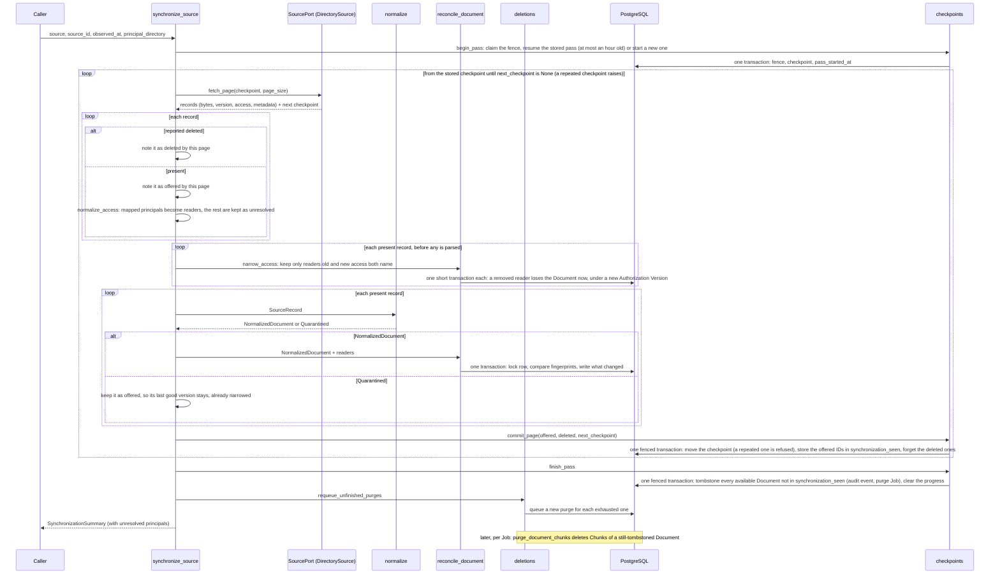

English version: [M08-T09-commit-source-checkpoints-safely.md](M08-T09-commit-source-checkpoints-safely.md)

# M08-T09 — Безпечна фіксація checkpoint джерела

Завдання: [M08-T09 — Commit Source checkpoints safely](../curriculum/milestones/M08-jobs-and-confluence/M08-T09-commit-source-checkpoints-safely.md)

## Що ти зробиш

Цей урок вчить прохід синхронізації пам'ятати, де він зупинився. Сьогодні прохід тримає своє місце лише в пам'яті процесу. Якщо воркер загине на сторінці 7 з 10, повтор із M08-T08 почне знову зі сторінки 1. Після уроку прохід записує своє місце в PostgreSQL після кожної завершеної сторінки, і повтор продовжує звідти. Нічого не губиться, і нічого не ховається помилково.

Конкретний приклад. Джерело "Handbook" віддає три сторінки: `a.txt`, потім `b.txt`, потім `c.txt`. Попередній прохід також зберіг `old.txt`, якого джерело вже не показує. Воркер гине, коли отримує третю сторінку.

| Час | Спроба 1 (воркер A) | Спроба 2 (воркер B) | Що після цього лежить у PostgreSQL |
|---|---|---|---|
| 10:00:00 | починає прохід, читає сторінку 1, зберігає `a.txt` | | місце: початок проходу; побачено: нічого |
| 10:00:01 | фіксує сторінку 1 | | місце: після сторінки 1; побачено: `a.txt` |
| 10:00:02 | читає сторінку 2, зберігає `b.txt`, фіксує її | | місце: після сторінки 2; побачено: `a.txt`, `b.txt` |
| 10:00:03 | гине, поки отримує сторінку 3 | | без змін |
| 10:05:00 | | продовжує: читає лише сторінку 3, зберігає `c.txt`, фіксує її | побачено: `a.txt`, `b.txt`, `c.txt` |
| 10:05:01 | | завершує: ховає кожен Document, якого немає серед побаченого | `old.txt` отримує tombstone; місце очищено |

Спроба 2 так і не прочитала сторінки 1 і 2, але не сховала ні `a.txt`, ні `b.txt`. PostgreSQL пам'ятав, що прохід їх уже бачив.

| Що просить завдання | Де це зроблено |
|---|---|
| Пересувати checkpoint лише після того, як записи й видалення сторінки надійно узгоджені | Блоки 1 і 4; крок 5: `commit_page` |
| Тести падіння воркера на кожній межі продовжують без втрат | Блоки 2 і 3; крок 7: тести падінь |
| ... і витримують повтор | Блок 2; крок 7: `test_a_page_reconciled_but_not_committed_is_replayed_harmlessly` |
| Успіх, межові випадки й типізовані відмови на справжній інфраструктурі | Крок 7: 20 тестів на справжньому PostgreSQL |
| Поведінка під час повтору й скасування явна | Блоки 2, 5 і 7 |
| Пояснити, що спростувало б цей дизайн | Крок 8 і питання для роздумів |
| Оновити лише зачеплену документацію | Крок 9: architecture, operations, security |

Цей урок містить код: кроки 2–7 пишуть міграцію, код і тести. Кроки 1, 8, 9 і 10 коду не потребують, хоча крок 9 редагує три документи.

Терміни цього уроку:

- **Контрольна точка (checkpoint):** власна закладка джерела, наприклад `"2"` або токен сторінки. Віддаєш її джерелу, і воно повертає наступну сторінку. Це звичайний рядок, який розуміє лише саме джерело.
- **Прохід (pass):** один обхід усіх сторінок джерела, що закінчується приховуванням Document, яких прохід не побачив. Один прохід може зайняти кілька спроб.
- **Спроба (attempt):** одна спроба проходу одним воркером. Падіння завершує спробу; наступна спроба того самого проходу продовжує.
- **Фіксація сторінки (page commit):** одна транзакція, що запускається після повної обробки сторінки. Вона зберігає результат сторінки й пересуває контрольну точку за неї.
- **Список побаченого (seen list):** external ID, які прохід уже зустрів, у новій таблиці `synchronization_seen`.
- **Позначка видалення (tombstone):** позначка, яка ховає Document від пошуку. Це не видалення рядка: рядок лишається, а Chunks очищаються пізніше.
- **Повтор (replay):** та сама робота вдруге після падіння. Він нешкідливий, коли робота **ідемпотентна (idempotent)**: два запуски дають той самий результат, що й один, як дві натиснуті кнопки ліфта.
- **Огорожа (fence):** з M08-T05. Рядок джерела зберігає час спостереження найновішого проходу. Писати може лише цей прохід.

## Перш ніж почати

Цей розділ пояснює кожне рішення, на яке спирається код. Прочитай його першим; кроки на нього розраховують.

### 1. Пересувай закладку лише після того, як сторінку завершено

Контрольна точка має переходити за сторінку лише тоді, коли кожен запис цієї сторінки збережено. Якщо порядок неправильний, падіння назавжди пропускає записи.

Візьмімо джерело з трьох сторінок вище. Припустимо, код зберігає контрольну точку, щойно прочитав сторінку, ще до її обробки:

| Час | Воркер A | PostgreSQL після цього |
|---|---|---|
| 10:00:02 | читає сторінку 2 і зберігає "після сторінки 2" | місце: після сторінки 2; `b.txt` ще не збережено |
| 10:00:03 | починає зберігати `b.txt` і гине на півдорозі | незавершена транзакція відкочується; `b.txt` досі немає |
| 10:05:00 | воркер B продовжує "після сторінки 2" і читає сторінку 3 | у цьому проході `b.txt` ніхто не прочитає |

Прихований факт простий. Фіксація (commit) стає постійною тієї миті, коли повертається, а все, що після неї, ніхто не обіцяє. Якщо закладка зафіксована першою, вона каже "сторінку 2 завершено", хоча це не так.

Наскільки це погано тут? З нинішнім джерелом-текою `b.txt` чекає наступного повного проходу, приблизно годину. У M08-T10 інкрементальний прохід читатиме лише зміни після контрольної точки, тож пропущена зміна вже не повернеться.

Виправлення — порядок. Було:

```python
page = await source.fetch_page(checkpoint=checkpoint, page_size=page_size)
# nothing was stored; the checkpoint lived only in this variable
checkpoint = page.next_checkpoint
```

Стало:

```python
page = await source.fetch_page(checkpoint=checkpoint, page_size=page_size)
# ... narrow and reconcile every record of the page, each in its own commit ...
await commit_page(..., next_checkpoint=page.next_checkpoint)  # only now
```

Це як закладка в книжці: її пересувають, коли дочитали сторінку, а не коли тільки перегорнули на неї.

### 2. Повторити сторінку — нешкідливо

Правильний порядок має власне вікно для падіння. Записи вже збережено, а фіксації сторінки ще не було.

| Час | Воркер A | PostgreSQL після цього |
|---|---|---|
| 10:00:00 | зберігає `a.txt` (його власна транзакція фіксується) | `a.txt` збережено; місце: початок проходу |
| 10:00:01 | гине перед фіксацією сторінки | без змін |
| 10:05:00 | воркер B стартує зі збереженого місця, тобто знову з початку, і читає сторінку 1 ще раз | |
| 10:05:00 | зберігає `a.txt` ще раз | нічого не записано: той самий текст, ті самі читачі |

Прихований факт: узгодження (reconciliation, з M03) порівнює відбитки перед записом. Відбиток — це короткий хеш тексту й ще один хеш читачів. Коли обидва збігаються з рядком у базі, узгодження нічого не пише й повідомляє `UNCHANGED`. Тож друге збереження `a.txt` нічого не змінює. З кроком звуження доступу (з M07) так само: читача, якого вже прибрали, вдруге не прибирають.

Тому ми приймаємо це вікно, а не закриваємо його. Правило таке: "сторінку можна зробити двічі, але ніколи не пропустити". Це обіцянка "щонайменше один раз" з ADR 0005.

### 3. Пам'ятай, що прохід бачив, а не лише де він

Самої контрольної точки замало. Наприкінці прохід ховає кожен Document, якого не побачив. А продовжена спроба ранніх сторінок не бачила.

Ось прохід із розділу "Що ти зробиш", який зберігає лише контрольну точку, а список побаченого тримає в пам'яті, як код робить сьогодні:

| Час | Воркер | Список побаченого в пам'яті | Результат |
|---|---|---|---|
| 10:00:02 | A, після сторінки 2 | `a.txt`, `b.txt` | |
| 10:00:03 | A гине | зникає разом із процесом | |
| 10:05:00 | B продовжує після сторінки 2 і читає сторінку 3 | `c.txt` | |
| 10:05:01 | B завершує й ховає те, чого не бачив | `c.txt` | `a.txt`, `b.txt` і `old.txt` отримують tombstone |

Два живі Document зникають із пошуку, а їхні Chunks стають у чергу на очищення. Прихований факт: крок наприкінці проходу вирішує за відсутністю. "Немає в списку" означає "видалено" лише тоді, коли список охоплює всі сторінки. Список з половини проходу робить хибне видалення схожим на правильне.

Виправлення: кожна фіксація сторінки записує ID сторінки в нову таблицю `synchronization_seen`. Фінальний крок читає цю таблицю замість множини в Python. Мовою SQL фінальне питання таке:

```sql
SELECT document_id FROM documents
WHERE source_id = :source AND availability = 'available'
  AND NOT EXISTS (
    SELECT 1 FROM synchronization_seen s
    WHERE s.source_id = documents.source_id
      AND s.external_id = documents.external_id)
ORDER BY external_id;
```

Це як список гостей на папері біля дверей, а не в голові охоронця: новий охоронець може змінити старого посеред вечора.

### 4. Фіксація сторінки — усе або нічого

Фіксація сторінки робить кілька речей. Вона пересуває контрольну точку, позначає її як використану, додає запропоновані ID до списку побаченого й прибирає ID, про які сторінка сказала "видалено". Усе це має статися разом.

Припустимо, це були б окремі фіксації, і воркер загинув між ними. Контрольна точка вже "після сторінки 2", а `b.txt` у список побаченого ще не потрапив. Наступна спроба пропускає сторінку 2 і наприкінці ховає `b.txt`. Це знову хибне видалення з блоку 3.

Тому вони ділять одну транзакцію. Ось команди, які надсилає одна фіксація сторінки:

```sql
BEGIN;
UPDATE sources SET checkpoint = '2'
  WHERE source_id = :source AND synchronization_fence = :observed_at
    AND pass_started_at IS NOT NULL
  RETURNING source_id;                          -- no row: a newer pass owns it
INSERT INTO synchronization_checkpoints (source_id, checkpoint)
  VALUES (:source, '2') ON CONFLICT DO NOTHING
  RETURNING checkpoint;                         -- no row: the Source repeated it
DELETE FROM synchronization_seen
  WHERE source_id = :source AND external_id IN (...);   -- reported deleted
INSERT INTO synchronization_seen (source_id, external_id)
  VALUES (...) ON CONFLICT DO NOTHING;                   -- offered
COMMIT;
```

| Якщо воркер гине... | Що лишається | Що скасовується |
|---|---|---|
| до `COMMIT` | кожна попередня фіксація сторінки; кожен уже узгоджений запис | усі чотири записи цієї фіксації |
| після `COMMIT` | усі чотири записи | нічого |

Самі записи документів у цю транзакцію не входять. Кожен запис зберігає власну коротку фіксацію, як у M07. Так читач, якого прибрали, швидко втрачає доступ, а блок 2 робить їхній повтор нешкідливим.

### 5. Спершу перевірка огорожі, і з блокуванням на запис

Записувати прогрес може лише найновіший прохід. Фіксація сторінки перевіряє це першою командою. Ця ж команда блокує рядок джерела від інших записувачів до кінця фіксації.

Наявний guard з M08-T05 бере **спільне блокування (share lock)**: його можуть тримати багато транзакцій одночасно, і воно змушує чекати тих, хто хоче писати. Фіксації сторінки треба змінити рядок джерела, тож спільного блокування замало. Якщо спершу взяти спільне блокування, а потім оновити той самий рядок, можливий взаємний тупик (deadlock). Дві транзакції тримають по спільному блокуванню, і кожна чекає, поки інша його відпустить, щоб записати. Тому фіксація починається одразу з `UPDATE` з перевіркою огорожі. Ця одна команда і перевіряє огорожу, і бере блокування на запис.

Два проходи все одно можуть зустрітися:

| Час | Прохід P1 (спостереження 10:00) | Прохід P2 (спостереження 10:10) | Рядок джерела після цього |
|---|---|---|---|
| 10:10:00 | посеред сторінки 3 | займає огорожу й знаходить прогрес P1, якому 10 хвилин | огорожа: 10:10; місце: після сторінки 2 |
| 10:10:00 | | продовжує його: читає від сторінки 3 | |
| 10:10:01 | пробує зафіксувати сторінку 3: `UPDATE` не знаходить жодного рядка | | P1 отримує `SynchronizationSuperseded`; він нічого не записав |

P2 успадковує список побаченого від P1. Це безпечно, бо успадкований список може лише зростати. Більший список означає менше прихованих Document, але ніколи хибно прихованих. Займання огорожі й читання прогресу відбуваються в одній транзакції, тож жодна фіксація P1 не проскочить між ними.

Скасована спроба поводиться як падіння: її відкрита транзакція відкочується, і наступна спроба продовжує з останньої фіксації сторінки. Подію `synchronization.finished` вона не записує, як і до цього уроку.

### 6. Знахідки рев'ю

Незалежний рецензент атакував першу версію випадковими точками падіння, паралельними проходами й ворожими джерелами. Три атаки її зламали. Для кожного виправлення є тест у кроці 7, який без нього падає.

**Видалено, а потім запропоновано знову, але нечитабельно.** У першій версії фіксація сторінки ще й ставила tombstone тому, про що сторінка сказала "видалено". Тоді в одному проході сталося таке. Сторінка 1 каже "`x.txt` видалено", і фіксація його ховає. Сторінка 2 знову пропонує `x.txt`, але файл не розбирається, тож ніщо його не повертає. Прохід закінчився зі схованим `x.txt`. Правило з M03 каже, що перемагає останнє повідомлення, і "файл, який не вдалося розібрати, — не видалений". Тепер фіксація сторінки лише прибирає видалені ID зі списку побаченого. Приховування чекає кінця проходу, де останнє слово за останнім повідомленням. Тест: `test_an_item_deleted_then_offered_unparseable_stays_available`.

**Наступна спроба зберігала повторену контрольну точку.** Джерело йде сторінками `start → A → B`, а `B` знову вказує на `A`. Спроба 1 зберегла A і B, а потім відмовилась від повтореного A, тримаючи список використаних точок лише в пам'яті. Спроба 2 продовжила з B з порожнім списком. Вона прийняла A, зберегла її й відмовилась уже на B. Кожна наступна спроба перемикала збережене місце між A і B і годину перечитувала сторінки. Тепер використані контрольні точки живуть у таблиці `synchronization_checkpoints`. Її первинний ключ відмовляє в повторі й між спробами. Тести: `test_a_repeated_checkpoint_is_never_stored` і `test_a_repeated_checkpoint_is_refused_by_a_resumed_attempt_too`.

**Дуже велика сторінка не могла зафіксуватися.** Одна вставка з 33 000 ID потребує 66 000 параметрів. PostgreSQL дозволяє щонайбільше 65 535 в одній команді, тож фіксація щоразу падала, і прохід ніколи не міг пройти цю сторінку. Тепер ID записуються пачками по 1 000. Тест: `test_a_page_larger_than_one_statement_can_hold_commits`.

Інші атаки рецензента дизайн витримав. Сотні випадкових розкладок сторінок із випадковими точками падіння дійшли до очікуваного стану. 40 раундів із трьома проходами, що перекривались, поки планувальник тримав спільне блокування того самого рядка, минули без взаємного тупика.

### 7. Відомі обмеження

**Продовжений прохід не перечитує ранніх сторінок.** Якщо джерело змінить сторінку 1 між спробою 1 і спробою 2, зміна чекатиме наступного проходу. Це стосується й читача, якого прибрали. Щоб обмежити очікування, прогрес, старший за годину (`MAX_RESUME_AGE`), відкидається, і прохід починається знову зі сторінки 1. Година рахується від першої спроби проходу, тож прохід, що падає довше, на кожному повторі починає спочатку. Найдовше очікування — приблизно година плюс інтервал синхронізації. Крок 9 записує це в `docs/security.md`.

**Контрольна точка має лишатися осмисленою годину.** Джерело-тека гортає за назвою файлу, тож його контрольна точка лишається дійсною. Джерело, що гортає за позицією ("пропусти 200"), може зсунутися, коли додаються елементи. Контракт джерела поки цього не забороняє; M08-T12 має брати для Confluence стабільні токени за ключем.

**Лічильники охоплюють одну спробу.** `SynchronizationSummary` рахує лише сторінки, які прочитала ця спроба. Нове поле `resumed` каже, коли це неповна картина.

**Список побаченого коштує один рядок на Document за прохід.** Рядки пишуться посторінково й видаляються, коли прохід закінчується. Для великого джерела це відчутна робота запису, хоча кожен рядок крихітний.

**Після завершеного проходу контрольна точка очищається.** Наступний прохід починає зі сторінки 1. Зберігати останню контрольну точку як курсор "зміни відтоді" — це інкрементальна синхронізація з M08-T10.

## Покрокові інструкції

Перед початком запусти PostgreSQL. Усі команди виконуй з кореня репозиторію. Для інтеграційних перевірок задай у терміналі URL тестової бази:

```bash
export KNOWLEDGE_SERVICE_TEST_DATABASE_URL="$(uv run python scripts/test_database_url.py)"
```

Запускай проти цієї бази лише одну інтеграційну команду за раз.

### Крок 1 — У цьому кроці без коду: запиши інваріант і свої передбачення

Перш ніж щось змінювати, запиши, що має бути правдою наприкінці і що ти очікуєш побачити. Передбачення ти перевіриш у кроках 8 і 10.

Створи `docs/evidence/M08-T09-commit-source-checkpoints-safely.md`:

```markdown
# M08-T09 — Commit Source checkpoints safely evidence

## Invariant

A Source's checkpoint moves past a page only in the transaction that also
stores the page's offered external IDs, forgets the ones it reported
deleted, and records the checkpoint as used, and that transaction commits
only after every record of the page is reconciled. A pass that dies at any
point resumes on its next attempt from its last committed page, if the pass
started at most `MAX_RESUME_AGE` ago; its end-of-pass tombstones count every
page any attempt committed. Only the pass that holds the Source's fence can
write progress, and a checkpoint the pass stored before is never stored
again.

## Owners

- Durable progress: PostgreSQL (`sources.checkpoint`,
  `sources.pass_started_at`, `synchronization_seen`,
  `synchronization_checkpoints`).
- Page commit and resume: `ingestion.checkpoints`.
- Retries of a failed attempt: the stored Job (M08-T04) and recovery
  (M08-T08); a retry is a new attempt of the same pass.
- Write authority: the Source's fence (M08-T05).

## Expected failing check

Before the change,
`uv run pytest tests/test_checkpoints_integration.py -q -m integration`
reports `no tests ran`, because the file does not exist.

## Predictions

- A pass dies while fetching page 3 of 3. Which page does the retry read first:
- The same pass, but the seen list is kept in memory only. Which Documents does the retry tombstone:
- How many tests fail if the page commit runs before the page's records are reconciled:
- A Source reports `x.txt` deleted on page 1 and offers it, unreadable, on page 2. Is `x.txt` available after the pass:

## Design

## Verification

## Review

## Decision

## Reflection
```

Шаблон evidence лишається англійською, як і інші записи в `docs/evidence`. Відповіді на передбачення можеш писати будь-якою мовою.

**Перевірка:** запусти очікувано невдалу перевірку з шаблону й побач `no tests ran`. Кожне передбачення має твою відповідь після двокрапки.

### Крок 2 — Крок із кодом: міграція і форма таблиць

Цей крок додає колонки й таблиці, де прохід тримає свій прогрес.

**Простими словами:** база вчиться пам'ятати незавершений прохід. Рядок джерела отримує час початку проходу поруч із колонкою контрольної точки, яка вже існує. Дві невеликі нові таблиці зберігають ID, які прохід побачив, і контрольні точки, які він використав. Поки ними ніхто не користується; це роблять наступні кроки.

| Що | Зберігає | Навіщо |
|---|---|---|
| `sources.pass_started_at` | коли почався поточний прохід; NULL, коли проходу немає | продовжувати лише свіжий прогрес (блок 7) |
| `sources.checkpoint` | уже існує, досі ніколи не записувалась | місце, звідки продовжувати |
| `ck_sources_checkpoint_pass` | контрольна точка потребує часу початку | закладці без її проходу не можна довіряти |
| `synchronization_seen` | один рядок на кожен external ID, який прохід побачив | блок 3 |
| `synchronization_checkpoints` | один рядок на кожну контрольну точку, яку прохід зберіг | блок 6, повторена контрольна точка |

**Рішення:** місце продовження лишається в `sources`, де вже є колонка і де живе огорожа. Обидва списки мають власні таблиці з ключем за джерелом, бо в одного джерела щонайбільше один незавершений прохід. Оновлення бази очищає будь-яку випадкову контрольну точку: жоден код її ще не писав, а продовжувати з закладки без її проходу небезпечно.

**Дія 1:** створи `migrations/versions/e1f2a3b4c5d6_synchronization_progress.py`:

```python
"""synchronization progress

Revision ID: e1f2a3b4c5d6
Revises: d0e1f2a3b4c5
Create Date: 2026-11-24 12:00:00.000000

"""

from collections.abc import Sequence

import sqlalchemy as sa
from alembic import op

# revision identifiers, used by Alembic.
revision: str = "e1f2a3b4c5d6"
down_revision: str | Sequence[str] | None = "d0e1f2a3b4c5"


def upgrade() -> None:
    # No pass wrote a checkpoint before this revision, and one without the
    # pass it belongs to cannot be resumed safely, so any stray one goes.
    op.execute("update sources set checkpoint = null")
    op.add_column(
        "sources",
        sa.Column("pass_started_at", sa.DateTime(timezone=True), nullable=True),
    )
    op.create_check_constraint(
        "ck_sources_checkpoint_pass",
        "sources",
        "checkpoint is null or pass_started_at is not null",
    )
    op.create_table(
        "synchronization_seen",
        sa.Column(
            "source_id",
            sa.Uuid(),
            sa.ForeignKey("sources.source_id", ondelete="CASCADE"),
            nullable=False,
        ),
        sa.Column("external_id", sa.Text(), nullable=False),
        sa.PrimaryKeyConstraint(
            "source_id", "external_id", name="pk_synchronization_seen"
        ),
    )
    op.create_table(
        "synchronization_checkpoints",
        sa.Column(
            "source_id",
            sa.Uuid(),
            sa.ForeignKey("sources.source_id", ondelete="CASCADE"),
            nullable=False,
        ),
        sa.Column("checkpoint", sa.Text(), nullable=False),
        sa.PrimaryKeyConstraint(
            "source_id", "checkpoint", name="pk_synchronization_checkpoints"
        ),
    )


def downgrade() -> None:
    op.drop_table("synchronization_checkpoints")
    op.drop_table("synchronization_seen")
    op.drop_constraint("ck_sources_checkpoint_pass", "sources", type_="check")
    op.drop_column("sources", "pass_started_at")
    # The resume point means nothing without the pass it belongs to.
    op.execute("update sources set checkpoint = null")
```

**Дія 2:** у `src/knowledge_service/persistence/schema.py` заміни кінець таблиці `sources`, від коментаря до `synchronization_fence` до її закривної `)`, ось цим. Код додає колонку, перевірку і дві нові таблиці одразу після `sources`:

```python
    # The observation time of the newest pass that claimed this Source; only
    # that pass may write its Documents (`ingestion.synchronization`).
    sa.Column("synchronization_fence", sa.DateTime(timezone=True), nullable=True),
    # When the pass whose progress `checkpoint` records started observing the
    # Source; NULL when no pass is in progress (`ingestion.checkpoints`).
    sa.Column("pass_started_at", sa.DateTime(timezone=True), nullable=True),
    sa.UniqueConstraint("kind", "location", name="uq_sources_kind_location"),
    sa.CheckConstraint(
        "checkpoint is null or pass_started_at is not null",
        name="ck_sources_checkpoint_pass",
    ),
)

# The external IDs the pass in progress has seen so far, one row each, so a
# resumed pass still knows them when it tombstones what it did not see.
synchronization_seen = sa.Table(
    "synchronization_seen",
    metadata,
    sa.Column(
        "source_id",
        sa.Uuid(),
        sa.ForeignKey("sources.source_id", ondelete="CASCADE"),
        nullable=False,
    ),
    sa.Column("external_id", sa.Text(), nullable=False),
    sa.PrimaryKeyConstraint("source_id", "external_id", name="pk_synchronization_seen"),
)

# Every checkpoint the pass in progress has stored, so a Source that hands
# one back is refused even by a later attempt that resumed after it.
synchronization_checkpoints = sa.Table(
    "synchronization_checkpoints",
    metadata,
    sa.Column(
        "source_id",
        sa.Uuid(),
        sa.ForeignKey("sources.source_id", ondelete="CASCADE"),
        nullable=False,
    ),
    sa.Column("checkpoint", sa.Text(), nullable=False),
    sa.PrimaryKeyConstraint(
        "source_id", "checkpoint", name="pk_synchronization_checkpoints"
    ),
)
```

Таблиці мають бути і в `schema.py`. Фікстура тестів очищає кожну таблицю, яку перелічує ця `metadata`, тож таблиця, якої тут немає, зберігала б рядки між тестами.

**Перевірка:** `uv run pyright src/knowledge_service/persistence/schema.py` показує `0 errors`. Саму міграцію запускає крок 7: кожен інтеграційний тест мігрує свою базу до `head`, а `test_the_migration_goes_down_and_up` перевіряє зворотний шлях.

### Крок 3 — Крок із кодом: команди над збереженим прогресом

Цей крок пише SQL-команди, що читають і змінюють прогрес. Це новий модуль збереження, `persistence/synchronization_progress.py`.

**Простими словами:** цей файл — єдиний код, що торкається таблиць прогресу. Він уміє почати новий прохід або підхопити свіжий, пересунути закладку, якщо цей прохід досі володіє джерелом, позначити контрольну точку як використану, додати й прибрати побачені ID, усе очистити наприкінці проходу і перелічити Document, яких прохід не побачив. Кожен запис, що пересуває чи очищає закладку, спершу перевіряє огорожу в тій самій команді.

| Функція | Робить | Повертає |
|---|---|---|
| `start_or_resume_pass` | продовжує прогрес, що почався щонайбільше `max_age` тому, інакше стирає його й починає заново | `PassProgress` (час початку, контрольна точка, чи продовжено) |
| `advance_checkpoint` | `UPDATE` з огорожею з блоку 5; `None` лишає збережену контрольну точку | `False`, коли джерелом володіє новіший прохід |
| `remember_checkpoint` | вставляє в `synchronization_checkpoints` | `False`, коли контрольну точку вже використовували |
| `end_pass` | `UPDATE` з огорожею, що очищає місце й час початку | `False`, коли джерелом володіє новіший прохід |
| `record_seen`, `forget_seen` | додають або прибирають побачені ID, по 1 000 за раз | нічого |
| `forget_pass` | видаляє побачені ID і використані контрольні точки проходу | нічого |
| `load_unseen_available` | запит `NOT EXISTS` з блоку 3 | ID Document, за external ID |

**Рішення:** `advance_checkpoint` з `None` лишає збережену контрольну точку, а не очищає її. Після останньої сторінки "наступної" немає. Якщо прохід загине до завершення, повтор має перечитати останню сторінку, а не почати з нуля. Пачки відсортовані, тож двоє записувачів блокують рядки в однаковому порядку.

**Дія:** створи `src/knowledge_service/persistence/synchronization_progress.py`:

```python
"""Statements over the stored progress of a Source's synchronization pass.

The progress is four facts: when the pass in progress started
(`sources.pass_started_at`), the checkpoint it resumes from
(`sources.checkpoint`), every checkpoint it has stored
(`synchronization_checkpoints`), and the external IDs it has seen so far
(`synchronization_seen`). `advance_checkpoint` and `end_pass` check, in
the same statement, that the pass still holds the Source's fence, and lock
the Source's row; the other writes run in the transaction that checked it.
"""

from collections.abc import Collection, Iterator, Sequence
from dataclasses import dataclass
from datetime import datetime, timedelta
from itertools import batched

import sqlalchemy as sa
from sqlalchemy.dialects.postgresql import insert
from sqlalchemy.ext.asyncio import AsyncConnection

from knowledge_service.documents import DocumentAvailability
from knowledge_service.identifiers import DocumentId, SourceId
from knowledge_service.persistence.schema import (
    documents,
    sources,
    synchronization_checkpoints,
    synchronization_seen,
)

# PostgreSQL takes at most 65,535 parameters in one statement; a page may
# hold more IDs than that, so they are written this many at a time.
BATCH_SIZE = 1000


@dataclass(frozen=True, slots=True)
class PassProgress:
    """Where a pass starts: from the beginning, or from a stored checkpoint."""

    started_at: datetime
    checkpoint: str | None
    resumed: bool


async def start_or_resume_pass(
    connection: AsyncConnection,
    *,
    source_id: SourceId,
    observed_at: datetime,
    max_age: timedelta,
) -> PassProgress:
    """Resume the stored pass if it started at most `max_age` ago, or start anew.

    Call it in the transaction that claimed the fence, so no older pass can
    store progress between the claim and this read. Starting anew forgets
    everything an earlier pass stored.
    """
    row = (
        await connection.execute(
            sa.select(sources.c.checkpoint, sources.c.pass_started_at)
            .where(sources.c.source_id == source_id.value)
            .with_for_update()
        )
    ).one()
    started_at: datetime | None = row.pass_started_at
    if started_at is not None and started_at <= observed_at <= started_at + max_age:
        return PassProgress(
            started_at=started_at, checkpoint=row.checkpoint, resumed=True
        )
    await forget_pass(connection, source_id=source_id)
    await connection.execute(
        sa.update(sources)
        .where(sources.c.source_id == source_id.value)
        .values(pass_started_at=observed_at, checkpoint=None)
    )
    return PassProgress(started_at=observed_at, checkpoint=None, resumed=False)


async def advance_checkpoint(
    connection: AsyncConnection,
    *,
    source_id: SourceId,
    observed_at: datetime,
    checkpoint: str | None,
) -> bool:
    """Store `checkpoint` as the resume point, if this pass holds the fence.

    None keeps the stored checkpoint: after the last page the pass resumes
    from that page, not past it. False, and nothing written, when a newer
    pass claimed the fence or no pass is in progress. The Source's row stays
    locked until the transaction ends, so no newer claim lands in between.
    """
    resume_from = (
        sources.c.checkpoint
        if checkpoint is None
        else sa.literal(checkpoint, sa.Text())
    )
    held = await connection.scalar(
        sa.update(sources)
        .where(
            sources.c.source_id == source_id.value,
            sources.c.synchronization_fence == observed_at,
            sources.c.pass_started_at.is_not(None),
        )
        .values(checkpoint=resume_from)
        .returning(sources.c.source_id)
    )
    return held is not None


async def remember_checkpoint(
    connection: AsyncConnection, *, source_id: SourceId, checkpoint: str
) -> bool:
    """Note that the pass stored `checkpoint`; False if it stored it before."""
    added = await connection.scalar(
        insert(synchronization_checkpoints)
        .values(source_id=source_id.value, checkpoint=checkpoint)
        .on_conflict_do_nothing()
        .returning(synchronization_checkpoints.c.checkpoint)
    )
    return added is not None


async def end_pass(
    connection: AsyncConnection, *, source_id: SourceId, observed_at: datetime
) -> bool:
    """Clear the stored resume point, if this pass holds the fence.

    The seen IDs stay until `forget_pass`, so the same transaction can still
    tombstone what the pass did not see.
    """
    held = await connection.scalar(
        sa.update(sources)
        .where(
            sources.c.source_id == source_id.value,
            sources.c.synchronization_fence == observed_at,
            sources.c.pass_started_at.is_not(None),
        )
        .values(checkpoint=None, pass_started_at=None)
        .returning(sources.c.source_id)
    )
    return held is not None


async def record_seen(
    connection: AsyncConnection, *, source_id: SourceId, external_ids: Collection[str]
) -> None:
    """Remember that the pass in progress saw these external IDs."""
    for batch in _batches(external_ids):
        await connection.execute(
            insert(synchronization_seen)
            .values(
                [
                    {"source_id": source_id.value, "external_id": external_id}
                    for external_id in batch
                ]
            )
            .on_conflict_do_nothing()
        )


async def forget_seen(
    connection: AsyncConnection, *, source_id: SourceId, external_ids: Collection[str]
) -> None:
    """Forget these external IDs: the Source reported them deleted."""
    for batch in _batches(external_ids):
        await connection.execute(
            sa.delete(synchronization_seen).where(
                synchronization_seen.c.source_id == source_id.value,
                synchronization_seen.c.external_id.in_(batch),
            )
        )


async def forget_pass(connection: AsyncConnection, *, source_id: SourceId) -> None:
    """Forget every external ID and checkpoint the pass stored."""
    for table in (synchronization_seen, synchronization_checkpoints):
        await connection.execute(
            sa.delete(table).where(table.c.source_id == source_id.value)
        )


async def load_unseen_available(
    connection: AsyncConnection, *, source_id: SourceId
) -> tuple[DocumentId, ...]:
    """Available Documents of the Source the pass in progress has not seen."""
    seen = sa.exists().where(
        synchronization_seen.c.source_id == documents.c.source_id,
        synchronization_seen.c.external_id == documents.c.external_id,
    )
    rows = await connection.scalars(
        sa.select(documents.c.document_id)
        .where(
            documents.c.source_id == source_id.value,
            documents.c.availability == DocumentAvailability.AVAILABLE.value,
            ~seen,
        )
        .order_by(documents.c.external_id)
    )
    return tuple(DocumentId(document_id) for document_id in rows)


def _batches(external_ids: Collection[str]) -> Iterator[Sequence[str]]:
    """The IDs in sorted batches, so concurrent writers lock rows in one order."""
    return batched(sorted(external_ids), BATCH_SIZE, strict=False)
```

`itertools.batched` ріже відсортовані ID на кортежі щонайбільше по 1 000. `strict=False` дозволяє останній пачці бути коротшою.

**Перевірка:** `uv run pyright src/knowledge_service/persistence/synchronization_progress.py` показує `0 errors`.

### Крок 4 — Крок із кодом: tombstone за збереженим списком побаченого

Цей крок вчить `deletions.py` ховати Document, яких немає в збереженому списку побаченого. Наявна `tombstone_missing` і далі працює для численних тестів, що її викликають.

**Простими словами:** код, що ховає один Document, переїжджає в невеликого помічника. Стара функція, яка отримує побачені ID як множину Python, тепер користується цим помічником. Нова функція питає базу, яких доступних Document бракує в збереженому списку, і ховає кожен тим самим помічником. Вона працює всередині транзакції, яку вже відкрив виклик, тож приховування й очищення прогресу фіксуються разом.

| Частина | Зміна |
|---|---|
| `_tombstone` | нова: колишнє тіло циклу (заблокувати рядок, перевірити ще раз, поставити tombstone, подія аудиту, Job очищення) |
| `tombstone_missing` | та сама сигнатура й поведінка, тепер викликає `_tombstone` |
| `tombstone_unseen` | нова: приймає з'єднання, читає `load_unseen_available`, викликає `_tombstone` |

**Рішення:** `tombstone_unseen` приймає з'єднання, а не runtime. Виклик із кроку 5 мусить очистити прогрес у тій самій транзакції. Інакше падіння між цими двома діями лишило б прогрес, що каже "не завершено", хоча tombstone уже записано. Це нешкідливо, але заплутано.

**Дія 1:** у docstring модуля `src/knowledge_service/ingestion/deletions.py` заміни пункт 1 нумерованого списку на:

```text
1. At the end of a complete Synchronization Run, every available Document
   the run did not see, or last saw reported deleted, is tombstoned:
   `tombstone_unseen` reads the seen IDs the run stored page by page;
   `tombstone_missing` takes them as a set in memory, for callers that hold
   a complete pass themselves. For each such Document, one transaction marks
   it tombstoned, records an audit event, and queues a purge Job. Retrieval
   reads only Chunks of available Documents, so the content disappears from
   reads at that commit, while the Chunks are still stored.
```

**Дія 2:** додай імпорт після імпорту `persistence.jobs`:

```python
from knowledge_service.persistence.jobs import enqueue_job, load_job, save_job
from knowledge_service.persistence.synchronization_progress import (
    load_unseen_available,
)
```

**Дія 3:** заміни всю функцію `tombstone_missing` цими трьома функціями:

```python
async def tombstone_missing(
    runtime: DatabaseRuntime,
    *,
    source_id: SourceId,
    seen: Collection[str],
    observed_at: datetime,
    guard: WriteGuard | None = None,
) -> tuple[Tombstone, ...]:
    """Tombstone every available Document of a Source whose ID is not in `seen`.

    `seen` must hold every external ID of one complete pass over the Source;
    after a partial pass, documents that were simply not reached yet would be
    tombstoned. A Document updated after `observed_at` was seen by a later
    observation, so it is kept. `guard` runs first in the transaction;
    raising from it tombstones nothing.
    """
    seen = frozenset(seen)
    tombstones: list[Tombstone] = []
    async with runtime.transaction() as connection:
        if guard is not None:
            await guard(connection)
        available = await load_available_documents(connection, source_id=source_id)
        for candidate in available:
            if candidate.provenance.external_id in seen:
                continue
            tombstone = await _tombstone(
                connection, document_id=candidate.document_id, observed_at=observed_at
            )
            if tombstone is not None:
                tombstones.append(tombstone)
    return tuple(tombstones)


async def tombstone_unseen(
    connection: AsyncConnection, *, source_id: SourceId, observed_at: datetime
) -> tuple[Tombstone, ...]:
    """Tombstone the available Documents the stored pass never saw.

    The seen IDs are the ones every committed page of the pass stored, so a
    pass resumed after a crash still counts the pages before it. The caller
    owns the transaction and has checked its fence.
    """
    tombstones: list[Tombstone] = []
    for document_id in await load_unseen_available(connection, source_id=source_id):
        tombstone = await _tombstone(
            connection, document_id=document_id, observed_at=observed_at
        )
        if tombstone is not None:
            tombstones.append(tombstone)
    return tuple(tombstones)


async def _tombstone(
    connection: AsyncConnection, *, document_id: DocumentId, observed_at: datetime
) -> Tombstone | None:
    """Tombstone one Document, deciding from its row under a lock.

    None when it is gone, already tombstoned, or updated after
    `observed_at`: a later observation saw it, so it is kept.
    """
    # Lock only this row, so a concurrent reconcile of the same document
    # waits, and decide from the row as it is now.
    document = await load_document_by_id(
        connection, document_id=document_id, for_update=True
    )
    if (
        document is None
        or document.availability is not DocumentAvailability.AVAILABLE
        or document.updated_at > observed_at
    ):
        return None
    tombstoned = document.tombstone(observed_at=observed_at)
    await upsert_document(connection, tombstoned)
    await record_audit_event(connection, availability_event(tombstoned))
    job = await _queue_purge(
        connection, document_id=tombstoned.document_id, now=observed_at
    )
    return Tombstone(
        document_id=tombstoned.document_id,
        external_id=tombstoned.provenance.external_id,
        purge_job_id=job.job_id,
    )
```

Перевірка `document.updated_at > observed_at` не змінилась. Document, оновлений пізнішим спостереженням, бачив хтось новіший, тож він лишається.

**Перевірка:** запусти старі тести видалення, які користуються `tombstone_missing`:

```bash
uv run pytest tests/test_deletions_integration.py -q -m integration
```

Усі тести проходять.

### Крок 5 — Крок із кодом: транзакція контрольної точки

Цей крок — серце уроку: модуль, що починає, фіксує й завершує прохід, який можна продовжити.

**Простими словами:** цей файл дає проходу три ходи. "Почати" займає джерело і або підхоплює свіжий незавершений прохід, або починає новий. "Зафіксувати сторінку" запускається після того, як сторінку повністю збережено. В одній транзакції воно перевіряє право власності, пересуває закладку, відмовляє в закладці, яку вже використовували, і оновлює список побаченого. "Завершити" запускається після останньої сторінки: ховає те, чого прохід не побачив, і стирає прогрес, щоб наступний прохід почав зі сторінки 1.

| Функція | Одна транзакція, яка... | Кидає |
|---|---|---|
| `begin_pass` | займає огорожу (M08-T05), потім викликає `start_or_resume_pass` | `SynchronizationSuperseded` |
| `commit_page` | чотири записи з блоку 4, огорожа першою | `SynchronizationSuperseded`, `InvalidSource` для повтореної контрольної точки |
| `finish_pass` | очищає місце (з огорожею), ставить tombstone небаченим, забуває списки | `SynchronizationSuperseded` |

**Рішення:** до останньої сторінки нічого не отримує tombstone (блок 6). `MAX_RESUME_AGE` — одна година, як і типовий інтервал синхронізації. У межах цього часу повтор заощаджує роботу, а сторінку, яку пропустило продовження, перечитають приблизно ще за один інтервал.

**Дія:** створи `src/knowledge_service/ingestion/checkpoints.py`:

```python
"""Make a synchronization pass resumable, one committed page at a time.

A pass stores its progress in PostgreSQL: when it started, the checkpoint it
resumes from, every checkpoint it stored, and the external IDs it has seen.
Each step is one transaction that first checks the pass still holds the
Source's fence:

1. `begin_pass` claims the fence and resumes the stored pass, if it started
   at most `MAX_RESUME_AGE` ago, or starts a new one.
2. `commit_page` runs after every record of a page is reconciled. It
   stores which external IDs the page offered and forgets the ones it
   reported deleted, and only then moves the checkpoint past the page. A
   crash before this commit replays the page, which reconciliation
   tolerates: an unchanged record writes nothing.
3. `finish_pass` runs after the last page. It tombstones every available
   Document the pass never saw, or last saw reported deleted, counting the
   pages of earlier attempts, and clears the progress, so the next pass
   starts from the beginning.

Nothing is tombstoned before the last page: an item reported deleted on one
page may be offered again on a later one, and the last report wins.

A resumed pass does not read the pages before its checkpoint again, so a
change the Source made there waits for the next pass. `MAX_RESUME_AGE`
bounds that wait.
"""

from collections.abc import Collection
from datetime import datetime, timedelta
from typing import Final

from knowledge_service.database import DatabaseRuntime
from knowledge_service.identifiers import SourceId
from knowledge_service.ingestion.deletions import Tombstone, tombstone_unseen
from knowledge_service.ingestion.sources import (
    InvalidSource,
    SynchronizationSuperseded,
)
from knowledge_service.persistence.sources import claim_synchronization_fence
from knowledge_service.persistence.synchronization_progress import (
    PassProgress,
    advance_checkpoint,
    end_pass,
    forget_pass,
    forget_seen,
    record_seen,
    remember_checkpoint,
    start_or_resume_pass,
)

# Older progress is dropped and the pass starts again from the beginning, so
# a page skipped by a resume is read again within this time.
MAX_RESUME_AGE: Final = timedelta(hours=1)


async def begin_pass(
    runtime: DatabaseRuntime,
    *,
    source_id: SourceId,
    observed_at: datetime,
    max_resume_age: timedelta = MAX_RESUME_AGE,
) -> PassProgress:
    """Claim the fence, then resume the stored pass or start a new one.

    Raises `SynchronizationSuperseded` when a pass that observed the Source
    at the same time or later already claimed it.
    """
    async with runtime.transaction() as connection:
        if not await claim_synchronization_fence(
            connection, source_id=source_id, observed_at=observed_at
        ):
            raise SynchronizationSuperseded("a newer synchronization pass started")
        return await start_or_resume_pass(
            connection,
            source_id=source_id,
            observed_at=observed_at,
            max_age=max_resume_age,
        )


async def commit_page(
    runtime: DatabaseRuntime,
    *,
    source_id: SourceId,
    observed_at: datetime,
    offered: Collection[str],
    deleted: Collection[str],
    next_checkpoint: str | None,
) -> None:
    """Record one reconciled page and move the checkpoint past it, together.

    `offered` and `deleted` are the page's external IDs by their last report.
    With `next_checkpoint` None, the page was the last one and the checkpoint
    stays. Writes nothing and raises `SynchronizationSuperseded` when a newer
    pass holds the fence, or `InvalidSource` when the pass stored
    `next_checkpoint` before.
    """
    async with runtime.transaction() as connection:
        # First, so the Source's row stays locked for the whole commit.
        if not await advance_checkpoint(
            connection,
            source_id=source_id,
            observed_at=observed_at,
            checkpoint=next_checkpoint,
        ):
            raise SynchronizationSuperseded("a newer synchronization pass started")
        if next_checkpoint is not None and not await remember_checkpoint(
            connection, source_id=source_id, checkpoint=next_checkpoint
        ):
            # Raising rolls the whole commit back, so it is never stored.
            raise InvalidSource("the source repeated a checkpoint")
        await forget_seen(connection, source_id=source_id, external_ids=deleted)
        await record_seen(connection, source_id=source_id, external_ids=offered)


async def finish_pass(
    runtime: DatabaseRuntime, *, source_id: SourceId, observed_at: datetime
) -> tuple[Tombstone, ...]:
    """Tombstone what the whole pass never saw and clear its progress.

    Raises `SynchronizationSuperseded`, writing nothing, when a newer pass
    holds the fence.
    """
    async with runtime.transaction() as connection:
        if not await end_pass(connection, source_id=source_id, observed_at=observed_at):
            raise SynchronizationSuperseded("a newer synchronization pass started")
        tombstones = await tombstone_unseen(
            connection, source_id=source_id, observed_at=observed_at
        )
        await forget_pass(connection, source_id=source_id)
    return tombstones
```

`InvalidSource`, кинутий усередині блоку `async with`, відкочує всю транзакцію, разом із `UPDATE` контрольної точки, що виконався першим. Саме тому повторену контрольну точку ніколи не збережено.

**Перевірка:** `uv run pyright src/knowledge_service/ingestion/checkpoints.py` показує `0 errors`.

### Крок 6 — Крок із кодом: прохід користується транзакцією контрольної точки

Цей крок переводить `synchronize_source` на нову схему: кожен прохід починає, фіксує кожну сторінку й завершує через крок 5.

**Простими словами:** прохід більше не тримає в пам'яті ні список побаченого, ні використані контрольні точки. Він починає з питання, звідки стартувати: зі сторінки 1 чи зі збереженого місця. Після того, як записи сторінки збережено, він фіксує сторінку. Після останньої сторінки він кличе "завершити" замість старого виклику tombstone. Підсумок і подія аудиту тепер кажуть, чи ця спроба продовжувала прохід.

| Зміна | Де |
|---|---|
| `begin_pass` замінює голе займання огорожі | `_claim_fence` |
| цикл стартує з `progress.checkpoint` | `_publish` |
| кожна сторінка збирає `deleted` замість зміни спільної для проходу множини `seen` | `_publish` |
| `commit_page` після циклу узгодження, перед heartbeat | `_publish` |
| `finish_pass` замінює `tombstone_missing` | `_publish` |
| параметр `max_resume_age`; `resumed` у підсумку й метаданих аудиту | `synchronize_source`, `SynchronizationSummary` |

**Рішення:** фіксація відбувається перед heartbeat. Heartbeat продовжує оренду в Redis і може кинути виняток. Коли фіксація перша, втрачена оренда ніколи не викидає щойно збережену сторінку. Перевірка повтореної контрольної точки переїжджає в базу (блок 6), тож множина `used` у пам'яті зникає.

Усі дії нижче — у `src/knowledge_service/ingestion/synchronization.py`.

**Дія 1:** у docstring модуля додай цей абзац після першого абзацу:

```text
The pass is resumable (`ingestion.checkpoints`). After every record of a
page is reconciled, one transaction stores the external IDs the page
offered, forgets the ones it reported deleted, and moves the Source's
checkpoint past it. A pass that fails resumes, on its next attempt, from
the last committed checkpoint, with the IDs earlier attempts saw, so its
tombstones still count every page. A page that was read but not committed
is read and reconciled again, which changes nothing that already landed.
```

Потім заміни останній абзац, що починається з "Every pass is fenced.", на:

```text
Every pass is fenced. Before it reads anything it claims the Source's fence
with its observation time, which works only when that time is newer than
every earlier pass's, and every transaction that writes a Document or the
pass's progress (each narrowing, each reconciliation, each page commit, the
tombstones) first checks, under a lock on the Source's row, that it still
holds the fence. A newer claim waits for those writes, and after it the
older pass's writes are refused with `SynchronizationSuperseded`. So an
older pass that finishes late can never undo a newer one. A pass observed
more than `MAX_CLOCK_SKEW` in the future is refused, so a bad clock cannot
hold the fence for long.
```

**Дія 2:** в імпортах додай імпорт `checkpoints` перед імпортом `deletions` і прибери `tombstone_missing` з імпорту `deletions`:

```python
from knowledge_service.ingestion.checkpoints import (
    MAX_RESUME_AGE,
    begin_pass,
    commit_page,
    finish_pass,
)
from knowledge_service.ingestion.deletions import (
    Tombstone,
    requeue_unfinished_purges,
)
```

Заміни імпорт `persistence.sources` цими двома рядками:

```python
from knowledge_service.persistence.sources import synchronization_fence_holds
from knowledge_service.persistence.synchronization_progress import PassProgress
```

**Дія 3:** додай поле `resumed` до підсумку:

```python
@dataclass(frozen=True, slots=True)
class SynchronizationSummary:
    """What one complete pass did."""

    run_id: SynchronizationRunId
    changes: Counter[Change]
    quarantined: tuple[Quarantined, ...]
    tombstones: tuple[Tombstone, ...]
    requeued_purges: tuple[JobId, ...]
    unresolved: tuple[UnresolvedAccess, ...]
    # Whether this attempt resumed a pass from its stored checkpoint; the
    # counts above cover only the pages this attempt read.
    resumed: bool
```

**Дія 4:** заміни `synchronize_source` цією версією. Вона приймає `max_resume_age`, зберігає прогрес, який повертає `_claim_fence`, передає його далі й додає `"resumed"` до метаданих аудиту:

```python
async def synchronize_source(
    runtime: DatabaseRuntime,
    source: SourcePort,
    *,
    source_id: SourceId,
    observed_at: datetime,
    principal_directory: PrincipalDirectory | None,
    page_size: int = PAGE_SIZE,
    run_id: SynchronizationRunId | None = None,
    heartbeat: Callable[[], Awaitable[None]] | None = None,
    max_resume_age: timedelta = MAX_RESUME_AGE,
) -> SynchronizationSummary:
    """Publish every record the Source offers, then tombstone the rest.

    Readers come from `principal_directory`, which every caller names: with
    None, only public items are readable. A Source that returns a checkpoint
    it returned before raises `InvalidSource` instead of paging forever.
    The pass runs as `run_id`, or as a new run, and records how it ended.
    It resumes the stored pass when that started at most `max_resume_age`
    before `observed_at`. Raises `SynchronizationSuperseded`, before reading
    and recording anything, when a pass with the same or a later
    `observed_at` started.
    """
    run = SynchronizationRunId.new() if run_id is None else run_id
    progress = await _claim_fence(
        runtime,
        source_id=source_id,
        observed_at=observed_at,
        max_resume_age=max_resume_age,
    )

    async def guard(connection: AsyncConnection) -> None:
        if not await synchronization_fence_holds(
            connection, source_id=source_id, observed_at=observed_at
        ):
            raise SynchronizationSuperseded("a newer synchronization pass started")

    try:
        summary = await _publish(
            runtime,
            source,
            source_id=source_id,
            observed_at=observed_at,
            principal_directory=principal_directory,
            page_size=page_size,
            run_id=run,
            heartbeat=heartbeat,
            guard=guard,
            progress=progress,
        )
    except Exception as error:
        # The pass's own error is raised either way; its record holds only
        # its type. A database that cannot take the record is logged.
        try:
            await _record_finished(
                runtime,
                source_id=source_id,
                run_id=run,
                observed_at=observed_at,
                outcome=AuditOutcome.FAILED,
                metadata={"failure": type(error).__name__},
            )
        except Exception as unrecorded:
            # Identifiers and type names only, as the other warnings here.
            logger.warning(
                "failed synchronization run %s of source %s not audited: %s",
                str(run.value),
                str(source_id.value),
                type(unrecorded).__name__,
            )
        raise
    await _record_finished(
        runtime,
        source_id=source_id,
        run_id=run,
        observed_at=observed_at,
        outcome=AuditOutcome.SUCCEEDED,
        metadata={
            "changed": sum(
                count
                for change, count in summary.changes.items()
                if change is not Change.UNCHANGED
            ),
            "unchanged": summary.changes[Change.UNCHANGED],
            "quarantined": len(summary.quarantined),
            "tombstoned": len(summary.tombstones),
            "unresolved": len(summary.unresolved),
            "resumed": summary.resumed,
        },
    )
    return summary
```

**Дія 5:** заміни `_claim_fence`:

```python
async def _claim_fence(
    runtime: DatabaseRuntime,
    *,
    source_id: SourceId,
    observed_at: datetime,
    max_resume_age: timedelta,
) -> PassProgress:
    if observed_at.utcoffset() != timedelta(0):
        raise InvalidSource("observed_at must be a UTC-aware timestamp")
    if observed_at > datetime.now(UTC) + MAX_CLOCK_SKEW:
        raise InvalidSource("observed_at is too far in the future to fence on")
    return await begin_pass(
        runtime,
        source_id=source_id,
        observed_at=observed_at,
        max_resume_age=max_resume_age,
    )
```

**Дія 6:** заміни `_publish`. Уважно прочитай два нові блоки: `deleted` для кожної сторінки і `commit_page` після циклу `for record, access in planned.values()`.

```python
async def _publish(
    runtime: DatabaseRuntime,
    source: SourcePort,
    *,
    source_id: SourceId,
    observed_at: datetime,
    principal_directory: PrincipalDirectory | None,
    page_size: int,
    run_id: SynchronizationRunId,
    heartbeat: Callable[[], Awaitable[None]] | None,
    guard: WriteGuard,
    progress: PassProgress,
) -> SynchronizationSummary:
    """Every page from the stored checkpoint, then the tombstones and purges."""
    checkpoint = progress.checkpoint
    changes: Counter[Change] = Counter()
    quarantined: list[Quarantined] = []
    # By external ID, so a record offered twice is reported as last seen.
    unresolved: dict[str, UnresolvedAccess] = {}
    while True:
        page = await source.fetch_page(checkpoint=checkpoint, page_size=page_size)
        # By external ID, so a record offered twice in a page counts once.
        planned: dict[str, tuple[SourceRecord, NormalizedAccess]] = {}
        # What the page reports deleted, by each item's last report.
        deleted: set[str] = set()
        for record in page.records:
            # The last report of an item in the page wins.
            unresolved.pop(record.external_id, None)
            planned.pop(record.external_id, None)
            if record.state is SourceRecordState.DELETED or record.access is None:
                deleted.add(record.external_id)
                continue
            deleted.discard(record.external_id)
            access = normalize_access(record.access, principal_directory)
            if access.unresolved:
                unresolved[record.external_id] = UnresolvedAccess(
                    record.external_id, access.unresolved
                )
            planned[record.external_id] = (record, access)
        # Security first: every reader this page removes loses the Document
        # before any record of the page is parsed or chunked.
        narrowed = await _revoke_first(
            runtime,
            list(planned.values()),
            source_id=source_id,
            observed_at=observed_at,
            run_id=run_id,
            guard=guard,
        )
        for record, access in planned.values():
            outcome = normalize(record, source_id=source_id)
            if isinstance(outcome, Quarantined):
                # Kept as seen: a file that fails to parse is not a deleted
                # one; its narrowing above already applied.
                quarantined.append(outcome)
                if record.external_id in narrowed:
                    changes[Change.ACCESS] += 1
                continue
            result = await reconcile_document(
                runtime,
                outcome,
                readers=access.readers,
                observed_at=observed_at,
                run_id=run_id,
                guard=guard,
            )
            changes[
                _counted(result.change, narrowed=record.external_id in narrowed)
            ] += 1
        # Every record of the page is reconciled; only now may the
        # checkpoint move past it. Quarantined records count as offered. A
        # checkpoint the pass stored before is refused and never stored.
        await commit_page(
            runtime,
            source_id=source_id,
            observed_at=observed_at,
            offered=planned.keys(),
            deleted=deleted,
            next_checkpoint=page.next_checkpoint,
        )
        if heartbeat is not None:
            # After the last page this runs just before the tombstones.
            await heartbeat()
        if page.next_checkpoint is None:
            break
        checkpoint = page.next_checkpoint
    tombstones = await finish_pass(
        runtime, source_id=source_id, observed_at=observed_at
    )
    requeued = await requeue_unfinished_purges(
        runtime, source_id=source_id, now=observed_at
    )
    if unresolved:
        # Counts only: a principal may name a person.
        logger.warning(
            "unresolved source principals: %d in %d documents",
            sum(len(item.principals) for item in unresolved.values()),
            len(unresolved),
        )
    return SynchronizationSummary(
        run_id=run_id,
        changes=changes,
        quarantined=tuple(quarantined),
        tombstones=tombstones,
        requeued_purges=requeued,
        unresolved=tuple(unresolved.values()),
        resumed=progress.resumed,
    )
```

`planned.keys()` містить external ID, чиє останнє повідомлення на сторінці було "є", разом із тими, що їх нормалізація відправила в карантин. Файл, який не вдалося розібрати, — не видалений, тож він вважається запропонованим.

**Дія 7:** подія аудиту тепер має ще один ключ. У `tests/test_audit_events_integration.py`, у `test_a_synchronization_run_records_how_it_ended`, додай `"resumed": False` до очікуваних метаданих:

```python
    assert dict(finished.metadata) == {
        "changed": 2,
        "unchanged": 0,
        "quarantined": 0,
        "tombstoned": 0,
        "unresolved": 0,
        "resumed": False,
    }
```

**Перевірка:** наявні тести синхронізації й далі проходять:

```bash
uv run pytest tests/test_synchronization_integration.py tests/test_exclusive_sync_integration.py tests/test_audit_events_integration.py -q -m integration
```

Усі тести проходять. Тести Redis у файлі exclusive-sync пропускаються, якщо не задано `KNOWLEDGE_SERVICE_TEST_REDIS_URL` і не запущено Redis.

### Крок 7 — Крок із кодом: падіння на кожній межі, на справжньому PostgreSQL

Цей крок пише тести, яких просить завдання: прохід зупиняють на кожній межі й запускають знову.

**Простими словами:** кожен тест запускає прохід і змушує його загинути в одній точно визначеній точці. Це невдале отримання сторінки, невдалий запис, невдала фіксація сторінки або невдале завершення. Потім тест запускає прохід знову, через кілька хвилин, як це зробив би повтор. Він перевіряє, які сторінки прочитав повтор, які Document лишились доступними чи сховались і який прогрес лишився в базі.

| Межа | Тест |
|---|---|
| після фіксації сторінки, перед наступним отриманням | `test_a_pass_resumes_after_the_last_committed_page` |
| після записів, перед фіксацією сторінки (повтор) | `test_a_page_reconciled_but_not_committed_is_replayed_harmlessly` |
| після фіксації останньої сторінки, перед завершенням | `test_a_resumed_pass_does_not_tombstone_what_an_earlier_attempt_saw` |
| усередині фіксації сторінки | `test_a_page_commit_is_all_or_nothing` |
| усередині узгодження запису | `test_the_checkpoint_never_passes_a_record_that_failed_to_reconcile`, `test_a_page_of_two_records_is_replayed_after_one_landed` |
| усередині звуження доступу на сторінці | `test_a_crash_while_narrowing_a_page_replays_it` |
| скасування | `test_a_cancelled_pass_resumes_like_a_crashed_one` |
| після завершення, до повторної постановки очищень | `test_a_crash_after_the_finish_starts_the_next_pass_over` |
| усередині завершення | `test_a_failed_finish_tombstones_nothing_and_keeps_the_progress` |
| видалення крізь падіння | `test_a_deletion_reported_before_a_crash_is_still_tombstoned`, `test_an_item_offered_then_reported_deleted_across_a_crash_is_tombstoned` |
| перемагає останнє повідомлення | `test_an_item_deleted_then_offered_unparseable_stays_available` |
| жодного залишку прогресу; застарілий прогрес | `test_a_finished_pass_leaves_no_progress_so_the_next_starts_over`, `test_progress_older_than_the_resume_age_is_dropped` |
| відмова: старіший прохід, повторена контрольна точка | `test_an_older_pass_cannot_move_the_checkpoint`, два тести повтореної контрольної точки |
| межа розміру; міграція | `test_a_page_larger_than_one_statement_can_hold_commits`, `test_the_migration_goes_down_and_up` |

**Рішення:** падіння імітується винятком в одній точно визначеній точці. `FakeSource(fail_on_call=3)` провалює третє отримання сторінки. `monkeypatch` підміняє одну функцію такою, що кидає виняток. Усередині транзакції виняток діє так само, як убитий процес: PostgreSQL відкочує все незафіксоване. Кожен тест дає повтору пізніший `observed_at`, як і справжньому повтору, бо огорожа двічі той самий час не приймає. `page_size=1` робить один запис однією сторінкою, тож "сторінка 2" і "`b.txt`" — одне й те саме.

**Дія:** створи `tests/test_checkpoints_integration.py`:

```python
"""Real PostgreSQL tests for a synchronization pass that resumes from its checkpoint.

Each test stops a pass at one boundary, the way a worker crash would, and
runs the pass again later: nothing is lost, and the replayed work changes
nothing that already landed.
"""

import asyncio
from collections.abc import AsyncIterator, Collection
from datetime import UTC, datetime, timedelta
from typing import Any

import pytest
import sqlalchemy as sa
from alembic import command
from pydantic import SecretStr
from sqlalchemy.engine import make_url
from sqlalchemy.ext.asyncio import AsyncConnection

from database_fixtures import migration_config, migration_environment
from fakes import FakeSource
from knowledge_service.database import DatabaseRuntime, create_database_runtime
from knowledge_service.documents import DocumentAvailability
from knowledge_service.identifiers import SourceId
from knowledge_service.ingestion import checkpoints, synchronization
from knowledge_service.ingestion.checkpoints import begin_pass, commit_page
from knowledge_service.ingestion.normalization import NormalizedDocument
from knowledge_service.ingestion.reconciliation import Change, Reconciliation
from knowledge_service.ingestion.sources import (
    InvalidSource,
    SourceAccess,
    SourcePage,
    SourceRecord,
    SourceUnavailable,
    SynchronizationSuperseded,
)
from knowledge_service.ingestion.synchronization import (
    SynchronizationSummary,
    synchronize_source,
)
from knowledge_service.persistence.schema import (
    documents,
    sources,
    synchronization_seen,
)
from knowledge_service.settings import Settings

pytestmark = pytest.mark.integration

SOURCE_ID = SourceId.parse("00000000-0000-0000-0000-000000000090")
OBSERVED_AT = datetime(2026, 11, 24, 9, 0, tzinfo=UTC)
RETRIED_AT = OBSERVED_AT + timedelta(minutes=5)
LATER = OBSERVED_AT + timedelta(hours=2)


class Crash(Exception):
    """Stands in for a worker that dies at one exact point."""


@pytest.fixture
async def runtime(migrated_database: str) -> AsyncIterator[DatabaseRuntime]:
    runtime = create_database_runtime(
        Settings(database_url=SecretStr(migrated_database))
    )
    async with runtime.transaction() as connection:
        await connection.execute(
            sa.insert(sources).values(
                source_id=SOURCE_ID.value,
                kind="local_directory",
                location="/srv/checkpoints",
                display_name="Checkpoints",
                enabled=True,
                created_at=OBSERVED_AT,
                updated_at=OBSERVED_AT,
            )
        )
    try:
        yield runtime
    finally:
        await runtime.dispose()


def record(name: str, text: str = "") -> SourceRecord:
    return SourceRecord.present(
        external_id=name,
        version="v1",
        media_type="text/plain",
        content=(text or f"The {name} policy.").encode(),
        access=SourceAccess(public=True),
    )


async def run(
    runtime: DatabaseRuntime,
    source: FakeSource,
    observed_at: datetime,
    *,
    max_resume_age: timedelta = checkpoints.MAX_RESUME_AGE,
) -> SynchronizationSummary:
    return await synchronize_source(
        runtime,
        source,
        source_id=SOURCE_ID,
        observed_at=observed_at,
        principal_directory=None,
        page_size=1,
        max_resume_age=max_resume_age,
    )


async def availability(runtime: DatabaseRuntime) -> dict[str, str]:
    async with runtime.transaction() as connection:
        rows = await connection.execute(
            sa.select(documents.c.external_id, documents.c.availability)
        )
        return {row.external_id: row.availability for row in rows}


async def progress(runtime: DatabaseRuntime) -> tuple[str | None, datetime | None]:
    async with runtime.transaction() as connection:
        row = (
            await connection.execute(
                sa.select(sources.c.checkpoint, sources.c.pass_started_at).where(
                    sources.c.source_id == SOURCE_ID.value
                )
            )
        ).one()
    return row.checkpoint, row.pass_started_at


THREE_PAGES = [[record("a.txt")], [record("b.txt")], [record("c.txt")]]


async def test_a_pass_resumes_after_the_last_committed_page(
    runtime: DatabaseRuntime,
) -> None:
    # The worker dies fetching page three; pages one and two committed.
    crashed = FakeSource(THREE_PAGES, fail_on_call=3)
    with pytest.raises(SourceUnavailable):
        await run(runtime, crashed, OBSERVED_AT)
    assert await progress(runtime) == ("2", OBSERVED_AT)

    retried = FakeSource(THREE_PAGES)
    summary = await run(runtime, retried, RETRIED_AT)

    assert retried.checkpoints == ["2"]
    assert summary.resumed is True
    assert summary.changes == {Change.CREATED: 1}
    assert summary.tombstones == ()
    assert await availability(runtime) == dict.fromkeys(
        ("a.txt", "b.txt", "c.txt"), DocumentAvailability.AVAILABLE.value
    )
    assert await progress(runtime) == (None, None)


async def test_a_page_reconciled_but_not_committed_is_replayed_harmlessly(
    runtime: DatabaseRuntime, monkeypatch: pytest.MonkeyPatch
) -> None:
    async def crash(*args: object, **kwargs: object) -> object:
        raise Crash

    with monkeypatch.context() as patched:
        patched.setattr(synchronization, "commit_page", crash)
        with pytest.raises(Crash):
            await run(runtime, FakeSource(THREE_PAGES), OBSERVED_AT)
    # Page one's record landed, but the checkpoint never moved past it.
    assert await availability(runtime) == {"a.txt": "available"}
    assert await progress(runtime) == (None, OBSERVED_AT)

    retried = FakeSource(THREE_PAGES)
    summary = await run(runtime, retried, RETRIED_AT)

    assert retried.checkpoints == [None, "1", "2"]
    assert summary.changes == {Change.UNCHANGED: 1, Change.CREATED: 2}
    assert summary.tombstones == ()


async def test_a_resumed_pass_does_not_tombstone_what_an_earlier_attempt_saw(
    runtime: DatabaseRuntime,
) -> None:
    await run(runtime, FakeSource([*THREE_PAGES, [record("old.txt")]]), OBSERVED_AT)
    # The next pass sees a, b, c, but no longer old.txt; it dies after the
    # last page committed, before the tombstones.
    crashed = FakeSource(THREE_PAGES)

    async def crash() -> None:
        if crashed.checkpoints[-1] == "2":
            raise Crash

    with pytest.raises(Crash):
        await synchronize_source(
            runtime,
            crashed,
            source_id=SOURCE_ID,
            observed_at=RETRIED_AT,
            principal_directory=None,
            page_size=1,
            heartbeat=crash,
        )

    retried = FakeSource(THREE_PAGES)
    summary = await run(runtime, retried, RETRIED_AT + timedelta(minutes=5))

    # Only the last page is read again; a.txt and b.txt are still known seen.
    assert retried.checkpoints == ["2"]
    assert [tombstone.external_id for tombstone in summary.tombstones] == ["old.txt"]
    assert await availability(runtime) == {
        "a.txt": "available",
        "b.txt": "available",
        "c.txt": "available",
        "old.txt": "tombstoned",
    }


async def test_a_page_commit_is_all_or_nothing(
    runtime: DatabaseRuntime, monkeypatch: pytest.MonkeyPatch
) -> None:
    record_seen = checkpoints.record_seen

    async def crash_on_b(
        connection: AsyncConnection,
        *,
        source_id: SourceId,
        external_ids: Collection[str],
    ) -> None:
        if "b.txt" in external_ids:
            raise Crash
        await record_seen(connection, source_id=source_id, external_ids=external_ids)

    # Page two's commit dies after it moved the checkpoint, before it ends.
    with monkeypatch.context() as patched:
        patched.setattr(checkpoints, "record_seen", crash_on_b)
        with pytest.raises(Crash):
            await run(runtime, FakeSource(THREE_PAGES), OBSERVED_AT)
    # The checkpoint move rolled back with the rest of the commit.
    assert await progress(runtime) == ("1", OBSERVED_AT)

    retried = FakeSource(THREE_PAGES)
    await run(runtime, retried, RETRIED_AT)

    assert retried.checkpoints == ["1", "2"]


async def test_the_checkpoint_never_passes_a_record_that_failed_to_reconcile(
    runtime: DatabaseRuntime, monkeypatch: pytest.MonkeyPatch
) -> None:
    reconcile_document = synchronization.reconcile_document

    async def crash_on_b(
        runtime: DatabaseRuntime, normalized: NormalizedDocument, **kwargs: Any
    ) -> Reconciliation:
        if normalized.provenance.external_id == "b.txt":
            raise Crash
        return await reconcile_document(runtime, normalized, **kwargs)

    with monkeypatch.context() as patched:
        patched.setattr(synchronization, "reconcile_document", crash_on_b)
        with pytest.raises(Crash):
            await run(runtime, FakeSource(THREE_PAGES), OBSERVED_AT)
    # Page one committed; page two, whose record failed, did not.
    assert await progress(runtime) == ("1", OBSERVED_AT)

    retried = FakeSource(THREE_PAGES)
    await run(runtime, retried, RETRIED_AT)

    assert retried.checkpoints == ["1", "2"]
    assert await availability(runtime) == dict.fromkeys(
        ("a.txt", "b.txt", "c.txt"), DocumentAvailability.AVAILABLE.value
    )


async def test_a_crash_while_narrowing_a_page_replays_it(
    runtime: DatabaseRuntime, monkeypatch: pytest.MonkeyPatch
) -> None:
    revoke_first = synchronization._revoke_first  # pyright: ignore[reportPrivateUsage]
    calls: list[int] = []

    async def crash_on_page_two(*args: Any, **kwargs: Any) -> set[str]:
        calls.append(1)
        if len(calls) == 2:
            raise Crash
        return await revoke_first(*args, **kwargs)

    with monkeypatch.context() as patched:
        patched.setattr(synchronization, "_revoke_first", crash_on_page_two)
        with pytest.raises(Crash):
            await run(runtime, FakeSource(THREE_PAGES), OBSERVED_AT)
    assert await progress(runtime) == ("1", OBSERVED_AT)

    retried = FakeSource(THREE_PAGES)
    await run(runtime, retried, RETRIED_AT)

    assert retried.checkpoints == ["1", "2"]
    assert await availability(runtime) == dict.fromkeys(
        ("a.txt", "b.txt", "c.txt"), DocumentAvailability.AVAILABLE.value
    )


async def test_a_page_of_two_records_is_replayed_after_one_landed(
    runtime: DatabaseRuntime, monkeypatch: pytest.MonkeyPatch
) -> None:
    pages = [[record("a.txt"), record("b.txt")], [record("c.txt")]]
    reconcile_document = synchronization.reconcile_document

    async def crash_on_b(
        runtime: DatabaseRuntime, normalized: NormalizedDocument, **kwargs: Any
    ) -> Reconciliation:
        if normalized.provenance.external_id == "b.txt":
            raise Crash
        return await reconcile_document(runtime, normalized, **kwargs)

    async def two_per_page(source: FakeSource, at: datetime) -> SynchronizationSummary:
        return await synchronize_source(
            runtime,
            source,
            source_id=SOURCE_ID,
            observed_at=at,
            principal_directory=None,
            page_size=2,
        )

    with monkeypatch.context() as patched:
        patched.setattr(synchronization, "reconcile_document", crash_on_b)
        with pytest.raises(Crash):
            await two_per_page(FakeSource(pages), OBSERVED_AT)
    # a.txt landed; the page holding it and b.txt was never committed.
    assert await availability(runtime) == {"a.txt": "available"}
    assert await progress(runtime) == (None, OBSERVED_AT)

    retried = FakeSource(pages)
    summary = await two_per_page(retried, RETRIED_AT)

    assert retried.checkpoints == [None, "1"]
    assert summary.changes == {Change.UNCHANGED: 1, Change.CREATED: 2}


async def test_a_cancelled_pass_resumes_like_a_crashed_one(
    runtime: DatabaseRuntime,
) -> None:
    waiting = asyncio.Event()

    class HangsOnPageThree(FakeSource):
        async def fetch_page(
            self, *, checkpoint: str | None, page_size: int
        ) -> SourcePage:
            if checkpoint == "2":
                waiting.set()
                await asyncio.Event().wait()
            return await super().fetch_page(checkpoint=checkpoint, page_size=page_size)

    task = asyncio.create_task(run(runtime, HangsOnPageThree(THREE_PAGES), OBSERVED_AT))
    await waiting.wait()
    task.cancel()
    with pytest.raises(asyncio.CancelledError):
        await task
    assert await progress(runtime) == ("2", OBSERVED_AT)

    retried = FakeSource(THREE_PAGES)
    summary = await run(runtime, retried, RETRIED_AT)

    assert retried.checkpoints == ["2"]
    assert summary.resumed is True


async def test_a_crash_after_the_finish_starts_the_next_pass_over(
    runtime: DatabaseRuntime, monkeypatch: pytest.MonkeyPatch
) -> None:
    await run(
        runtime, FakeSource([[record("a.txt")], [record("old.txt")]]), OBSERVED_AT
    )

    async def crash(*args: object, **kwargs: object) -> None:
        raise Crash

    # The finish committed; the worker dies before it requeues purges.
    with monkeypatch.context() as patched:
        patched.setattr(synchronization, "requeue_unfinished_purges", crash)
        with pytest.raises(Crash):
            await run(runtime, FakeSource([[record("a.txt")]]), RETRIED_AT)
    assert await availability(runtime) == {
        "a.txt": "available",
        "old.txt": "tombstoned",
    }
    assert await progress(runtime) == (None, None)

    again = FakeSource([[record("a.txt")]])
    summary = await run(runtime, again, RETRIED_AT + timedelta(minutes=5))

    assert again.checkpoints == [None]
    assert summary.resumed is False
    assert summary.tombstones == ()


async def test_a_deletion_reported_before_a_crash_is_still_tombstoned(
    runtime: DatabaseRuntime,
) -> None:
    await run(runtime, FakeSource([[record("a.txt")], [record("b.txt")]]), OBSERVED_AT)
    reports_deletion = [
        [SourceRecord.deleted(external_id="a.txt", version="v2")],
        [record("b.txt")],
    ]
    # Page one reports a.txt deleted; the worker dies fetching page two.
    with pytest.raises(SourceUnavailable):
        await run(runtime, FakeSource(reports_deletion, fail_on_call=2), RETRIED_AT)
    # Nothing is tombstoned before the last page.
    assert await availability(runtime) == {"a.txt": "available", "b.txt": "available"}

    retried = FakeSource(reports_deletion)
    summary = await run(runtime, retried, RETRIED_AT + timedelta(minutes=5))

    # The retry never reads page one again, yet the deletion it stored counts.
    assert retried.checkpoints == ["1"]
    assert [tombstone.external_id for tombstone in summary.tombstones] == ["a.txt"]


async def test_an_item_offered_then_reported_deleted_across_a_crash_is_tombstoned(
    runtime: DatabaseRuntime,
) -> None:
    layout = [
        [record("a.txt")],
        [SourceRecord.deleted(external_id="a.txt", version="v2")],
        [record("b.txt")],
    ]
    # Page one offers a.txt, page two reports it deleted; the worker dies
    # fetching page three.
    with pytest.raises(SourceUnavailable):
        await run(runtime, FakeSource(layout, fail_on_call=3), OBSERVED_AT)

    summary = await run(runtime, FakeSource(layout), RETRIED_AT)

    # The last report of a.txt was "deleted", so it is no longer seen.
    assert [tombstone.external_id for tombstone in summary.tombstones] == ["a.txt"]


async def test_an_item_deleted_then_offered_unparseable_stays_available(
    runtime: DatabaseRuntime,
) -> None:
    await run(runtime, FakeSource([[record("x.txt")]]), OBSERVED_AT)
    unparseable = SourceRecord.present(
        external_id="x.txt",
        version="v3",
        media_type="application/x-unknown",
        content=b"???",
        access=SourceAccess(public=True),
    )

    summary = await run(
        runtime,
        FakeSource(
            [[SourceRecord.deleted(external_id="x.txt", version="v2")], [unparseable]]
        ),
        RETRIED_AT,
    )

    # The last report says present; a file that fails to parse is not gone.
    assert summary.tombstones == ()
    assert await availability(runtime) == {"x.txt": "available"}


async def test_a_failed_finish_tombstones_nothing_and_keeps_the_progress(
    runtime: DatabaseRuntime, monkeypatch: pytest.MonkeyPatch
) -> None:
    await run(runtime, FakeSource([[record("a.txt")], [record("b.txt")]]), OBSERVED_AT)

    async def crash(*args: object, **kwargs: object) -> None:
        raise Crash

    with monkeypatch.context() as patched:
        patched.setattr(checkpoints, "forget_pass", crash)
        with pytest.raises(Crash):
            await run(runtime, FakeSource([[record("a.txt")]]), RETRIED_AT)
    assert await availability(runtime) == {"a.txt": "available", "b.txt": "available"}
    assert await progress(runtime) == (None, RETRIED_AT)

    summary = await run(
        runtime, FakeSource([[record("a.txt")]]), LATER - timedelta(hours=1)
    )

    assert summary.resumed is True
    assert [tombstone.external_id for tombstone in summary.tombstones] == ["b.txt"]
    assert await progress(runtime) == (None, None)


async def test_a_finished_pass_leaves_no_progress_so_the_next_starts_over(
    runtime: DatabaseRuntime,
) -> None:
    await run(runtime, FakeSource(THREE_PAGES), OBSERVED_AT)

    again = FakeSource(THREE_PAGES)
    summary = await run(runtime, again, RETRIED_AT)

    assert again.checkpoints == [None, "1", "2"]
    assert summary.resumed is False
    assert summary.changes == {Change.UNCHANGED: 3}


async def test_progress_older_than_the_resume_age_is_dropped(
    runtime: DatabaseRuntime,
) -> None:
    with pytest.raises(SourceUnavailable):
        await run(runtime, FakeSource(THREE_PAGES, fail_on_call=3), OBSERVED_AT)

    fresh = FakeSource([[record("a.txt")]])
    summary = await run(runtime, fresh, LATER, max_resume_age=timedelta(hours=1))

    # It starts from the beginning, and the old attempt's seen IDs are gone,
    # so b.txt, which this pass did not see, is tombstoned.
    assert fresh.checkpoints == [None]
    assert summary.resumed is False
    assert [tombstone.external_id for tombstone in summary.tombstones] == ["b.txt"]


async def test_an_older_pass_cannot_move_the_checkpoint(
    runtime: DatabaseRuntime,
) -> None:
    await begin_pass(runtime, source_id=SOURCE_ID, observed_at=OBSERVED_AT)
    await begin_pass(runtime, source_id=SOURCE_ID, observed_at=RETRIED_AT)

    with pytest.raises(SynchronizationSuperseded):
        await commit_page(
            runtime,
            source_id=SOURCE_ID,
            observed_at=OBSERVED_AT,
            offered=["a.txt"],
            deleted=[],
            next_checkpoint="7",
        )
    assert await progress(runtime) == (None, OBSERVED_AT)


async def test_a_repeated_checkpoint_is_never_stored(runtime: DatabaseRuntime) -> None:
    class Stuck(FakeSource):
        """Hands back checkpoint "1" after every page."""

        async def fetch_page(
            self, *, checkpoint: str | None, page_size: int
        ) -> SourcePage:
            page = await super().fetch_page(checkpoint=checkpoint, page_size=page_size)
            return SourcePage(records=page.records, next_checkpoint="1")

    with pytest.raises(InvalidSource, match="repeated a checkpoint"):
        await run(runtime, Stuck([[record("a.txt")], [record("b.txt")]]), OBSERVED_AT)
    assert await progress(runtime) == ("1", OBSERVED_AT)


class Cycle(FakeSource):
    """Pages None, then "A", then "B", and "B" points back to "A"."""

    async def fetch_page(self, *, checkpoint: str | None, page_size: int) -> SourcePage:
        self.checkpoints.append(checkpoint)
        following = {None: "A", "A": "B", "B": "A"}[checkpoint]
        return SourcePage(
            records=(record(f"{checkpoint}.txt"),), next_checkpoint=following
        )


async def test_a_repeated_checkpoint_is_refused_by_a_resumed_attempt_too(
    runtime: DatabaseRuntime,
) -> None:
    with pytest.raises(InvalidSource, match="repeated a checkpoint"):
        await run(runtime, Cycle([]), OBSERVED_AT)
    assert await progress(runtime) == ("B", OBSERVED_AT)

    # The retry resumes from "B"; "A" was stored by the first attempt.
    retried = Cycle([])
    with pytest.raises(InvalidSource, match="repeated a checkpoint"):
        await run(runtime, retried, RETRIED_AT)

    assert retried.checkpoints == ["B"]
    assert await progress(runtime) == ("B", OBSERVED_AT)


async def test_a_page_larger_than_one_statement_can_hold_commits(
    runtime: DatabaseRuntime,
) -> None:
    # Two parameters per ID: 40,000 IDs would be 80,000 in one statement,
    # over PostgreSQL's limit of 65,535.
    offered = [f"{number:05}.txt" for number in range(40_000)]
    await begin_pass(runtime, source_id=SOURCE_ID, observed_at=OBSERVED_AT)

    await commit_page(
        runtime,
        source_id=SOURCE_ID,
        observed_at=OBSERVED_AT,
        offered=offered,
        deleted=offered[:35_000],
        next_checkpoint=None,
    )

    async with runtime.transaction() as connection:
        stored = await connection.scalar(
            sa.select(sa.func.count()).select_from(synchronization_seen)
        )
    assert stored == 40_000


def test_the_migration_goes_down_and_up(migrated_database: str) -> None:
    url = make_url(migrated_database)
    config = migration_config()
    with migration_environment(url):
        command.downgrade(config, "d0e1f2a3b4c5")
    engine = sa.create_engine(url.set(drivername="postgresql+psycopg"))
    try:
        with engine.connect() as connection:
            columns = {
                column["name"]
                for column in sa.inspect(connection).get_columns("sources")
            }
            tables = set(sa.inspect(connection).get_table_names())
        assert "pass_started_at" not in columns
        assert "synchronization_seen" not in tables
        assert "synchronization_checkpoints" not in tables
    finally:
        with migration_environment(url):
            command.upgrade(config, "head")
        engine.dispose()
```

Дві деталі варто прочитати уважно. У тесті "усе або нічого" підмінена `record_seen` кидає виняток лише для сторінки 2. Сторінка 1 фіксується звичайно, тож збережена контрольна точка `"1"` показує, що пересування точки сторінки 2 відкотилось. У тесті завершення повтор іде через 55 хвилин після початку невдалої спроби, ще в межах години, тож він продовжує прохід.

**Перевірка:**

```bash
uv run pytest tests/test_checkpoints_integration.py -q -m integration
```

Ти бачиш `20 passed`.

### Крок 8 — У цьому кроці без коду: зламай навмисно

Цей крок переносить фіксацію сторінки перед збереженням записів, тобто робить неправильний порядок з блоку 1. Він показує, які тести стережуть порядок.

**Дія 1:** у `_publish` у `src/knowledge_service/ingestion/synchronization.py` виріж увесь вираз `await commit_page(...)` разом із трьома рядками коментаря над ним. Встав їх просто над рядком `for record, access in planned.values():`.

**Дія 2:** запусти:

```bash
uv run pytest tests/test_checkpoints_integration.py tests/test_synchronization_integration.py -q -m integration
```

Ти бачиш `3 failed, 40 passed`. Падають `test_a_page_reconciled_but_not_committed_is_replayed_harmlessly`, `test_the_checkpoint_never_passes_a_record_that_failed_to_reconcile` і `test_a_page_of_two_records_is_replayed_after_one_landed`. У другому `b.txt` не вдається узгодити, але його сторінку вже зафіксовано. Повтор починає зі сторінки 3, тож `b.txt` ніколи не зберігається. Це пропущений запис з блоку 1.

Зверни увагу, що 23 старіші тести синхронізації й далі проходять. Вони ніколи не падають посеред сторінки, тож порядок для них невидимий. Саме це спростувало б дизайн: будь-який тест падіння, після повтору якого бракує запису.

**Дія 3:** скасуй зміну й запусти команду ще раз: `43 passed`.

**Перевірка:** порівняй кількість зі своїм передбаченням із кроку 1 і запиши її у файл evidence.

### Крок 9 — У цьому кроці без коду: онови три документи

Цей крок описує прохід, який можна продовжити, там, де його шукатимуть оператори й рецензенти. Нові тексти лишаються англійською, як і решта цих документів.

**Дія 1:** у `docs/architecture.md`, у розділі "Synchronization as built in M03", додай цей абзац після першого абзацу:

```markdown
Since M08-T09 the pass is resumable (`ingestion.checkpoints`). Its progress
lives in PostgreSQL: `sources.pass_started_at`, `sources.checkpoint`, every
checkpoint it stored in `synchronization_checkpoints`, and the external IDs
it has seen in `synchronization_seen`. The checkpoint moves past a page only
in the transaction that also stores what the page offered and forgets what
it reported deleted, and that transaction commits only after every record of
the page is reconciled. Nothing is tombstoned before the last page, so an
item reported deleted and then offered again keeps its last report. A pass
that fails resumes on its next attempt from the last committed page, and its
final tombstones still count the pages earlier attempts saw. Progress older
than `MAX_RESUME_AGE` (an hour, counted from the pass's first attempt) is
dropped, and the pass starts again from the beginning.
```

Потім заміни діаграму одразу під ним на:

````markdown

````

**Дія 2:** у `docs/operations.md` заміни речення "Database transitions make availability and checkpoint changes durable." на:

```markdown
Database transitions make availability and checkpoint changes durable: a synchronization pass that fails resumes on its next attempt from its last committed page, if that pass started at most an hour ago, and otherwise starts over. The hour counts from when the pass first started, not from its last attempt. Every attempt must observe the Source at a later time than the one before it, because the fence refuses the same observation time twice. A resumed pass does not read the pages before its checkpoint again, so a change on them waits for the next pass.
```

**Дія 3:** у `docs/security.md` додай цей абзац одразу після таблиці "Threat-driven controls":

```markdown
A synchronization pass that resumes from its checkpoint does not read the
pages before it again. A reader the Source removed on one of those pages
between the failed attempt and the resumed one keeps the Document until the
next pass reads that page: at most `MAX_RESUME_AGE` (an hour) after the pass
started, plus the synchronization interval (an hour by default).
```

**Перевірка:** `make docs-check` проходить.

### Крок 10 — У цьому кроці без коду: перевірки, evidence і прогрес

Цей крок запускає всі перевірки й завершує записи.

**Дія 1:** запусти всі перевірки, одну за одною:

```bash
make format-check
make lint
make typecheck
make test-unit
make test-integration
make docs-check
```

**Дія 2:** заверши файл evidence. Під "Verification" запиши результати перевірок і кількість із кроку 8. Під "Review" — знахідки рев'ю (блок 6) і відомі обмеження (блок 7). Під "Design" і "Decision" — дизайн, а під "Reflection" — свої відповіді на питання нижче. Потім познач завдання виконаним у `docs/curriculum/PROGRESS.md`, зроби наступним незаблокованим завданням M08-T10 і зроби коміт `m08-t09: commit source checkpoints safely`.

**Перевірка:** усі перевірки проходять, а `git status` після коміту чистий.

## Питання для роздумів

- Прохід зафіксував сторінки 1 і 2 і загинув. Потім джерело прибрало Боба з Document на сторінці 1. Коли Боб втратить доступ, і яке налаштування визначає найдовший час, поки доступ у нього лишається?
- Воркер зберіг усі записи сторінки 2 і загинув просто перед фіксацією сторінки. Що повтор робить зі сторінкою 2, і чому вдруге в базі нічого не змінюється?
- Чому ID, які прохід побачив, мають жити в PostgreSQL, а не в множині Python? Опиши, що сховав би кінець продовженого проходу, якби вони там не жили.
- Наша перша версія ховала документ, про який сторінка сказала "видалено", щойно ця сторінка фіксувалась. Наведи приклад із двома сторінками, де це було неправильно, і скажи, що код робить тепер.
- Яка помилка ще може статися після того, як виклик вважає прохід успішним? Подумай про прохід, що завершився, поки джерело змінило сторінку, яку цей прохід пропустив під час продовження.
- Який тест упав би першим, якби хтось згодом переніс фіксацію сторінки перед збереженням записів? А який — якби хтось знову почав тримати використані контрольні точки в пам'яті?

## Чекліст завершення

- [ ] Файл evidence містить інваріант, власників і твої передбачення, записані до змін, а очікувано невдала перевірка показала `no tests ran`.
- [ ] Міграція `e1f2a3b4c5d6` додає `pass_started_at`, його перевірку, `synchronization_seen` і `synchronization_checkpoints`, а `schema.py` оголошує те саме.
- [ ] `persistence/synchronization_progress.py` і `ingestion/checkpoints.py` існують; `deletions.py` має `_tombstone` і `tombstone_unseen`, а старі тести видалення проходять.
- [ ] `synchronize_source` починає, фіксує кожну сторінку й завершує через `checkpoints`; підсумок і подія аудиту містять `resumed`.
- [ ] `tests/test_checkpoints_integration.py` проходить: 20 тестів на справжньому PostgreSQL.
- [ ] Навмисну поломку запущено, видно `3 failed, 40 passed`, і її скасовано.
- [ ] `docs/architecture.md`, `docs/operations.md` і `docs/security.md` описують прохід, який можна продовжити, і його обмеження.
- [ ] Усі перевірки проходять: формат, lint, типи, unit, integration, docs.
- [ ] Evidence, статус завдання, рядок у PROGRESS і коміт готові.

Коли напишеш файли, поділись ними або виводом помилок, і я перевірю їх за цим чеклістом.
